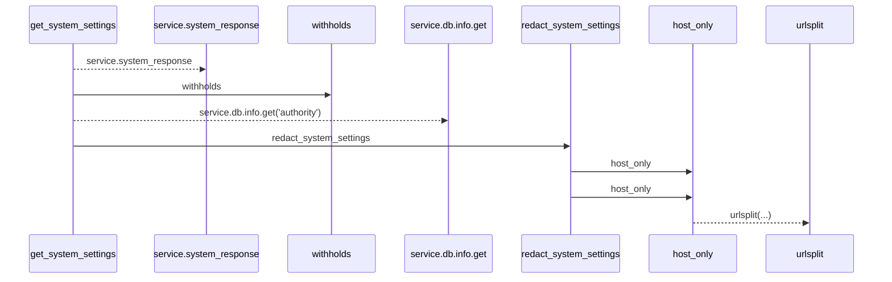
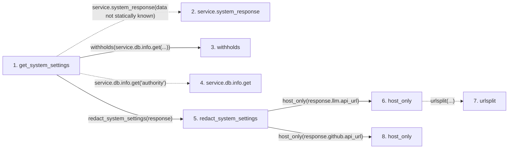

# get_system_settings

**Entry point:** `get_system_settings` (`http`)
**Source:** [routers_system_settings](../modules/routers_system_settings.md)
**Modules touched:** [routers_system_settings](../modules/routers_system_settings.md), [settings_read](../modules/settings_read.md)

## Call sequence

> Static overview in presentation order, not runtime execution order. Arrows retain captured callers; representative internal continuations and boundary examples precede repeated helper detail.

<!-- Auto-generated from static call edges. Dashed arrows are external or unresolved calls. Reviewed runtime conditions and side effects belong in Behavior. -->

> Call sequence diagram shows 7 of 7 interactions; 0 omitted to keep the visualization within the 30-interaction and generated-diagram limits, with uncertain identities omitted rather than inferred.

> Captured boundary calls: external 1 of 1 (0 omitted); unresolved 2 of 2 (0 omitted). These counts cover the captured static trace.
> Detailed flow queries retain their own coverage and limits; omitted paths may execute at runtime.

## Data flow

<!-- Auto-generated static analysis. Treat values and boundaries as best-effort hints, not runtime proof. -->

### Analysis coverage

**Effect analysis evaluated.** Flow assembly and source effect analysis are separate; empty observations do not prove an empty handler body.

Source steps: 5; effect analysis evaluated: 5, partial: 0, unavailable: 0. Counts include steps omitted from the displayed trace.

Collector observations for 5 source steps with known totals: observed: 15, emitted: 15, omitted: 0. Unavailable totals are excluded.

### Step data

| Step | Inputs | Reads | Writes | Returns |
|---|---|---|---|---|
| `get_system_settings` | `service: Annotated[RuntimeSettingsService, Depends(get_runtime_settings_service)]` | - | - | `...` |
| `service.system_response` | - | - | - | - |
| `withholds` | `authority` | - | - | `...` |
| `service.db.info.get` | - | - | - | - |
| `redact_system_settings` | `response` | - | `response.llm.api_url`, `response.github.api_url`, `response.redacted_fields` | `response` |
| `host_only` | `url: str \| None` | - | - | `...`, `''` |
| `urlsplit` | - | - | - | - |
| `host_only` | `url: str \| None` | - | - | `...`, `''` |

### Call data

| From | To | Line | Call |
|---|---|---:|---|
| get_system_settings | service.system_response | 41 | `service.system_response(data not statically known)` |
| get_system_settings | withholds | 42 | `withholds(service.db.info.get(...))` |
| get_system_settings | service.db.info.get | 42 | `service.db.info.get('authority')` |
| get_system_settings | redact_system_settings | 42 | `redact_system_settings(response)` |
| redact_system_settings | host_only | 52 | `host_only(response.llm.api_url)` |
| host_only | urlsplit | 36 | `urlsplit(...)` |
| redact_system_settings | host_only | 53 | `host_only(response.github.api_url)` |

### Boundary effects

*No boundary-effect observations were captured in this static trace.*

### Static analysis gaps

| Kind | Step | Target | Line |
|---|---|---|---:|
| unresolved_call | `get_system_settings` | `service.system_response` | 41 |
| unresolved_call | `get_system_settings` | `service.db.info.get` | 42 |
| external_call | `host_only` | `urlsplit` | 36 |

## Behavior

This flow starts at `get_system_settings` and is classified as `http`. The generated call and data-flow sections are bounded static projections; runtime conditions and side effects require source-level confirmation.
