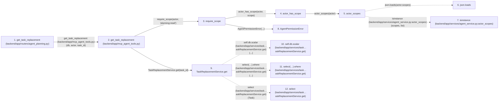

# get_task_replacement

**Entry point:** `get_task_replacement` (`http`)
**Source:** [routers_agent_planning](../modules/routers_agent_planning.md)
**Modules touched:** [agent_service](../modules/agent_service.md), [authority](../modules/authority.md), [config](../modules/config.md), [mcp_agent_tools](../modules/mcp_agent_tools.md), and 4 more

**Complete modules touched:**

- [agent_service](../modules/agent_service.md)
- [authority](../modules/authority.md)
- [config](../modules/config.md)
- [mcp_agent_tools](../modules/mcp_agent_tools.md)
- [query_limits](../modules/query_limits.md)
- [review_provenance](../modules/review_provenance.md)
- [routers_agent_planning](../modules/routers_agent_planning.md)
- [task_replacement_service](../modules/task_replacement_service.md)

## Call sequence

> Static overview in presentation order, not runtime execution order. Arrows retain captured callers; representative internal continuations and boundary examples precede repeated helper detail.

```mermaid
sequenceDiagram
    participant p0 as get_task_replacement (backend/app/routers/agent_planning.py)
    participant p1 as get_task_replacement (backend/app/mcp_agent_tools.py)
    participant p2 as _handle_agent_error
    participant p3 as require_scope
    participant p4 as TaskReplacementService.get
    participant p5 as actor_has_scope
    participant p6 as require_project
    participant p7 as relation_for
    participant p8 as TaskReplacementService.projection
    participant p9 as replaced_by
    participant p10 as get_settings
    participant p11 as replacing
    participant p12 as attempt_history
    participant p13 as _contributor
    participant p14 as review_history
    participant p15 as _assignments
    participant p16 as TaskReplacementService
    participant p17 as AgentPermissionError
    participant p18 as actor_scopes
    participant p19 as internal_authority
    participant p20 as AuthorityError
    participant p21 as carried_contributors
    participant p22 as Settings
    participant p23 as attributed
    participant p24 as _attempt_history
    participant p25 as CollectionLimitExceededError
    participant p26 as isinstance (backend/app/routers/agent…ng.py:_handle_agent_error)
    participant p27 as TaskReplacementResponse.model_validate(…).model_dump
    participant p28 as HTTPException
    participant p29 as str
    p0->>p1: get_task_replacement (backend/app/mcp_agent_tools.py)
    p0->>p2: _handle_agent_error
    p1->>p3: require_scope
    p1->>p4: TaskReplacementService.get
    p3->>p5: actor_has_scope
    p4->>p6: require_project
    p4->>p7: relation_for
    p4->>p8: TaskReplacementService.projection
    p7->>p9: replaced_by
    p6->>p10: get_settings
    p7->>p11: replacing
    p8->>p12: attempt_history
    p8->>p13: _contributor
    p12->>p14: review_history
    p12->>p15: _assignments
    p1->>p16: TaskReplacementService
    p3->>p17: AgentPermissionError
    p5->>p18: actor_scopes
    p8->>p19: internal_authority
    p6->>p20: AuthorityError
    p8->>p21: carried_contributors
    p10->>p22: Settings
    p13->>p23: attributed
    p14->>p24: _attempt_history
    p15->>p25: CollectionLimitExceededError
    p2-->>p26: isinstance (backend/app/routers/agent…ng.py:_handle_agent_error)(exc, AgentPermissionError)
    p1-->>p27: TaskReplacementResponse.model_validate(…).model_dump(mode='json')
    p2-->>p28: HTTPException(status_code=status.HTTP_403_FORBIDDEN, detail=str(...))
    p2-->>p29: str(exc)
    p2-->>p26: isinstance (backend/app/routers/agent…ng.py:_handle_agent_error)(exc, AgentRoutingConflictError)
```

<!-- Auto-generated from static call edges. Dashed arrows are external or unresolved calls. Reviewed runtime conditions and side effects belong in Behavior. -->

> Call sequence diagram shows 30 of 117 interactions; 87 omitted to keep the visualization within the 30-interaction and generated-diagram limits, with uncertain identities omitted rather than inferred.

> Captured boundary calls: external 4 of 44 (40 omitted); unresolved 1 of 39 (38 omitted). These counts cover the captured static trace.

Omitted captured detail, grouped by actual caller occurrence and target module:

| Caller | Parent step | Target module | Kind | Omitted interactions |
| --- | --- | --- | --- | --- |
| `backend/app/services/agent_service.py:actor_scopes` | 5 | - | external | 2 |
| `backend/app/services/task_replacement_service.py:TaskReplacementService.get` | 9 | - | unresolved | 2 |
| `backend/app/services/task_replacement_service.py:TaskReplacementService.get` | 9 | - | external | 3 |
| `backend/app/authority.py:require_project` | 14 | - | unresolved | 2 |
| `backend/app/authority.py:require_project` | 14 | [backend/app/authority.py](../modules/authority.md) | internal | 1 |
| `backend/app/services/task_replacement_service.py:replaced_by` | 22 | [backend/app/authority.py](../modules/authority.md) | internal | 1 |
| `backend/app/authority.py:internal_authority` | 23 | - | unresolved | 1 |
| `backend/app/services/task_replacement_service.py:replaced_by` | 22 | - | unresolved | 2 |
> Omission summary shows 8 of 28 groups; 20 further groups are not expanded here. Counts above include all omitted interactions.
> Detailed flow queries retain their own coverage and limits; omitted paths may execute at runtime.

> Trace truncated at the depth limit; deeper calls are omitted.

## Data flow

<!-- Auto-generated static analysis. Treat values and boundaries as best-effort hints, not runtime proof. -->

### Analysis coverage

**Effect analysis partially available.** Flow assembly and source effect analysis are separate; empty observations do not prove an empty handler body.

Source steps: 35; effect analysis evaluated: 27, partial: 2, unavailable: 6. Counts include steps omitted from the displayed trace.

Collector observations for 29 source steps with known totals: observed: 137, emitted: 128, omitted: 9. Unavailable totals are excluded.

- Callable record unavailable for one or more source steps; those steps have no represented callable body.
- Effect collector omitted observations before flow assembly; displayed effects are partial.
- Effect collector totals unavailable; observed counts cover captured records only.

| Step | Callable record | Effect analysis | Collector totals | Observed | Emitted | Omitted |
|---|---|---|---|---:|---:|---:|
| `get_task_replacement (backend/app/routers/agent_planning.py)` | `available` | `evaluated` | `available` | `4` | `4` | `0` |
| `get_task_replacement (backend/app/mcp_agent_tools.py)` | `available` | `evaluated` | `available` | `4` | `4` | `0` |
| `require_scope` | `available` | `evaluated` | `available` | `2` | `2` | `0` |
| `actor_has_scope` | `available` | `evaluated` | `available` | `3` | `3` | `0` |
| `actor_scopes` | `available` | `evaluated` | `available` | `3` | `3` | `0` |
| `json.loads` | `not_applicable` | `not_applicable` | `not_applicable` | — | — | — |
| `isinstance (backend/app/services/agent_service.py:actor_scopes)` | `not_applicable` | `not_applicable` | `not_applicable` | — | — | — |
| `AgentPermissionError` | `unavailable` | `unavailable` | `unavailable` | — | — | — |
| `TaskReplacementService.get` | `available` | `evaluated` | `available` | `5` | `5` | `0` |
| `self.db.scalar (backend/app/services/task…askReplacementService.get)` | `not_applicable` | `not_applicable` | `not_applicable` | — | — | — |
| `select(…).where (backend/app/services/task…askReplacementService.get)` | `not_applicable` | `not_applicable` | `not_applicable` | — | — | — |
| `select (backend/app/services/task…askReplacementService.get)` | `not_applicable` | `not_applicable` | `not_applicable` | — | — | — |

### Step data

| Step | Inputs | Reads | Writes | Returns |
|---|---|---|---|---|
| `get_task_replacement (backend/app/routers/agent_planning.py)` | `task_id: int`, `actor: Annotated[AgentActor, Depends(get_agent_actor)]`, `db: Annotated[AsyncSession, Depends(get_db, scope='function')]` | - | - | `...` |
| `get_task_replacement (backend/app/mcp_agent_tools.py)` | `db: AsyncSession`, `actor: AgentActor`, `task_id: int` | - | - | `...` |
| `require_scope` | `actor: AgentActor`, `scope: str` | - | - | - |
| `actor_has_scope` | `actor: AgentActor`, `scope: str` | - | - | `...` |
| `actor_scopes` | `actor: AgentActor` | `json` | - | `...` |
| `json.loads` | - | - | - | - |
| `isinstance (backend/app/services/agent_service.py:actor_scopes)` | - | - | - | - |
| `AgentPermissionError` | - | - | - | - |
| `TaskReplacementService.get` | `task_id` | `Task`, `self.db`, `self.db` | - | `...` |
| `self.db.scalar (backend/app/services/task…askReplacementService.get)` | - | - | - | - |
| `select(…).where (backend/app/services/task…askReplacementService.get)` | - | - | - | - |
| `select (backend/app/services/task…askReplacementService.get)` | - | - | - | - |

### Call data

| From | To | Line | Call |
|---|---|---:|---|
| get_task_replacement (backend/app/routers/agent_planning.py) | get_task_replacement (backend/app/mcp_agent_tools.py) | 423 | `mcp_agent_tools.get_task_replacement(db, actor, task_id)` |
| get_task_replacement (backend/app/mcp_agent_tools.py) | require_scope | 1264 | `require_scope(actor, 'planning:read')` |
| require_scope | actor_has_scope | 113 | `actor_has_scope(actor, scope)` |
| actor_has_scope | actor_scopes | 95 | `actor_scopes(actor)` |
| actor_scopes | json.loads | 87 | `json.loads(actor.scopes)` |
| actor_scopes | isinstance (backend/app/services/agent_service.py:actor_scopes) | 90 | `isinstance(scopes, list)` |
| require_scope | AgentPermissionError | 114 | `AgentPermissionError(...)` |
| get_task_replacement (backend/app/mcp_agent_tools.py) | TaskReplacementService.get | 1265 | `TaskReplacementService(db).get(task_id)` |
| TaskReplacementService.get | self.db.scalar (backend/app/services/task…askReplacementService.get) | 239 | `self.db.scalar(...)` |
| TaskReplacementService.get | select(…).where (backend/app/services/task…askReplacementService.get) | 239 | `select(Task).where(...)` |
| TaskReplacementService.get | select (backend/app/services/task…askReplacementService.get) | 239 | `select(Task)` |

### Boundary effects

*No boundary-effect observations were captured in this static trace.*

### Static analysis gaps

| Kind | Step | Target | Line |
|---|---|---|---:|
| external_call | `actor_scopes` | `json.loads` | 87 |
| external_call | `actor_scopes` | `isinstance` | 90 |
| unresolved_call | `TaskReplacementService.get` | `self.db.scalar` | 239 |
| unresolved_call | `TaskReplacementService.get` | `select(Task).where` | 239 |
| external_call | `TaskReplacementService.get` | `select` | 239 |
| step_limit | `get_task_replacement` | `first 12 steps` | 0 |
| truncated_flow | `get_task_replacement` | `depth limit` | 0 |

## Behavior

Reads the replacement disposition of a task: its role as original or replacement, who decided and why, the carried runs, the moved dependents and releases, and the attempt history with its server-held attribution. It changes nothing.
