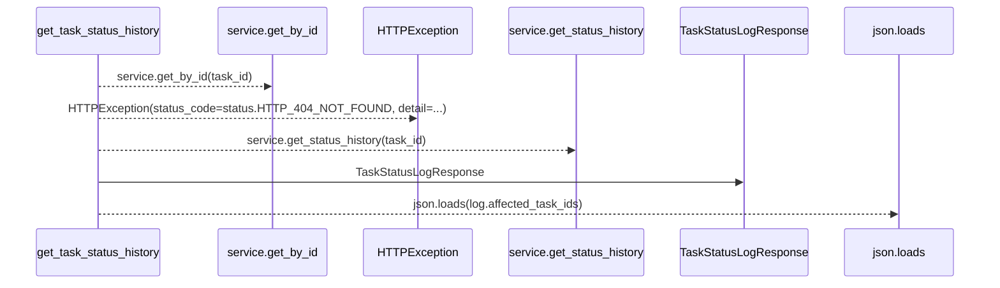
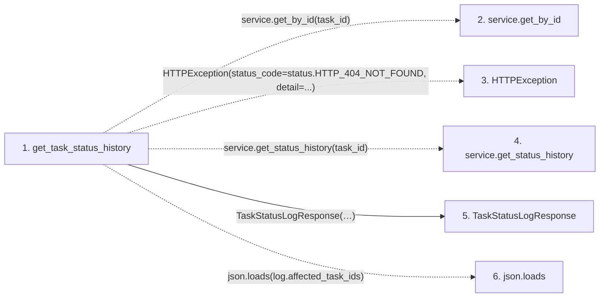

# get_task_status_history

**Entry point:** `get_task_status_history` (`http`)
**Source:** [tasks](../modules/tasks.md)
**Modules touched:** [schemas_task](../modules/schemas_task.md), [tasks](../modules/tasks.md)

## Call sequence

> Static overview in presentation order, not runtime execution order. Arrows retain captured callers; representative internal continuations and boundary examples precede repeated helper detail.

<!-- Auto-generated from static call edges. Dashed arrows are external or unresolved calls. Reviewed runtime conditions and side effects belong in Behavior. -->

> Call sequence diagram shows 5 of 5 interactions; 0 omitted to keep the visualization within the 30-interaction and generated-diagram limits, with uncertain identities omitted rather than inferred.

> Captured boundary calls: external 2 of 2 (0 omitted); unresolved 2 of 2 (0 omitted). These counts cover the captured static trace.
> Detailed flow queries retain their own coverage and limits; omitted paths may execute at runtime.

## Data flow

<!-- Auto-generated static analysis. Treat values and boundaries as best-effort hints, not runtime proof. -->

### Analysis coverage

**Effect analysis partially available.** Flow assembly and source effect analysis are separate; empty observations do not prove an empty handler body.

Source steps: 2; effect analysis evaluated: 1, partial: 0, unavailable: 1. Counts include steps omitted from the displayed trace.

Collector observations for 1 source steps with known totals: observed: 4, emitted: 4, omitted: 0. Unavailable totals are excluded.

- Callable record unavailable for one or more source steps; those steps have no represented callable body.
- Effect collector totals unavailable; observed counts cover captured records only.

| Step | Callable record | Effect analysis | Collector totals | Observed | Emitted | Omitted |
|---|---|---|---|---:|---:|---:|
| `get_task_status_history` | `available` | `evaluated` | `available` | `4` | `4` | `0` |
| `service.get_by_id` | `not_applicable` | `not_applicable` | `not_applicable` | — | — | — |
| `HTTPException` | `not_applicable` | `not_applicable` | `not_applicable` | — | — | — |
| `service.get_status_history` | `not_applicable` | `not_applicable` | `not_applicable` | — | — | — |
| `TaskStatusLogResponse` | `unavailable` | `unavailable` | `unavailable` | — | — | — |
| `json.loads` | `not_applicable` | `not_applicable` | `not_applicable` | — | — | — |

### Step data

| Step | Inputs | Reads | Writes | Returns |
|---|---|---|---|---|
| `get_task_status_history` | `task_id: int`, `service: Annotated[TaskService, Depends(get_task_service)]` | `status` | - | `...` |
| `service.get_by_id` | - | - | - | - |
| `HTTPException` | - | - | - | - |
| `service.get_status_history` | - | - | - | - |
| `TaskStatusLogResponse` | - | - | - | - |
| `json.loads` | - | - | - | - |

### Call data

| From | To | Line | Call |
|---|---|---:|---|
| get_task_status_history | service.get_by_id | 975 | `service.get_by_id(task_id)` |
| get_task_status_history | HTTPException | 977 | `HTTPException(status_code=status.HTTP_404_NOT_FOUND, detail=...)` |
| get_task_status_history | service.get_status_history | 982 | `service.get_status_history(task_id)` |
| get_task_status_history | TaskStatusLogResponse | 985 | `TaskStatusLogResponse(id=log.id, task_id=log.task_id, from_status=log.from_status, to_status=log.to_status, changed_at=log.changed_at, reason=log.reason, triggered_by=log.triggered_by, affected_task_ids=...)` |
| get_task_status_history | json.loads | 993 | `json.loads(log.affected_task_ids)` |

### Boundary effects

*No boundary-effect observations were captured in this static trace.*

### Static analysis gaps

| Kind | Step | Target | Line |
|---|---|---|---:|
| unresolved_call | `get_task_status_history` | `service.get_by_id` | 975 |
| external_call | `get_task_status_history` | `HTTPException` | 977 |
| unresolved_call | `get_task_status_history` | `service.get_status_history` | 982 |
| external_call | `get_task_status_history` | `json.loads` | 993 |

## Behavior

This flow starts at `get_task_status_history` and is classified as `http`. The generated call and data-flow sections are bounded static projections; runtime conditions and side effects require source-level confirmation.
