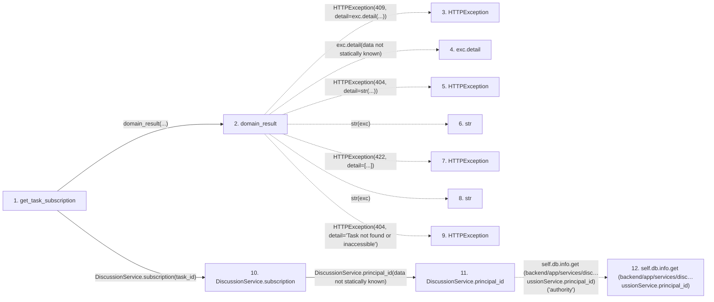

# get_task_subscription

**Entry point:** `get_task_subscription` (`http`)
**Source:** [routers_discussion](../modules/routers_discussion.md)
**Modules touched:** [authority](../modules/authority.md), [config](../modules/config.md), [discussion_service](../modules/discussion_service.md), [routers_discussion](../modules/routers_discussion.md), and 1 more

**Complete modules touched:**

- [authority](../modules/authority.md)
- [config](../modules/config.md)
- [discussion_service](../modules/discussion_service.md)
- [routers_discussion](../modules/routers_discussion.md)
- [routers_task_domain](../modules/routers_task_domain.md)

## Call sequence

> Static overview in presentation order, not runtime execution order. Arrows retain captured callers; representative internal continuations and boundary examples precede repeated helper detail.

```mermaid
sequenceDiagram
    participant p0 as get_task_subscription
    participant p1 as DiscussionService.subscription
    participant p2 as domain_result
    participant p3 as DiscussionService
    participant p4 as DiscussionService.principal_id
    participant p5 as DiscussionService.task
    participant p6 as require_project
    participant p7 as get_settings
    participant p8 as AuthorityError
    participant p9 as internal_authority
    participant p10 as Settings
    participant p11 as HTTPException
    participant p12 as exc.detail
    participant p13 as self.db.get
    participant p14 as str
    participant p15 as sorted
    participant p16 as self.db.info.get (backend/app/services/disc…ussionService.principal_id)
    participant p17 as self.db.scalar
    participant p18 as select(…).where(…).execution_options
    participant p19 as select(…).where
    participant p20 as select
    participant p21 as ValueError
    participant p22 as self.db.info.get (backend/app/services/disc….py:DiscussionService.task)
    participant p23 as any
    participant p24 as authority.allows (backend/app/services/disc….py:DiscussionService.task)
    participant p25 as self.db.execute
    participant p26 as update(…).where(…).values(…).execution_options
    p0->>p1: DiscussionService.subscription
    p0->>p2: domain_result
    p0->>p3: DiscussionService
    p1->>p4: DiscussionService.principal_id
    p1->>p5: DiscussionService.task
    p5->>p6: require_project
    p6->>p7: get_settings
    p4->>p8: AuthorityError
    p5->>p9: internal_authority
    p7->>p10: Settings
    p2-->>p11: HTTPException(409, detail=exc.detail(...))
    p2-->>p12: exc.detail
    p2-->>p11: HTTPException(404, detail=str(...))
    p1-->>p13: self.db.get(TaskSubscription, (...))
    p2-->>p14: str(exc)
    p1-->>p15: sorted(EVENTS)
    p2-->>p11: HTTPException(422, detail=[...])
    p2-->>p14: str(exc)
    p2-->>p11: HTTPException(404, detail='Task not found or inaccessible')
    p4-->>p16: self.db.info.get (backend/app/services/disc…ussionService.principal_id)('authority')
    p5-->>p17: self.db.scalar(...)
    p5-->>p18: select(…).where(…).execution_options(populate_existing=True)
    p5-->>p19: select(…).where(...)
    p5-->>p20: select(Task)
    p5-->>p21: ValueError('Task not found or inaccessible')
    p5-->>p22: self.db.info.get (backend/app/services/disc….py:DiscussionService.task)('authority')
    p5-->>p23: any(...)
    p5-->>p24: authority.allows (backend/app/services/disc….py:DiscussionService.task)(task.project_id, action)
    p5-->>p25: self.db.execute(...)
    p5-->>p26: update(…).where(…).values(…).execution_options(synchronize_session=False)
```

<!-- Auto-generated from static call edges. Dashed arrows are external or unresolved calls. Reviewed runtime conditions and side effects belong in Behavior. -->

> Call sequence diagram shows 30 of 40 interactions; 10 omitted to keep the visualization within the 30-interaction and generated-diagram limits, with uncertain identities omitted rather than inferred.

> Captured boundary calls: external 10 of 11 (1 omitted); unresolved 10 of 15 (5 omitted). These counts cover the captured static trace.

Omitted captured detail, grouped by actual caller occurrence and target module:

| Caller | Parent step | Target module | Kind | Omitted interactions |
| --- | --- | --- | --- | --- |
| `backend/app/authority.py:require_project` | 20 | - | unresolved | 2 |
| `backend/app/authority.py:require_project` | 20 | [backend/app/authority.py](../modules/authority.md) | internal | 2 |
| `backend/app/services/discussion_service.py:DiscussionService.task` | 14 | [backend/app/authority.py](../modules/authority.md) | internal | 1 |
| `backend/app/authority.py:internal_authority` | 31 | - | unresolved | 1 |
| `backend/app/services/discussion_service.py:DiscussionService.task` | 14 | - | unresolved | 2 |
| `backend/app/services/discussion_service.py:DiscussionService.task` | 14 | - | external | 1 |
| `backend/app/services/discussion_service.py:DiscussionService.task` | 14 | [backend/app/services/discussion_service.py](../modules/discussion_service.md) | internal | 1 |
> Detailed flow queries retain their own coverage and limits; omitted paths may execute at runtime.

## Data flow

<!-- Auto-generated static analysis. Treat values and boundaries as best-effort hints, not runtime proof. -->

### Analysis coverage

**Effect analysis partially available.** Flow assembly and source effect analysis are separate; empty observations do not prove an empty handler body.

Source steps: 15; effect analysis evaluated: 9, partial: 0, unavailable: 6. Counts include steps omitted from the displayed trace.

Collector observations for 9 source steps with known totals: observed: 33, emitted: 33, omitted: 0. Unavailable totals are excluded.

- Callable record unavailable for one or more source steps; those steps have no represented callable body.
- Effect collector totals unavailable; observed counts cover captured records only.

| Step | Callable record | Effect analysis | Collector totals | Observed | Emitted | Omitted |
|---|---|---|---|---:|---:|---:|
| `get_task_subscription` | `available` | `evaluated` | `available` | `3` | `3` | `0` |
| `domain_result` | `available` | `evaluated` | `available` | `3` | `3` | `0` |
| `HTTPException` | `not_applicable` | `not_applicable` | `not_applicable` | — | — | — |
| `exc.detail` | `not_applicable` | `not_applicable` | `not_applicable` | — | — | — |
| `HTTPException` | `not_applicable` | `not_applicable` | `not_applicable` | — | — | — |
| `str` | `not_applicable` | `not_applicable` | `not_applicable` | — | — | — |
| `HTTPException` | `not_applicable` | `not_applicable` | `not_applicable` | — | — | — |
| `str` | `not_applicable` | `not_applicable` | `not_applicable` | — | — | — |
| `HTTPException` | `not_applicable` | `not_applicable` | `not_applicable` | — | — | — |
| `DiscussionService.subscription` | `available` | `evaluated` | `available` | `4` | `4` | `0` |
| `DiscussionService.principal_id` | `available` | `evaluated` | `available` | `1` | `1` | `0` |
| `self.db.info.get (backend/app/services/disc…ussionService.principal_id)` | `not_applicable` | `not_applicable` | `not_applicable` | — | — | — |

### Step data

| Step | Inputs | Reads | Writes | Returns |
|---|---|---|---|---|
| `get_task_subscription` | `task_id: int`, `db: DiscussionDatabase` | - | - | `...` |
| `domain_result` | `awaitable` | `TaskVersionConflictError` | - | `result` |
| `HTTPException` | - | - | - | - |
| `exc.detail` | - | - | - | - |
| `HTTPException` | - | - | - | - |
| `str` | - | - | - | - |
| `HTTPException` | - | - | - | - |
| `str` | - | - | - | - |
| `HTTPException` | - | - | - | - |
| `DiscussionService.subscription` | `task_id` | `TaskSubscription`, `EVENTS` | - | `{...}` |
| `DiscussionService.principal_id` | - | - | - | `authority.principal_id` |
| `self.db.info.get (backend/app/services/disc…ussionService.principal_id)` | - | - | - | - |

### Call data

| From | To | Line | Call |
|---|---|---:|---|
| get_task_subscription | domain_result | 65 | `domain_result(...)` |
| domain_result | HTTPException | 51 | `HTTPException(409, detail=exc.detail(...))` |
| domain_result | exc.detail | 51 | `exc.detail(data not statically known)` |
| domain_result | HTTPException | 53 | `HTTPException(404, detail=str(...))` |
| domain_result | str | 53 | `str(exc)` |
| domain_result | HTTPException | 55 | `HTTPException(422, detail=[...])` |
| domain_result | str | 55 | `str(exc)` |
| domain_result | HTTPException | 57 | `HTTPException(404, detail='Task not found or inaccessible')` |
| get_task_subscription | DiscussionService.subscription | 65 | `DiscussionService(db).subscription(task_id)` |
| DiscussionService.subscription | DiscussionService.principal_id | 167 | `self.principal_id(data not statically known)` |
| DiscussionService.principal_id | self.db.info.get (backend/app/services/disc…ussionService.principal_id) | 24 | `self.db.info.get('authority')` |

### Boundary effects

*No boundary-effect observations were captured in this static trace.*

### Static analysis gaps

| Kind | Step | Target | Line |
|---|---|---|---:|
| external_call | `domain_result` | `HTTPException` | 51 |
| unresolved_call | `domain_result` | `exc.detail` | 51 |
| external_call | `domain_result` | `HTTPException` | 53 |
| external_call | `domain_result` | `HTTPException` | 55 |
| external_call | `domain_result` | `HTTPException` | 57 |
| unresolved_call | `DiscussionService.principal_id` | `self.db.info.get` | 24 |
| step_limit | `get_task_subscription` | `first 12 steps` | 0 |

## Behavior

Returns only the current human’s task subscription, with version zero for an absent preference row. Other subscribers are not exposed.
