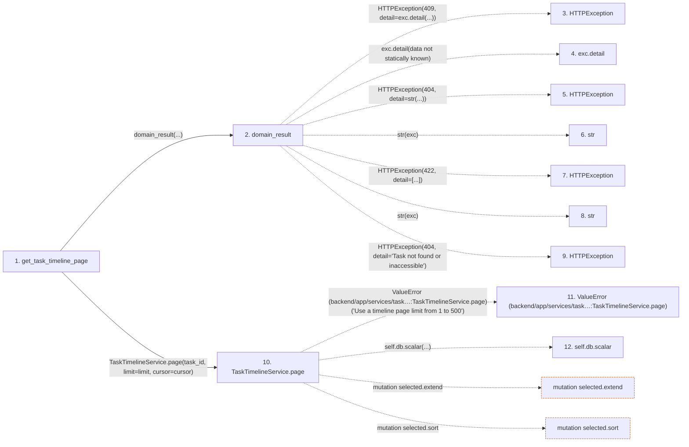

# get_task_timeline_page

**Entry point:** `get_task_timeline_page` (`http`)
**Source:** [tasks](../modules/tasks.md)
**Modules touched:** [authority](../modules/authority.md), [routers_task_domain](../modules/routers_task_domain.md), [schemas_agent](../modules/schemas_agent.md), [task_timeline_service](../modules/task_timeline_service.md), and 2 more

**Complete modules touched:**

- [authority](../modules/authority.md)
- [routers_task_domain](../modules/routers_task_domain.md)
- [schemas_agent](../modules/schemas_agent.md)
- [task_timeline_service](../modules/task_timeline_service.md)
- [tasks](../modules/tasks.md)
- [time](../modules/time.md)

## Call sequence

> Static overview in presentation order, not runtime execution order. Arrows retain captured callers; representative internal continuations and boundary examples precede repeated helper detail.

```mermaid
sequenceDiagram
    participant p0 as get_task_timeline_page
    participant p1 as TaskTimelineService.page
    participant p2 as domain_result
    participant p3 as TaskTimelineService
    participant p4 as TaskTimelinePage
    participant p5 as TaskTimelineService.decode
    participant p6 as TaskTimelineService._attach_person_names
    participant p7 as as_utc
    participant p8 as TaskTimelineService.item
    participant p9 as TaskTimelineService._attach_agent_names
    participant p10 as internal_authority
    participant p11 as HTTPException
    participant p12 as exc.detail
    participant p13 as ValueError (backend/app/services/task…:TaskTimelineService.page)
    participant p14 as self.db.scalar
    participant p15 as select(…).where (backend/app/services/task…skTimelineService.page, 1)
    participant p16 as str
    participant p17 as select (backend/app/services/task…:TaskTimelineService.page)
    participant p18 as LookupError
    participant p19 as select(…).where (backend/app/services/task…skTimelineService.page, 2)
    participant p20 as select(…).where (backend/app/services/task…skTimelineService.page, 3)
    participant p21 as select(…).where (backend/app/services/task…:TaskTimelineService.page)
    participant p22 as select(…).options(…).join(…).where
    participant p23 as select(…).options(…).join
    p0->>p1: TaskTimelineService.page
    p0->>p2: domain_result
    p0->>p3: TaskTimelineService
    p0->>p4: TaskTimelinePage
    p1->>p5: TaskTimelineService.decode
    p1->>p6: TaskTimelineService._attach_person_names
    p1->>p7: as_utc
    p1->>p8: TaskTimelineService.item
    p1->>p9: TaskTimelineService._attach_agent_names
    p6->>p10: internal_authority
    p2-->>p11: HTTPException(409, detail=exc.detail(...))
    p2-->>p12: exc.detail
    p1-->>p13: ValueError (backend/app/services/task…:TaskTimelineService.page)('Use a timeline page limit from 1 to 500')
    p1-->>p14: self.db.scalar(...)
    p2-->>p11: HTTPException(404, detail=str(...))
    p1-->>p15: select(…).where (backend/app/services/task…skTimelineService.page, 1)(...)
    p2-->>p16: str(exc)
    p1-->>p17: select (backend/app/services/task…:TaskTimelineService.page)(Task.id)
    p2-->>p11: HTTPException(422, detail=[...])
    p1-->>p18: LookupError('Task not found or inaccessible')
    p2-->>p16: str(exc)
    p2-->>p11: HTTPException(404, detail='Task not found or inaccessible')
    p1-->>p19: select(…).where (backend/app/services/task…skTimelineService.page, 2)(...)
    p1-->>p17: select (backend/app/services/task…:TaskTimelineService.page)(TaskEvent)
    p1-->>p20: select(…).where (backend/app/services/task…skTimelineService.page, 3)(...)
    p1-->>p17: select (backend/app/services/task…:TaskTimelineService.page)(TaskStatusLog)
    p1-->>p21: select(…).where (backend/app/services/task…:TaskTimelineService.page)(...)
    p1-->>p17: select (backend/app/services/task…:TaskTimelineService.page)(AgentRun)
    p1-->>p22: select(…).options(…).join(…).where(...)
    p1-->>p23: select(…).options(…).join(AgentRun)
```

<!-- Auto-generated from static call edges. Dashed arrows are external or unresolved calls. Reviewed runtime conditions and side effects belong in Behavior. -->

> Call sequence diagram shows 30 of 117 interactions; 87 omitted to keep the visualization within the 30-interaction and generated-diagram limits, with uncertain identities omitted rather than inferred.

> Captured boundary calls: external 12 of 50 (38 omitted); unresolved 8 of 56 (48 omitted). These counts cover the captured static trace.

Omitted captured detail, grouped by actual caller occurrence and target module:

| Caller | Parent step | Target module | Kind | Omitted interactions |
| --- | --- | --- | --- | --- |
| `backend/app/services/task_timeline_service.py:TaskTimelineService.decode` | 16 | - | external | 14 |
| `backend/app/services/task_timeline_service.py:TaskTimelineService.decode` | 16 | [backend/app/utils/time.py](../modules/time.md) | internal | 1 |
| `backend/app/utils/time.py:as_utc` | 30 | - | unresolved | 2 |
| `backend/app/services/task_timeline_service.py:TaskTimelineService.page` | 10 | - | unresolved | 14 |
| `backend/app/services/task_timeline_service.py:TaskTimelineService.page` | 10 | - | external | 10 |
| `backend/app/services/task_timeline_service.py:TaskTimelineService.item` | 61 | - | external | 7 |
| `backend/app/services/task_timeline_service.py:TaskTimelineService.item` | 61 | - | unresolved | 4 |
| `backend/app/services/task_timeline_service.py:TaskTimelineService._attach_agent_names` | 73 | - | unresolved | 9 |
> Omission summary shows 8 of 12 groups; 4 further groups are not expanded here. Counts above include all omitted interactions.
> Detailed flow queries retain their own coverage and limits; omitted paths may execute at runtime.

## Data flow

<!-- Auto-generated static analysis. Treat values and boundaries as best-effort hints, not runtime proof. -->

### Analysis coverage

**Effect analysis partially available.** Flow assembly and source effect analysis are separate; empty observations do not prove an empty handler body.

Source steps: 12; effect analysis evaluated: 10, partial: 0, unavailable: 2. Counts include steps omitted from the displayed trace.

Collector observations for 10 source steps with known totals: observed: 52, emitted: 52, omitted: 0. Unavailable totals are excluded.

- Callable record unavailable for one or more source steps; those steps have no represented callable body.
- Effect collector totals unavailable; observed counts cover captured records only.

| Step | Callable record | Effect analysis | Collector totals | Observed | Emitted | Omitted |
|---|---|---|---|---:|---:|---:|
| `get_task_timeline_page` | `available` | `evaluated` | `available` | `5` | `5` | `0` |
| `domain_result` | `available` | `evaluated` | `available` | `3` | `3` | `0` |
| `HTTPException` | `not_applicable` | `not_applicable` | `not_applicable` | — | — | — |
| `exc.detail` | `not_applicable` | `not_applicable` | `not_applicable` | — | — | — |
| `HTTPException` | `not_applicable` | `not_applicable` | `not_applicable` | — | — | — |
| `str` | `not_applicable` | `not_applicable` | `not_applicable` | — | — | — |
| `HTTPException` | `not_applicable` | `not_applicable` | `not_applicable` | — | — | — |
| `str` | `not_applicable` | `not_applicable` | `not_applicable` | — | — | — |
| `HTTPException` | `not_applicable` | `not_applicable` | `not_applicable` | — | — | — |
| `TaskTimelineService.page` | `available` | `evaluated` | `available` | `12` | `12` | `0` |
| `ValueError (backend/app/services/task…:TaskTimelineService.page)` | `not_applicable` | `not_applicable` | `not_applicable` | — | — | — |
| `self.db.scalar` | `not_applicable` | `not_applicable` | `not_applicable` | — | — | — |

### Step data

| Step | Inputs | Reads | Writes | Returns |
|---|---|---|---|---|
| `get_task_timeline_page` | `task_id: int`, `db: Annotated[AsyncSession, Depends(get_db, scope='function')]`, `limit: int`, `cursor: str \| None` | - | - | `TaskTimelinePage(...)` |
| `domain_result` | `awaitable` | `TaskVersionConflictError` | - | `result` |
| `HTTPException` | - | - | - | - |
| `exc.detail` | - | - | - | - |
| `HTTPException` | - | - | - | - |
| `str` | - | - | - | - |
| `HTTPException` | - | - | - | - |
| `str` | - | - | - | - |
| `HTTPException` | - | - | - | - |
| `TaskTimelineService.page` | `task_id`, `limit`, `cursor` | `Task`, `TaskEvent`, `TaskStatusLog`, `AgentRun`, `AgentRunEvent`, `AgentRun` | - | `dict(...)` |
| `ValueError (backend/app/services/task…:TaskTimelineService.page)` | - | - | - | - |
| `self.db.scalar` | - | - | - | - |

### Call data

| From | To | Line | Call |
|---|---|---:|---|
| get_task_timeline_page | domain_result | 1026 | `domain_result(...)` |
| domain_result | HTTPException | 51 | `HTTPException(409, detail=exc.detail(...))` |
| domain_result | exc.detail | 51 | `exc.detail(data not statically known)` |
| domain_result | HTTPException | 53 | `HTTPException(404, detail=str(...))` |
| domain_result | str | 53 | `str(exc)` |
| domain_result | HTTPException | 55 | `HTTPException(422, detail=[...])` |
| domain_result | str | 55 | `str(exc)` |
| domain_result | HTTPException | 57 | `HTTPException(404, detail='Task not found or inaccessible')` |
| get_task_timeline_page | TaskTimelineService.page | 1026 | `TaskTimelineService(db).page(task_id, limit=limit, cursor=cursor)` |
| TaskTimelineService.page | ValueError (backend/app/services/task…:TaskTimelineService.page) | 45 | `ValueError('Use a timeline page limit from 1 to 500')` |
| TaskTimelineService.page | self.db.scalar | 47 | `self.db.scalar(...)` |

### Boundary effects

| Kind | Target | Step | Line |
|---|---|---|---:|
| mutation | `selected.extend` | `TaskTimelineService.page` | 61 |
| mutation | `selected.sort` | `TaskTimelineService.page` | 62 |

### Static analysis gaps

| Kind | Step | Target | Line |
|---|---|---|---:|
| external_call | `domain_result` | `HTTPException` | 51 |
| unresolved_call | `domain_result` | `exc.detail` | 51 |
| external_call | `domain_result` | `HTTPException` | 53 |
| external_call | `domain_result` | `HTTPException` | 55 |
| external_call | `domain_result` | `HTTPException` | 57 |
| external_call | `TaskTimelineService.page` | `ValueError` | 45 |
| unresolved_call | `TaskTimelineService.page` | `self.db.scalar` | 47 |
| step_limit | `get_task_timeline_page` | `first 12 steps` | 0 |

## Behavior

This flow starts at `get_task_timeline_page` and is classified as `http`. The generated call and data-flow sections are bounded static projections; runtime conditions and side effects require source-level confirmation.
