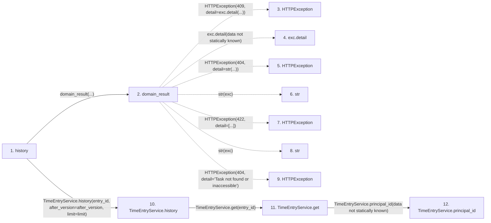

# history

**Entry point:** `history` (`http`)
**Source:** [time_entries](../modules/time_entries.md)
**Modules touched:** [authority](../modules/authority.md), [config](../modules/config.md), [routers_task_domain](../modules/routers_task_domain.md), [schemas_time_entry](../modules/schemas_time_entry.md), and 2 more

**Complete modules touched:**

- [authority](../modules/authority.md)
- [config](../modules/config.md)
- [routers_task_domain](../modules/routers_task_domain.md)
- [schemas_time_entry](../modules/schemas_time_entry.md)
- [time_entries](../modules/time_entries.md)
- [time_entry_service](../modules/time_entry_service.md)

## Call sequence

> Static overview in presentation order, not runtime execution order. Arrows retain captured callers; representative internal continuations and boundary examples precede repeated helper detail.

```mermaid
sequenceDiagram
    participant p0 as history
    participant p1 as TimeEntryService.history
    participant p2 as domain_result
    participant p3 as TimeEntryService
    participant p4 as TimeEntryService.get
    participant p5 as TimeEntryService.principal_id
    participant p6 as TimeEntryService.project
    participant p7 as get_settings
    participant p8 as require_project
    participant p9 as TimeRevisionResponse
    participant p10 as AuthorityError
    participant p11 as Settings
    participant p12 as HTTPException
    participant p13 as exc.detail
    participant p14 as ValueError
    participant p15 as (…).all
    participant p16 as str
    participant p17 as self.db.scalars
    participant p18 as select(…).where(…).order_by(…).limit
    participant p19 as select(…).where(…).order_by
    participant p20 as select(…).where (backend/app/services/time…y:TimeEntryService.history)
    participant p21 as select (backend/app/services/time…y:TimeEntryService.history)
    participant p22 as TimeRevisionResponse(…).model_dump
    participant p23 as getattr
    participant p24 as len
    participant p25 as self.db.scalar (backend/app/services/time…ce.py:TimeEntryService.get)
    p0->>p1: TimeEntryService.history
    p0->>p2: domain_result
    p0->>p3: TimeEntryService
    p1->>p4: TimeEntryService.get
    p4->>p5: TimeEntryService.principal_id
    p4->>p6: TimeEntryService.project
    p5->>p7: get_settings
    p6->>p8: require_project
    p1->>p9: TimeRevisionResponse
    p5->>p10: AuthorityError
    p7->>p11: Settings
    p2-->>p12: HTTPException(409, detail=exc.detail(...))
    p2-->>p13: exc.detail
    p1-->>p14: ValueError('Use bounded correction history parameters')
    p2-->>p12: HTTPException(404, detail=str(...))
    p1-->>p15: (…).all
    p2-->>p16: str(exc)
    p1-->>p17: self.db.scalars(...)
    p2-->>p12: HTTPException(422, detail=[...])
    p1-->>p18: select(…).where(…).order_by(…).limit(...)
    p2-->>p16: str(exc)
    p1-->>p19: select(…).where(…).order_by(TimeEntryRevision.version)
    p2-->>p12: HTTPException(404, detail='Task not found or inaccessible')
    p1-->>p20: select(…).where (backend/app/services/time…y:TimeEntryService.history)(..., ..., ...)
    p1-->>p21: select (backend/app/services/time…y:TimeEntryService.history)(TimeEntryRevision)
    p1-->>p22: TimeRevisionResponse(…).model_dump(mode='json')
    p1-->>p23: getattr(row, name)
    p1-->>p24: len(rows)
    p1-->>p24: len(rows)
    p4-->>p25: self.db.scalar (backend/app/services/time…ce.py:TimeEntryService.get)(...)
```

<!-- Auto-generated from static call edges. Dashed arrows are external or unresolved calls. Reviewed runtime conditions and side effects belong in Behavior. -->

> Call sequence diagram shows 30 of 48 interactions; 18 omitted to keep the visualization within the 30-interaction and generated-diagram limits, with uncertain identities omitted rather than inferred.

> Captured boundary calls: external 11 of 16 (5 omitted); unresolved 8 of 16 (8 omitted). These counts cover the captured static trace.

Omitted captured detail, grouped by actual caller occurrence and target module:

| Caller | Parent step | Target module | Kind | Omitted interactions |
| --- | --- | --- | --- | --- |
| `backend/app/services/time_entry_service.py:TimeEntryService.principal_id` | 12 | - | unresolved | 1 |
| `backend/app/services/time_entry_service.py:TimeEntryService.principal_id` | 12 | [backend/app/authority.py](../modules/authority.md) | internal | 1 |
| `backend/app/services/time_entry_service.py:TimeEntryService.get` | 11 | - | unresolved | 2 |
| `backend/app/services/time_entry_service.py:TimeEntryService.get` | 11 | - | external | 2 |
| `backend/app/authority.py:require_project` | 24 | - | unresolved | 2 |
| `backend/app/authority.py:require_project` | 24 | [backend/app/config.py](../modules/config.md) | internal | 1 |
| `backend/app/authority.py:require_project` | 24 | [backend/app/authority.py](../modules/authority.md) | internal | 2 |
| `backend/app/services/time_entry_service.py:TimeEntryService.project` | 23 | - | unresolved | 3 |
> Omission summary shows 8 of 10 groups; 2 further groups are not expanded here. Counts above include all omitted interactions.
> Detailed flow queries retain their own coverage and limits; omitted paths may execute at runtime.

## Data flow

<!-- Auto-generated static analysis. Treat values and boundaries as best-effort hints, not runtime proof. -->

### Analysis coverage

**Effect analysis partially available.** Flow assembly and source effect analysis are separate; empty observations do not prove an empty handler body.

Source steps: 17; effect analysis evaluated: 9, partial: 0, unavailable: 8. Counts include steps omitted from the displayed trace.

Collector observations for 9 source steps with known totals: observed: 27, emitted: 27, omitted: 0. Unavailable totals are excluded.

- Callable record unavailable for one or more source steps; those steps have no represented callable body.
- Effect collector totals unavailable; observed counts cover captured records only.

| Step | Callable record | Effect analysis | Collector totals | Observed | Emitted | Omitted |
|---|---|---|---|---:|---:|---:|
| `history` | `available` | `evaluated` | `available` | `5` | `5` | `0` |
| `domain_result` | `available` | `evaluated` | `available` | `3` | `3` | `0` |
| `HTTPException` | `not_applicable` | `not_applicable` | `not_applicable` | — | — | — |
| `exc.detail` | `not_applicable` | `not_applicable` | `not_applicable` | — | — | — |
| `HTTPException` | `not_applicable` | `not_applicable` | `not_applicable` | — | — | — |
| `str` | `not_applicable` | `not_applicable` | `not_applicable` | — | — | — |
| `HTTPException` | `not_applicable` | `not_applicable` | `not_applicable` | — | — | — |
| `str` | `not_applicable` | `not_applicable` | `not_applicable` | — | — | — |
| `HTTPException` | `not_applicable` | `not_applicable` | `not_applicable` | — | — | — |
| `TimeEntryService.history` | `available` | `evaluated` | `available` | `4` | `4` | `0` |
| `TimeEntryService.get` | `available` | `evaluated` | `available` | `2` | `2` | `0` |
| `TimeEntryService.principal_id` | `available` | `evaluated` | `available` | `1` | `1` | `0` |

### Step data

| Step | Inputs | Reads | Writes | Returns |
|---|---|---|---|---|
| `history` | `entry_id: int`, `db: DB`, `after_version: int`, `limit: int` | - | - | `...` |
| `domain_result` | `awaitable` | `TaskVersionConflictError` | - | `result` |
| `HTTPException` | - | - | - | - |
| `exc.detail` | - | - | - | - |
| `HTTPException` | - | - | - | - |
| `str` | - | - | - | - |
| `HTTPException` | - | - | - | - |
| `str` | - | - | - | - |
| `HTTPException` | - | - | - | - |
| `TimeEntryService.history` | `entry_id`, `after_version`, `limit` | - | - | `{...}` |
| `TimeEntryService.get` | `entry_id` | - | - | `entry` |
| `TimeEntryService.principal_id` | - | - | - | `authority.principal_id` |

### Call data

| From | To | Line | Call |
|---|---|---:|---|
| history | domain_result | 83 | `domain_result(...)` |
| domain_result | HTTPException | 51 | `HTTPException(409, detail=exc.detail(...))` |
| domain_result | exc.detail | 51 | `exc.detail(data not statically known)` |
| domain_result | HTTPException | 53 | `HTTPException(404, detail=str(...))` |
| domain_result | str | 53 | `str(exc)` |
| domain_result | HTTPException | 55 | `HTTPException(422, detail=[...])` |
| domain_result | str | 55 | `str(exc)` |
| domain_result | HTTPException | 57 | `HTTPException(404, detail='Task not found or inaccessible')` |
| history | TimeEntryService.history | 83 | `TimeEntryService(db).history(entry_id, after_version=after_version, limit=limit)` |
| TimeEntryService.history | TimeEntryService.get | 193 | `self.get(entry_id)` |
| TimeEntryService.get | TimeEntryService.principal_id | 70 | `self.principal_id(data not statically known)` |

### Boundary effects

*No boundary-effect observations were captured in this static trace.*

### Static analysis gaps

| Kind | Step | Target | Line |
|---|---|---|---:|
| external_call | `domain_result` | `HTTPException` | 51 |
| unresolved_call | `domain_result` | `exc.detail` | 51 |
| external_call | `domain_result` | `HTTPException` | 53 |
| external_call | `domain_result` | `HTTPException` | 55 |
| external_call | `domain_result` | `HTTPException` | 57 |
| step_limit | `history` | `first 12 steps` | 0 |

## Behavior

This flow starts at `history` and is classified as `http`. The generated call and data-flow sections are bounded static projections; runtime conditions and side effects require source-level confirmation.
