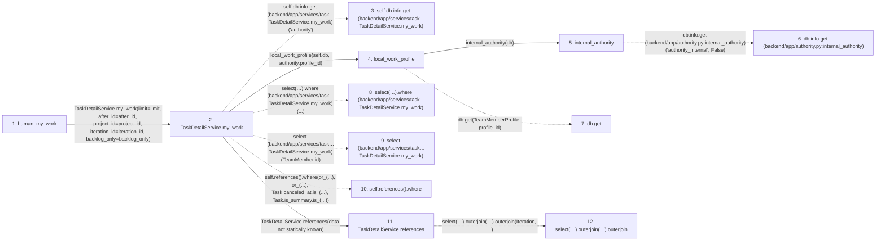

# human_my_work

**Entry point:** `human_my_work` (`http`)
**Source:** [routers_task_domain](../modules/routers_task_domain.md)
**Modules touched:** [agent_routing_policy](../modules/agent_routing_policy.md), [agent_routing_rollout](../modules/agent_routing_rollout.md), [agent_service](../modules/agent_service.md), and 17 more

**Complete modules touched:**

- [agent_routing_policy](../modules/agent_routing_policy.md)
- [agent_routing_rollout](../modules/agent_routing_rollout.md)
- [agent_service](../modules/agent_service.md)
- [agent_team_setup_service](../modules/agent_team_setup_service.md)
- [agent_work_service](../modules/agent_work_service.md)
- [authority](../modules/authority.md)
- [autonomy_canonical](../modules/autonomy_canonical.md)
- [commands](../modules/commands.md)
- [config](../modules/config.md)
- [delivery_dependency_service](../modules/delivery_dependency_service.md)
- [identity_service](../modules/identity_service.md)
- [routers_task_domain](../modules/routers_task_domain.md)
- [schemas_task_domain](../modules/schemas_task_domain.md)
- [services_work_metrics](../modules/services_work_metrics.md)
- [task_brief_service](../modules/task_brief_service.md)
- [task_detail](../modules/task_detail.md)
- [task_detail_service](../modules/task_detail_service.md)
- [task_domain_service](../modules/task_domain_service.md)
- [task_service](../modules/task_service.md)
- [time](../modules/time.md)

## Call sequence

> Static overview in presentation order, not runtime execution order. Arrows retain captured callers; representative internal continuations and boundary examples precede repeated helper detail.

```mermaid
sequenceDiagram
    participant p0 as human_my_work
    participant p1 as TaskDetailService.my_work
    participant p2 as TaskDetailService
    participant p3 as local_work_profile
    participant p4 as require_project
    participant p5 as TaskDetailService.page
    participant p6 as TaskDetailService._policy_flags
    participant p7 as TaskDomainService.allowed_actions
    participant p8 as TaskDomainService._policy_task
    participant p9 as get_settings
    participant p10 as DeliveryDependencyService.ready
    participant p11 as action_projection
    participant p12 as TaskBriefService.require_review
    participant p13 as AgentWorkService._start_blockers
    participant p14 as AgentWorkService._selection_pending
    participant p15 as DeliveryDependencyService.projection
    participant p16 as AgentWorkService._resolve_rollout
    participant p17 as AgentWorkService._is_model_aware_assignment
    participant p18 as AgentWorkService._validate_assignment_actor
    participant p19 as sha256_hex
    participant p20 as AgentWorkService._working_today
    participant p21 as AgentTeamSetupService.routing_readiness
    participant p22 as AgentWorkService._routing_snapshot
    participant p23 as evaluate_actor_authorization
    participant p24 as working_today
    participant p25 as canonical_json_bytes
    participant p26 as DeliveryDependencyService._accepted
    participant p27 as TaskDetailService.references
    participant p28 as TaskDetailService.reviewer_names
    participant p29 as HTTPException
    participant p30 as self.db.info.get (backend/app/services/task…TaskDetailService.my_work)
    p0->>p1: TaskDetailService.my_work
    p0->>p2: TaskDetailService
    p1->>p3: local_work_profile
    p1->>p4: require_project
    p1->>p5: TaskDetailService.page
    p1->>p6: TaskDetailService._policy_flags
    p1->>p7: TaskDomainService.allowed_actions
    p7->>p8: TaskDomainService._policy_task
    p4->>p9: get_settings
    p7->>p10: DeliveryDependencyService.ready
    p7->>p11: action_projection
    p7->>p12: TaskBriefService.require_review
    p7->>p13: AgentWorkService._start_blockers
    p13->>p14: AgentWorkService._selection_pending
    p10->>p15: DeliveryDependencyService.projection
    p13->>p16: AgentWorkService._resolve_rollout
    p13->>p17: AgentWorkService._is_model_aware_assignment
    p13->>p18: AgentWorkService._validate_assignment_actor
    p12->>p19: sha256_hex
    p13->>p20: AgentWorkService._working_today
    p16->>p21: AgentTeamSetupService.routing_readiness
    p14->>p22: AgentWorkService._routing_snapshot
    p18->>p23: evaluate_actor_authorization
    p20->>p24: working_today
    p19->>p25: canonical_json_bytes
    p15->>p26: DeliveryDependencyService._accepted
    p1->>p27: TaskDetailService.references
    p1->>p28: TaskDetailService.reviewer_names
    p0-->>p29: HTTPException(422, detail=[...])
    p1-->>p30: self.db.info.get (backend/app/services/task…TaskDetailService.my_work)('authority')
```

<!-- Auto-generated from static call edges. Dashed arrows are external or unresolved calls. Reviewed runtime conditions and side effects belong in Behavior. -->

> Call sequence diagram shows 30 of 405 interactions; 375 omitted to keep the visualization within the 30-interaction and generated-diagram limits, with uncertain identities omitted rather than inferred.

> Captured boundary calls: external 1 of 89 (88 omitted); unresolved 1 of 227 (226 omitted). These counts cover the captured static trace.

Omitted captured detail, grouped by actual caller occurrence and target module:

| Caller | Parent step | Target module | Kind | Omitted interactions |
| --- | --- | --- | --- | --- |
| `backend/app/services/identity_service.py:local_work_profile` | 4 | [backend/app/authority.py](../modules/authority.md) | internal | 1 |
| `backend/app/authority.py:internal_authority` | 5 | - | unresolved | 1 |
| `backend/app/services/identity_service.py:local_work_profile` | 4 | - | unresolved | 1 |
| `backend/app/services/task_detail_service.py:TaskDetailService.my_work` | 2 | - | unresolved | 16 |
| `backend/app/services/task_detail_service.py:TaskDetailService.my_work` | 2 | - | external | 6 |
| `backend/app/services/task_detail_service.py:TaskDetailService.references` | 11 | - | unresolved | 9 |
| `backend/app/services/task_detail_service.py:TaskDetailService.references` | 11 | - | external | 2 |
| `backend/app/authority.py:require_project` | 32 | - | unresolved | 2 |
> Omission summary shows 8 of 87 groups; 79 further groups are not expanded here. Counts above include all omitted interactions.
> Detailed flow queries retain their own coverage and limits; omitted paths may execute at runtime.

> Trace truncated at the depth limit; deeper calls are omitted.

## Data flow

<!-- Auto-generated static analysis. Treat values and boundaries as best-effort hints, not runtime proof. -->

### Analysis coverage

**Effect analysis partially available.** Flow assembly and source effect analysis are separate; empty observations do not prove an empty handler body.

Source steps: 90; effect analysis evaluated: 63, partial: 3, unavailable: 24. Counts include steps omitted from the displayed trace.

Collector observations for 66 source steps with known totals: observed: 377, emitted: 345, omitted: 32. Unavailable totals are excluded.

- Callable record unavailable for one or more source steps; those steps have no represented callable body.
- Effect collector omitted observations before flow assembly; displayed effects are partial.
- Effect collector totals unavailable; observed counts cover captured records only.

| Step | Callable record | Effect analysis | Collector totals | Observed | Emitted | Omitted |
|---|---|---|---|---:|---:|---:|
| `human_my_work` | `available` | `evaluated` | `available` | `7` | `7` | `0` |
| `TaskDetailService.my_work` | `available` | `evaluated` | `available` | `16` | `16` | `0` |
| `self.db.info.get (backend/app/services/task…TaskDetailService.my_work)` | `not_applicable` | `not_applicable` | `not_applicable` | — | — | — |
| `local_work_profile` | `available` | `evaluated` | `available` | `4` | `4` | `0` |
| `internal_authority` | `available` | `evaluated` | `available` | `3` | `3` | `0` |
| `db.info.get (backend/app/authority.py:internal_authority)` | `not_applicable` | `not_applicable` | `not_applicable` | — | — | — |
| `db.get` | `not_applicable` | `not_applicable` | `not_applicable` | — | — | — |
| `select(…).where (backend/app/services/task…TaskDetailService.my_work)` | `not_applicable` | `not_applicable` | `not_applicable` | — | — | — |
| `select (backend/app/services/task…TaskDetailService.my_work)` | `not_applicable` | `not_applicable` | `not_applicable` | — | — | — |
| `self.references().where` | `not_applicable` | `not_applicable` | `not_applicable` | — | — | — |
| `TaskDetailService.references` | `available` | `evaluated` | `available` | `2` | `2` | `0` |
| `select(…).outerjoin(…).outerjoin` | `not_applicable` | `not_applicable` | `not_applicable` | — | — | — |

### Step data

| Step | Inputs | Reads | Writes | Returns |
|---|---|---|---|---|
| `human_my_work` | `db: DB`, `limit: int`, `after_id: int`, `project_id: int \| None`, `iteration_id: int \| None`, `backlog_only: bool` | - | - | `...` |
| `TaskDetailService.my_work` | `limit`, `after_id`, `project_id`, `iteration_id`, `backlog_only` | `self.db`, `Task`, `Task`, `self.db`, `Task`, `Task` | `item.reviewer_name` | `unlinked`, `unlinked`, `{...}`, `{...}` |
| `self.db.info.get (backend/app/services/task…TaskDetailService.my_work)` | - | - | - | - |
| `local_work_profile` | `db`, `profile_id` | - | - | `None`, `...` |
| `internal_authority` | `db` | - | `db.info[...]`, `db.info[...]` | - |
| `db.info.get (backend/app/authority.py:internal_authority)` | - | - | - | - |
| `db.get` | - | - | - | - |
| `select(…).where (backend/app/services/task…TaskDetailService.my_work)` | - | - | - | - |
| `select (backend/app/services/task…TaskDetailService.my_work)` | - | - | - | - |
| `self.references().where` | - | - | - | - |
| `TaskDetailService.references` | - | `Task` | - | `...` |
| `select(…).outerjoin(…).outerjoin` | - | - | - | - |

### Call data

| From | To | Line | Call |
|---|---|---:|---|
| human_my_work | TaskDetailService.my_work | 134 | `TaskDetailService(db).my_work(limit=limit, after_id=after_id, project_id=project_id, iteration_id=iteration_id, backlog_only=backlog_only)` |
| TaskDetailService.my_work | self.db.info.get (backend/app/services/task…TaskDetailService.my_work) | 108 | `self.db.info.get('authority')` |
| TaskDetailService.my_work | local_work_profile | 115 | `local_work_profile(self.db, authority.profile_id)` |
| local_work_profile | internal_authority | 40 | `internal_authority(db)` |
| internal_authority | db.info.get (backend/app/authority.py:internal_authority) | 87 | `db.info.get('authority_internal', False)` |
| local_work_profile | db.get | 41 | `db.get(TeamMemberProfile, profile_id)` |
| TaskDetailService.my_work | select(…).where (backend/app/services/task…TaskDetailService.my_work) | 121 | `select(TeamMember.id).where(...)` |
| TaskDetailService.my_work | select (backend/app/services/task…TaskDetailService.my_work) | 121 | `select(TeamMember.id)` |
| TaskDetailService.my_work | self.references().where | 122 | `self.references().where(or_(...), or_(...), Task.canceled_at.is_(...), Task.is_summary.is_(...))` |
| TaskDetailService.my_work | TaskDetailService.references | 122 | `self.references(data not statically known)` |
| TaskDetailService.references | select(…).outerjoin(…).outerjoin | 39 | `select(Task.id, Task.title, Task.version, Task.status, Task.project_id, Task.iteration_id, Task.parent_id, Task.owner_profile_id, Project.name.label('project_name'), Iteration.name.label('iteration_name'), Task.blocked_reason, Task.canceled_at, and_(Task.status == 'closed', Task.accepted_at.is_not(None), Task.accepted_by_principal_id.is_not(None), Task.accepted_version.is_not(None), Task.accepted_version == Task.version, Task.canceled_at.is_(None)).label('acceptance_current')).outerjoin(Project, Project.id == Task.project_id).outerjoin(Iteration, ...)` |

### Boundary effects

*No boundary-effect observations were captured in this static trace.*

### Static analysis gaps

| Kind | Step | Target | Line |
|---|---|---|---:|
| unresolved_call | `TaskDetailService.my_work` | `self.db.info.get` | 108 |
| unresolved_call | `internal_authority` | `db.info.get` | 87 |
| unresolved_call | `local_work_profile` | `db.get` | 41 |
| unresolved_call | `TaskDetailService.my_work` | `select(TeamMember.id).where` | 121 |
| external_call | `TaskDetailService.my_work` | `select` | 121 |
| unresolved_call | `TaskDetailService.my_work` | `self.references().where` | 122 |
| unresolved_call | `TaskDetailService.references` | `select(Task.id, Task.title, Task.version, Task.status, Task.project_id, Task.iteration_id, Task.parent_id, Task.owner_profile_id, Project.name.label('project_name'), Iteration.name.label('iteration_name'), Task.blocked_reason, Task.canceled_at, and_(Task.status == 'closed', Task.accepted_at.is_not(None), Task.accepted_by_principal_id.is_not(None), Task.accepted_version.is_not(None), Task.accepted_version == Task.version, Task.canceled_at.is_(None)).label('acceptance_current')).outerjoin(Project, Project.id == Task.project_id).outerjoin` | 39 |
| step_limit | `human_my_work` | `first 12 steps` | 0 |
| truncated_flow | `human_my_work` | `depth limit` | 0 |

## Behavior

Returns authenticated ownership queues across visible projects, including nested/backlog work. Optional project, iteration and backlog filters apply before cursor pagination; incompatible iteration/backlog selection fails explicitly. Missing profile or membership is explicit. Page cursors are live observations rather than a frozen complete inventory.
