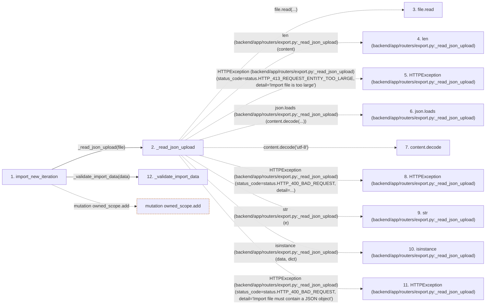

# import_new_iteration

**Entry point:** `import_new_iteration` (`http`)
**Source:** [export](../modules/export.md)
**Modules touched:** [authority](../modules/authority.md), [calendar_service](../modules/calendar_service.md), [commands](../modules/commands.md), [config](../modules/config.md), and 22 more

**Complete modules touched:**

- [authority](../modules/authority.md)
- [calendar_service](../modules/calendar_service.md)
- [commands](../modules/commands.md)
- [config](../modules/config.md)
- [delivery_dependency_service](../modules/delivery_dependency_service.md)
- [discussion_service](../modules/discussion_service.md)
- [export](../modules/export.md)
- [identity_service](../modules/identity_service.md)
- [import_parser](../modules/import_parser.md)
- [iteration_service](../modules/iteration_service.md)
- [models_calendar](../modules/models_calendar.md)
- [models_iteration](../modules/models_iteration.md)
- [models_outbound_webhook](../modules/models_outbound_webhook.md)
- [models_task](../modules/models_task.md)
- [mutation_versions](../modules/mutation_versions.md)
- [planning_input_context](../modules/planning_input_context.md)
- [schemas_common](../modules/schemas_common.md)
- [schemas_iteration](../modules/schemas_iteration.md)
- [schemas_task](../modules/schemas_task.md)
- [schemas_team](../modules/schemas_team.md)
- [snapshot_service](../modules/snapshot_service.md)
- [sql_semantics](../modules/sql_semantics.md)
- [task_brief_service](../modules/task_brief_service.md)
- [task_service](../modules/task_service.md)
- [team_member](../modules/team_member.md)
- [team_service](../modules/team_service.md)

## Call sequence

> Static overview in presentation order, not runtime execution order. Arrows retain captured callers; representative internal continuations and boundary examples precede repeated helper detail.

```mermaid
sequenceDiagram
    participant p0 as import_new_iteration
    participant p1 as _validate_import_data
    participant p2 as command_transaction
    participant p3 as planning_input_reservation
    participant p4 as IterationService.create
    participant p5 as _process_import
    participant p6 as _read_json_upload
    participant p7 as IterationCreate
    participant p8 as _optional_int
    participant p9 as IterationService
    participant p10 as lock_iterations
    participant p11 as affected_iteration_ids
    participant p12 as IterationService._require_project_exists
    participant p13 as IterationService._calendar_id_for_create
    participant p14 as DeliveryDependencyService.reconcile
    participant p15 as DiscussionService.enqueue
    participant p16 as _import_task
    participant p17 as CalendarService.get_or_create_default
    participant p18 as _import_task_record
    participant p19 as require_operator
    participant p20 as require_project
    participant p21 as DeliveryDependencyService.validate_cycles
    participant p22 as DiscussionService.recipient_authorized
    participant p23 as prospective_member_profiles
    participant p24 as TaskService.reserve_task_version
    participant p25 as clear_execution_evidence
    participant p26 as DeliveryDependencyService.graph
    participant p27 as IdentityService.context
    participant p28 as commit_or_flush
    participant p29 as HTTPException (backend/app/routers/export.py:import_new_iteration)
    participant p30 as iter_data.get
    p0->>p1: _validate_import_data
    p0->>p2: command_transaction
    p0->>p3: planning_input_reservation
    p0->>p4: IterationService.create
    p0->>p5: _process_import
    p0->>p6: _read_json_upload
    p0->>p7: IterationCreate
    p0->>p8: _optional_int
    p0->>p9: IterationService
    p0->>p10: lock_iterations
    p3->>p11: affected_iteration_ids
    p4->>p12: IterationService._require_project_exists
    p4->>p13: IterationService._calendar_id_for_create
    p2->>p14: DeliveryDependencyService.reconcile
    p2->>p15: DiscussionService.enqueue
    p5->>p16: _import_task
    p13->>p17: CalendarService.get_or_create_default
    p16->>p18: _import_task_record
    p11->>p19: require_operator
    p11->>p20: require_project
    p14->>p21: DeliveryDependencyService.validate_cycles
    p15->>p22: DiscussionService.recipient_authorized
    p11->>p23: prospective_member_profiles
    p14->>p24: TaskService.reserve_task_version
    p14->>p25: clear_execution_evidence
    p21->>p26: DeliveryDependencyService.graph
    p22->>p27: IdentityService.context
    p17->>p28: commit_or_flush
    p0-->>p29: HTTPException (backend/app/routers/export.py:import_new_iteration)(status_code=status.HTTP_400_BAD_REQUEST, detail='Missing iteration data in export file')
    p0-->>p30: iter_data.get('calendar_id')
```

<!-- Auto-generated from static call edges. Dashed arrows are external or unresolved calls. Reviewed runtime conditions and side effects belong in Behavior. -->

> Call sequence diagram shows 30 of 630 interactions; 600 omitted to keep the visualization within the 30-interaction and generated-diagram limits, with uncertain identities omitted rather than inferred.

> Captured boundary calls: external 1 of 176 (175 omitted); unresolved 1 of 327 (326 omitted). These counts cover the captured static trace.

Omitted captured detail, grouped by actual caller occurrence and target module:

| Caller | Parent step | Target module | Kind | Omitted interactions |
| --- | --- | --- | --- | --- |
| `backend/app/routers/export.py:_read_json_upload` | 2 | - | unresolved | 2 |
| `backend/app/routers/export.py:_read_json_upload` | 2 | - | external | 7 |
| `backend/app/routers/export.py:_validate_import_data` | 12 | - | unresolved | 2 |
| `backend/app/routers/export.py:_validate_import_data` | 12 | - | external | 9 |
| `backend/app/routers/export.py:_validate_import_data` | 12 | [backend/app/routers/export.py](../modules/export.md) | internal | 1 |
| `backend/app/routers/export.py:_validate_import_task_tree` | 16 | - | unresolved | 3 |
| `backend/app/routers/export.py:_validate_import_task_tree` | 16 | - | external | 6 |
| `backend/app/commands.py:command_transaction` | 34 | [backend/app/commands.py](../modules/commands.md) | internal | 2 |
> Omission summary shows 8 of 136 groups; 128 further groups are not expanded here. Counts above include all omitted interactions.
> Detailed flow queries retain their own coverage and limits; omitted paths may execute at runtime.

> Trace truncated at the depth limit; deeper calls are omitted.

## Data flow

<!-- Auto-generated static analysis. Treat values and boundaries as best-effort hints, not runtime proof. -->

### Analysis coverage

**Effect analysis partially available.** Flow assembly and source effect analysis are separate; empty observations do not prove an empty handler body.

Source steps: 128; effect analysis evaluated: 76, partial: 2, unavailable: 50. Counts include steps omitted from the displayed trace.

Collector observations for 78 source steps with known totals: observed: 351, emitted: 349, omitted: 2. Unavailable totals are excluded.

- Callable record unavailable for one or more source steps; those steps have no represented callable body.
- Effect collector omitted observations before flow assembly; displayed effects are partial.
- Effect collector totals unavailable; observed counts cover captured records only.

| Step | Callable record | Effect analysis | Collector totals | Observed | Emitted | Omitted |
|---|---|---|---|---:|---:|---:|
| `import_new_iteration` | `available` | `evaluated` | `available` | `7` | `7` | `0` |
| `_read_json_upload` | `available` | `evaluated` | `available` | `8` | `8` | `0` |
| `file.read` | `not_applicable` | `not_applicable` | `not_applicable` | — | — | — |
| `len (backend/app/routers/export.py:_read_json_upload)` | `not_applicable` | `not_applicable` | `not_applicable` | — | — | — |
| `HTTPException (backend/app/routers/export.py:_read_json_upload)` | `not_applicable` | `not_applicable` | `not_applicable` | — | — | — |
| `json.loads (backend/app/routers/export.py:_read_json_upload)` | `not_applicable` | `not_applicable` | `not_applicable` | — | — | — |
| `content.decode` | `not_applicable` | `not_applicable` | `not_applicable` | — | — | — |
| `HTTPException (backend/app/routers/export.py:_read_json_upload)` | `not_applicable` | `not_applicable` | `not_applicable` | — | — | — |
| `str (backend/app/routers/export.py:_read_json_upload)` | `not_applicable` | `not_applicable` | `not_applicable` | — | — | — |
| `isinstance (backend/app/routers/export.py:_read_json_upload)` | `not_applicable` | `not_applicable` | `not_applicable` | — | — | — |
| `HTTPException (backend/app/routers/export.py:_read_json_upload)` | `not_applicable` | `not_applicable` | `not_applicable` | — | — | — |
| `_validate_import_data` | `available` | `evaluated` | `available` | `1` | `1` | `0` |

### Step data

| Step | Inputs | Reads | Writes | Returns |
|---|---|---|---|---|
| `import_new_iteration` | `file: Annotated[UploadFile, File(...)]`, `db: Annotated[AsyncSession, Depends(get_db, scope='function')]` | `status`, `status`, `status` | - | `...` |
| `_read_json_upload` | `file: UploadFile` | `MAX_JSON_IMPORT_BYTES`, `MAX_JSON_IMPORT_BYTES`, `status`, `json`, `status`, `status` | - | `data` |
| `file.read` | - | - | - | - |
| `len (backend/app/routers/export.py:_read_json_upload)` | - | - | - | - |
| `HTTPException (backend/app/routers/export.py:_read_json_upload)` | - | - | - | - |
| `json.loads (backend/app/routers/export.py:_read_json_upload)` | - | - | - | - |
| `content.decode` | - | - | - | - |
| `HTTPException (backend/app/routers/export.py:_read_json_upload)` | - | - | - | - |
| `str (backend/app/routers/export.py:_read_json_upload)` | - | - | - | - |
| `isinstance (backend/app/routers/export.py:_read_json_upload)` | - | - | - | - |
| `HTTPException (backend/app/routers/export.py:_read_json_upload)` | - | - | - | - |
| `_validate_import_data` | `data` | - | - | - |

### Call data

| From | To | Line | Call |
|---|---|---:|---|
| import_new_iteration | _read_json_upload | 276 | `_read_json_upload(file)` |
| _read_json_upload | file.read | 38 | `file.read(...)` |
| _read_json_upload | len (backend/app/routers/export.py:_read_json_upload) | 39 | `len(content)` |
| _read_json_upload | HTTPException (backend/app/routers/export.py:_read_json_upload) | 40 | `HTTPException(status_code=status.HTTP_413_REQUEST_ENTITY_TOO_LARGE, detail='Import file is too large')` |
| _read_json_upload | json.loads (backend/app/routers/export.py:_read_json_upload) | 45 | `json.loads(content.decode(...))` |
| _read_json_upload | content.decode | 45 | `content.decode('utf-8')` |
| _read_json_upload | HTTPException (backend/app/routers/export.py:_read_json_upload) | 47 | `HTTPException(status_code=status.HTTP_400_BAD_REQUEST, detail=...)` |
| _read_json_upload | str (backend/app/routers/export.py:_read_json_upload) | 49 | `str(e)` |
| _read_json_upload | isinstance (backend/app/routers/export.py:_read_json_upload) | 51 | `isinstance(data, dict)` |
| _read_json_upload | HTTPException (backend/app/routers/export.py:_read_json_upload) | 52 | `HTTPException(status_code=status.HTTP_400_BAD_REQUEST, detail='Import file must contain a JSON object')` |
| import_new_iteration | _validate_import_data | 278 | `_validate_import_data(data)` |

### Boundary effects

| Kind | Target | Step | Line |
|---|---|---|---:|
| mutation | `owned_scope.add` | `import_new_iteration` | 314 |

### Static analysis gaps

| Kind | Step | Target | Line |
|---|---|---|---:|
| unresolved_call | `_read_json_upload` | `file.read` | 38 |
| external_call | `_read_json_upload` | `HTTPException` | 40 |
| external_call | `_read_json_upload` | `json.loads` | 45 |
| unresolved_call | `_read_json_upload` | `content.decode` | 45 |
| external_call | `_read_json_upload` | `HTTPException` | 47 |
| external_call | `_read_json_upload` | `isinstance` | 51 |
| external_call | `_read_json_upload` | `HTTPException` | 52 |
| step_limit | `import_new_iteration` | `first 12 steps` | 0 |
| truncated_flow | `import_new_iteration` | `depth limit` | 0 |

## Behavior

This flow starts at `import_new_iteration` and is classified as `http`. The generated call and data-flow sections are bounded static projections; runtime conditions and side effects require source-level confirmation.
