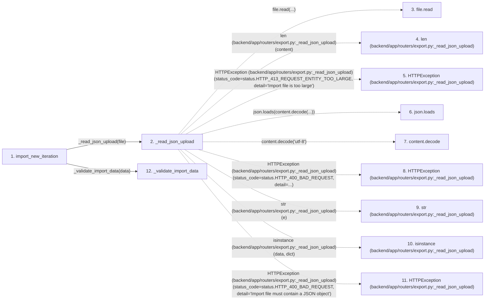

# import_new_iteration

**Entry point:** `import_new_iteration` (`http`)
**Source:** [export](../modules/export.md)
**Modules touched:** [allocation_removal](../modules/allocation_removal.md), [authority](../modules/authority.md), [calendar_rules](../modules/calendar_rules.md), [capacity_transfers](../modules/capacity_transfers.md), and 26 more

**Complete modules touched:**

- [allocation_removal](../modules/allocation_removal.md)
- [authority](../modules/authority.md)
- [calendar_rules](../modules/calendar_rules.md)
- [capacity_transfers](../modules/capacity_transfers.md)
- [commands](../modules/commands.md)
- [config](../modules/config.md)
- [delivery_dependency_service](../modules/delivery_dependency_service.md)
- [discussion_service](../modules/discussion_service.md)
- [execution_planning_window](../modules/execution_planning_window.md)
- [export](../modules/export.md)
- [import_parser](../modules/import_parser.md)
- [import_planning_service](../modules/import_planning_service.md)
- [import_review_service](../modules/import_review_service.md)
- [iteration_service](../modules/iteration_service.md)
- [models_agent](../modules/models_agent.md)
- [models_outbound_webhook](../modules/models_outbound_webhook.md)
- [models_task](../modules/models_task.md)
- [mutation_versions](../modules/mutation_versions.md)
- [planning_input_context](../modules/planning_input_context.md)
- [schemas_common](../modules/schemas_common.md)
- [schemas_iteration](../modules/schemas_iteration.md)
- [schemas_team](../modules/schemas_team.md)
- [snapshot_service](../modules/snapshot_service.md)
- [sql_semantics](../modules/sql_semantics.md)
- [task_brief_service](../modules/task_brief_service.md)
- [task_reactivation_service](../modules/task_reactivation_service.md)
- [task_service](../modules/task_service.md)
- [team_member](../modules/team_member.md)
- [team_service](../modules/team_service.md)
- [time](../modules/time.md)

## Call sequence

> Static overview in presentation order, not runtime execution order. Arrows retain captured callers; representative internal continuations and boundary examples precede repeated helper detail.

```mermaid
sequenceDiagram
    participant p0 as import_new_iteration
    participant p1 as _validate_import_data
    participant p2 as apply_reviewed_import
    participant p3 as _read_json_upload
    participant p4 as write_new_iteration_import
    participant p5 as import_scope_revisions
    participant p6 as target_sha256
    participant p7 as run_import_with_changes
    participant p8 as changes_sha256
    participant p9 as affected_iteration_ids
    participant p10 as _sha256
    participant p11 as capture_import_state
    participant p12 as write_iteration_import
    participant p13 as diff_import_state
    participant p14 as command_transaction
    participant p15 as planning_input_reservation
    participant p16 as get_settings
    participant p17 as require_operator
    participant p18 as require_project
    participant p19 as _process_import
    participant p20 as prospective_member_profiles
    participant p21 as _sort_key
    participant p22 as inspect_allocation_history
    participant p23 as lock_planning
    participant p24 as transfer_iteration_ids
    participant p25 as process_reactivation_checks
    participant p26 as DeliveryDependencyService.reconcile
    participant p27 as parse_team_members_text
    participant p28 as DiscussionService.enqueue
    participant p29 as len (backend/app/routers/export.py:_read_json_upload)
    participant p30 as file.read
    p0->>p1: _validate_import_data
    p0->>p2: apply_reviewed_import
    p0->>p3: _read_json_upload
    p0->>p4: write_new_iteration_import
    p2->>p5: import_scope_revisions
    p2->>p6: target_sha256
    p2->>p7: run_import_with_changes
    p2->>p8: changes_sha256
    p5->>p9: affected_iteration_ids
    p6->>p10: _sha256
    p7->>p11: capture_import_state
    p7->>p12: write_iteration_import
    p7->>p13: diff_import_state
    p4->>p14: command_transaction
    p4->>p15: planning_input_reservation
    p9->>p16: get_settings
    p9->>p17: require_operator
    p9->>p18: require_project
    p4->>p19: _process_import
    p9->>p20: prospective_member_profiles
    p13->>p21: _sort_key
    p15->>p22: inspect_allocation_history
    p15->>p23: lock_planning
    p15->>p24: transfer_iteration_ids
    p14->>p25: process_reactivation_checks
    p14->>p26: DeliveryDependencyService.reconcile
    p20->>p27: parse_team_members_text
    p14->>p28: DiscussionService.enqueue
    p3-->>p29: len (backend/app/routers/export.py:_read_json_upload)(content)
    p3-->>p30: file.read(...)
```

<!-- Auto-generated from static call edges. Dashed arrows are external or unresolved calls. Reviewed runtime conditions and side effects belong in Behavior. -->

> Call sequence diagram shows 30 of 795 interactions; 765 omitted to keep the visualization within the 30-interaction and generated-diagram limits, with uncertain identities omitted rather than inferred.

> Captured boundary calls: external 1 of 240 (239 omitted); unresolved 1 of 370 (369 omitted). These counts cover the captured static trace.

Omitted captured detail, grouped by actual caller occurrence and target module:

| Caller | Parent step | Target module | Kind | Omitted interactions |
| --- | --- | --- | --- | --- |
| `backend/app/routers/export.py:_read_json_upload` | 2 | - | external | 6 |
| `backend/app/routers/export.py:_read_json_upload` | 2 | - | unresolved | 1 |
| `backend/app/routers/export.py:_validate_import_data` | 12 | - | unresolved | 2 |
| `backend/app/routers/export.py:_validate_import_data` | 12 | - | external | 9 |
| `backend/app/routers/export.py:_validate_import_data` | 12 | [backend/app/routers/export.py](../modules/export.md) | internal | 1 |
| `backend/app/routers/export.py:_validate_import_task_tree` | 16 | - | unresolved | 3 |
| `backend/app/routers/export.py:_validate_import_task_tree` | 16 | - | external | 6 |
| `backend/app/services/import_review_service.py:apply_reviewed_import` | 34 | [backend/app/services/import_review_service.py](../modules/import_review_service.md) | internal | 5 |
> Omission summary shows 8 of 171 groups; 163 further groups are not expanded here. Counts above include all omitted interactions.
> Detailed flow queries retain their own coverage and limits; omitted paths may execute at runtime.

> Trace truncated at the depth limit; deeper calls are omitted.

## Data flow

<!-- Auto-generated static analysis. Treat values and boundaries as best-effort hints, not runtime proof. -->

### Analysis coverage

**Effect analysis partially available.** Flow assembly and source effect analysis are separate; empty observations do not prove an empty handler body.

Source steps: 186; effect analysis evaluated: 119, partial: 8, unavailable: 59. Counts include steps omitted from the displayed trace.

Collector observations for 127 source steps with known totals: observed: 684, emitted: 652, omitted: 32. Unavailable totals are excluded.

- Callable record unavailable for one or more source steps; those steps have no represented callable body.
- Effect collector omitted observations before flow assembly; displayed effects are partial.
- Effect collector totals unavailable; observed counts cover captured records only.

| Step | Callable record | Effect analysis | Collector totals | Observed | Emitted | Omitted |
|---|---|---|---|---:|---:|---:|
| `import_new_iteration` | `available` | `evaluated` | `available` | `5` | `5` | `0` |
| `_read_json_upload` | `available` | `evaluated` | `available` | `8` | `8` | `0` |
| `file.read` | `not_applicable` | `not_applicable` | `not_applicable` | — | — | — |
| `len (backend/app/routers/export.py:_read_json_upload)` | `not_applicable` | `not_applicable` | `not_applicable` | — | — | — |
| `HTTPException (backend/app/routers/export.py:_read_json_upload)` | `not_applicable` | `not_applicable` | `not_applicable` | — | — | — |
| `json.loads` | `not_applicable` | `not_applicable` | `not_applicable` | — | — | — |
| `content.decode` | `not_applicable` | `not_applicable` | `not_applicable` | — | — | — |
| `HTTPException (backend/app/routers/export.py:_read_json_upload)` | `not_applicable` | `not_applicable` | `not_applicable` | — | — | — |
| `str (backend/app/routers/export.py:_read_json_upload)` | `not_applicable` | `not_applicable` | `not_applicable` | — | — | — |
| `isinstance (backend/app/routers/export.py:_read_json_upload)` | `not_applicable` | `not_applicable` | `not_applicable` | — | — | — |
| `HTTPException (backend/app/routers/export.py:_read_json_upload)` | `not_applicable` | `not_applicable` | `not_applicable` | — | — | — |
| `_validate_import_data` | `available` | `evaluated` | `available` | `1` | `1` | `0` |

### Step data

| Step | Inputs | Reads | Writes | Returns |
|---|---|---|---|---|
| `import_new_iteration` | `file: Annotated[UploadFile, File(...)]`, `db: Annotated[AsyncSession, Depends(get_db, scope='function')]`, `review_digest: Annotated[str \| None, Form()]` | - | - | `...`, `result` |
| `_read_json_upload` | `file: UploadFile` | `MAX_JSON_IMPORT_BYTES`, `MAX_JSON_IMPORT_BYTES`, `status`, `json`, `status`, `status` | - | `data` |
| `file.read` | - | - | - | - |
| `len (backend/app/routers/export.py:_read_json_upload)` | - | - | - | - |
| `HTTPException (backend/app/routers/export.py:_read_json_upload)` | - | - | - | - |
| `json.loads` | - | - | - | - |
| `content.decode` | - | - | - | - |
| `HTTPException (backend/app/routers/export.py:_read_json_upload)` | - | - | - | - |
| `str (backend/app/routers/export.py:_read_json_upload)` | - | - | - | - |
| `isinstance (backend/app/routers/export.py:_read_json_upload)` | - | - | - | - |
| `HTTPException (backend/app/routers/export.py:_read_json_upload)` | - | - | - | - |
| `_validate_import_data` | `data` | - | - | - |

### Call data

| From | To | Line | Call |
|---|---|---:|---|
| import_new_iteration | _read_json_upload | 281 | `_read_json_upload(file)` |
| _read_json_upload | file.read | 38 | `file.read(...)` |
| _read_json_upload | len (backend/app/routers/export.py:_read_json_upload) | 39 | `len(content)` |
| _read_json_upload | HTTPException (backend/app/routers/export.py:_read_json_upload) | 40 | `HTTPException(status_code=status.HTTP_413_REQUEST_ENTITY_TOO_LARGE, detail='Import file is too large')` |
| _read_json_upload | json.loads | 45 | `json.loads(content.decode(...))` |
| _read_json_upload | content.decode | 45 | `content.decode('utf-8')` |
| _read_json_upload | HTTPException (backend/app/routers/export.py:_read_json_upload) | 47 | `HTTPException(status_code=status.HTTP_400_BAD_REQUEST, detail=...)` |
| _read_json_upload | str (backend/app/routers/export.py:_read_json_upload) | 49 | `str(e)` |
| _read_json_upload | isinstance (backend/app/routers/export.py:_read_json_upload) | 51 | `isinstance(data, dict)` |
| _read_json_upload | HTTPException (backend/app/routers/export.py:_read_json_upload) | 52 | `HTTPException(status_code=status.HTTP_400_BAD_REQUEST, detail='Import file must contain a JSON object')` |
| import_new_iteration | _validate_import_data | 283 | `_validate_import_data(data)` |

### Boundary effects

*No boundary-effect observations were captured in this static trace.*

### Static analysis gaps

| Kind | Step | Target | Line |
|---|---|---|---:|
| unresolved_call | `_read_json_upload` | `file.read` | 38 |
| external_call | `_read_json_upload` | `HTTPException` | 40 |
| external_call | `_read_json_upload` | `json.loads` | 45 |
| unresolved_call | `_read_json_upload` | `content.decode` | 45 |
| external_call | `_read_json_upload` | `HTTPException` | 47 |
| external_call | `_read_json_upload` | `isinstance` | 51 |
| external_call | `_read_json_upload` | `HTTPException` | 52 |
| step_limit | `import_new_iteration` | `first 12 steps` | 0 |
| truncated_flow | `import_new_iteration` | `depth limit` | 0 |

## Behavior

Imports a JSON plan file. When the request carries the `review_digest` of a plan-import dry run, the write runs the same writer, recomputes the file hash, the target revisions and the change set, and applies only if all three still match the reviewed digest; otherwise it is refused and rolled back. Without a digest the file is applied directly.
