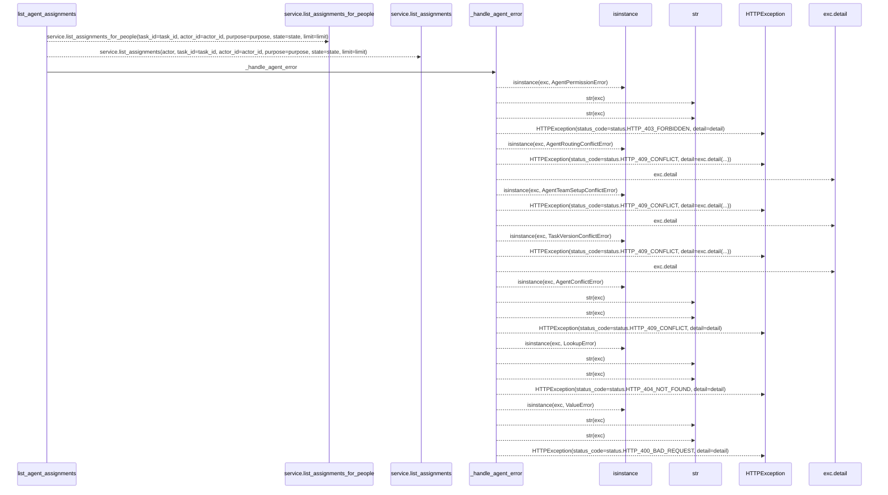
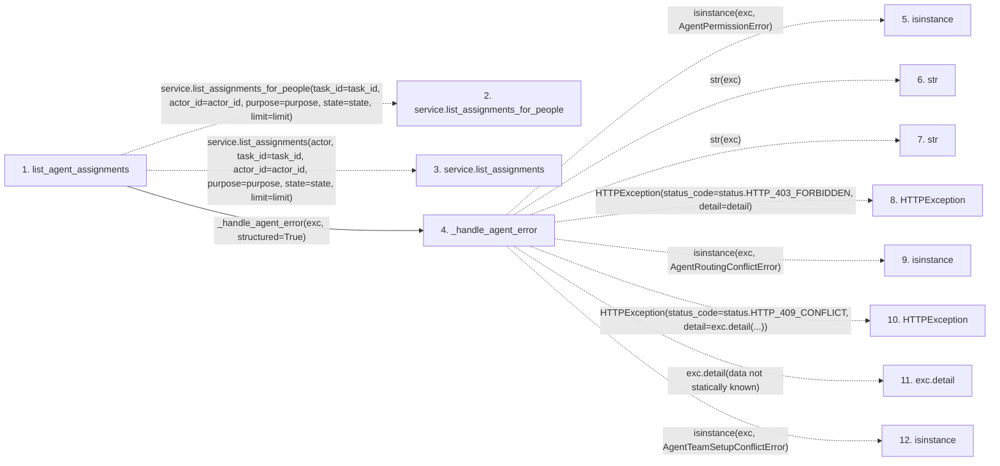

# list_agent_assignments

**Entry point:** `list_agent_assignments` (`http`)
**Source:** [routers_agent](../modules/routers_agent.md)
**Modules touched:** [routers_agent](../modules/routers_agent.md)

## Call sequence

> Static overview in presentation order, not runtime execution order. Arrows retain captured callers; representative internal continuations and boundary examples precede repeated helper detail.

<!-- Auto-generated from static call edges. Dashed arrows are external or unresolved calls. Reviewed runtime conditions and side effects belong in Behavior. -->

> Call sequence diagram shows 28 of 28 interactions; 0 omitted to keep the visualization within the 30-interaction and generated-diagram limits, with uncertain identities omitted rather than inferred.

> Captured boundary calls: external 22 of 22 (0 omitted); unresolved 5 of 5 (0 omitted). These counts cover the captured static trace.
> Detailed flow queries retain their own coverage and limits; omitted paths may execute at runtime.

## Data flow

<!-- Auto-generated static analysis. Treat values and boundaries as best-effort hints, not runtime proof. -->

### Analysis coverage

**Effect analysis partially available.** Flow assembly and source effect analysis are separate; empty observations do not prove an empty handler body.

Source steps: 2; effect analysis evaluated: 1, partial: 1, unavailable: 0. Counts include steps omitted from the displayed trace.

Collector observations for 2 source steps with known totals: observed: 23, emitted: 19, omitted: 4. Unavailable totals are excluded.

- Effect collector omitted observations before flow assembly; displayed effects are partial.

| Step | Callable record | Effect analysis | Collector totals | Observed | Emitted | Omitted |
|---|---|---|---|---:|---:|---:|
| `list_agent_assignments` | `available` | `evaluated` | `available` | `9` | `9` | `0` |
| `service.list_assignments_for_people` | `not_applicable` | `not_applicable` | `not_applicable` | — | — | — |
| `service.list_assignments` | `not_applicable` | `not_applicable` | `not_applicable` | — | — | — |
| `_handle_agent_error` | `available` | `partial` | `available` | `14` | `10` | `4` |
| `isinstance` | `not_applicable` | `not_applicable` | `not_applicable` | — | — | — |
| `str` | `not_applicable` | `not_applicable` | `not_applicable` | — | — | — |
| `str` | `not_applicable` | `not_applicable` | `not_applicable` | — | — | — |
| `HTTPException` | `not_applicable` | `not_applicable` | `not_applicable` | — | — | — |
| `isinstance` | `not_applicable` | `not_applicable` | `not_applicable` | — | — | — |
| `HTTPException` | `not_applicable` | `not_applicable` | `not_applicable` | — | — | — |
| `exc.detail` | `not_applicable` | `not_applicable` | `not_applicable` | — | — | — |
| `isinstance` | `not_applicable` | `not_applicable` | `not_applicable` | — | — | — |

### Step data

| Step | Inputs | Reads | Writes | Returns |
|---|---|---|---|---|
| `list_agent_assignments` | `actor: Annotated[AgentActor \| None, Depends(get_assignment_reader)]`, `service: Annotated[AgentWorkService, Depends(get_agent_work_service)]`, `task_id: Optional[int]`, `actor_id: Optional[int]`, `purpose: Optional[str]`, `state: Optional[str]`, `limit: int` | - | - | `...`, `...` |
| `service.list_assignments_for_people` | - | - | - | - |
| `service.list_assignments` | - | - | - | - |
| `_handle_agent_error` | `exc: Exception`, `structured: bool` | `AgentPermissionError`, `status`, `AgentRoutingConflictError`, `status`, `AgentTeamSetupConflictError`, `status`, `TaskVersionConflictError`, `status` | - | - |
| `isinstance` | - | - | - | - |
| `str` | - | - | - | - |
| `str` | - | - | - | - |
| `HTTPException` | - | - | - | - |
| `isinstance` | - | - | - | - |
| `HTTPException` | - | - | - | - |
| `exc.detail` | - | - | - | - |
| `isinstance` | - | - | - | - |

### Call data

| From | To | Line | Call |
|---|---|---:|---|
| list_agent_assignments | service.list_assignments_for_people | 850 | `service.list_assignments_for_people(task_id=task_id, actor_id=actor_id, purpose=purpose, state=state, limit=limit)` |
| list_agent_assignments | service.list_assignments | 857 | `service.list_assignments(actor, task_id=task_id, actor_id=actor_id, purpose=purpose, state=state, limit=limit)` |
| list_agent_assignments | _handle_agent_error | 866 | `_handle_agent_error(exc, structured=True)` |
| _handle_agent_error | isinstance | 330 | `isinstance(exc, AgentPermissionError)` |
| _handle_agent_error | str | 332 | `str(exc)` |
| _handle_agent_error | str | 334 | `str(exc)` |
| _handle_agent_error | HTTPException | 336 | `HTTPException(status_code=status.HTTP_403_FORBIDDEN, detail=detail)` |
| _handle_agent_error | isinstance | 337 | `isinstance(exc, AgentRoutingConflictError)` |
| _handle_agent_error | HTTPException | 338 | `HTTPException(status_code=status.HTTP_409_CONFLICT, detail=exc.detail(...))` |
| _handle_agent_error | exc.detail | 338 | `exc.detail(data not statically known)` |
| _handle_agent_error | isinstance | 339 | `isinstance(exc, AgentTeamSetupConflictError)` |

### Boundary effects

*No boundary-effect observations were captured in this static trace.*

### Static analysis gaps

| Kind | Step | Target | Line |
|---|---|---|---:|
| unresolved_call | `list_agent_assignments` | `service.list_assignments_for_people` | 850 |
| unresolved_call | `list_agent_assignments` | `service.list_assignments` | 857 |
| external_call | `_handle_agent_error` | `isinstance` | 330 |
| external_call | `_handle_agent_error` | `HTTPException` | 336 |
| external_call | `_handle_agent_error` | `isinstance` | 337 |
| external_call | `_handle_agent_error` | `HTTPException` | 338 |
| unresolved_call | `_handle_agent_error` | `exc.detail` | 338 |
| external_call | `_handle_agent_error` | `isinstance` | 339 |
| step_limit | `list_agent_assignments` | `first 12 steps` | 0 |

## Behavior

With an agent key, lists the full assignment projection inside that actor's queue boundary, as before. Without one, a person, trusted-local browser or paired observer who can read some work (the pipeline's rule), or an operator, lists the assignments of the tasks they can see. Those rows follow the request's ORM read scope; the named actors and model bindings are then read internally, so binding status is not misreported, and routing evidence, the assigner's reason and reviewer details are left out. Anyone else gets 401.
