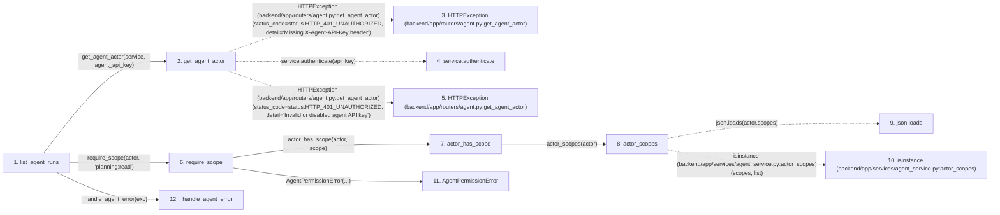

# list_agent_runs

**Entry point:** `list_agent_runs` (`http`)
**Source:** [routers_agent](../modules/routers_agent.md)
**Modules touched:** [agent_run_read](../modules/agent_run_read.md), [agent_run_read_service](../modules/agent_run_read_service.md), [agent_service](../modules/agent_service.md), [authority](../modules/authority.md), and 5 more

**Complete modules touched:**

- [agent_run_read](../modules/agent_run_read.md)
- [agent_run_read_service](../modules/agent_run_read_service.md)
- [agent_service](../modules/agent_service.md)
- [authority](../modules/authority.md)
- [execution_usage_service](../modules/execution_usage_service.md)
- [routers_agent](../modules/routers_agent.md)
- [schemas_agent](../modules/schemas_agent.md)
- [schemas_execution_usage](../modules/schemas_execution_usage.md)
- [time](../modules/time.md)

## Call sequence

> Static overview in presentation order, not runtime execution order. Arrows retain captured callers; representative internal continuations and boundary examples precede repeated helper detail.

```mermaid
sequenceDiagram
    participant p0 as list_agent_runs
    participant p1 as require_scope
    participant p2 as AgentRunReadService.list
    participant p3 as get_agent_actor
    participant p4 as _handle_agent_error
    participant p5 as _reads_work_as_person
    participant p6 as AgentRunReadService
    participant p7 as actor_has_scope
    participant p8 as run_identity
    participant p9 as ExecutionUsageService.response
    participant p10 as AgentPermissionError
    participant p11 as internal_authority
    participant p12 as AgentRunReadItem
    participant p13 as AgentAssignmentActorSummary
    participant p14 as AgentRunHarness
    participant p15 as actor_scopes
    participant p16 as ExecutionUsageResponse
    participant p17 as as_utc
    participant p18 as HTTPException (backend/app/routers/agent.py:list_agent_runs)
    participant p19 as service.db.info.get
    participant p20 as HTTPException (backend/app/routers/agent.py:get_agent_actor)
    participant p21 as isinstance (backend/app/routers/agent.py:_handle_agent_error)
    participant p22 as bool
    participant p23 as select
    participant p24 as service.authenticate
    participant p25 as str
    participant p26 as query.where
    participant p27 as HTTPException (backend/app/routers/agent.py:_handle_agent_error)
    p0->>p1: require_scope
    p0->>p2: AgentRunReadService.list
    p0->>p3: get_agent_actor
    p0->>p4: _handle_agent_error
    p0->>p5: _reads_work_as_person
    p0->>p6: AgentRunReadService
    p1->>p7: actor_has_scope
    p2->>p8: run_identity
    p2->>p9: ExecutionUsageService.response
    p1->>p10: AgentPermissionError
    p2->>p11: internal_authority
    p2->>p12: AgentRunReadItem
    p2->>p13: AgentAssignmentActorSummary
    p2->>p14: AgentRunHarness
    p7->>p15: actor_scopes
    p9->>p16: ExecutionUsageResponse
    p8->>p17: as_utc
    p0-->>p18: HTTPException (backend/app/routers/agent.py:list_agent_runs)(status_code=status.HTTP_401_UNAUTHORIZED, detail='Sign in to read runs.')
    p0-->>p19: service.db.info.get('authority')
    p3-->>p20: HTTPException (backend/app/routers/agent.py:get_agent_actor)(status_code=status.HTTP_401_UNAUTHORIZED, detail='Missing X-Agent-API-Key header')
    p4-->>p21: isinstance (backend/app/routers/agent.py:_handle_agent_error)(exc, AgentPermissionError)
    p5-->>p22: bool(authority.projects)
    p2-->>p23: select(AgentRun)
    p3-->>p24: service.authenticate(api_key)
    p4-->>p25: str(exc)
    p2-->>p26: query.where(...)
    p3-->>p20: HTTPException (backend/app/routers/agent.py:get_agent_actor)(status_code=status.HTTP_401_UNAUTHORIZED, detail='Invalid or disabled agent API key')
    p4-->>p25: str(exc)
    p2-->>p26: query.where(...)
    p4-->>p27: HTTPException (backend/app/routers/agent.py:_handle_agent_error)(status_code=status.HTTP_403_FORBIDDEN, detail=detail)
```

<!-- Auto-generated from static call edges. Dashed arrows are external or unresolved calls. Reviewed runtime conditions and side effects belong in Behavior. -->

> Call sequence diagram shows 30 of 91 interactions; 61 omitted to keep the visualization within the 30-interaction and generated-diagram limits, with uncertain identities omitted rather than inferred.

> Captured boundary calls: external 9 of 35 (26 omitted); unresolved 4 of 39 (35 omitted). These counts cover the captured static trace.

Omitted captured detail, grouped by actual caller occurrence and target module:

| Caller | Parent step | Target module | Kind | Omitted interactions |
| --- | --- | --- | --- | --- |
| `backend/app/services/agent_service.py:actor_scopes` | 8 | - | external | 2 |
| `backend/app/routers/agent.py:_handle_agent_error` | 12 | - | external | 18 |
| `backend/app/routers/agent.py:_handle_agent_error` | 12 | - | unresolved | 3 |
| `backend/app/services/agent_run_read_service.py:AgentRunReadService.list` | 42 | - | unresolved | 25 |
| `backend/app/services/agent_run_read_service.py:AgentRunReadService.list` | 42 | - | external | 4 |
| `backend/app/services/execution_usage_service.py:run_identity` | 57 | - | unresolved | 3 |
| `backend/app/services/execution_usage_service.py:run_identity` | 57 | - | external | 2 |
| `backend/app/utils/time.py:as_utc` | 63 | - | unresolved | 2 |
> Omission summary shows 8 of 10 groups; 2 further groups are not expanded here. Counts above include all omitted interactions.
> Detailed flow queries retain their own coverage and limits; omitted paths may execute at runtime.

## Data flow

<!-- Auto-generated static analysis. Treat values and boundaries as best-effort hints, not runtime proof. -->

### Analysis coverage

**Effect analysis partially available.** Flow assembly and source effect analysis are separate; empty observations do not prove an empty handler body.

Source steps: 18; effect analysis evaluated: 11, partial: 1, unavailable: 6. Counts include steps omitted from the displayed trace.

Collector observations for 12 source steps with known totals: observed: 68, emitted: 64, omitted: 4. Unavailable totals are excluded.

- Callable record unavailable for one or more source steps; those steps have no represented callable body.
- Effect collector omitted observations before flow assembly; displayed effects are partial.
- Effect collector totals unavailable; observed counts cover captured records only.

| Step | Callable record | Effect analysis | Collector totals | Observed | Emitted | Omitted |
|---|---|---|---|---:|---:|---:|
| `list_agent_runs` | `available` | `evaluated` | `available` | `11` | `11` | `0` |
| `get_agent_actor` | `available` | `evaluated` | `available` | `5` | `5` | `0` |
| `HTTPException (backend/app/routers/agent.py:get_agent_actor)` | `not_applicable` | `not_applicable` | `not_applicable` | — | — | — |
| `service.authenticate` | `not_applicable` | `not_applicable` | `not_applicable` | — | — | — |
| `HTTPException (backend/app/routers/agent.py:get_agent_actor)` | `not_applicable` | `not_applicable` | `not_applicable` | — | — | — |
| `require_scope` | `available` | `evaluated` | `available` | `2` | `2` | `0` |
| `actor_has_scope` | `available` | `evaluated` | `available` | `3` | `3` | `0` |
| `actor_scopes` | `available` | `evaluated` | `available` | `3` | `3` | `0` |
| `json.loads` | `not_applicable` | `not_applicable` | `not_applicable` | — | — | — |
| `isinstance (backend/app/services/agent_service.py:actor_scopes)` | `not_applicable` | `not_applicable` | `not_applicable` | — | — | — |
| `AgentPermissionError` | `unavailable` | `unavailable` | `unavailable` | — | — | — |
| `_handle_agent_error` | `available` | `partial` | `available` | `14` | `10` | `4` |

### Step data

| Step | Inputs | Reads | Writes | Returns |
|---|---|---|---|---|
| `list_agent_runs` | `service: Annotated[AgentService, Depends(get_agent_service)]`, `agent_api_key: Annotated[Optional[str], Header(alias='X-Agent-API-Key')]`, `task_id: Optional[int]`, `harness_kind: Optional[str]`, `harness_session_id: Optional[str]`, `status_filter: Optional[str]`, `actor_id: Optional[int]`, `limit: int` | `AgentPermissionError`, `status` | - | `...` |
| `get_agent_actor` | `service: Annotated[AgentService, Depends(get_agent_service)]`, `api_key: Annotated[Optional[str], Header(alias='X-Agent-API-Key')]` | `status`, `status` | - | `actor` |
| `HTTPException (backend/app/routers/agent.py:get_agent_actor)` | - | - | - | - |
| `service.authenticate` | - | - | - | - |
| `HTTPException (backend/app/routers/agent.py:get_agent_actor)` | - | - | - | - |
| `require_scope` | `actor: AgentActor`, `scope: str` | - | - | - |
| `actor_has_scope` | `actor: AgentActor`, `scope: str` | - | - | `...` |
| `actor_scopes` | `actor: AgentActor` | `json` | - | `...` |
| `json.loads` | - | - | - | - |
| `isinstance (backend/app/services/agent_service.py:actor_scopes)` | - | - | - | - |
| `AgentPermissionError` | - | - | - | - |
| `_handle_agent_error` | `exc: Exception`, `structured: bool` | `AgentPermissionError`, `status`, `AgentRoutingConflictError`, `status`, `AgentTeamSetupConflictError`, `status`, `TaskVersionConflictError`, `status` | - | - |

### Call data

| From | To | Line | Call |
|---|---|---:|---|
| list_agent_runs | get_agent_actor | 1455 | `get_agent_actor(service, agent_api_key)` |
| get_agent_actor | HTTPException (backend/app/routers/agent.py:get_agent_actor) | 173 | `HTTPException(status_code=status.HTTP_401_UNAUTHORIZED, detail='Missing X-Agent-API-Key header')` |
| get_agent_actor | service.authenticate | 177 | `service.authenticate(api_key)` |
| get_agent_actor | HTTPException (backend/app/routers/agent.py:get_agent_actor) | 179 | `HTTPException(status_code=status.HTTP_401_UNAUTHORIZED, detail='Invalid or disabled agent API key')` |
| list_agent_runs | require_scope | 1457 | `require_scope(actor, 'planning:read')` |
| require_scope | actor_has_scope | 101 | `actor_has_scope(actor, scope)` |
| actor_has_scope | actor_scopes | 95 | `actor_scopes(actor)` |
| actor_scopes | json.loads | 87 | `json.loads(actor.scopes)` |
| actor_scopes | isinstance (backend/app/services/agent_service.py:actor_scopes) | 90 | `isinstance(scopes, list)` |
| require_scope | AgentPermissionError | 102 | `AgentPermissionError(...)` |
| list_agent_runs | _handle_agent_error | 1459 | `_handle_agent_error(exc)` |

### Boundary effects

*No boundary-effect observations were captured in this static trace.*

### Static analysis gaps

| Kind | Step | Target | Line |
|---|---|---|---:|
| external_call | `get_agent_actor` | `HTTPException` | 173 |
| unresolved_call | `get_agent_actor` | `service.authenticate` | 177 |
| external_call | `get_agent_actor` | `HTTPException` | 179 |
| external_call | `actor_scopes` | `json.loads` | 87 |
| external_call | `actor_scopes` | `isinstance` | 90 |
| step_limit | `list_agent_runs` | `first 12 steps` | 0 |

## Behavior

Lists runs of the tasks the reader can see, newest first, filtered by task, declared harness session, status or actor. People read on the pipeline's rule, operators read all, and an agent key needs `planning:read`. Rows follow the task read scope; actors and the latest declared usage report are read internally for the visible runs. Run events, logs, artifacts, summaries and errors are not returned; run detail keeps its key requirement.
