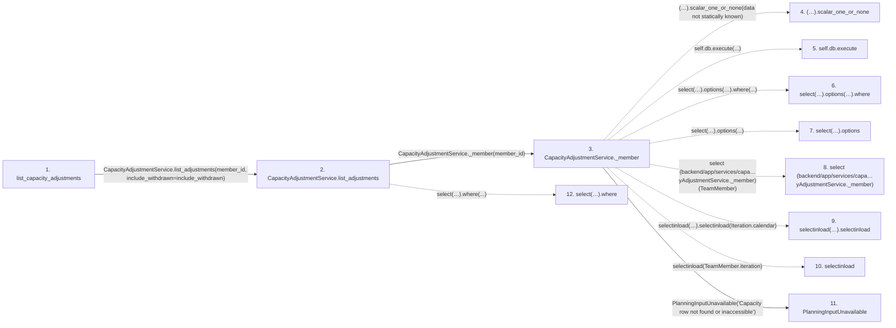

# list_capacity_adjustments

**Entry point:** `list_capacity_adjustments` (`http`)
**Source:** [routers_team](../modules/routers_team.md)
**Modules touched:** [capacity_adjustments](../modules/capacity_adjustments.md), [planning_input_context](../modules/planning_input_context.md), [query_limits](../modules/query_limits.md), [routers_team](../modules/routers_team.md)

## Call sequence

> Static overview in presentation order, not runtime execution order. Arrows retain captured callers; representative internal continuations and boundary examples precede repeated helper detail.

```mermaid
sequenceDiagram
    participant p0 as list_capacity_adjustments
    participant p1 as CapacityAdjustmentService.list_adjustments
    participant p2 as CapacityAdjustmentService
    participant p3 as CapacityAdjustmentService._member
    participant p4 as select(…).where
    participant p5 as select (backend/app/services/capa…ntService.list_adjustments)
    participant p6 as query.where
    participant p7 as adjustment.withdrawn_at.is_
    participant p8 as (…).all
    participant p9 as self.db.scalars
    participant p10 as query.order_by(…).limit
    participant p11 as query.order_by
    participant p12 as len
    participant p13 as CollectionLimitExceededError
    participant p14 as _response
    participant p15 as (…).scalar_one_or_none
    participant p16 as CapacityAdjustmentResponse.model_validate
    participant p17 as self.db.execute
    participant p18 as select(…).options(…).where
    participant p19 as select(…).options
    participant p20 as select (backend/app/services/capa…yAdjustmentService._member)
    participant p21 as selectinload(…).selectinload
    participant p22 as selectinload
    participant p23 as PlanningInputUnavailable
    p0->>p1: CapacityAdjustmentService.list_adjustments
    p0->>p2: CapacityAdjustmentService
    p1->>p3: CapacityAdjustmentService._member
    p1-->>p4: select(…).where(...)
    p1-->>p5: select (backend/app/services/capa…ntService.list_adjustments)(adjustment)
    p1-->>p6: query.where(adjustment.withdrawn_at.is_(...))
    p1-->>p7: adjustment.withdrawn_at.is_(None)
    p1-->>p8: (…).all
    p1-->>p9: self.db.scalars(...)
    p1-->>p10: query.order_by(…).limit(...)
    p1-->>p11: query.order_by(adjustment.start_date, adjustment.id)
    p1-->>p12: len(rows)
    p1->>p13: CollectionLimitExceededError
    p1->>p14: _response
    p3-->>p15: (…).scalar_one_or_none
    p14-->>p16: CapacityAdjustmentResponse.model_validate(row)
    p3-->>p17: self.db.execute(...)
    p3-->>p18: select(…).options(…).where(...)
    p3-->>p19: select(…).options(...)
    p3-->>p20: select (backend/app/services/capa…yAdjustmentService._member)(TeamMember)
    p3-->>p21: selectinload(…).selectinload(Iteration.calendar)
    p3-->>p22: selectinload(TeamMember.iteration)
    p3->>p23: PlanningInputUnavailable
```

<!-- Auto-generated from static call edges. Dashed arrows are external or unresolved calls. Reviewed runtime conditions and side effects belong in Behavior. -->

> Call sequence diagram shows 23 of 23 interactions; 0 omitted to keep the visualization within the 30-interaction and generated-diagram limits, with uncertain identities omitted rather than inferred.

> Captured boundary calls: external 4 of 4 (0 omitted); unresolved 13 of 13 (0 omitted). These counts cover the captured static trace.
> Detailed flow queries retain their own coverage and limits; omitted paths may execute at runtime.

## Data flow

<!-- Auto-generated static analysis. Treat values and boundaries as best-effort hints, not runtime proof. -->

### Analysis coverage

**Effect analysis partially available.** Flow assembly and source effect analysis are separate; empty observations do not prove an empty handler body.

Source steps: 7; effect analysis evaluated: 4, partial: 0, unavailable: 3. Counts include steps omitted from the displayed trace.

Collector observations for 4 source steps with known totals: observed: 17, emitted: 17, omitted: 0. Unavailable totals are excluded.

- Callable record unavailable for one or more source steps; those steps have no represented callable body.
- Effect collector totals unavailable; observed counts cover captured records only.

| Step | Callable record | Effect analysis | Collector totals | Observed | Emitted | Omitted |
|---|---|---|---|---:|---:|---:|
| `list_capacity_adjustments` | `available` | `evaluated` | `available` | `4` | `4` | `0` |
| `CapacityAdjustmentService.list_adjustments` | `available` | `evaluated` | `available` | `4` | `4` | `0` |
| `CapacityAdjustmentService._member` | `available` | `evaluated` | `available` | `2` | `2` | `0` |
| `(…).scalar_one_or_none` | `not_applicable` | `not_applicable` | `not_applicable` | — | — | — |
| `self.db.execute` | `not_applicable` | `not_applicable` | `not_applicable` | — | — | — |
| `select(…).options(…).where` | `not_applicable` | `not_applicable` | `not_applicable` | — | — | — |
| `select(…).options` | `not_applicable` | `not_applicable` | `not_applicable` | — | — | — |
| `select (backend/app/services/capa…yAdjustmentService._member)` | `not_applicable` | `not_applicable` | `not_applicable` | — | — | — |
| `selectinload(…).selectinload` | `not_applicable` | `not_applicable` | `not_applicable` | — | — | — |
| `selectinload` | `not_applicable` | `not_applicable` | `not_applicable` | — | — | — |
| `PlanningInputUnavailable` | `unavailable` | `unavailable` | `unavailable` | — | — | — |
| `select(…).where` | `not_applicable` | `not_applicable` | `not_applicable` | — | — | — |

### Step data

| Step | Inputs | Reads | Writes | Returns |
|---|---|---|---|---|
| `list_capacity_adjustments` | `member_id: int`, `db: Annotated[AsyncSession, Depends(get_db, scope='function')]`, `include_withdrawn: bool` | - | - | `...` |
| `CapacityAdjustmentService.list_adjustments` | `member_id`, `include_withdrawn` | `TeamMemberCapacityAdjustment` | - | `...` |
| `CapacityAdjustmentService._member` | `member_id` | - | - | `member` |
| `(…).scalar_one_or_none` | - | - | - | - |
| `self.db.execute` | - | - | - | - |
| `select(…).options(…).where` | - | - | - | - |
| `select(…).options` | - | - | - | - |
| `select (backend/app/services/capa…yAdjustmentService._member)` | - | - | - | - |
| `selectinload(…).selectinload` | - | - | - | - |
| `selectinload` | - | - | - | - |
| `PlanningInputUnavailable` | - | - | - | - |
| `select(…).where` | - | - | - | - |

### Call data

| From | To | Line | Call |
|---|---|---:|---|
| list_capacity_adjustments | CapacityAdjustmentService.list_adjustments | 287 | `CapacityAdjustmentService(db).list_adjustments(member_id, include_withdrawn=include_withdrawn)` |
| CapacityAdjustmentService.list_adjustments | CapacityAdjustmentService._member | 170 | `self._member(member_id)` |
| CapacityAdjustmentService._member | (…).scalar_one_or_none | 160 | `(await self.db.execute(select(TeamMember).options(selectinload(TeamMember.iteration).selectinload(Iteration.calendar)).where(TeamMember.id == member_id))).scalar_one_or_none(data not statically known)` |
| CapacityAdjustmentService._member | self.db.execute | 160 | `self.db.execute(...)` |
| CapacityAdjustmentService._member | select(…).options(…).where | 161 | `select(TeamMember).options(selectinload(TeamMember.iteration).selectinload(Iteration.calendar)).where(...)` |
| CapacityAdjustmentService._member | select(…).options | 161 | `select(TeamMember).options(...)` |
| CapacityAdjustmentService._member | select (backend/app/services/capa…yAdjustmentService._member) | 161 | `select(TeamMember)` |
| CapacityAdjustmentService._member | selectinload(…).selectinload | 161 | `selectinload(TeamMember.iteration).selectinload(Iteration.calendar)` |
| CapacityAdjustmentService._member | selectinload | 161 | `selectinload(TeamMember.iteration)` |
| CapacityAdjustmentService._member | PlanningInputUnavailable | 166 | `PlanningInputUnavailable('Capacity row not found or inaccessible')` |
| CapacityAdjustmentService.list_adjustments | select(…).where | 172 | `select(adjustment).where(...)` |

### Boundary effects

*No boundary-effect observations were captured in this static trace.*

### Static analysis gaps

| Kind | Step | Target | Line |
|---|---|---|---:|
| unresolved_call | `CapacityAdjustmentService._member` | `(await self.db.execute(select(TeamMember).options(selectinload(TeamMember.iteration).selectinload(Iteration.calendar)).where(TeamMember.id == member_id))).scalar_one_or_none` | 160 |
| unresolved_call | `CapacityAdjustmentService._member` | `self.db.execute` | 160 |
| unresolved_call | `CapacityAdjustmentService._member` | `select(TeamMember).options(selectinload(TeamMember.iteration).selectinload(Iteration.calendar)).where` | 161 |
| unresolved_call | `CapacityAdjustmentService._member` | `select(TeamMember).options` | 161 |
| external_call | `CapacityAdjustmentService._member` | `select` | 161 |
| unresolved_call | `CapacityAdjustmentService._member` | `selectinload(TeamMember.iteration).selectinload` | 161 |
| external_call | `CapacityAdjustmentService._member` | `selectinload` | 161 |
| unresolved_call | `CapacityAdjustmentService.list_adjustments` | `select(adjustment).where` | 172 |
| step_limit | `list_capacity_adjustments` | `first 12 steps` | 0 |

## Behavior

Lists the dated adjustments of a capacity row without changing anything. A dated capacity adjustment replaces one capacity row's availability percentage on a bounded date range only; every other date keeps the row's own value. Preview runs the real change inside a rolled-back command and returns the effective daily capacity with the change; apply records it under the observed planning revisions. A change advances the shared planning revision and the revision of each affected iteration, changes no task version and leaves issued work current. A reduction on dates where the row's issued work is scheduled is refused, and a row without an iteration cannot be adjusted.
