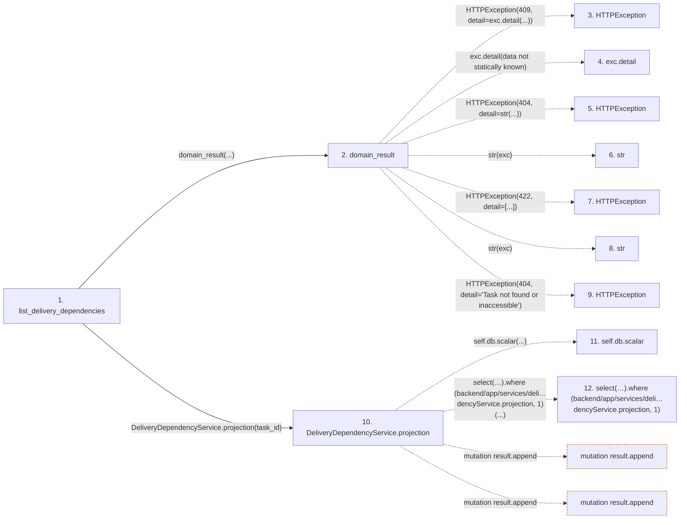

# list_delivery_dependencies

**Entry point:** `list_delivery_dependencies` (`http`)
**Source:** [delivery_dependencies](../modules/delivery_dependencies.md)
**Modules touched:** [authority](../modules/authority.md), [config](../modules/config.md), [delivery_dependencies](../modules/delivery_dependencies.md), [delivery_dependency_service](../modules/delivery_dependency_service.md), and 2 more

**Complete modules touched:**

- [authority](../modules/authority.md)
- [config](../modules/config.md)
- [delivery_dependencies](../modules/delivery_dependencies.md)
- [delivery_dependency_service](../modules/delivery_dependency_service.md)
- [routers_task_domain](../modules/routers_task_domain.md)
- [task_service](../modules/task_service.md)

## Call sequence

> Static overview in presentation order, not runtime execution order. Arrows retain captured callers; representative internal continuations and boundary examples precede repeated helper detail.

```mermaid
sequenceDiagram
    participant p0 as list_delivery_dependencies
    participant p1 as DeliveryDependencyService.projection
    participant p2 as domain_result
    participant p3 as DeliveryDependencyService
    participant p4 as require_project
    participant p5 as DeliveryDependencyService._accepted
    participant p6 as get_settings
    participant p7 as TaskService._task_subtree_ids
    participant p8 as TaskService
    participant p9 as AuthorityError
    participant p10 as Settings
    participant p11 as HTTPException
    participant p12 as self.db.scalar
    participant p13 as exc.detail
    participant p14 as select(…).where (backend/app/services/deli…dencyService.projection, 1)
    participant p15 as select (backend/app/services/deli…pendencyService.projection)
    participant p16 as str
    participant p17 as ValueError
    participant p18 as (…).all (backend/app/services/deli…pendencyService.projection)
    participant p19 as self.db.scalars (backend/app/services/deli…pendencyService.projection)
    participant p20 as select(…).where(…).order_by
    participant p21 as select(…).where (backend/app/services/deli…pendencyService.projection)
    participant p22 as self.db.info.get
    participant p23 as select(…).where (backend/app/services/deli…dencyService.projection, 2)
    p0->>p1: DeliveryDependencyService.projection
    p0->>p2: domain_result
    p0->>p3: DeliveryDependencyService
    p1->>p4: require_project
    p1->>p5: DeliveryDependencyService._accepted
    p4->>p6: get_settings
    p5->>p7: TaskService._task_subtree_ids
    p5->>p8: TaskService
    p4->>p9: AuthorityError
    p6->>p10: Settings
    p2-->>p11: HTTPException(409, detail=exc.detail(...))
    p1-->>p12: self.db.scalar(...)
    p2-->>p13: exc.detail
    p1-->>p14: select(…).where (backend/app/services/deli…dencyService.projection, 1)(...)
    p2-->>p11: HTTPException(404, detail=str(...))
    p1-->>p15: select (backend/app/services/deli…pendencyService.projection)(Task)
    p2-->>p16: str(exc)
    p1-->>p17: ValueError('Task not found or inaccessible')
    p2-->>p11: HTTPException(422, detail=[...])
    p2-->>p16: str(exc)
    p1-->>p18: (…).all (backend/app/services/deli…pendencyService.projection)
    p2-->>p11: HTTPException(404, detail='Task not found or inaccessible')
    p1-->>p19: self.db.scalars (backend/app/services/deli…pendencyService.projection)(...)
    p1-->>p20: select(…).where(…).order_by(DeliveryDependency.id)
    p1-->>p21: select(…).where (backend/app/services/deli…pendencyService.projection)(...)
    p1-->>p15: select (backend/app/services/deli…pendencyService.projection)(DeliveryDependency)
    p1-->>p22: self.db.info.get('authority')
    p1-->>p12: self.db.scalar(...)
    p1-->>p23: select(…).where (backend/app/services/deli…dencyService.projection, 2)(...)
    p1-->>p15: select (backend/app/services/deli…pendencyService.projection)(model)
```

<!-- Auto-generated from static call edges. Dashed arrows are external or unresolved calls. Reviewed runtime conditions and side effects belong in Behavior. -->

> Call sequence diagram shows 30 of 54 interactions; 24 omitted to keep the visualization within the 30-interaction and generated-diagram limits, with uncertain identities omitted rather than inferred.

> Captured boundary calls: external 10 of 15 (5 omitted); unresolved 10 of 27 (17 omitted). These counts cover the captured static trace.

Omitted captured detail, grouped by actual caller occurrence and target module:

| Caller | Parent step | Target module | Kind | Omitted interactions |
| --- | --- | --- | --- | --- |
| `backend/app/authority.py:require_project` | 15 | - | unresolved | 2 |
| `backend/app/authority.py:require_project` | 15 | [backend/app/authority.py](../modules/authority.md) | internal | 1 |
| `backend/app/services/delivery_dependency_service.py:DeliveryDependencyService.projection` | 10 | - | unresolved | 3 |
| `backend/app/services/task_service.py:TaskService._task_subtree_ids` | 34 | - | unresolved | 5 |
| `backend/app/services/task_service.py:TaskService._task_subtree_ids` | 34 | - | external | 1 |
| `backend/app/services/delivery_dependency_service.py:DeliveryDependencyService._accepted` | 33 | - | unresolved | 7 |
| `backend/app/services/delivery_dependency_service.py:DeliveryDependencyService._accepted` | 33 | - | external | 4 |
| `backend/app/services/delivery_dependency_service.py:DeliveryDependencyService._accepted` | 33 | [backend/app/services/delivery_dependency_service.py](../modules/delivery_dependency_service.md) | internal | 1 |
> Detailed flow queries retain their own coverage and limits; omitted paths may execute at runtime.

## Data flow

<!-- Auto-generated static analysis. Treat values and boundaries as best-effort hints, not runtime proof. -->

### Analysis coverage

**Effect analysis partially available.** Flow assembly and source effect analysis are separate; empty observations do not prove an empty handler body.

Source steps: 13; effect analysis evaluated: 8, partial: 0, unavailable: 5. Counts include steps omitted from the displayed trace.

Collector observations for 8 source steps with known totals: observed: 36, emitted: 36, omitted: 0. Unavailable totals are excluded.

- Callable record unavailable for one or more source steps; those steps have no represented callable body.
- Effect collector totals unavailable; observed counts cover captured records only.

| Step | Callable record | Effect analysis | Collector totals | Observed | Emitted | Omitted |
|---|---|---|---|---:|---:|---:|
| `list_delivery_dependencies` | `available` | `evaluated` | `available` | `3` | `3` | `0` |
| `domain_result` | `available` | `evaluated` | `available` | `3` | `3` | `0` |
| `HTTPException` | `not_applicable` | `not_applicable` | `not_applicable` | — | — | — |
| `exc.detail` | `not_applicable` | `not_applicable` | `not_applicable` | — | — | — |
| `HTTPException` | `not_applicable` | `not_applicable` | `not_applicable` | — | — | — |
| `str` | `not_applicable` | `not_applicable` | `not_applicable` | — | — | — |
| `HTTPException` | `not_applicable` | `not_applicable` | `not_applicable` | — | — | — |
| `str` | `not_applicable` | `not_applicable` | `not_applicable` | — | — | — |
| `HTTPException` | `not_applicable` | `not_applicable` | `not_applicable` | — | — | — |
| `DeliveryDependencyService.projection` | `available` | `evaluated` | `available` | `8` | `8` | `0` |
| `self.db.scalar` | `not_applicable` | `not_applicable` | `not_applicable` | — | — | — |
| `select(…).where (backend/app/services/deli…dencyService.projection, 1)` | `not_applicable` | `not_applicable` | `not_applicable` | — | — | — |

### Step data

| Step | Inputs | Reads | Writes | Returns |
|---|---|---|---|---|
| `list_delivery_dependencies` | `task_id: int`, `db: DeliveryDatabase` | - | - | `...` |
| `domain_result` | `awaitable` | `TaskVersionConflictError` | - | `result` |
| `HTTPException` | - | - | - | - |
| `exc.detail` | - | - | - | - |
| `HTTPException` | - | - | - | - |
| `str` | - | - | - | - |
| `HTTPException` | - | - | - | - |
| `str` | - | - | - | - |
| `HTTPException` | - | - | - | - |
| `DeliveryDependencyService.projection` | `task_id` | `Task`, `self.db`, `Task`, `ProjectMilestone` | - | `result` |
| `self.db.scalar` | - | - | - | - |
| `select(…).where (backend/app/services/deli…dencyService.projection, 1)` | - | - | - | - |

### Call data

| From | To | Line | Call |
|---|---|---:|---|
| list_delivery_dependencies | domain_result | 25 | `domain_result(...)` |
| domain_result | HTTPException | 51 | `HTTPException(409, detail=exc.detail(...))` |
| domain_result | exc.detail | 51 | `exc.detail(data not statically known)` |
| domain_result | HTTPException | 53 | `HTTPException(404, detail=str(...))` |
| domain_result | str | 53 | `str(exc)` |
| domain_result | HTTPException | 55 | `HTTPException(422, detail=[...])` |
| domain_result | str | 55 | `str(exc)` |
| domain_result | HTTPException | 57 | `HTTPException(404, detail='Task not found or inaccessible')` |
| list_delivery_dependencies | DeliveryDependencyService.projection | 25 | `DeliveryDependencyService(db).projection(task_id)` |
| DeliveryDependencyService.projection | self.db.scalar | 55 | `self.db.scalar(...)` |
| DeliveryDependencyService.projection | select(…).where (backend/app/services/deli…dencyService.projection, 1) | 55 | `select(Task).where(...)` |

### Boundary effects

| Kind | Target | Step | Line |
|---|---|---|---:|
| mutation | `result.append` | `DeliveryDependencyService.projection` | 70 |
| mutation | `result.append` | `DeliveryDependencyService.projection` | 73 |

### Static analysis gaps

| Kind | Step | Target | Line |
|---|---|---|---:|
| external_call | `domain_result` | `HTTPException` | 51 |
| unresolved_call | `domain_result` | `exc.detail` | 51 |
| external_call | `domain_result` | `HTTPException` | 53 |
| external_call | `domain_result` | `HTTPException` | 55 |
| external_call | `domain_result` | `HTTPException` | 57 |
| unresolved_call | `DeliveryDependencyService.projection` | `self.db.scalar` | 55 |
| unresolved_call | `DeliveryDependencyService.projection` | `select(Task).where` | 55 |
| step_limit | `list_delivery_dependencies` | `first 12 steps` | 0 |

## Behavior

Shows current delivery readiness for an authorized task. A target must have current attributed acceptance; hidden or missing targets expose a generic unavailable blocker without target identity or status.
