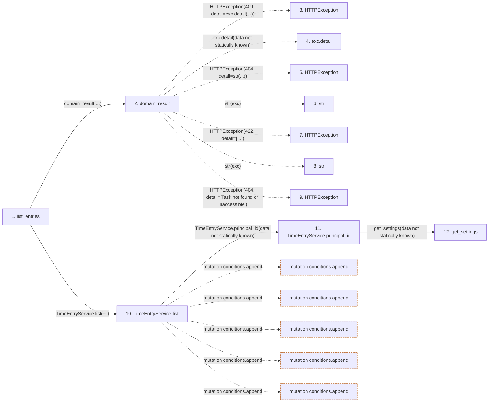

# list_entries

**Entry point:** `list_entries` (`http`)
**Source:** [time_entries](../modules/time_entries.md)
**Modules touched:** [authority](../modules/authority.md), [config](../modules/config.md), [routers_task_domain](../modules/routers_task_domain.md), [schemas_time_entry](../modules/schemas_time_entry.md), and 2 more

**Complete modules touched:**

- [authority](../modules/authority.md)
- [config](../modules/config.md)
- [routers_task_domain](../modules/routers_task_domain.md)
- [schemas_time_entry](../modules/schemas_time_entry.md)
- [time_entries](../modules/time_entries.md)
- [time_entry_service](../modules/time_entry_service.md)

## Call sequence

> Static overview in presentation order, not runtime execution order. Arrows retain captured callers; representative internal continuations and boundary examples precede repeated helper detail.

```mermaid
sequenceDiagram
    participant p0 as list_entries
    participant p1 as TimeEntryService.list
    participant p2 as domain_result
    participant p3 as TimeEntryService
    participant p4 as TimeEntryService.principal_id
    participant p5 as TimeEntryService.project
    participant p6 as TimeEntryService.serialize
    participant p7 as get_settings
    participant p8 as require_project
    participant p9 as TimeEntryService.check_window
    participant p10 as AuthorityError
    participant p11 as TimeEntryResponse
    participant p12 as Settings
    participant p13 as HTTPException
    participant p14 as exc.detail
    participant p15 as ValueError (backend/app/services/time…e.py:TimeEntryService.list)
    participant p16 as str
    participant p17 as TimeEntry.project_id.in_
    participant p18 as select (backend/app/services/time…e.py:TimeEntryService.list)
    participant p19 as conditions.append
    participant p20 as TimeEntry.voided.is_
    participant p21 as self.db.scalar (backend/app/services/time…e.py:TimeEntryService.list)
    participant p22 as select(…).where (backend/app/services/time…y:TimeEntryService.list, 1)
    p0->>p1: TimeEntryService.list
    p0->>p2: domain_result
    p0->>p3: TimeEntryService
    p1->>p4: TimeEntryService.principal_id
    p1->>p5: TimeEntryService.project
    p1->>p6: TimeEntryService.serialize
    p4->>p7: get_settings
    p5->>p8: require_project
    p1->>p9: TimeEntryService.check_window
    p4->>p10: AuthorityError
    p6->>p11: TimeEntryResponse
    p7->>p12: Settings
    p2-->>p13: HTTPException(409, detail=exc.detail(...))
    p2-->>p14: exc.detail
    p2-->>p13: HTTPException(404, detail=str(...))
    p1-->>p15: ValueError (backend/app/services/time…e.py:TimeEntryService.list)('Use bounded time-entry page parameters')
    p2-->>p16: str(exc)
    p2-->>p13: HTTPException(422, detail=[...])
    p1-->>p17: TimeEntry.project_id.in_(select(...))
    p2-->>p16: str(exc)
    p1-->>p18: select (backend/app/services/time…e.py:TimeEntryService.list)(Project.id)
    p2-->>p13: HTTPException(404, detail='Task not found or inaccessible')
    p1-->>p19: conditions.append(...)
    p1-->>p19: conditions.append(...)
    p1-->>p19: conditions.append(...)
    p1-->>p19: conditions.append(...)
    p1-->>p19: conditions.append(TimeEntry.voided.is_(...))
    p1-->>p20: TimeEntry.voided.is_(False)
    p1-->>p21: self.db.scalar (backend/app/services/time…e.py:TimeEntryService.list)(...)
    p1-->>p22: select(…).where (backend/app/services/time…y:TimeEntryService.list, 1)(...)
```

<!-- Auto-generated from static call edges. Dashed arrows are external or unresolved calls. Reviewed runtime conditions and side effects belong in Behavior. -->

> Call sequence diagram shows 30 of 57 interactions; 27 omitted to keep the visualization within the 30-interaction and generated-diagram limits, with uncertain identities omitted rather than inferred.

> Captured boundary calls: external 8 of 18 (10 omitted); unresolved 10 of 22 (12 omitted). These counts cover the captured static trace.

Omitted captured detail, grouped by actual caller occurrence and target module:

| Caller | Parent step | Target module | Kind | Omitted interactions |
| --- | --- | --- | --- | --- |
| `backend/app/services/time_entry_service.py:TimeEntryService.principal_id` | 11 | - | unresolved | 1 |
| `backend/app/services/time_entry_service.py:TimeEntryService.principal_id` | 11 | [backend/app/authority.py](../modules/authority.md) | internal | 1 |
| `backend/app/services/time_entry_service.py:TimeEntryService.check_window` | 17 | - | external | 1 |
| `backend/app/authority.py:require_project` | 21 | - | unresolved | 2 |
| `backend/app/authority.py:require_project` | 21 | [backend/app/config.py](../modules/config.md) | internal | 1 |
| `backend/app/authority.py:require_project` | 21 | [backend/app/authority.py](../modules/authority.md) | internal | 2 |
| `backend/app/services/time_entry_service.py:TimeEntryService.project` | 20 | - | unresolved | 3 |
| `backend/app/services/time_entry_service.py:TimeEntryService.project` | 20 | - | external | 3 |
> Omission summary shows 8 of 13 groups; 5 further groups are not expanded here. Counts above include all omitted interactions.
> Detailed flow queries retain their own coverage and limits; omitted paths may execute at runtime.

## Data flow

<!-- Auto-generated static analysis. Treat values and boundaries as best-effort hints, not runtime proof. -->

### Analysis coverage

**Effect analysis partially available.** Flow assembly and source effect analysis are separate; empty observations do not prove an empty handler body.

Source steps: 18; effect analysis evaluated: 9, partial: 1, unavailable: 8. Counts include steps omitted from the displayed trace.

Collector observations for 10 source steps with known totals: observed: 50, emitted: 49, omitted: 1. Unavailable totals are excluded.

- Callable record unavailable for one or more source steps; those steps have no represented callable body.
- Effect collector omitted observations before flow assembly; displayed effects are partial.
- Effect collector totals unavailable; observed counts cover captured records only.

| Step | Callable record | Effect analysis | Collector totals | Observed | Emitted | Omitted |
|---|---|---|---|---:|---:|---:|
| `list_entries` | `available` | `partial` | `available` | `10` | `9` | `1` |
| `domain_result` | `available` | `evaluated` | `available` | `3` | `3` | `0` |
| `HTTPException` | `not_applicable` | `not_applicable` | `not_applicable` | — | — | — |
| `exc.detail` | `not_applicable` | `not_applicable` | `not_applicable` | — | — | — |
| `HTTPException` | `not_applicable` | `not_applicable` | `not_applicable` | — | — | — |
| `str` | `not_applicable` | `not_applicable` | `not_applicable` | — | — | — |
| `HTTPException` | `not_applicable` | `not_applicable` | `not_applicable` | — | — | — |
| `str` | `not_applicable` | `not_applicable` | `not_applicable` | — | — | — |
| `HTTPException` | `not_applicable` | `not_applicable` | `not_applicable` | — | — | — |
| `TimeEntryService.list` | `available` | `evaluated` | `available` | `20` | `20` | `0` |
| `TimeEntryService.principal_id` | `available` | `evaluated` | `available` | `1` | `1` | `0` |
| `get_settings` | `available` | `evaluated` | `available` | `1` | `1` | `0` |

### Step data

| Step | Inputs | Reads | Writes | Returns |
|---|---|---|---|---|
| `list_entries` | `db: DB`, `project_id: int \| None`, `task_id: int \| None`, `start: date \| None`, `end: date \| None`, `after_id: int`, `upper_id: int \| None`, `limit: int` | - | - | `...` |
| `domain_result` | `awaitable` | `TaskVersionConflictError` | - | `result` |
| `HTTPException` | - | - | - | - |
| `exc.detail` | - | - | - | - |
| `HTTPException` | - | - | - | - |
| `str` | - | - | - | - |
| `HTTPException` | - | - | - | - |
| `str` | - | - | - | - |
| `HTTPException` | - | - | - | - |
| `TimeEntryService.list` | `project_id`, `task_id`, `start`, `end`, `after_id`, `upper_id`, `limit`, `include_voided` | `TimeEntry`, `Project`, `TimeEntry`, `TimeEntry`, `TimeEntry`, `TimeEntry` | - | `{...}` |
| `TimeEntryService.principal_id` | - | - | - | `authority.principal_id` |
| `get_settings` | - | - | - | `Settings(...)` |

### Call data

| From | To | Line | Call |
|---|---|---:|---|
| list_entries | domain_result | 39 | `domain_result(...)` |
| domain_result | HTTPException | 51 | `HTTPException(409, detail=exc.detail(...))` |
| domain_result | exc.detail | 51 | `exc.detail(data not statically known)` |
| domain_result | HTTPException | 53 | `HTTPException(404, detail=str(...))` |
| domain_result | str | 53 | `str(exc)` |
| domain_result | HTTPException | 55 | `HTTPException(422, detail=[...])` |
| domain_result | str | 55 | `str(exc)` |
| domain_result | HTTPException | 57 | `HTTPException(404, detail='Task not found or inaccessible')` |
| list_entries | TimeEntryService.list | 39 | `TimeEntryService(db).list(project_id=project_id, task_id=task_id, start=start, end=end, after_id=after_id, upper_id=upper_id, limit=limit, include_voided=include_voided)` |
| TimeEntryService.list | TimeEntryService.principal_id | 85 | `self.principal_id(data not statically known)` |
| TimeEntryService.principal_id | get_settings | 34 | `get_settings(data not statically known)` |

### Boundary effects

| Kind | Target | Step | Line |
|---|---|---|---:|
| mutation | `conditions.append` | `TimeEntryService.list` | 94 |
| mutation | `conditions.append` | `TimeEntryService.list` | 96 |
| mutation | `conditions.append` | `TimeEntryService.list` | 98 |
| mutation | `conditions.append` | `TimeEntryService.list` | 100 |
| mutation | `conditions.append` | `TimeEntryService.list` | 102 |

### Static analysis gaps

| Kind | Step | Target | Line |
|---|---|---|---:|
| external_call | `domain_result` | `HTTPException` | 51 |
| unresolved_call | `domain_result` | `exc.detail` | 51 |
| external_call | `domain_result` | `HTTPException` | 53 |
| external_call | `domain_result` | `HTTPException` | 55 |
| external_call | `domain_result` | `HTTPException` | 57 |
| step_limit | `list_entries` | `first 12 steps` | 0 |

## Behavior

This flow starts at `list_entries` and is classified as `http`. The generated call and data-flow sections are bounded static projections; runtime conditions and side effects require source-level confirmation.
