# list_outbound_webhook_deliveries

**Entry point:** `list_outbound_webhook_deliveries` (`http`)
**Source:** [outbound_webhooks](../modules/outbound_webhooks.md)
**Modules touched:** [config](../modules/config.md), [language_service](../modules/language_service.md), [outbound_webhooks](../modules/outbound_webhooks.md), [settings_read](../modules/settings_read.md), and 2 more

**Complete modules touched:**

- [config](../modules/config.md)
- [language_service](../modules/language_service.md)
- [outbound_webhooks](../modules/outbound_webhooks.md)
- [settings_read](../modules/settings_read.md)
- [system_settings_service](../modules/system_settings_service.md)
- [url_policy](../modules/url_policy.md)

## Call sequence

> Static overview in presentation order, not runtime execution order. Arrows retain captured callers; representative internal continuations and boundary examples precede repeated helper detail.

```mermaid
sequenceDiagram
    participant p0 as list_outbound_webhook_deliveries
    participant p1 as _bad_request
    participant p2 as redact_webhook_delivery
    participant p3 as withholds
    participant p4 as resolve_runtime_ui_language
    participant p5 as backend_error_message
    participant p6 as RuntimeSettingsService.get_app_settings
    participant p7 as entity_not_found_message
    participant p8 as get_settings
    participant p9 as scoped_entity_not_found_message
    participant p10 as entity_deleted_message
    participant p11 as RuntimeSettingsService.resolve
    participant p12 as localized
    participant p13 as RuntimeSettingsService._definition
    participant p14 as RuntimeSettingsService._decrypt_secret
    participant p15 as RuntimeSettingsService._coerce
    participant p16 as host_only
    participant p17 as normalize_language
    participant p18 as RuntimeSettingsService
    participant p19 as Settings
    participant p20 as RuntimeSettingsService._row
    participant p21 as RuntimeSettingsService._env_value
    participant p22 as RuntimeSettingsError
    participant p23 as RuntimeSettingsService._fernet
    participant p24 as RuntimeSettingsEncryptionError
    participant p25 as normalize_provider_api_url
    participant p26 as HTTPException
    participant p27 as service.list_deliveries
    participant p28 as service.db.info.get
    participant p29 as OutboundWebhookDeliveryResponse.model_validate
    participant p30 as response.model_copy
    p0->>p1: _bad_request
    p0->>p2: redact_webhook_delivery
    p0->>p3: withholds
    p1->>p4: resolve_runtime_ui_language
    p1->>p5: backend_error_message
    p4->>p6: RuntimeSettingsService.get_app_settings
    p5->>p7: entity_not_found_message
    p4->>p8: get_settings
    p5->>p9: scoped_entity_not_found_message
    p5->>p10: entity_deleted_message
    p6->>p11: RuntimeSettingsService.resolve
    p7->>p12: localized
    p11->>p13: RuntimeSettingsService._definition
    p11->>p14: RuntimeSettingsService._decrypt_secret
    p11->>p15: RuntimeSettingsService._coerce
    p2->>p16: host_only
    p4->>p17: normalize_language
    p4->>p18: RuntimeSettingsService
    p8->>p19: Settings
    p11->>p20: RuntimeSettingsService._row
    p11->>p21: RuntimeSettingsService._env_value
    p13->>p22: RuntimeSettingsError
    p14->>p23: RuntimeSettingsService._fernet
    p14->>p24: RuntimeSettingsEncryptionError
    p15->>p25: normalize_provider_api_url
    p1-->>p26: HTTPException(status_code=status.HTTP_400_BAD_REQUEST, detail=backend_error_message(...))
    p0-->>p27: service.list_deliveries(target_id=target_id, status=status_filter, channel=channel, limit=limit)
    p0-->>p28: service.db.info.get('authority')
    p0-->>p29: OutboundWebhookDeliveryResponse.model_validate(delivery)
    p2-->>p30: response.model_copy(update={...})
```

<!-- Auto-generated from static call edges. Dashed arrows are external or unresolved calls. Reviewed runtime conditions and side effects belong in Behavior. -->

> Call sequence diagram shows 30 of 169 interactions; 139 omitted to keep the visualization within the 30-interaction and generated-diagram limits, with uncertain identities omitted rather than inferred.

> Captured boundary calls: external 1 of 47 (46 omitted); unresolved 4 of 74 (70 omitted). These counts cover the captured static trace.

Omitted captured detail, grouped by actual caller occurrence and target module:

| Caller | Parent step | Target module | Kind | Omitted interactions |
| --- | --- | --- | --- | --- |
| `backend/app/services/language_service.py:normalize_language` | 5 | - | unresolved | 2 |
| `backend/app/services/language_service.py:normalize_language` | 5 | - | external | 1 |
| `backend/app/services/system_settings_service.py:RuntimeSettingsService._definition` | 11 | - | unresolved | 1 |
| `backend/app/services/system_settings_service.py:RuntimeSettingsService._row` | 14 | - | unresolved | 3 |
| `backend/app/services/system_settings_service.py:RuntimeSettingsService._row` | 14 | - | external | 1 |
| `backend/app/services/system_settings_service.py:RuntimeSettingsService._decrypt_secret` | 19 | - | unresolved | 3 |
| `backend/app/services/system_settings_service.py:RuntimeSettingsService._coerce` | 25 | - | external | 8 |
| `backend/app/services/system_settings_service.py:RuntimeSettingsService._coerce` | 25 | [backend/app/services/system_settings_service.py](../modules/system_settings_service.md) | internal | 14 |
> Omission summary shows 8 of 29 groups; 21 further groups are not expanded here. Counts above include all omitted interactions.
> Detailed flow queries retain their own coverage and limits; omitted paths may execute at runtime.

> Trace truncated at the depth limit; deeper calls are omitted.

## Data flow

<!-- Auto-generated static analysis. Treat values and boundaries as best-effort hints, not runtime proof. -->

### Analysis coverage

**Effect analysis partially available.** Flow assembly and source effect analysis are separate; empty observations do not prove an empty handler body.

Source steps: 49; effect analysis evaluated: 30, partial: 1, unavailable: 18. Counts include steps omitted from the displayed trace.

Collector observations for 31 source steps with known totals: observed: 157, emitted: 131, omitted: 26. Unavailable totals are excluded.

- Callable record unavailable for one or more source steps; those steps have no represented callable body.
- Effect collector omitted observations before flow assembly; displayed effects are partial.
- Effect collector totals unavailable; observed counts cover captured records only.

| Step | Callable record | Effect analysis | Collector totals | Observed | Emitted | Omitted |
|---|---|---|---|---:|---:|---:|
| `list_outbound_webhook_deliveries` | `available` | `evaluated` | `available` | `8` | `8` | `0` |
| `service.list_deliveries` | `not_applicable` | `not_applicable` | `not_applicable` | — | — | — |
| `_bad_request` | `available` | `evaluated` | `available` | `4` | `4` | `0` |
| `resolve_runtime_ui_language` | `available` | `evaluated` | `available` | `5` | `5` | `0` |
| `normalize_language` | `available` | `evaluated` | `available` | `4` | `4` | `0` |
| `str(…).strip().lower` | `not_applicable` | `not_applicable` | `not_applicable` | — | — | — |
| `str(…).strip (backend/app/services/lang…ice.py:normalize_language)` | `not_applicable` | `not_applicable` | `not_applicable` | — | — | — |
| `str (backend/app/services/lang…ice.py:normalize_language)` | `not_applicable` | `not_applicable` | `not_applicable` | — | — | — |
| `RuntimeSettingsService.get_app_settings` | `available` | `evaluated` | `available` | `1` | `1` | `0` |
| `RuntimeSettingsService.resolve` | `available` | `evaluated` | `available` | `4` | `4` | `0` |
| `RuntimeSettingsService._definition` | `available` | `evaluated` | `available` | `2` | `2` | `0` |
| `SETTING_DEFINITIONS.get` | `not_applicable` | `not_applicable` | `not_applicable` | — | — | — |

```mermaid
flowchart LR
    s1["1. list_outbound_webhook_deliveries"]
    s2["2. service.list_deliveries"]
    s3["3. _bad_request"]
    s4["4. resolve_runtime_ui_language"]
    s5["5. normalize_language"]
    s6["6. str(…).strip().lower"]
    s7["7. str(…).strip (backend/app/services/lang…ice.py:normalize_language)"]
    s8["8. str (backend/app/services/lang…ice.py:normalize_language)"]
    s9["9. RuntimeSettingsService.get_app_settings"]
    s10["10. RuntimeSettingsService.resolve"]
    s11["11. RuntimeSettingsService._definition"]
    s12["12. SETTING_DEFINITIONS.get"]
    s1 -. "service.list_deliveries(target_id=target_id, status=status_filter, channel=channel, limit=limit)" .-> s2
    s1 -->|"_bad_request(service, exc)"| s3
    s3 -->|"resolve_runtime_ui_language(service.db)"| s4
    s4 -->|"normalize_language(default)"| s5
    s5 -. "str(…).strip().lower(data not statically known)" .-> s6
    s5 -. "str(…).strip (backend/app/services/lang…ice.py:normalize_language)(data not statically known)" .-> s7
    s5 -. "str (backend/app/services/lang…ice.py:normalize_language)(...)" .-> s8
    s4 -->|"RuntimeSettingsService.get_app_settings(data not statically known)"| s9
    s9 -->|"RuntimeSettingsService.resolve('app.ui_language')"| s10
    s10 -->|"RuntimeSettingsService._definition(key)"| s11
    s11 -. "SETTING_DEFINITIONS.get(key)" .-> s12
    click s1 "../modules/outbound_webhooks.md"
    click s3 "../modules/outbound_webhooks.md"
    click s4 "../modules/language_service.md"
    click s5 "../modules/language_service.md"
    click s9 "../modules/system_settings_service.md"
    click s10 "../modules/system_settings_service.md"
    click s11 "../modules/system_settings_service.md"
```

### Step data

| Step | Inputs | Reads | Writes | Returns |
|---|---|---|---|---|
| `list_outbound_webhook_deliveries` | `service: Annotated[OutboundWebhookService, Depends(get_outbound_webhook_service)]`, `target_id: Optional[int]`, `status_filter: Optional[str]`, `channel: str`, `limit: int` | `OutboundWebhookValidationError` | - | `deliveries`, `...` |
| `service.list_deliveries` | - | - | - | - |
| `_bad_request` | `service: OutboundWebhookService`, `error: Exception` | `status` | - | `HTTPException(...)` |
| `resolve_runtime_ui_language` | `db: Any`, `default: LanguageCode \| None` | - | - | `normalize_language(...)`, `normalize_language(...)`, `fallback` |
| `normalize_language` | `value: Any`, `default: LanguageCode` | - | - | `normalized`, `default` |
| `str(…).strip().lower` | - | - | - | - |
| `str(…).strip (backend/app/services/lang…ice.py:normalize_language)` | - | - | - | - |
| `str (backend/app/services/lang…ice.py:normalize_language)` | - | - | - | - |
| `RuntimeSettingsService.get_app_settings` | - | - | - | `SimpleNamespace(...)` |
| `RuntimeSettingsService.resolve` | `key: str` | - | - | `(...)`, `(...)`, `(...)` |
| `RuntimeSettingsService._definition` | `key: str` | - | - | `definition` |
| `SETTING_DEFINITIONS.get` | - | - | - | - |

### Call data

| From | To | Line | Call |
|---|---|---:|---|
| list_outbound_webhook_deliveries | service.list_deliveries | 146 | `service.list_deliveries(target_id=target_id, status=status_filter, channel=channel, limit=limit)` |
| list_outbound_webhook_deliveries | _bad_request | 153 | `_bad_request(service, exc)` |
| _bad_request | resolve_runtime_ui_language | 40 | `resolve_runtime_ui_language(service.db)` |
| resolve_runtime_ui_language | normalize_language | 406 | `normalize_language(default)` |
| normalize_language | str(…).strip().lower | 35 | `str(value or '').strip().lower(data not statically known)` |
| normalize_language | str(…).strip (backend/app/services/lang…ice.py:normalize_language) | 35 | `str(value or '').strip(data not statically known)` |
| normalize_language | str (backend/app/services/lang…ice.py:normalize_language) | 35 | `str(...)` |
| resolve_runtime_ui_language | RuntimeSettingsService.get_app_settings | 411 | `RuntimeSettingsService(db).get_app_settings(data not statically known)` |
| RuntimeSettingsService.get_app_settings | RuntimeSettingsService.resolve | 337 | `self.resolve('app.ui_language')` |
| RuntimeSettingsService.resolve | RuntimeSettingsService._definition | 284 | `self._definition(key)` |
| RuntimeSettingsService._definition | SETTING_DEFINITIONS.get | 154 | `SETTING_DEFINITIONS.get(key)` |

### Boundary effects

*No boundary-effect observations were captured in this static trace.*

### Static analysis gaps

| Kind | Step | Target | Line |
|---|---|---|---:|
| unresolved_call | `list_outbound_webhook_deliveries` | `service.list_deliveries` | 146 |
| unresolved_call | `normalize_language` | `str(value or '').strip().lower` | 35 |
| unresolved_call | `normalize_language` | `str(value or '').strip` | 35 |
| unresolved_call | `RuntimeSettingsService._definition` | `SETTING_DEFINITIONS.get` | 154 |
| step_limit | `list_outbound_webhook_deliveries` | `first 12 steps` | 0 |
| truncated_flow | `list_outbound_webhook_deliveries` | `depth limit` | 0 |

## Behavior

This flow starts at `list_outbound_webhook_deliveries` and is classified as `http`. The generated call and data-flow sections are bounded static projections; runtime conditions and side effects require source-level confirmation.
