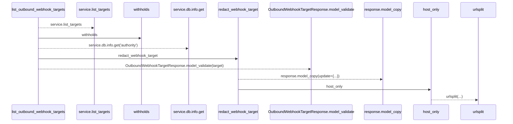
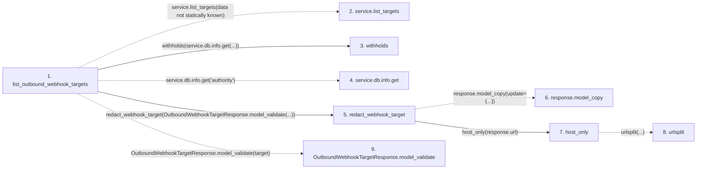

# list_outbound_webhook_targets

**Entry point:** `list_outbound_webhook_targets` (`http`)
**Source:** [outbound_webhooks](../modules/outbound_webhooks.md)
**Modules touched:** [outbound_webhooks](../modules/outbound_webhooks.md), [settings_read](../modules/settings_read.md)

## Call sequence

> Static overview in presentation order, not runtime execution order. Arrows retain captured callers; representative internal continuations and boundary examples precede repeated helper detail.

<!-- Auto-generated from static call edges. Dashed arrows are external or unresolved calls. Reviewed runtime conditions and side effects belong in Behavior. -->

> Call sequence diagram shows 8 of 8 interactions; 0 omitted to keep the visualization within the 30-interaction and generated-diagram limits, with uncertain identities omitted rather than inferred.

> Captured boundary calls: external 1 of 1 (0 omitted); unresolved 4 of 4 (0 omitted). These counts cover the captured static trace.
> Detailed flow queries retain their own coverage and limits; omitted paths may execute at runtime.

## Data flow

<!-- Auto-generated static analysis. Treat values and boundaries as best-effort hints, not runtime proof. -->

### Analysis coverage

**Effect analysis evaluated.** Flow assembly and source effect analysis are separate; empty observations do not prove an empty handler body.

Source steps: 4; effect analysis evaluated: 4, partial: 0, unavailable: 0. Counts include steps omitted from the displayed trace.

Collector observations for 4 source steps with known totals: observed: 10, emitted: 10, omitted: 0. Unavailable totals are excluded.

### Step data

| Step | Inputs | Reads | Writes | Returns |
|---|---|---|---|---|
| `list_outbound_webhook_targets` | `service: Annotated[OutboundWebhookService, Depends(get_outbound_webhook_service)]` | - | - | `targets`, `...` |
| `service.list_targets` | - | - | - | - |
| `withholds` | `authority` | - | - | `...` |
| `service.db.info.get` | - | - | - | - |
| `redact_webhook_target` | `response` | - | - | `response.model_copy(...)` |
| `response.model_copy` | - | - | - | - |
| `host_only` | `url: str \| None` | - | - | `...`, `''` |
| `urlsplit` | - | - | - | - |
| `OutboundWebhookTargetResponse.model_validate` | - | - | - | - |

### Call data

| From | To | Line | Call |
|---|---|---:|---|
| list_outbound_webhook_targets | service.list_targets | 52 | `service.list_targets(data not statically known)` |
| list_outbound_webhook_targets | withholds | 53 | `withholds(service.db.info.get(...))` |
| list_outbound_webhook_targets | service.db.info.get | 53 | `service.db.info.get('authority')` |
| list_outbound_webhook_targets | redact_webhook_target | 55 | `redact_webhook_target(OutboundWebhookTargetResponse.model_validate(...))` |
| redact_webhook_target | response.model_copy | 63 | `response.model_copy(update={...})` |
| redact_webhook_target | host_only | 63 | `host_only(response.url)` |
| host_only | urlsplit | 36 | `urlsplit(...)` |
| list_outbound_webhook_targets | OutboundWebhookTargetResponse.model_validate | 55 | `OutboundWebhookTargetResponse.model_validate(target)` |

### Boundary effects

*No boundary-effect observations were captured in this static trace.*

### Static analysis gaps

| Kind | Step | Target | Line |
|---|---|---|---:|
| unresolved_call | `list_outbound_webhook_targets` | `service.list_targets` | 52 |
| unresolved_call | `list_outbound_webhook_targets` | `service.db.info.get` | 53 |
| unresolved_call | `redact_webhook_target` | `response.model_copy` | 63 |
| external_call | `host_only` | `urlsplit` | 36 |
| unresolved_call | `list_outbound_webhook_targets` | `OutboundWebhookTargetResponse.model_validate` | 55 |

## Behavior

This flow starts at `list_outbound_webhook_targets` and is classified as `http`. The generated call and data-flow sections are bounded static projections; runtime conditions and side effects require source-level confirmation.
