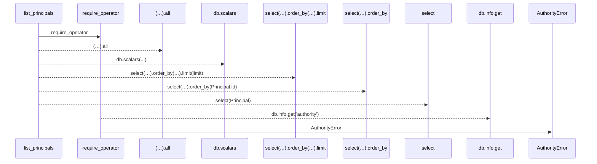
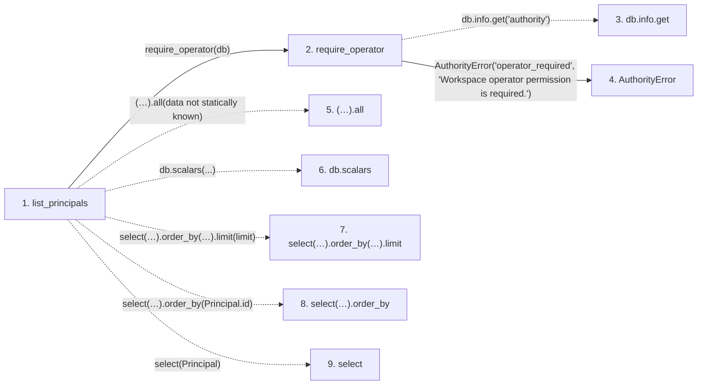

# list_principals

**Entry point:** `list_principals` (`http`)
**Source:** [routers_identity](../modules/routers_identity.md)
**Modules touched:** [authority](../modules/authority.md), [routers_identity](../modules/routers_identity.md)

## Call sequence

> Static overview in presentation order, not runtime execution order. Arrows retain captured callers; representative internal continuations and boundary examples precede repeated helper detail.

<!-- Auto-generated from static call edges. Dashed arrows are external or unresolved calls. Reviewed runtime conditions and side effects belong in Behavior. -->

> Call sequence diagram shows 8 of 8 interactions; 0 omitted to keep the visualization within the 30-interaction and generated-diagram limits, with uncertain identities omitted rather than inferred.

> Captured boundary calls: external 1 of 1 (0 omitted); unresolved 5 of 5 (0 omitted). These counts cover the captured static trace.
> Detailed flow queries retain their own coverage and limits; omitted paths may execute at runtime.

## Data flow

<!-- Auto-generated static analysis. Treat values and boundaries as best-effort hints, not runtime proof. -->

### Analysis coverage

**Effect analysis partially available.** Flow assembly and source effect analysis are separate; empty observations do not prove an empty handler body.

Source steps: 3; effect analysis evaluated: 2, partial: 0, unavailable: 1. Counts include steps omitted from the displayed trace.

Collector observations for 2 source steps with known totals: observed: 4, emitted: 4, omitted: 0. Unavailable totals are excluded.

- Callable record unavailable for one or more source steps; those steps have no represented callable body.
- Effect collector totals unavailable; observed counts cover captured records only.

| Step | Callable record | Effect analysis | Collector totals | Observed | Emitted | Omitted |
|---|---|---|---|---:|---:|---:|
| `list_principals` | `available` | `evaluated` | `available` | `3` | `3` | `0` |
| `require_operator` | `available` | `evaluated` | `available` | `1` | `1` | `0` |
| `db.info.get` | `not_applicable` | `not_applicable` | `not_applicable` | — | — | — |
| `AuthorityError` | `unavailable` | `unavailable` | `unavailable` | — | — | — |
| `(…).all` | `not_applicable` | `not_applicable` | `not_applicable` | — | — | — |
| `db.scalars` | `not_applicable` | `not_applicable` | `not_applicable` | — | — | — |
| `select(…).order_by(…).limit` | `not_applicable` | `not_applicable` | `not_applicable` | — | — | — |
| `select(…).order_by` | `not_applicable` | `not_applicable` | `not_applicable` | — | — | — |
| `select` | `not_applicable` | `not_applicable` | `not_applicable` | — | — | — |

### Step data

| Step | Inputs | Reads | Writes | Returns |
|---|---|---|---|---|
| `list_principals` | `db: Database`, `limit: int` | - | - | `...` |
| `require_operator` | `db` | - | - | - |
| `db.info.get` | - | - | - | - |
| `AuthorityError` | - | - | - | - |
| `(…).all` | - | - | - | - |
| `db.scalars` | - | - | - | - |
| `select(…).order_by(…).limit` | - | - | - | - |
| `select(…).order_by` | - | - | - | - |
| `select` | - | - | - | - |

### Call data

| From | To | Line | Call |
|---|---|---:|---|
| list_principals | require_operator | 235 | `require_operator(db)` |
| require_operator | db.info.get | 79 | `db.info.get('authority')` |
| require_operator | AuthorityError | 81 | `AuthorityError('operator_required', 'Workspace operator permission is required.')` |
| list_principals | (…).all | 236 | `(await db.scalars(select(Principal).order_by(Principal.id).limit(limit))).all(data not statically known)` |
| list_principals | db.scalars | 236 | `db.scalars(...)` |
| list_principals | select(…).order_by(…).limit | 236 | `select(Principal).order_by(Principal.id).limit(limit)` |
| list_principals | select(…).order_by | 236 | `select(Principal).order_by(Principal.id)` |
| list_principals | select | 236 | `select(Principal)` |

### Boundary effects

*No boundary-effect observations were captured in this static trace.*

### Static analysis gaps

| Kind | Step | Target | Line |
|---|---|---|---:|
| unresolved_call | `require_operator` | `db.info.get` | 79 |
| unresolved_call | `list_principals` | `(await db.scalars(select(Principal).order_by(Principal.id).limit(limit))).all` | 236 |
| unresolved_call | `list_principals` | `db.scalars` | 236 |
| unresolved_call | `list_principals` | `select(Principal).order_by(Principal.id).limit` | 236 |
| unresolved_call | `list_principals` | `select(Principal).order_by` | 236 |
| external_call | `list_principals` | `select` | 236 |

## Behavior

This flow starts at `list_principals` and is classified as `http`. The generated call and data-flow sections are bounded static projections; runtime conditions and side effects require source-level confirmation.
