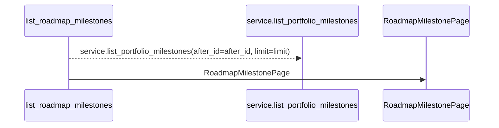
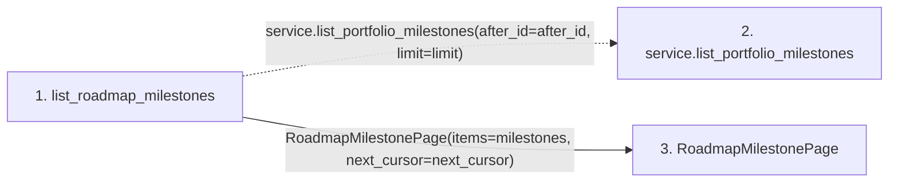

# list_roadmap_milestones

**Entry point:** `list_roadmap_milestones` (`http`)
**Source:** [projects](../modules/projects.md)
**Modules touched:** [projects](../modules/projects.md), [schemas_project](../modules/schemas_project.md)

## Call sequence

> Static overview in presentation order, not runtime execution order. Arrows retain captured callers; representative internal continuations and boundary examples precede repeated helper detail.

<!-- Auto-generated from static call edges. Dashed arrows are external or unresolved calls. Reviewed runtime conditions and side effects belong in Behavior. -->

> Call sequence diagram shows 2 of 2 interactions; 0 omitted to keep the visualization within the 30-interaction and generated-diagram limits, with uncertain identities omitted rather than inferred.

> Captured boundary calls: external 0 of 0 (0 omitted); unresolved 1 of 1 (0 omitted). These counts cover the captured static trace.
> Detailed flow queries retain their own coverage and limits; omitted paths may execute at runtime.

## Data flow

<!-- Auto-generated static analysis. Treat values and boundaries as best-effort hints, not runtime proof. -->

### Analysis coverage

**Effect analysis partially available.** Flow assembly and source effect analysis are separate; empty observations do not prove an empty handler body.

Source steps: 2; effect analysis evaluated: 1, partial: 0, unavailable: 1. Counts include steps omitted from the displayed trace.

Collector observations for 1 source steps with known totals: observed: 4, emitted: 4, omitted: 0. Unavailable totals are excluded.

- Callable record unavailable for one or more source steps; those steps have no represented callable body.
- Effect collector totals unavailable; observed counts cover captured records only.

| Step | Callable record | Effect analysis | Collector totals | Observed | Emitted | Omitted |
|---|---|---|---|---:|---:|---:|
| `list_roadmap_milestones` | `available` | `evaluated` | `available` | `4` | `4` | `0` |
| `service.list_portfolio_milestones` | `not_applicable` | `not_applicable` | `not_applicable` | — | — | — |
| `RoadmapMilestonePage` | `unavailable` | `unavailable` | `unavailable` | — | — | — |

### Step data

| Step | Inputs | Reads | Writes | Returns |
|---|---|---|---|---|
| `list_roadmap_milestones` | `service: Annotated[ProjectService, Depends(get_project_service)]`, `after_id: Annotated[int \| None, Query(ge=0)]`, `limit: Annotated[int, Query(ge=1, le=MAX_BOUNDED_LIST_ITEMS)]` | - | - | `RoadmapMilestonePage(...)` |
| `service.list_portfolio_milestones` | - | - | - | - |
| `RoadmapMilestonePage` | - | - | - | - |

### Call data

| From | To | Line | Call |
|---|---|---:|---|
| list_roadmap_milestones | service.list_portfolio_milestones | 127 | `service.list_portfolio_milestones(after_id=after_id, limit=limit)` |
| list_roadmap_milestones | RoadmapMilestonePage | 131 | `RoadmapMilestonePage(items=milestones, next_cursor=next_cursor)` |

### Boundary effects

*No boundary-effect observations were captured in this static trace.*

### Static analysis gaps

| Kind | Step | Target | Line |
|---|---|---|---:|
| unresolved_call | `list_roadmap_milestones` | `service.list_portfolio_milestones` | 127 |

## Behavior

This flow starts at `list_roadmap_milestones` and is classified as `http`. The generated call and data-flow sections are bounded static projections; runtime conditions and side effects require source-level confirmation.
