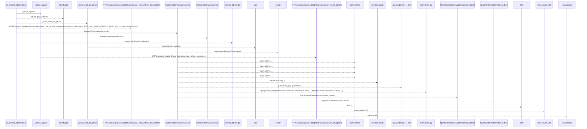
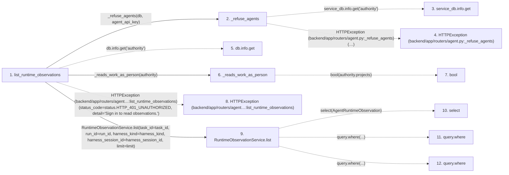

# list_runtime_observations

**Entry point:** `list_runtime_observations` (`http`)
**Source:** [routers_agent](../modules/routers_agent.md)
**Modules touched:** [routers_agent](../modules/routers_agent.md), [runtime_observation_service](../modules/runtime_observation_service.md)

## Call sequence

> Static overview in presentation order, not runtime execution order. Arrows retain captured callers; representative internal continuations and boundary examples precede repeated helper detail.

<!-- Auto-generated from static call edges. Dashed arrows are external or unresolved calls. Reviewed runtime conditions and side effects belong in Behavior. -->

> Call sequence diagram shows 22 of 22 interactions; 0 omitted to keep the visualization within the 30-interaction and generated-diagram limits, with uncertain identities omitted rather than inferred.

> Captured boundary calls: external 5 of 5 (0 omitted); unresolved 13 of 13 (0 omitted). These counts cover the captured static trace.
> Detailed flow queries retain their own coverage and limits; omitted paths may execute at runtime.

## Data flow

<!-- Auto-generated static analysis. Treat values and boundaries as best-effort hints, not runtime proof. -->

### Analysis coverage

**Effect analysis partially available.** Flow assembly and source effect analysis are separate; empty observations do not prove an empty handler body.

Source steps: 5; effect analysis evaluated: 4, partial: 0, unavailable: 1. Counts include steps omitted from the displayed trace.

Collector observations for 4 source steps with known totals: observed: 25, emitted: 25, omitted: 0. Unavailable totals are excluded.

- Callable record unavailable for one or more source steps; those steps have no represented callable body.
- Effect collector totals unavailable; observed counts cover captured records only.

| Step | Callable record | Effect analysis | Collector totals | Observed | Emitted | Omitted |
|---|---|---|---|---:|---:|---:|
| `list_runtime_observations` | `available` | `evaluated` | `available` | `9` | `9` | `0` |
| `_refuse_agents` | `available` | `evaluated` | `available` | `3` | `3` | `0` |
| `service_db.info.get` | `not_applicable` | `not_applicable` | `not_applicable` | — | — | — |
| `HTTPException (backend/app/routers/agent.py:_refuse_agents)` | `not_applicable` | `not_applicable` | `not_applicable` | — | — | — |
| `db.info.get` | `not_applicable` | `not_applicable` | `not_applicable` | — | — | — |
| `_reads_work_as_person` | `available` | `evaluated` | `available` | `2` | `2` | `0` |
| `bool` | `not_applicable` | `not_applicable` | `not_applicable` | — | — | — |
| `HTTPException (backend/app/routers/agent…:list_runtime_observations)` | `not_applicable` | `not_applicable` | `not_applicable` | — | — | — |
| `RuntimeObservationService.list` | `available` | `evaluated` | `available` | `11` | `11` | `0` |
| `select` | `not_applicable` | `not_applicable` | `not_applicable` | — | — | — |
| `query.where` | `not_applicable` | `not_applicable` | `not_applicable` | — | — | — |
| `query.where` | `not_applicable` | `not_applicable` | `not_applicable` | — | — | — |

### Step data

| Step | Inputs | Reads | Writes | Returns |
|---|---|---|---|---|
| `list_runtime_observations` | `db: Annotated[AsyncSession, Depends(get_db, scope='function')]`, `agent_api_key: Annotated[Optional[str], Header(alias='X-Agent-API-Key')]`, `task_id: Optional[int]`, `run_id: Optional[int]`, `harness_kind: Optional[str]`, `harness_session_id: Optional[str]`, `limit: int` | `status` | - | `...` |
| `_refuse_agents` | `service_db`, `agent_api_key` | `status` | - | - |
| `service_db.info.get` | - | - | - | - |
| `HTTPException (backend/app/routers/agent.py:_refuse_agents)` | - | - | - | - |
| `db.info.get` | - | - | - | - |
| `_reads_work_as_person` | `authority` | - | - | `...` |
| `bool` | - | - | - | - |
| `HTTPException (backend/app/routers/agent…:list_runtime_observations)` | - | - | - | - |
| `RuntimeObservationService.list` | `task_id`, `run_id`, `harness_kind`, `harness_session_id`, `limit` | `AgentRuntimeObservation`, `AgentRuntimeObservation`, `AgentRuntimeObservation`, `AgentRuntimeObservation`, `AgentRuntimeObservation` | - | `list(...)` |
| `select` | - | - | - | - |
| `query.where` | - | - | - | - |
| `query.where` | - | - | - | - |

### Call data

| From | To | Line | Call |
|---|---|---:|---|
| list_runtime_observations | _refuse_agents | 1560 | `_refuse_agents(db, agent_api_key)` |
| _refuse_agents | service_db.info.get | 1518 | `service_db.info.get('authority')` |
| _refuse_agents | HTTPException (backend/app/routers/agent.py:_refuse_agents) | 1520 | `HTTPException(status_code=status.HTTP_403_FORBIDDEN, detail='Runtime observations are advisory and are not available to agents.')` |
| list_runtime_observations | db.info.get | 1561 | `db.info.get('authority')` |
| list_runtime_observations | _reads_work_as_person | 1562 | `_reads_work_as_person(authority)` |
| _reads_work_as_person | bool | 267 | `bool(authority.projects)` |
| list_runtime_observations | HTTPException (backend/app/routers/agent…:list_runtime_observations) | 1563 | `HTTPException(status_code=status.HTTP_401_UNAUTHORIZED, detail='Sign in to read observations.')` |
| list_runtime_observations | RuntimeObservationService.list | 1564 | `RuntimeObservationService(db).list(task_id=task_id, run_id=run_id, harness_kind=harness_kind, harness_session_id=harness_session_id, limit=limit)` |
| RuntimeObservationService.list | select | 100 | `select(AgentRuntimeObservation)` |
| RuntimeObservationService.list | query.where | 102 | `query.where(...)` |
| RuntimeObservationService.list | query.where | 104 | `query.where(...)` |

### Boundary effects

*No boundary-effect observations were captured in this static trace.*

### Static analysis gaps

| Kind | Step | Target | Line |
|---|---|---|---:|
| unresolved_call | `_refuse_agents` | `service_db.info.get` | 1518 |
| external_call | `_refuse_agents` | `HTTPException` | 1520 |
| unresolved_call | `list_runtime_observations` | `db.info.get` | 1561 |
| external_call | `list_runtime_observations` | `HTTPException` | 1563 |
| external_call | `RuntimeObservationService.list` | `select` | 100 |
| unresolved_call | `RuntimeObservationService.list` | `query.where` | 102 |
| unresolved_call | `RuntimeObservationService.list` | `query.where` | 104 |
| step_limit | `list_runtime_observations` | `first 12 steps` | 0 |

## Behavior

Lists observations for people (on the pipeline's read rule), observers and operators, newest first, filtered by task, run or harness session. The request's task read scope applies, so rows without a task are visible only to operators and trusted-local readers. Agent keys get 403, so agents cannot steer on observations.
