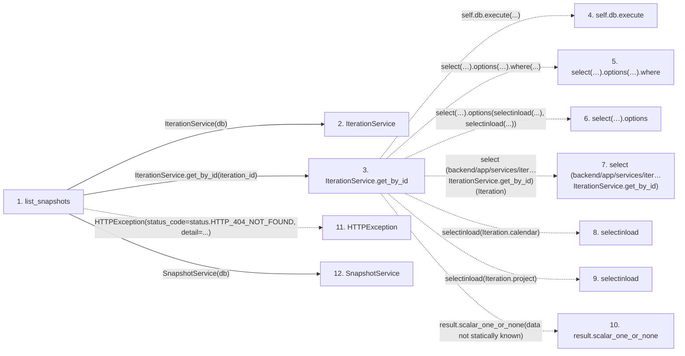

# list_snapshots

**Entry point:** `list_snapshots` (`http`)
**Source:** [snapshots](../modules/snapshots.md)
**Modules touched:** [config](../modules/config.md), [iteration_service](../modules/iteration_service.md), [snapshot_service](../modules/snapshot_service.md), [snapshots](../modules/snapshots.md)

## Call sequence

> Static overview in presentation order, not runtime execution order. Arrows retain captured callers; representative internal continuations and boundary examples precede repeated helper detail.

```mermaid
sequenceDiagram
    participant p0 as list_snapshots
    participant p1 as SnapshotService.list_snapshots
    participant p2 as IterationService
    participant p3 as IterationService.get_by_id
    participant p4 as SnapshotService
    participant p5 as SnapshotService._encode
    participant p6 as get_settings
    participant p7 as SnapshotService._payload_visible
    participant p8 as Settings
    participant p9 as HTTPException
    participant p10 as self.db.execute
    participant p11 as str
    participant p12 as (…).all
    participant p13 as select(…).options(…).where
    participant p14 as self.db.scalars
    participant p15 as select(…).options
    participant p16 as select(…).where(…).order_by(…).limit
    participant p17 as select (backend/app/services/iter…IterationService.get_by_id)
    participant p18 as select(…).where(…).order_by
    participant p19 as selectinload
    participant p20 as select(…).where
    participant p21 as select (backend/app/services/snap…shotService.list_snapshots)
    participant p22 as result.scalar_one_or_none
    participant p23 as ApplicationSnapshot.created_at.desc
    participant p24 as ApplicationSnapshot.id.desc
    participant p25 as row.created_at.isoformat
    participant p26 as row.payload.get(…).get
    participant p27 as row.payload.get
    participant p28 as len (backend/app/services/snap…shotService.list_snapshots)
    p0->>p1: SnapshotService.list_snapshots
    p0->>p2: IterationService
    p0->>p3: IterationService.get_by_id
    p0->>p4: SnapshotService
    p1->>p5: SnapshotService._encode
    p5->>p6: get_settings
    p1->>p7: SnapshotService._payload_visible
    p6->>p8: Settings
    p0-->>p9: HTTPException(status_code=status.HTTP_404_NOT_FOUND, detail=...)
    p3-->>p10: self.db.execute(...)
    p0-->>p9: HTTPException(status_code=status.HTTP_400_BAD_REQUEST, detail=str(...))
    p0-->>p11: str(exc)
    p1-->>p12: (…).all
    p3-->>p13: select(…).options(…).where(...)
    p1-->>p14: self.db.scalars(...)
    p3-->>p15: select(…).options(selectinload(...), selectinload(...))
    p1-->>p16: select(…).where(…).order_by(…).limit(100)
    p3-->>p17: select (backend/app/services/iter…IterationService.get_by_id)(Iteration)
    p1-->>p18: select(…).where(…).order_by(ApplicationSnapshot.created_at.desc(...), ApplicationSnapshot.id.desc(...))
    p3-->>p19: selectinload(Iteration.calendar)
    p1-->>p20: select(…).where(...)
    p3-->>p19: selectinload(Iteration.project)
    p1-->>p21: select (backend/app/services/snap…shotService.list_snapshots)(ApplicationSnapshot)
    p3-->>p22: result.scalar_one_or_none
    p1-->>p23: ApplicationSnapshot.created_at.desc
    p1-->>p24: ApplicationSnapshot.id.desc
    p1-->>p25: row.created_at.isoformat
    p1-->>p26: row.payload.get(…).get('reason', 'unknown')
    p1-->>p27: row.payload.get('snapshot_info', {...})
    p1-->>p28: len (backend/app/services/snap…shotService.list_snapshots)(self._encode(...))
```

<!-- Auto-generated from static call edges. Dashed arrows are external or unresolved calls. Reviewed runtime conditions and side effects belong in Behavior. -->

> Call sequence diagram shows 30 of 42 interactions; 12 omitted to keep the visualization within the 30-interaction and generated-diagram limits, with uncertain identities omitted rather than inferred.

> Captured boundary calls: external 8 of 12 (4 omitted); unresolved 14 of 22 (8 omitted). These counts cover the captured static trace.

Omitted captured detail, grouped by actual caller occurrence and target module:

| Caller | Parent step | Target module | Kind | Omitted interactions |
| --- | --- | --- | --- | --- |
| `backend/app/services/snapshot_service.py:SnapshotService._payload_visible` | 22 | - | unresolved | 7 |
| `backend/app/services/snapshot_service.py:SnapshotService._payload_visible` | 22 | - | external | 1 |
| `backend/app/services/snapshot_service.py:SnapshotService._encode` | 35 | - | unresolved | 1 |
| `backend/app/services/snapshot_service.py:SnapshotService._encode` | 35 | - | external | 3 |
> Detailed flow queries retain their own coverage and limits; omitted paths may execute at runtime.

## Data flow

<!-- Auto-generated static analysis. Treat values and boundaries as best-effort hints, not runtime proof. -->

### Analysis coverage

**Effect analysis partially available.** Flow assembly and source effect analysis are separate; empty observations do not prove an empty handler body.

Source steps: 9; effect analysis evaluated: 6, partial: 0, unavailable: 3. Counts include steps omitted from the displayed trace.

Collector observations for 6 source steps with known totals: observed: 20, emitted: 20, omitted: 0. Unavailable totals are excluded.

- Callable record unavailable for one or more source steps; those steps have no represented callable body.
- Effect collector totals unavailable; observed counts cover captured records only.

| Step | Callable record | Effect analysis | Collector totals | Observed | Emitted | Omitted |
|---|---|---|---|---:|---:|---:|
| `list_snapshots` | `available` | `evaluated` | `available` | `6` | `6` | `0` |
| `IterationService` | `unavailable` | `unavailable` | `unavailable` | — | — | — |
| `IterationService.get_by_id` | `available` | `evaluated` | `available` | `3` | `3` | `0` |
| `self.db.execute` | `not_applicable` | `not_applicable` | `not_applicable` | — | — | — |
| `select(…).options(…).where` | `not_applicable` | `not_applicable` | `not_applicable` | — | — | — |
| `select(…).options` | `not_applicable` | `not_applicable` | `not_applicable` | — | — | — |
| `select (backend/app/services/iter…IterationService.get_by_id)` | `not_applicable` | `not_applicable` | `not_applicable` | — | — | — |
| `selectinload` | `not_applicable` | `not_applicable` | `not_applicable` | — | — | — |
| `selectinload` | `not_applicable` | `not_applicable` | `not_applicable` | — | — | — |
| `result.scalar_one_or_none` | `not_applicable` | `not_applicable` | `not_applicable` | — | — | — |
| `HTTPException` | `not_applicable` | `not_applicable` | `not_applicable` | — | — | — |
| `SnapshotService` | `unavailable` | `unavailable` | `unavailable` | — | — | — |

### Step data

| Step | Inputs | Reads | Writes | Returns |
|---|---|---|---|---|
| `list_snapshots` | `iteration_id: int`, `db: Annotated[AsyncSession, Depends(get_db, scope='function')]` | `status`, `SnapshotPathError`, `status` | - | `...` |
| `IterationService` | - | - | - | - |
| `IterationService.get_by_id` | `iteration_id: int` | `Iteration` | - | `result.scalar_one_or_none(...)` |
| `self.db.execute` | - | - | - | - |
| `select(…).options(…).where` | - | - | - | - |
| `select(…).options` | - | - | - | - |
| `select (backend/app/services/iter…IterationService.get_by_id)` | - | - | - | - |
| `selectinload` | - | - | - | - |
| `selectinload` | - | - | - | - |
| `result.scalar_one_or_none` | - | - | - | - |
| `HTTPException` | - | - | - | - |
| `SnapshotService` | - | - | - | - |

### Call data

| From | To | Line | Call |
|---|---|---:|---|
| list_snapshots | IterationService | 190 | `IterationService(db)` |
| list_snapshots | IterationService.get_by_id | 191 | `iteration_service.get_by_id(iteration_id)` |
| IterationService.get_by_id | self.db.execute | 323 | `self.db.execute(...)` |
| IterationService.get_by_id | select(…).options(…).where | 324 | `select(Iteration).options(selectinload(Iteration.calendar), selectinload(Iteration.project)).where(...)` |
| IterationService.get_by_id | select(…).options | 324 | `select(Iteration).options(selectinload(...), selectinload(...))` |
| IterationService.get_by_id | select (backend/app/services/iter…IterationService.get_by_id) | 324 | `select(Iteration)` |
| IterationService.get_by_id | selectinload | 326 | `selectinload(Iteration.calendar)` |
| IterationService.get_by_id | selectinload | 327 | `selectinload(Iteration.project)` |
| IterationService.get_by_id | result.scalar_one_or_none | 331 | `result.scalar_one_or_none(data not statically known)` |
| list_snapshots | HTTPException | 194 | `HTTPException(status_code=status.HTTP_404_NOT_FOUND, detail=...)` |
| list_snapshots | SnapshotService | 199 | `SnapshotService(db)` |

### Boundary effects

*No boundary-effect observations were captured in this static trace.*

### Static analysis gaps

| Kind | Step | Target | Line |
|---|---|---|---:|
| unresolved_call | `IterationService.get_by_id` | `self.db.execute` | 323 |
| unresolved_call | `IterationService.get_by_id` | `select(Iteration).options(selectinload(Iteration.calendar), selectinload(Iteration.project)).where` | 324 |
| unresolved_call | `IterationService.get_by_id` | `select(Iteration).options` | 324 |
| external_call | `IterationService.get_by_id` | `select` | 324 |
| external_call | `IterationService.get_by_id` | `selectinload` | 326 |
| external_call | `IterationService.get_by_id` | `selectinload` | 327 |
| unresolved_call | `IterationService.get_by_id` | `result.scalar_one_or_none` | 331 |
| external_call | `list_snapshots` | `HTTPException` | 194 |
| step_limit | `list_snapshots` | `first 12 steps` | 0 |

## Behavior

This flow starts at `list_snapshots` and is classified as `http`. The generated call and data-flow sections are bounded static projections; runtime conditions and side effects require source-level confirmation.
