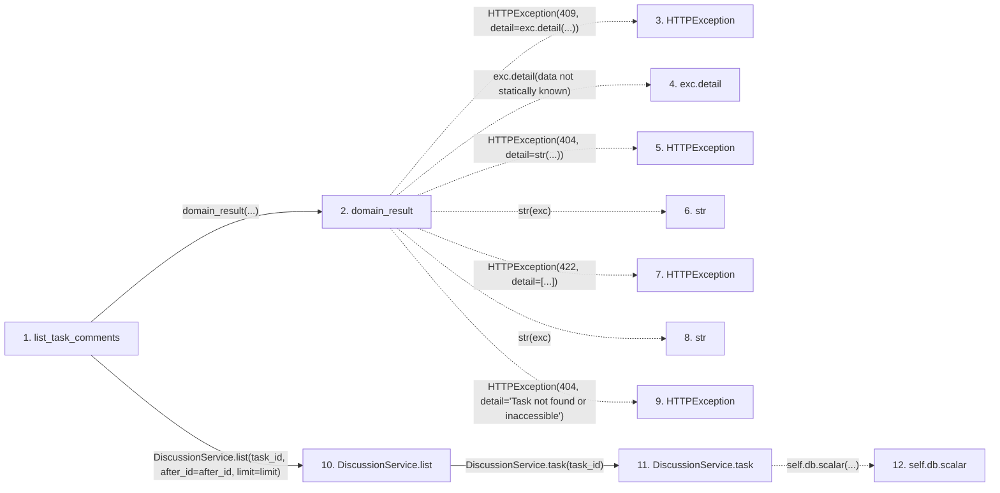

# list_task_comments

**Entry point:** `list_task_comments` (`http`)
**Source:** [routers_discussion](../modules/routers_discussion.md)
**Modules touched:** [authority](../modules/authority.md), [config](../modules/config.md), [discussion_service](../modules/discussion_service.md), [routers_discussion](../modules/routers_discussion.md), and 1 more

**Complete modules touched:**

- [authority](../modules/authority.md)
- [config](../modules/config.md)
- [discussion_service](../modules/discussion_service.md)
- [routers_discussion](../modules/routers_discussion.md)
- [routers_task_domain](../modules/routers_task_domain.md)

## Call sequence

> Static overview in presentation order, not runtime execution order. Arrows retain captured callers; representative internal continuations and boundary examples precede repeated helper detail.

```mermaid
sequenceDiagram
    participant p0 as list_task_comments
    participant p1 as DiscussionService.list
    participant p2 as domain_result
    participant p3 as DiscussionService
    participant p4 as DiscussionService.task
    participant p5 as require_project
    participant p6 as get_settings
    participant p7 as DiscussionService.serialize
    participant p8 as AuthorityError
    participant p9 as internal_authority
    participant p10 as Settings
    participant p11 as HTTPException
    participant p12 as exc.detail
    participant p13 as ValueError (backend/app/services/disc….py:DiscussionService.list)
    participant p14 as (…).all
    participant p15 as str
    participant p16 as self.db.execute (backend/app/services/disc….py:DiscussionService.list)
    participant p17 as select(…).join(…).where(…).order_by(…).limit
    participant p18 as select(…).join(…).where(…).order_by
    participant p19 as select(…).join(…).where
    participant p20 as select(…).join
    participant p21 as select (backend/app/services/disc….py:DiscussionService.list)
    participant p22 as len
    participant p23 as self.db.scalar
    participant p24 as select(…).where(…).execution_options
    participant p25 as select(…).where
    p0->>p1: DiscussionService.list
    p0->>p2: domain_result
    p0->>p3: DiscussionService
    p1->>p4: DiscussionService.task
    p4->>p5: require_project
    p5->>p6: get_settings
    p1->>p7: DiscussionService.serialize
    p4->>p8: AuthorityError
    p4->>p9: internal_authority
    p6->>p10: Settings
    p2-->>p11: HTTPException(409, detail=exc.detail(...))
    p2-->>p12: exc.detail
    p1-->>p13: ValueError (backend/app/services/disc….py:DiscussionService.list)('Use a limit from 1 to 100 and a nonnegative cursor')
    p2-->>p11: HTTPException(404, detail=str(...))
    p1-->>p14: (…).all
    p2-->>p15: str(exc)
    p1-->>p16: self.db.execute (backend/app/services/disc….py:DiscussionService.list)(...)
    p2-->>p11: HTTPException(422, detail=[...])
    p1-->>p17: select(…).join(…).where(…).order_by(…).limit(...)
    p2-->>p15: str(exc)
    p1-->>p18: select(…).join(…).where(…).order_by(TaskComment.id)
    p2-->>p11: HTTPException(404, detail='Task not found or inaccessible')
    p1-->>p19: select(…).join(…).where(..., ...)
    p1-->>p20: select(…).join(Principal, ...)
    p1-->>p21: select (backend/app/services/disc….py:DiscussionService.list)(TaskComment, Principal.display_name)
    p1-->>p22: len(rows)
    p1-->>p22: len(rows)
    p4-->>p23: self.db.scalar(...)
    p4-->>p24: select(…).where(…).execution_options(populate_existing=True)
    p4-->>p25: select(…).where(...)
```

<!-- Auto-generated from static call edges. Dashed arrows are external or unresolved calls. Reviewed runtime conditions and side effects belong in Behavior. -->

> Call sequence diagram shows 30 of 46 interactions; 16 omitted to keep the visualization within the 30-interaction and generated-diagram limits, with uncertain identities omitted rather than inferred.

> Captured boundary calls: external 10 of 14 (4 omitted); unresolved 10 of 19 (9 omitted). These counts cover the captured static trace.

Omitted captured detail, grouped by actual caller occurrence and target module:

| Caller | Parent step | Target module | Kind | Omitted interactions |
| --- | --- | --- | --- | --- |
| `backend/app/services/discussion_service.py:DiscussionService.task` | 11 | - | external | 4 |
| `backend/app/authority.py:require_project` | 17 | - | unresolved | 2 |
| `backend/app/authority.py:require_project` | 17 | [backend/app/authority.py](../modules/authority.md) | internal | 2 |
| `backend/app/services/discussion_service.py:DiscussionService.task` | 11 | - | unresolved | 6 |
| `backend/app/authority.py:internal_authority` | 28 | - | unresolved | 1 |
| `backend/app/services/discussion_service.py:DiscussionService.task` | 11 | [backend/app/services/discussion_service.py](../modules/discussion_service.md) | internal | 1 |
> Detailed flow queries retain their own coverage and limits; omitted paths may execute at runtime.

## Data flow

<!-- Auto-generated static analysis. Treat values and boundaries as best-effort hints, not runtime proof. -->

### Analysis coverage

**Effect analysis partially available.** Flow assembly and source effect analysis are separate; empty observations do not prove an empty handler body.

Source steps: 14; effect analysis evaluated: 9, partial: 0, unavailable: 5. Counts include steps omitted from the displayed trace.

Collector observations for 9 source steps with known totals: observed: 37, emitted: 37, omitted: 0. Unavailable totals are excluded.

- Callable record unavailable for one or more source steps; those steps have no represented callable body.
- Effect collector totals unavailable; observed counts cover captured records only.

| Step | Callable record | Effect analysis | Collector totals | Observed | Emitted | Omitted |
|---|---|---|---|---:|---:|---:|
| `list_task_comments` | `available` | `evaluated` | `available` | `5` | `5` | `0` |
| `domain_result` | `available` | `evaluated` | `available` | `3` | `3` | `0` |
| `HTTPException` | `not_applicable` | `not_applicable` | `not_applicable` | — | — | — |
| `exc.detail` | `not_applicable` | `not_applicable` | `not_applicable` | — | — | — |
| `HTTPException` | `not_applicable` | `not_applicable` | `not_applicable` | — | — | — |
| `str` | `not_applicable` | `not_applicable` | `not_applicable` | — | — | — |
| `HTTPException` | `not_applicable` | `not_applicable` | `not_applicable` | — | — | — |
| `str` | `not_applicable` | `not_applicable` | `not_applicable` | — | — | — |
| `HTTPException` | `not_applicable` | `not_applicable` | `not_applicable` | — | — | — |
| `DiscussionService.list` | `available` | `evaluated` | `available` | `4` | `4` | `0` |
| `DiscussionService.task` | `available` | `evaluated` | `available` | `7` | `7` | `0` |
| `self.db.scalar` | `not_applicable` | `not_applicable` | `not_applicable` | — | — | — |

### Step data

| Step | Inputs | Reads | Writes | Returns |
|---|---|---|---|---|
| `list_task_comments` | `task_id: int`, `db: DiscussionDatabase`, `after_id: int`, `limit: int` | - | - | `...` |
| `domain_result` | `awaitable` | `TaskVersionConflictError` | - | `result` |
| `HTTPException` | - | - | - | - |
| `exc.detail` | - | - | - | - |
| `HTTPException` | - | - | - | - |
| `str` | - | - | - | - |
| `HTTPException` | - | - | - | - |
| `str` | - | - | - | - |
| `HTTPException` | - | - | - | - |
| `DiscussionService.list` | `task_id`, `after_id`, `limit` | - | - | `{...}` |
| `DiscussionService.task` | `task_id`, `writing`, `lock` | `self.db`, `self.db` | - | `...`, `task` |
| `self.db.scalar` | - | - | - | - |

### Call data

| From | To | Line | Call |
|---|---|---:|---|
| list_task_comments | domain_result | 39 | `domain_result(...)` |
| domain_result | HTTPException | 51 | `HTTPException(409, detail=exc.detail(...))` |
| domain_result | exc.detail | 51 | `exc.detail(data not statically known)` |
| domain_result | HTTPException | 53 | `HTTPException(404, detail=str(...))` |
| domain_result | str | 53 | `str(exc)` |
| domain_result | HTTPException | 55 | `HTTPException(422, detail=[...])` |
| domain_result | str | 55 | `str(exc)` |
| domain_result | HTTPException | 57 | `HTTPException(404, detail='Task not found or inaccessible')` |
| list_task_comments | DiscussionService.list | 39 | `DiscussionService(db).list(task_id, after_id=after_id, limit=limit)` |
| DiscussionService.list | DiscussionService.task | 81 | `self.task(task_id)` |
| DiscussionService.task | self.db.scalar | 30 | `self.db.scalar(...)` |

### Boundary effects

*No boundary-effect observations were captured in this static trace.*

### Static analysis gaps

| Kind | Step | Target | Line |
|---|---|---|---:|
| external_call | `domain_result` | `HTTPException` | 51 |
| unresolved_call | `domain_result` | `exc.detail` | 51 |
| external_call | `domain_result` | `HTTPException` | 53 |
| external_call | `domain_result` | `HTTPException` | 55 |
| external_call | `domain_result` | `HTTPException` | 57 |
| unresolved_call | `DiscussionService.task` | `self.db.scalar` | 30 |
| step_limit | `list_task_comments` | `first 12 steps` | 0 |

## Behavior

Returns a bounded cursor page of discussion for an accessible task. Original task identity preserves attribution and history after supported restoration. Missing and inaccessible task scope use the same unavailable boundary.
