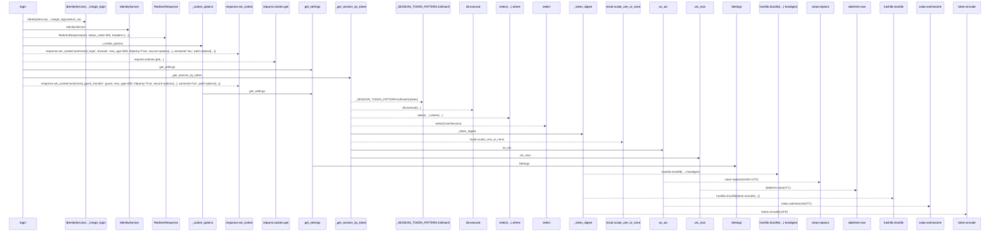
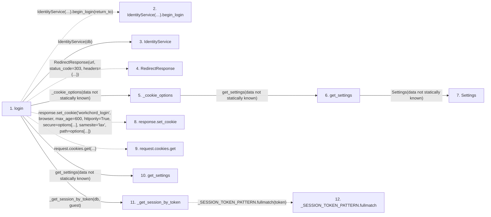

# login

**Entry point:** `login` (`http`)
**Source:** [routers_identity](../modules/routers_identity.md)
**Modules touched:** [config](../modules/config.md), [identity_service](../modules/identity_service.md), [routers_identity](../modules/routers_identity.md), [session_service](../modules/session_service.md), [time](../modules/time.md)

## Call sequence

> Static overview in presentation order, not runtime execution order. Arrows retain captured callers; representative internal continuations and boundary examples precede repeated helper detail.

<!-- Auto-generated from static call edges. Dashed arrows are external or unresolved calls. Reviewed runtime conditions and side effects belong in Behavior. -->

> Call sequence diagram shows 25 of 25 interactions; 0 omitted to keep the visualization within the 30-interaction and generated-diagram limits, with uncertain identities omitted rather than inferred.

> Captured boundary calls: external 4 of 4 (0 omitted); unresolved 12 of 12 (0 omitted). These counts cover the captured static trace.
> Detailed flow queries retain their own coverage and limits; omitted paths may execute at runtime.

## Data flow

<!-- Auto-generated static analysis. Treat values and boundaries as best-effort hints, not runtime proof. -->

### Analysis coverage

**Effect analysis partially available.** Flow assembly and source effect analysis are separate; empty observations do not prove an empty handler body.

Source steps: 10; effect analysis evaluated: 8, partial: 0, unavailable: 2. Counts include steps omitted from the displayed trace.

Collector observations for 8 source steps with known totals: observed: 23, emitted: 23, omitted: 0. Unavailable totals are excluded.

- Callable record unavailable for one or more source steps; those steps have no represented callable body.
- Effect collector totals unavailable; observed counts cover captured records only.

| Step | Callable record | Effect analysis | Collector totals | Observed | Emitted | Omitted |
|---|---|---|---|---:|---:|---:|
| `login` | `available` | `evaluated` | `available` | `4` | `4` | `0` |
| `IdentityService(…).begin_login` | `not_applicable` | `not_applicable` | `not_applicable` | — | — | — |
| `IdentityService` | `unavailable` | `unavailable` | `unavailable` | — | — | — |
| `RedirectResponse` | `not_applicable` | `not_applicable` | `not_applicable` | — | — | — |
| `_cookie_options` | `available` | `evaluated` | `available` | `1` | `1` | `0` |
| `get_settings` | `available` | `evaluated` | `available` | `1` | `1` | `0` |
| `Settings` | `unavailable` | `unavailable` | `unavailable` | — | — | — |
| `response.set_cookie` | `not_applicable` | `not_applicable` | `not_applicable` | — | — | — |
| `request.cookies.get` | `not_applicable` | `not_applicable` | `not_applicable` | — | — | — |
| `get_settings` | `available` | `evaluated` | `available` | `1` | `1` | `0` |
| `_get_session_by_token` | `available` | `evaluated` | `available` | `7` | `7` | `0` |
| `_SESSION_TOKEN_PATTERN.fullmatch` | `not_applicable` | `not_applicable` | `not_applicable` | — | — | — |

### Step data

| Step | Inputs | Reads | Writes | Returns |
|---|---|---|---|---|
| `login` | `request: Request`, `db: Database`, `return_to: str` | - | - | `response` |
| `IdentityService(…).begin_login` | - | - | - | - |
| `IdentityService` | - | - | - | - |
| `RedirectResponse` | - | - | - | - |
| `_cookie_options` | - | - | - | `{...}` |
| `get_settings` | - | - | - | `Settings(...)` |
| `Settings` | - | - | - | - |
| `response.set_cookie` | - | - | - | - |
| `request.cookies.get` | - | - | - | - |
| `get_settings` | - | - | - | `Settings(...)` |
| `_get_session_by_token` | `db: AsyncSession`, `token: str \| None` | `UserSession` | - | `None`, `None`, `None`, `session` |
| `_SESSION_TOKEN_PATTERN.fullmatch` | - | - | - | - |

### Call data

| From | To | Line | Call |
|---|---|---:|---|
| login | IdentityService(…).begin_login | 152 | `IdentityService(db).begin_login(return_to)` |
| login | IdentityService | 152 | `IdentityService(db)` |
| login | RedirectResponse | 153 | `RedirectResponse(url, status_code=303, headers={...})` |
| login | _cookie_options | 154 | `_cookie_options(data not statically known)` |
| _cookie_options | get_settings | 37 | `get_settings(data not statically known)` |
| get_settings | Settings | 481 | `Settings(data not statically known)` |
| login | response.set_cookie | 155 | `response.set_cookie('workchord_login', browser, max_age=600, httponly=True, secure=options[...], samesite='lax', path=options[...])` |
| login | request.cookies.get | 156 | `request.cookies.get(...)` |
| login | get_settings | 156 | `get_settings(data not statically known)` |
| login | _get_session_by_token | 158 | `_get_session_by_token(db, guest)` |
| _get_session_by_token | _SESSION_TOKEN_PATTERN.fullmatch | 73 | `_SESSION_TOKEN_PATTERN.fullmatch(token)` |

### Boundary effects

*No boundary-effect observations were captured in this static trace.*

### Static analysis gaps

| Kind | Step | Target | Line |
|---|---|---|---:|
| unresolved_call | `login` | `IdentityService(db).begin_login` | 152 |
| external_call | `login` | `RedirectResponse` | 153 |
| unresolved_call | `login` | `response.set_cookie` | 155 |
| unresolved_call | `login` | `request.cookies.get` | 156 |
| unresolved_call | `_get_session_by_token` | `_SESSION_TOKEN_PATTERN.fullmatch` | 73 |
| step_limit | `login` | `first 12 steps` | 0 |

## Behavior

This flow starts at `login` and is classified as `http`. The generated call and data-flow sections are bounded static projections; runtime conditions and side effects require source-level confirmation.

Starts trusted OIDC sign-in using browser state, nonce and PKCE. The response redirects to the configured provider and permits only a safe application return path.
