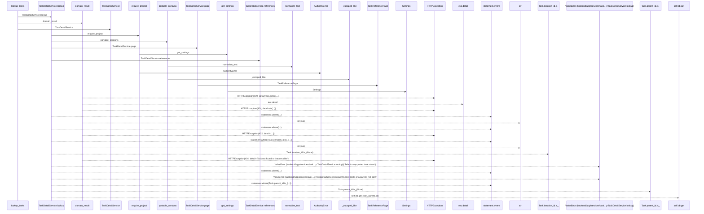
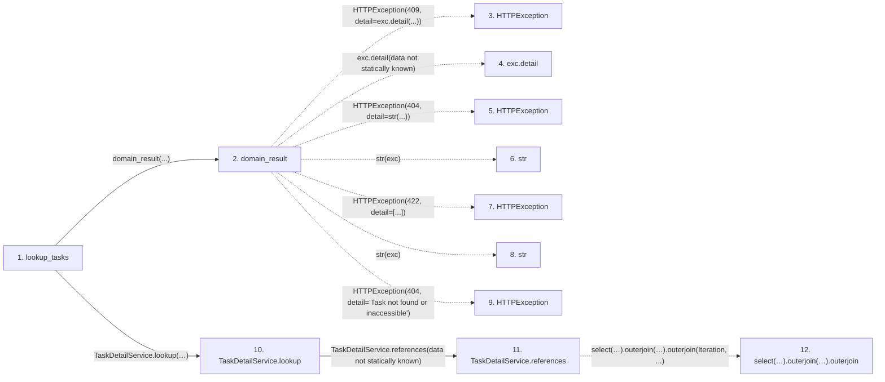

# lookup_tasks

**Entry point:** `lookup_tasks` (`http`)
**Source:** [routers_task_domain](../modules/routers_task_domain.md)
**Modules touched:** [authority](../modules/authority.md), [config](../modules/config.md), [routers_task_domain](../modules/routers_task_domain.md), [sql_semantics](../modules/sql_semantics.md), and 2 more

**Complete modules touched:**

- [authority](../modules/authority.md)
- [config](../modules/config.md)
- [routers_task_domain](../modules/routers_task_domain.md)
- [sql_semantics](../modules/sql_semantics.md)
- [task_detail](../modules/task_detail.md)
- [task_detail_service](../modules/task_detail_service.md)

## Call sequence

> Static overview in presentation order, not runtime execution order. Arrows retain captured callers; representative internal continuations and boundary examples precede repeated helper detail.

<!-- Auto-generated from static call edges. Dashed arrows are external or unresolved calls. Reviewed runtime conditions and side effects belong in Behavior. -->

> Call sequence diagram shows 30 of 77 interactions; 47 omitted to keep the visualization within the 30-interaction and generated-diagram limits, with uncertain identities omitted rather than inferred.

> Captured boundary calls: external 8 of 21 (13 omitted); unresolved 9 of 40 (31 omitted). These counts cover the captured static trace.

Omitted captured detail, grouped by actual caller occurrence and target module:

| Caller | Parent step | Target module | Kind | Omitted interactions |
| --- | --- | --- | --- | --- |
| `backend/app/services/task_detail_service.py:TaskDetailService.references` | 11 | - | unresolved | 9 |
| `backend/app/services/task_detail_service.py:TaskDetailService.references` | 11 | - | external | 2 |
| `backend/app/authority.py:require_project` | 23 | - | unresolved | 2 |
| `backend/app/authority.py:require_project` | 23 | [backend/app/authority.py](../modules/authority.md) | internal | 1 |
| `backend/app/services/task_detail_service.py:TaskDetailService.lookup` | 10 | - | external | 7 |
| `backend/app/services/task_detail_service.py:TaskDetailService.lookup` | 10 | [backend/app/authority.py](../modules/authority.md) | internal | 1 |
| `backend/app/services/task_detail_service.py:TaskDetailService.lookup` | 10 | - | unresolved | 6 |
| `backend/app/sql_semantics.py:normalize_text` | 49 | - | unresolved | 1 |
> Omission summary shows 8 of 15 groups; 7 further groups are not expanded here. Counts above include all omitted interactions.
> Detailed flow queries retain their own coverage and limits; omitted paths may execute at runtime.

## Data flow

<!-- Auto-generated static analysis. Treat values and boundaries as best-effort hints, not runtime proof. -->

### Analysis coverage

**Effect analysis partially available.** Flow assembly and source effect analysis are separate; empty observations do not prove an empty handler body.

Source steps: 17; effect analysis evaluated: 10, partial: 2, unavailable: 5. Counts include steps omitted from the displayed trace.

Collector observations for 12 source steps with known totals: observed: 58, emitted: 54, omitted: 4. Unavailable totals are excluded.

- Callable record unavailable for one or more source steps; those steps have no represented callable body.
- Effect collector omitted observations before flow assembly; displayed effects are partial.
- Effect collector totals unavailable; observed counts cover captured records only.

| Step | Callable record | Effect analysis | Collector totals | Observed | Emitted | Omitted |
|---|---|---|---|---:|---:|---:|
| `lookup_tasks` | `available` | `partial` | `available` | `11` | `9` | `2` |
| `domain_result` | `available` | `evaluated` | `available` | `3` | `3` | `0` |
| `HTTPException` | `not_applicable` | `not_applicable` | `not_applicable` | — | — | — |
| `exc.detail` | `not_applicable` | `not_applicable` | `not_applicable` | — | — | — |
| `HTTPException` | `not_applicable` | `not_applicable` | `not_applicable` | — | — | — |
| `str` | `not_applicable` | `not_applicable` | `not_applicable` | — | — | — |
| `HTTPException` | `not_applicable` | `not_applicable` | `not_applicable` | — | — | — |
| `str` | `not_applicable` | `not_applicable` | `not_applicable` | — | — | — |
| `HTTPException` | `not_applicable` | `not_applicable` | `not_applicable` | — | — | — |
| `TaskDetailService.lookup` | `available` | `partial` | `available` | `19` | `17` | `2` |
| `TaskDetailService.references` | `available` | `evaluated` | `available` | `2` | `2` | `0` |
| `select(…).outerjoin(…).outerjoin` | `not_applicable` | `not_applicable` | `not_applicable` | — | — | — |

### Step data

| Step | Inputs | Reads | Writes | Returns |
|---|---|---|---|---|
| `lookup_tasks` | `db: DB`, `project_id: int \| None`, `iteration_id: int \| None`, `q: str \| None`, `backlog_only: bool`, `limit: int`, `after_id: int`, `task_status: str \| None` | - | - | `...` |
| `domain_result` | `awaitable` | `TaskVersionConflictError` | - | `result` |
| `HTTPException` | - | - | - | - |
| `exc.detail` | - | - | - | - |
| `HTTPException` | - | - | - | - |
| `str` | - | - | - | - |
| `HTTPException` | - | - | - | - |
| `str` | - | - | - | - |
| `HTTPException` | - | - | - | - |
| `TaskDetailService.lookup` | `project_id`, `iteration_id`, `query`, `backlog_only`, `limit`, `after_id`, `status`, `parent_id` | `self.db`, `Task`, `Task`, `Task`, `Task`, `self.db`, `Task`, `Task` | - | `...` |
| `TaskDetailService.references` | - | `Task` | - | `...` |
| `select(…).outerjoin(…).outerjoin` | - | - | - | - |

### Call data

| From | To | Line | Call |
|---|---|---:|---|
| lookup_tasks | domain_result | 87 | `domain_result(...)` |
| domain_result | HTTPException | 51 | `HTTPException(409, detail=exc.detail(...))` |
| domain_result | exc.detail | 51 | `exc.detail(data not statically known)` |
| domain_result | HTTPException | 53 | `HTTPException(404, detail=str(...))` |
| domain_result | str | 53 | `str(exc)` |
| domain_result | HTTPException | 55 | `HTTPException(422, detail=[...])` |
| domain_result | str | 55 | `str(exc)` |
| domain_result | HTTPException | 57 | `HTTPException(404, detail='Task not found or inaccessible')` |
| lookup_tasks | TaskDetailService.lookup | 87 | `TaskDetailService(db).lookup(project_id=project_id, iteration_id=iteration_id, query=q, backlog_only=backlog_only, limit=limit, after_id=after_id, status=task_status, parent_id=parent_id, roots_only=roots_only)` |
| TaskDetailService.lookup | TaskDetailService.references | 55 | `self.references(data not statically known)` |
| TaskDetailService.references | select(…).outerjoin(…).outerjoin | 39 | `select(Task.id, Task.title, Task.version, Task.status, Task.project_id, Task.iteration_id, Task.parent_id, Task.owner_profile_id, Project.name.label('project_name'), Iteration.name.label('iteration_name'), Task.blocked_reason, Task.canceled_at, and_(Task.status == 'closed', Task.accepted_at.is_not(None), Task.accepted_by_principal_id.is_not(None), Task.accepted_version.is_not(None), Task.accepted_version == Task.version, Task.canceled_at.is_(None)).label('acceptance_current')).outerjoin(Project, Project.id == Task.project_id).outerjoin(Iteration, ...)` |

### Boundary effects

*No boundary-effect observations were captured in this static trace.*

### Static analysis gaps

| Kind | Step | Target | Line |
|---|---|---|---:|
| external_call | `domain_result` | `HTTPException` | 51 |
| unresolved_call | `domain_result` | `exc.detail` | 51 |
| external_call | `domain_result` | `HTTPException` | 53 |
| external_call | `domain_result` | `HTTPException` | 55 |
| external_call | `domain_result` | `HTTPException` | 57 |
| unresolved_call | `TaskDetailService.references` | `select(Task.id, Task.title, Task.version, Task.status, Task.project_id, Task.iteration_id, Task.parent_id, Task.owner_profile_id, Project.name.label('project_name'), Iteration.name.label('iteration_name'), Task.blocked_reason, Task.canceled_at, and_(Task.status == 'closed', Task.accepted_at.is_not(None), Task.accepted_by_principal_id.is_not(None), Task.accepted_version.is_not(None), Task.accepted_version == Task.version, Task.canceled_at.is_(None)).label('acceptance_current')).outerjoin(Project, Project.id == Task.project_id).outerjoin` | 39 |
| step_limit | `lookup_tasks` | `first 12 steps` | 0 |

## Behavior

This flow starts at `lookup_tasks` and is classified as `http`. The generated call and data-flow sections are bounded static projections; runtime conditions and side effects require source-level confirmation.
