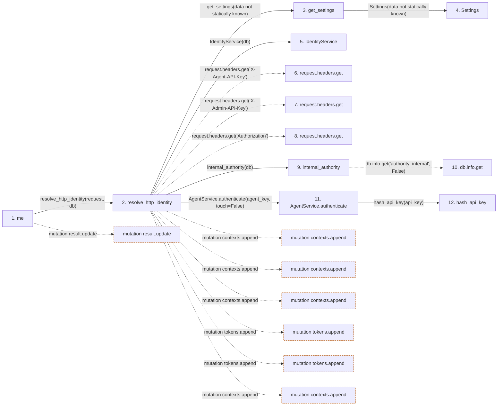

# me

**Entry point:** `me` (`http`)
**Source:** [routers_identity](../modules/routers_identity.md)
**Modules touched:** [agent_service](../modules/agent_service.md), [authority](../modules/authority.md), [commands](../modules/commands.md), [config](../modules/config.md), and 8 more

**Complete modules touched:**

- [agent_service](../modules/agent_service.md)
- [authority](../modules/authority.md)
- [commands](../modules/commands.md)
- [config](../modules/config.md)
- [http_authority](../modules/http_authority.md)
- [identity_service](../modules/identity_service.md)
- [maintenance](../modules/maintenance.md)
- [models_identity](../modules/models_identity.md)
- [routers_identity](../modules/routers_identity.md)
- [security](../modules/security.md)
- [session_service](../modules/session_service.md)
- [time](../modules/time.md)

## Call sequence

> Static overview in presentation order, not runtime execution order. Arrows retain captured callers; representative internal continuations and boundary examples precede repeated helper detail.

```mermaid
sequenceDiagram
    participant p0 as me
    participant p1 as resolve_http_identity
    participant p2 as local_work_profile
    participant p3 as get_settings
    participant p4 as AgentService.authenticate
    participant p5 as IdentityService.actor_context
    participant p6 as admin_api_key_is_valid
    participant p7 as _get_session_by_token
    participant p8 as require_identity_writes
    participant p9 as IdentityService.context
    participant p10 as commit_or_flush
    participant p11 as internal_authority
    participant p12 as IdentityService
    participant p13 as AgentService
    participant p14 as AuthorityError
    participant p15 as Authority
    participant p16 as digest
    participant p17 as Settings
    participant p18 as hash_api_key
    participant p19 as _token_digest
    participant p20 as Principal
    participant p21 as as_utc
    participant p22 as utc_now
    participant p23 as current_command
    participant p24 as MaintenanceModeError
    participant p25 as bool
    participant p26 as db.get (backend/app/routers/identity.py:me)
    participant p27 as result.update
    participant p28 as db.get (backend/app/services/iden…ice.py:local_work_profile)
    p0->>p1: resolve_http_identity
    p0->>p2: local_work_profile
    p0->>p3: get_settings
    p1->>p4: AgentService.authenticate
    p1->>p5: IdentityService.actor_context
    p1->>p6: admin_api_key_is_valid
    p1->>p7: _get_session_by_token
    p5->>p8: require_identity_writes
    p5->>p9: IdentityService.context
    p4->>p10: commit_or_flush
    p2->>p11: internal_authority
    p1->>p12: IdentityService
    p1->>p13: AgentService
    p1->>p14: AuthorityError
    p1->>p15: Authority
    p1->>p16: digest
    p3->>p17: Settings
    p4->>p18: hash_api_key
    p7->>p19: _token_digest
    p5->>p20: Principal
    p7->>p21: as_utc
    p4->>p22: utc_now
    p10->>p23: current_command
    p8->>p24: MaintenanceModeError
    p0-->>p25: bool(...)
    p0-->>p26: db.get (backend/app/routers/identity.py:me)(Principal, authority.principal_id)
    p0-->>p27: result.update(principal={...}, workspace_role=authority.workspace_role, projects=authority.projects)
    p0-->>p26: db.get (backend/app/routers/identity.py:me)(TeamMemberProfile, authority.profile_id)
    p0-->>p26: db.get (backend/app/routers/identity.py:me)(UserSession, authority.session_id)
    p2-->>p28: db.get (backend/app/services/iden…ice.py:local_work_profile)(TeamMemberProfile, profile_id)
```

<!-- Auto-generated from static call edges. Dashed arrows are external or unresolved calls. Reviewed runtime conditions and side effects belong in Behavior. -->

> Call sequence diagram shows 30 of 133 interactions; 103 omitted to keep the visualization within the 30-interaction and generated-diagram limits, with uncertain identities omitted rather than inferred.

> Captured boundary calls: external 1 of 22 (21 omitted); unresolved 5 of 61 (56 omitted). These counts cover the captured static trace.

Omitted captured detail, grouped by actual caller occurrence and target module:

| Caller | Parent step | Target module | Kind | Omitted interactions |
| --- | --- | --- | --- | --- |
| `backend/app/http_authority.py:resolve_http_identity` | 2 | [backend/app/config.py](../modules/config.md) | internal | 1 |
| `backend/app/http_authority.py:resolve_http_identity` | 2 | - | unresolved | 26 |
| `backend/app/http_authority.py:resolve_http_identity` | 2 | [backend/app/authority.py](../modules/authority.md) | internal | 13 |
| `backend/app/authority.py:internal_authority` | 9 | - | unresolved | 1 |
| `backend/app/services/agent_service.py:hash_api_key` | 12 | - | unresolved | 2 |
| `backend/app/services/agent_service.py:hash_api_key` | 12 | - | external | 1 |
| `backend/app/services/agent_service.py:AgentService.authenticate` | 11 | - | unresolved | 5 |
| `backend/app/services/agent_service.py:AgentService.authenticate` | 11 | - | external | 2 |
> Omission summary shows 8 of 35 groups; 27 further groups are not expanded here. Counts above include all omitted interactions.
> Detailed flow queries retain their own coverage and limits; omitted paths may execute at runtime.

## Data flow

<!-- Auto-generated static analysis. Treat values and boundaries as best-effort hints, not runtime proof. -->

### Analysis coverage

**Effect analysis partially available.** Flow assembly and source effect analysis are separate; empty observations do not prove an empty handler body.

Source steps: 51; effect analysis evaluated: 30, partial: 0, unavailable: 21. Counts include steps omitted from the displayed trace.

Collector observations for 30 source steps with known totals: observed: 113, emitted: 113, omitted: 0. Unavailable totals are excluded.

- Callable record unavailable for one or more source steps; those steps have no represented callable body.
- Effect collector totals unavailable; observed counts cover captured records only.

| Step | Callable record | Effect analysis | Collector totals | Observed | Emitted | Omitted |
|---|---|---|---|---:|---:|---:|
| `me` | `available` | `evaluated` | `available` | `12` | `12` | `0` |
| `resolve_http_identity` | `available` | `evaluated` | `available` | `14` | `14` | `0` |
| `get_settings` | `available` | `evaluated` | `available` | `1` | `1` | `0` |
| `Settings` | `unavailable` | `unavailable` | `unavailable` | — | — | — |
| `IdentityService` | `unavailable` | `unavailable` | `unavailable` | — | — | — |
| `request.headers.get` | `not_applicable` | `not_applicable` | `not_applicable` | — | — | — |
| `request.headers.get` | `not_applicable` | `not_applicable` | `not_applicable` | — | — | — |
| `request.headers.get` | `not_applicable` | `not_applicable` | `not_applicable` | — | — | — |
| `internal_authority` | `available` | `evaluated` | `available` | `3` | `3` | `0` |
| `db.info.get` | `not_applicable` | `not_applicable` | `not_applicable` | — | — | — |
| `AgentService.authenticate` | `available` | `evaluated` | `available` | `7` | `7` | `0` |
| `hash_api_key` | `available` | `evaluated` | `available` | `2` | `2` | `0` |

### Step data

| Step | Inputs | Reads | Writes | Returns |
|---|---|---|---|---|
| `me` | `request: Request`, `response: Response`, `db: Database` | `AuthorityError`, `Principal`, `UserSession` | `response.headers[...]`, `result[...]`, `result[...]`, `result[...]` | `result` |
| `resolve_http_identity` | `request`, `db` | `WorkspaceAuthorityState`, `Principal`, `WorkspaceAuthorityState`, `Principal`, `Principal` | - | `authority` |
| `get_settings` | - | - | - | `Settings(...)` |
| `Settings` | - | - | - | - |
| `IdentityService` | - | - | - | - |
| `request.headers.get` | - | - | - | - |
| `request.headers.get` | - | - | - | - |
| `request.headers.get` | - | - | - | - |
| `internal_authority` | `db` | - | `db.info[...]`, `db.info[...]` | - |
| `db.info.get` | - | - | - | - |
| `AgentService.authenticate` | `api_key: str`, `touch: bool` | `AgentActor`, `AgentActor`, `self.db` | `actor.last_seen_at` | `actor` |
| `hash_api_key` | `api_key: str` | - | - | `...` |

### Call data

| From | To | Line | Call |
|---|---|---:|---|
| me | resolve_http_identity | 143 | `resolve_http_identity(request, db)` |
| resolve_http_identity | get_settings | 43 | `get_settings(data not statically known)` |
| get_settings | Settings | 481 | `Settings(data not statically known)` |
| resolve_http_identity | IdentityService | 45 | `IdentityService(db)` |
| resolve_http_identity | request.headers.get | 46 | `request.headers.get('X-Agent-API-Key')` |
| resolve_http_identity | request.headers.get | 47 | `request.headers.get('X-Admin-API-Key')` |
| resolve_http_identity | request.headers.get | 48 | `request.headers.get('Authorization')` |
| resolve_http_identity | internal_authority | 49 | `internal_authority(db)` |
| internal_authority | db.info.get | 87 | `db.info.get('authority_internal', False)` |
| resolve_http_identity | AgentService.authenticate | 52 | `AgentService(db).authenticate(agent_key, touch=False)` |
| AgentService.authenticate | hash_api_key | 133 | `hash_api_key(api_key)` |

### Boundary effects

| Kind | Target | Step | Line |
|---|---|---|---:|
| mutation | `result.update` | `me` | 154 |
| mutation | `contexts.append` | `resolve_http_identity` | 63 |
| mutation | `contexts.append` | `resolve_http_identity` | 65 |
| mutation | `contexts.append` | `resolve_http_identity` | 75 |
| mutation | `tokens.append` | `resolve_http_identity` | 86 |
| mutation | `tokens.append` | `resolve_http_identity` | 94 |
| mutation | `contexts.append` | `resolve_http_identity` | 99 |

### Static analysis gaps

| Kind | Step | Target | Line |
|---|---|---|---:|
| unresolved_call | `resolve_http_identity` | `request.headers.get` | 46 |
| unresolved_call | `resolve_http_identity` | `request.headers.get` | 47 |
| unresolved_call | `resolve_http_identity` | `request.headers.get` | 48 |
| unresolved_call | `internal_authority` | `db.info.get` | 87 |
| step_limit | `me` | `first 12 steps` | 0 |

## Behavior

This flow starts at `me` and is classified as `http`. The generated call and data-flow sections are bounded static projections; runtime conditions and side effects require source-level confirmation.
