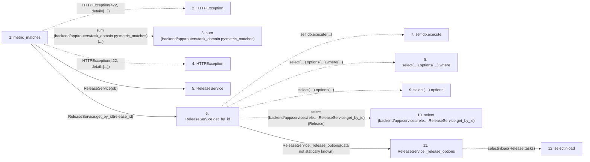

# metric_matches

**Entry point:** `metric_matches` (`http`)
**Source:** [routers_task_domain](../modules/routers_task_domain.md)
**Modules touched:** [authority](../modules/authority.md), [commands](../modules/commands.md), [config](../modules/config.md), [query_limits](../modules/query_limits.md), and 4 more

**Complete modules touched:**

- [authority](../modules/authority.md)
- [commands](../modules/commands.md)
- [config](../modules/config.md)
- [query_limits](../modules/query_limits.md)
- [release_service](../modules/release_service.md)
- [routers_task_domain](../modules/routers_task_domain.md)
- [services_work_metrics](../modules/services_work_metrics.md)
- [time](../modules/time.md)

## Call sequence

> Static overview in presentation order, not runtime execution order. Arrows retain captured callers; representative internal continuations and boundary examples precede repeated helper detail.

```mermaid
sequenceDiagram
    participant p0 as metric_matches
    participant p1 as ReleaseService.get_by_id
    participant p2 as require_project
    participant p3 as ReleaseService
    participant p4 as ReleaseService.metric_task_ids
    participant p5 as aggregate_metrics
    participant p6 as get_settings
    participant p7 as ReleaseService._attach_work_metrics
    participant p8 as scoped_metric_tasks
    participant p9 as working_today
    participant p10 as AuthorityError
    participant p11 as ReleaseService._release_options
    participant p12 as Settings
    participant p13 as utc_now
    participant p14 as _scope_conditions
    participant p15 as HierarchyScopeError
    participant p16 as as_utc
    participant p17 as CollectionLimitExceededError
    participant p18 as HTTPException
    participant p19 as db.get
    participant p20 as sum (backend/app/routers/task_domain.py:metric_matches)
    participant p21 as self.db.execute
    participant p22 as db.info.get (backend/app/authority.py:require_project)
    participant p23 as select(…).options(…).where
    participant p24 as select(…).options
    participant p25 as select (backend/app/services/rele…:ReleaseService.get_by_id)
    participant p26 as authority.allows (backend/app/authority.py:require_project)
    participant p27 as result.scalar_one_or_none
    p0->>p1: ReleaseService.get_by_id
    p0->>p2: require_project
    p0->>p3: ReleaseService
    p0->>p4: ReleaseService.metric_task_ids
    p0->>p5: aggregate_metrics
    p2->>p6: get_settings
    p1->>p7: ReleaseService._attach_work_metrics
    p4->>p8: scoped_metric_tasks
    p5->>p9: working_today
    p2->>p10: AuthorityError
    p1->>p11: ReleaseService._release_options
    p6->>p12: Settings
    p5->>p13: utc_now
    p5->>p14: _scope_conditions
    p5->>p15: HierarchyScopeError
    p9->>p16: as_utc
    p8->>p17: CollectionLimitExceededError
    p0-->>p18: HTTPException(422, detail=[...])
    p0-->>p19: db.get(Project, project_id)
    p0-->>p20: sum (backend/app/routers/task_domain.py:metric_matches)(...)
    p0-->>p18: HTTPException(422, detail=[...])
    p0-->>p18: HTTPException(404, detail='Release not found')
    p0-->>p18: HTTPException(404, detail='Project not found')
    p1-->>p21: self.db.execute(...)
    p2-->>p22: db.info.get (backend/app/authority.py:require_project)('authority')
    p1-->>p23: select(…).options(…).where(...)
    p1-->>p24: select(…).options(...)
    p1-->>p25: select (backend/app/services/rele…:ReleaseService.get_by_id)(Release)
    p2-->>p26: authority.allows (backend/app/authority.py:require_project)(project_id, action)
    p1-->>p27: result.scalar_one_or_none
```

<!-- Auto-generated from static call edges. Dashed arrows are external or unresolved calls. Reviewed runtime conditions and side effects belong in Behavior. -->

> Call sequence diagram shows 30 of 313 interactions; 283 omitted to keep the visualization within the 30-interaction and generated-diagram limits, with uncertain identities omitted rather than inferred.

> Captured boundary calls: external 6 of 122 (116 omitted); unresolved 7 of 164 (157 omitted). These counts cover the captured static trace.

Omitted captured detail, grouped by actual caller occurrence and target module:

| Caller | Parent step | Target module | Kind | Omitted interactions |
| --- | --- | --- | --- | --- |
| `backend/app/services/release_service.py:ReleaseService._release_options` | 11 | - | external | 1 |
| `backend/app/services/release_service.py:ReleaseService._attach_work_metrics` | 14 | [backend/app/services/release_service.py](../modules/release_service.md) | internal | 1 |
| `backend/app/services/work_metrics.py:scoped_metric_tasks` | 16 | - | external | 3 |
| `backend/app/services/work_metrics.py:scoped_metric_tasks` | 16 | - | unresolved | 6 |
| `backend/app/services/release_service.py:ReleaseService._attach_work_metrics` | 14 | [backend/app/services/work_metrics.py](../modules/services_work_metrics.md) | internal | 1 |
| `backend/app/utils/time.py:utc_now` | 28 | - | external | 1 |
| `backend/app/services/work_metrics.py:aggregate_metrics` | 27 | - | unresolved | 113 |
| `backend/app/authority.py:_scope_conditions` | 32 | - | external | 36 |
> Omission summary shows 8 of 20 groups; 12 further groups are not expanded here. Counts above include all omitted interactions.
> Detailed flow queries retain their own coverage and limits; omitted paths may execute at runtime.

## Data flow

<!-- Auto-generated static analysis. Treat values and boundaries as best-effort hints, not runtime proof. -->

### Analysis coverage

**Effect analysis partially available.** Flow assembly and source effect analysis are separate; empty observations do not prove an empty handler body.

Source steps: 28; effect analysis evaluated: 19, partial: 3, unavailable: 6. Counts include steps omitted from the displayed trace.

Collector observations for 22 source steps with known totals: observed: 132, emitted: 126, omitted: 6. Unavailable totals are excluded.

- Callable record unavailable for one or more source steps; those steps have no represented callable body.
- Effect collector omitted observations before flow assembly; displayed effects are partial.
- Effect collector totals unavailable; observed counts cover captured records only.

| Step | Callable record | Effect analysis | Collector totals | Observed | Emitted | Omitted |
|---|---|---|---|---:|---:|---:|
| `metric_matches` | `available` | `evaluated` | `available` | `8` | `8` | `0` |
| `HTTPException` | `not_applicable` | `not_applicable` | `not_applicable` | — | — | — |
| `sum (backend/app/routers/task_domain.py:metric_matches)` | `not_applicable` | `not_applicable` | `not_applicable` | — | — | — |
| `HTTPException` | `not_applicable` | `not_applicable` | `not_applicable` | — | — | — |
| `ReleaseService` | `unavailable` | `unavailable` | `unavailable` | — | — | — |
| `ReleaseService.get_by_id` | `available` | `evaluated` | `available` | `3` | `3` | `0` |
| `self.db.execute` | `not_applicable` | `not_applicable` | `not_applicable` | — | — | — |
| `select(…).options(…).where` | `not_applicable` | `not_applicable` | `not_applicable` | — | — | — |
| `select(…).options` | `not_applicable` | `not_applicable` | `not_applicable` | — | — | — |
| `select (backend/app/services/rele…:ReleaseService.get_by_id)` | `not_applicable` | `not_applicable` | `not_applicable` | — | — | — |
| `ReleaseService._release_options` | `available` | `evaluated` | `available` | `2` | `2` | `0` |
| `selectinload` | `not_applicable` | `not_applicable` | `not_applicable` | — | — | — |

### Step data

| Step | Inputs | Reads | Writes | Returns |
|---|---|---|---|---|
| `metric_matches` | `db: DB`, `metric: str`, `project_id: int \| None`, `iteration_id: int \| None`, `release_id: int \| None`, `limit: int` | - | - | `...`, `...` |
| `HTTPException` | - | - | - | - |
| `sum (backend/app/routers/task_domain.py:metric_matches)` | - | - | - | - |
| `HTTPException` | - | - | - | - |
| `ReleaseService` | - | - | - | - |
| `ReleaseService.get_by_id` | `release_id: int` | `Release` | - | `...` |
| `self.db.execute` | - | - | - | - |
| `select(…).options(…).where` | - | - | - | - |
| `select(…).options` | - | - | - | - |
| `select (backend/app/services/rele…:ReleaseService.get_by_id)` | - | - | - | - |
| `ReleaseService._release_options` | - | `Release` | - | `(...)` |
| `selectinload` | - | - | - | - |

### Call data

| From | To | Line | Call |
|---|---|---:|---|
| metric_matches | HTTPException | 92 | `HTTPException(422, detail=[...])` |
| metric_matches | sum (backend/app/routers/task_domain.py:metric_matches) | 93 | `sum(...)` |
| metric_matches | HTTPException | 94 | `HTTPException(422, detail=[...])` |
| metric_matches | ReleaseService | 98 | `ReleaseService(db)` |
| metric_matches | ReleaseService.get_by_id | 99 | `releases.get_by_id(release_id)` |
| ReleaseService.get_by_id | self.db.execute | 117 | `self.db.execute(...)` |
| ReleaseService.get_by_id | select(…).options(…).where | 118 | `select(Release).options(*self._release_options()).where(...)` |
| ReleaseService.get_by_id | select(…).options | 118 | `select(Release).options(...)` |
| ReleaseService.get_by_id | select (backend/app/services/rele…:ReleaseService.get_by_id) | 118 | `select(Release)` |
| ReleaseService.get_by_id | ReleaseService._release_options | 119 | `self._release_options(data not statically known)` |
| ReleaseService._release_options | selectinload | 37 | `selectinload(Release.tasks)` |

### Boundary effects

*No boundary-effect observations were captured in this static trace.*

### Static analysis gaps

| Kind | Step | Target | Line |
|---|---|---|---:|
| external_call | `metric_matches` | `HTTPException` | 92 |
| external_call | `metric_matches` | `sum` | 93 |
| external_call | `metric_matches` | `HTTPException` | 94 |
| unresolved_call | `ReleaseService.get_by_id` | `self.db.execute` | 117 |
| unresolved_call | `ReleaseService.get_by_id` | `select(Release).options(*self._release_options()).where` | 118 |
| unresolved_call | `ReleaseService.get_by_id` | `select(Release).options` | 118 |
| external_call | `ReleaseService.get_by_id` | `select` | 118 |
| external_call | `ReleaseService._release_options` | `selectinload` | 37 |
| step_limit | `metric_matches` | `first 12 steps` | 0 |

## Behavior

This flow starts at `metric_matches` and is classified as `http`. The generated call and data-flow sections are bounded static projections; runtime conditions and side effects require source-level confirmation.
