# metrics_endpoint

**Entry point:** `metrics_endpoint` (`http`)
**Source:** [app_main](../modules/app_main.md)
**Modules touched:** [app_database](../modules/app_database.md), [app_main](../modules/app_main.md), [config](../modules/config.md), [database_config](../modules/database_config.md), and 4 more

**Complete modules touched:**

- [app_database](../modules/app_database.md)
- [app_main](../modules/app_main.md)
- [config](../modules/config.md)
- [database_config](../modules/database_config.md)
- [maintenance](../modules/maintenance.md)
- [observability](../modules/observability.md)
- [time](../modules/time.md)
- [upgrade_service](../modules/upgrade_service.md)

## Call sequence

> Static overview in presentation order, not runtime execution order. Arrows retain captured callers; representative internal continuations and boundary examples precede repeated helper detail.

```mermaid
sequenceDiagram
    participant p0 as metrics_endpoint
    participant p1 as collect_metrics
    participant p2 as readiness_snapshot
    participant p3 as get_settings
    participant p4 as head_revision
    participant p5 as _queue_snapshot
    participant p6 as maintenance_state
    participant p7 as alembic_config
    participant p8 as maintenance_configuration_fingerprint
    participant p9 as database_configuration
    participant p10 as _postgresql_snapshot
    participant p11 as database_runtime_summary
    participant p12 as _resident_set_size_bytes
    participant p13 as Settings
    participant p14 as utc_now
    participant p15 as UpgradeError
    participant p16 as as_utc
    participant p17 as migrations_dir
    participant p18 as alembic_safe_url
    participant p19 as parse_database_configuration
    participant p20 as PlainTextResponse
    participant p21 as metrics.render_prometheus
    participant p22 as logger.warning
    participant p23 as asyncio.timeout
    participant p24 as async_session_maker
    participant p25 as db.execute (backend/app/observability.py:readiness_snapshot)
    participant p26 as text (backend/app/observability.py:readiness_snapshot)
    participant p27 as list (backend/app/observability.py:readiness_snapshot)
    participant p28 as (…).scalars
    p0->>p1: collect_metrics
    p1->>p2: readiness_snapshot
    p2->>p3: get_settings
    p2->>p4: head_revision
    p2->>p5: _queue_snapshot
    p2->>p6: maintenance_state
    p4->>p7: alembic_config
    p6->>p8: maintenance_configuration_fingerprint
    p7->>p9: database_configuration
    p2->>p10: _postgresql_snapshot
    p2->>p11: database_runtime_summary
    p2->>p12: _resident_set_size_bytes
    p3->>p13: Settings
    p5->>p14: utc_now
    p4->>p15: UpgradeError
    p5->>p16: as_utc
    p7->>p17: migrations_dir
    p7->>p18: alembic_safe_url
    p9->>p19: parse_database_configuration
    p0-->>p20: PlainTextResponse(metrics.render_prometheus(...), media_type='text/plain version=0.0.4 charset=utf-8')
    p0-->>p21: metrics.render_prometheus
    p1-->>p22: logger.warning('Could not refresh database metrics', exc_info=True)
    p2-->>p23: asyncio.timeout(settings.database_readiness_timeout_seconds)
    p2-->>p24: async_session_maker
    p2-->>p25: db.execute (backend/app/observability.py:readiness_snapshot)(text(...))
    p2-->>p26: text (backend/app/observability.py:readiness_snapshot)('SELECT 1')
    p2-->>p27: list (backend/app/observability.py:readiness_snapshot)(...)
    p2-->>p28: (…).scalars
    p2-->>p25: db.execute (backend/app/observability.py:readiness_snapshot)(text(...))
    p2-->>p26: text (backend/app/observability.py:readiness_snapshot)('SELECT version_num FROM alembic_version ORDER BY version_num')
```

<!-- Auto-generated from static call edges. Dashed arrows are external or unresolved calls. Reviewed runtime conditions and side effects belong in Behavior. -->

> Call sequence diagram shows 30 of 126 interactions; 96 omitted to keep the visualization within the 30-interaction and generated-diagram limits, with uncertain identities omitted rather than inferred.

> Captured boundary calls: external 5 of 49 (44 omitted); unresolved 6 of 53 (47 omitted). These counts cover the captured static trace.

Omitted captured detail, grouped by actual caller occurrence and target module:

| Caller | Parent step | Target module | Kind | Omitted interactions |
| --- | --- | --- | --- | --- |
| `backend/app/services/upgrade_service.py:head_revision` | 6 | - | external | 2 |
| `backend/app/services/upgrade_service.py:migrations_dir` | 9 | - | unresolved | 1 |
| `backend/app/services/upgrade_service.py:migrations_dir` | 9 | - | external | 1 |
| `backend/app/services/upgrade_service.py:alembic_config` | 8 | - | external | 3 |
| `backend/app/services/upgrade_service.py:alembic_config` | 8 | - | unresolved | 2 |
| `backend/app/database_config.py:alembic_safe_url` | 17 | - | external | 2 |
| `backend/app/database_config.py:alembic_safe_url` | 17 | - | unresolved | 2 |
| `backend/app/services/upgrade_service.py:database_configuration` | 22 | [backend/app/config.py](../modules/config.md) | internal | 1 |
> Omission summary shows 8 of 27 groups; 19 further groups are not expanded here. Counts above include all omitted interactions.
> Detailed flow queries retain their own coverage and limits; omitted paths may execute at runtime.

> Trace truncated at the depth limit; deeper calls are omitted.

## Data flow

<!-- Auto-generated static analysis. Treat values and boundaries as best-effort hints, not runtime proof. -->

### Analysis coverage

**Effect analysis partially available.** Flow assembly and source effect analysis are separate; empty observations do not prove an empty handler body.

Source steps: 25; effect analysis evaluated: 23, partial: 0, unavailable: 2. Counts include steps omitted from the displayed trace.

Collector observations for 23 source steps with known totals: observed: 51, emitted: 51, omitted: 0. Unavailable totals are excluded.

- Callable record unavailable for one or more source steps; those steps have no represented callable body.
- Effect collector totals unavailable; observed counts cover captured records only.

| Step | Callable record | Effect analysis | Collector totals | Observed | Emitted | Omitted |
|---|---|---|---|---:|---:|---:|
| `metrics_endpoint` | `available` | `evaluated` | `available` | `1` | `1` | `0` |
| `collect_metrics` | `available` | `evaluated` | `available` | `0` | `0` | `0` |
| `readiness_snapshot` | `available` | `evaluated` | `available` | `6` | `6` | `0` |
| `get_settings` | `available` | `evaluated` | `available` | `1` | `1` | `0` |
| `Settings` | `unavailable` | `unavailable` | `unavailable` | — | — | — |
| `head_revision` | `available` | `evaluated` | `available` | `1` | `1` | `0` |
| `ScriptDirectory.from_config` | `not_applicable` | `not_applicable` | `not_applicable` | — | — | — |
| `alembic_config` | `available` | `evaluated` | `available` | `3` | `3` | `0` |
| `migrations_dir` | `available` | `evaluated` | `available` | `1` | `1` | `0` |
| `Path(…).resolve` | `not_applicable` | `not_applicable` | `not_applicable` | — | — | — |
| `Path (backend/app/services/upgr…service.py:migrations_dir)` | `not_applicable` | `not_applicable` | `not_applicable` | — | — | — |
| `Config` | `not_applicable` | `not_applicable` | `not_applicable` | — | — | — |

```mermaid
flowchart LR
    s1["1. metrics_endpoint"]
    s2["2. collect_metrics"]
    s3["3. readiness_snapshot"]
    s4["4. get_settings"]
    s5["5. Settings"]
    s6["6. head_revision"]
    s7["7. ScriptDirectory.from_config"]
    s8["8. alembic_config"]
    s9["9. migrations_dir"]
    s10["10. Path(…).resolve"]
    s11["11. Path (backend/app/services/upgr…service.py:migrations_dir)"]
    s12["12. Config"]
    s1 -->|"collect_metrics(data not statically known)"| s2
    s2 -->|"readiness_snapshot(data not statically known)"| s3
    s3 -->|"get_settings(data not statically known)"| s4
    s4 -->|"Settings(data not statically known)"| s5
    s3 -->|"head_revision(data not statically known)"| s6
    s6 -. "ScriptDirectory.from_config(alembic_config(...))" .-> s7
    s6 -->|"alembic_config(data not statically known)"| s8
    s8 -->|"migrations_dir(data not statically known)"| s9
    s9 -. "Path(…).resolve(data not statically known)" .-> s10
    s9 -. "Path (backend/app/services/upgr…service.py:migrations_dir)(__file__)" .-> s11
    s8 -. "Config(str(...))" .-> s12
    click s1 "../modules/app_main.md"
    click s2 "../modules/observability.md"
    click s3 "../modules/observability.md"
    click s4 "../modules/config.md"
    click s5 "../modules/config.md"
    click s6 "../modules/upgrade_service.md"
    click s8 "../modules/upgrade_service.md"
    click s9 "../modules/upgrade_service.md"
```

### Step data

| Step | Inputs | Reads | Writes | Returns |
|---|---|---|---|---|
| `metrics_endpoint` | - | - | - | `PlainTextResponse(...)` |
| `collect_metrics` | - | - | - | - |
| `readiness_snapshot` | - | `SQLAlchemyError`, `SQLAlchemyError`, `SQLAlchemyError`, `SQLAlchemyError` | - | `(...)`, `(...)` |
| `get_settings` | - | - | - | `Settings(...)` |
| `Settings` | - | - | - | - |
| `head_revision` | - | - | - | `heads[...]` |
| `ScriptDirectory.from_config` | - | - | - | - |
| `alembic_config` | `connection: Connection \| None` | - | `config.attributes[...]` | `config` |
| `migrations_dir` | - | - | - | `...` |
| `Path(…).resolve` | - | - | - | - |
| `Path (backend/app/services/upgr…service.py:migrations_dir)` | - | - | - | - |
| `Config` | - | - | - | - |

### Call data

| From | To | Line | Call |
|---|---|---:|---|
| metrics_endpoint | collect_metrics | 286 | `collect_metrics(data not statically known)` |
| collect_metrics | readiness_snapshot | 399 | `readiness_snapshot(data not statically known)` |
| readiness_snapshot | get_settings | 252 | `get_settings(data not statically known)` |
| get_settings | Settings | 481 | `Settings(data not statically known)` |
| readiness_snapshot | head_revision | 253 | `head_revision(data not statically known)` |
| head_revision | ScriptDirectory.from_config | 90 | `ScriptDirectory.from_config(alembic_config(...))` |
| head_revision | alembic_config | 90 | `alembic_config(data not statically known)` |
| alembic_config | migrations_dir | 70 | `migrations_dir(data not statically known)` |
| migrations_dir | Path(…).resolve | 59 | `Path(__file__).resolve(data not statically known)` |
| migrations_dir | Path (backend/app/services/upgr…service.py:migrations_dir) | 59 | `Path(__file__)` |
| alembic_config | Config | 71 | `Config(str(...))` |

### Boundary effects

*No boundary-effect observations were captured in this static trace.*

### Static analysis gaps

| Kind | Step | Target | Line |
|---|---|---|---:|
| external_call | `head_revision` | `ScriptDirectory.from_config` | 90 |
| unresolved_call | `migrations_dir` | `Path(__file__).resolve` | 59 |
| external_call | `alembic_config` | `Config` | 71 |
| step_limit | `metrics_endpoint` | `first 12 steps` | 0 |
| truncated_flow | `metrics_endpoint` | `depth limit` | 0 |

## Behavior

This flow starts at `metrics_endpoint` and is classified as `http`. The generated call and data-flow sections are bounded static projections; runtime conditions and side effects require source-level confirmation.
