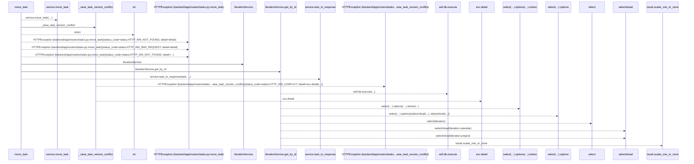
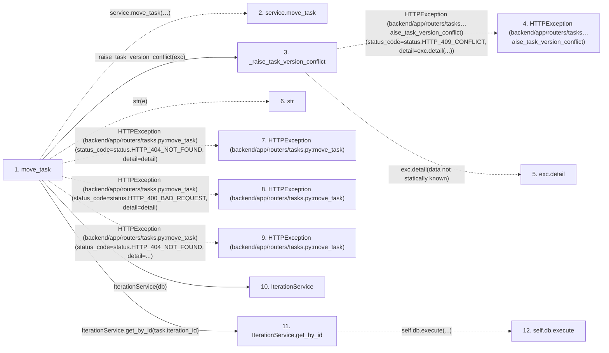

# move_task

**Entry point:** `move_task` (`http`)
**Source:** [tasks](../modules/tasks.md)
**Modules touched:** [iteration_service](../modules/iteration_service.md), [tasks](../modules/tasks.md)

## Call sequence

> Static overview in presentation order, not runtime execution order. Arrows retain captured callers; representative internal continuations and boundary examples precede repeated helper detail.

<!-- Auto-generated from static call edges. Dashed arrows are external or unresolved calls. Reviewed runtime conditions and side effects belong in Behavior. -->

> Call sequence diagram shows 18 of 18 interactions; 0 omitted to keep the visualization within the 30-interaction and generated-diagram limits, with uncertain identities omitted rather than inferred.

> Captured boundary calls: external 8 of 8 (0 omitted); unresolved 7 of 7 (0 omitted). These counts cover the captured static trace.
> Detailed flow queries retain their own coverage and limits; omitted paths may execute at runtime.

## Data flow

<!-- Auto-generated static analysis. Treat values and boundaries as best-effort hints, not runtime proof. -->

### Analysis coverage

**Effect analysis partially available.** Flow assembly and source effect analysis are separate; empty observations do not prove an empty handler body.

Source steps: 4; effect analysis evaluated: 3, partial: 0, unavailable: 1. Counts include steps omitted from the displayed trace.

Collector observations for 3 source steps with known totals: observed: 14, emitted: 14, omitted: 0. Unavailable totals are excluded.

- Callable record unavailable for one or more source steps; those steps have no represented callable body.
- Effect collector totals unavailable; observed counts cover captured records only.

| Step | Callable record | Effect analysis | Collector totals | Observed | Emitted | Omitted |
|---|---|---|---|---:|---:|---:|
| `move_task` | `available` | `evaluated` | `available` | `9` | `9` | `0` |
| `service.move_task` | `not_applicable` | `not_applicable` | `not_applicable` | — | — | — |
| `_raise_task_version_conflict` | `available` | `evaluated` | `available` | `2` | `2` | `0` |
| `HTTPException (backend/app/routers/tasks…aise_task_version_conflict)` | `not_applicable` | `not_applicable` | `not_applicable` | — | — | — |
| `exc.detail` | `not_applicable` | `not_applicable` | `not_applicable` | — | — | — |
| `str` | `not_applicable` | `not_applicable` | `not_applicable` | — | — | — |
| `HTTPException (backend/app/routers/tasks.py:move_task)` | `not_applicable` | `not_applicable` | `not_applicable` | — | — | — |
| `HTTPException (backend/app/routers/tasks.py:move_task)` | `not_applicable` | `not_applicable` | `not_applicable` | — | — | — |
| `HTTPException (backend/app/routers/tasks.py:move_task)` | `not_applicable` | `not_applicable` | `not_applicable` | — | — | — |
| `IterationService` | `unavailable` | `unavailable` | `unavailable` | — | — | — |
| `IterationService.get_by_id` | `available` | `evaluated` | `available` | `3` | `3` | `0` |
| `self.db.execute` | `not_applicable` | `not_applicable` | `not_applicable` | — | — | — |

### Step data

| Step | Inputs | Reads | Writes | Returns |
|---|---|---|---|---|
| `move_task` | `task_id: int`, `data: TaskMoveRequest`, `service: Annotated[TaskService, Depends(get_task_service)]`, `db: Annotated[AsyncSession, Depends(get_db, scope='function')]` | `TaskVersionConflictError`, `status`, `status`, `status` | - | `service.task_to_response(...)` |
| `service.move_task` | - | - | - | - |
| `_raise_task_version_conflict` | `exc: TaskVersionConflictError` | `status` | - | - |
| `HTTPException (backend/app/routers/tasks…aise_task_version_conflict)` | - | - | - | - |
| `exc.detail` | - | - | - | - |
| `str` | - | - | - | - |
| `HTTPException (backend/app/routers/tasks.py:move_task)` | - | - | - | - |
| `HTTPException (backend/app/routers/tasks.py:move_task)` | - | - | - | - |
| `HTTPException (backend/app/routers/tasks.py:move_task)` | - | - | - | - |
| `IterationService` | - | - | - | - |
| `IterationService.get_by_id` | `iteration_id: int` | `Iteration` | - | `result.scalar_one_or_none(...)` |
| `self.db.execute` | - | - | - | - |

### Call data

| From | To | Line | Call |
|---|---|---:|---|
| move_task | service.move_task | 363 | `service.move_task(task_id, target_iteration_id=data.iteration_id, parent_id=data.parent_id, expected_version=data.expected_version, expected_revisions=data.expected_revisions)` |
| move_task | _raise_task_version_conflict | 371 | `_raise_task_version_conflict(exc)` |
| _raise_task_version_conflict | HTTPException (backend/app/routers/tasks…aise_task_version_conflict) | 59 | `HTTPException(status_code=status.HTTP_409_CONFLICT, detail=exc.detail(...))` |
| _raise_task_version_conflict | exc.detail | 61 | `exc.detail(data not statically known)` |
| move_task | str | 373 | `str(e)` |
| move_task | HTTPException (backend/app/routers/tasks.py:move_task) | 375 | `HTTPException(status_code=status.HTTP_404_NOT_FOUND, detail=detail)` |
| move_task | HTTPException (backend/app/routers/tasks.py:move_task) | 379 | `HTTPException(status_code=status.HTTP_400_BAD_REQUEST, detail=detail)` |
| move_task | HTTPException (backend/app/routers/tasks.py:move_task) | 384 | `HTTPException(status_code=status.HTTP_404_NOT_FOUND, detail=...)` |
| move_task | IterationService | 389 | `IterationService(db)` |
| move_task | IterationService.get_by_id | 390 | `iteration_service.get_by_id(task.iteration_id)` |
| IterationService.get_by_id | self.db.execute | 323 | `self.db.execute(...)` |

### Boundary effects

*No boundary-effect observations were captured in this static trace.*

### Static analysis gaps

| Kind | Step | Target | Line |
|---|---|---|---:|
| unresolved_call | `move_task` | `service.move_task` | 363 |
| external_call | `_raise_task_version_conflict` | `HTTPException` | 59 |
| unresolved_call | `_raise_task_version_conflict` | `exc.detail` | 61 |
| external_call | `move_task` | `HTTPException` | 375 |
| external_call | `move_task` | `HTTPException` | 379 |
| external_call | `move_task` | `HTTPException` | 384 |
| unresolved_call | `IterationService.get_by_id` | `self.db.execute` | 323 |
| step_limit | `move_task` | `first 12 steps` | 0 |

## Behavior

This flow starts at `move_task` and is classified as `http`. The generated call and data-flow sections are bounded static projections; runtime conditions and side effects require source-level confirmation.
