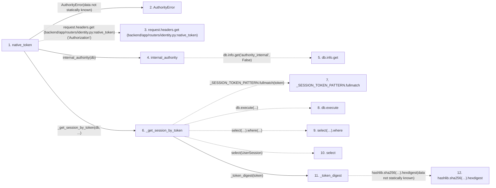

# native_token

**Entry point:** `native_token` (`http`)
**Source:** [routers_identity](../modules/routers_identity.md)
**Modules touched:** [authority](../modules/authority.md), [config](../modules/config.md), [identity_service](../modules/identity_service.md), [routers_identity](../modules/routers_identity.md), and 2 more

**Complete modules touched:**

- [authority](../modules/authority.md)
- [config](../modules/config.md)
- [identity_service](../modules/identity_service.md)
- [routers_identity](../modules/routers_identity.md)
- [session_service](../modules/session_service.md)
- [time](../modules/time.md)

## Call sequence

> Static overview in presentation order, not runtime execution order. Arrows retain captured callers; representative internal continuations and boundary examples precede repeated helper detail.

```mermaid
sequenceDiagram
    participant p0 as native_token
    participant p1 as _get_session_by_token
    participant p2 as get_client_ip
    participant p3 as session_grant
    participant p4 as AuthorityError
    participant p5 as internal_authority
    participant p6 as IdentityService
    participant p7 as renewable_until
    participant p8 as get_settings
    participant p9 as session_lifetimes
    participant p10 as _token_digest
    participant p11 as as_utc
    participant p12 as utc_now
    participant p13 as Settings
    participant p14 as ip_address
    participant p15 as request.headers.get (backend/app/routers/identity.py:native_token)
    participant p16 as authorization.partition
    participant p17 as IdentityService(…).renew_session
    participant p18 as db.info.get
    participant p19 as _SESSION_TOKEN_PATTERN.fullmatch
    participant p20 as db.execute
    participant p21 as any
    participant p22 as select(…).where
    participant p23 as ip_network
    participant p24 as select
    participant p25 as request.headers.get (backend/app/services/sess…n_service.py:get_client_ip)
    participant p26 as result.scalar_one_or_none
    participant p27 as forwarded_for.split(…)[…].strip
    participant p28 as forwarded_for.split
    p0->>p1: _get_session_by_token
    p0->>p2: get_client_ip
    p0->>p3: session_grant
    p0->>p4: AuthorityError
    p0->>p5: internal_authority
    p0->>p6: IdentityService
    p3->>p7: renewable_until
    p2->>p8: get_settings
    p7->>p9: session_lifetimes
    p1->>p10: _token_digest
    p1->>p11: as_utc
    p1->>p12: utc_now
    p8->>p13: Settings
    p2-->>p14: ip_address(direct_ip)
    p0-->>p15: request.headers.get (backend/app/routers/identity.py:native_token)('Authorization')
    p0-->>p16: authorization.partition(' ')
    p0-->>p17: IdentityService(…).renew_session(source_id, ..., request.headers.get(...), rotate=rotate)
    p0-->>p15: request.headers.get (backend/app/routers/identity.py:native_token)('User-Agent')
    p5-->>p18: db.info.get('authority_internal', False)
    p1-->>p19: _SESSION_TOKEN_PATTERN.fullmatch(token)
    p1-->>p20: db.execute(...)
    p2-->>p21: any(...)
    p1-->>p22: select(…).where(...)
    p2-->>p23: ip_network(network, strict=False)
    p1-->>p24: select(UserSession)
    p2-->>p25: request.headers.get (backend/app/services/sess…n_service.py:get_client_ip)('X-Forwarded-For')
    p1-->>p26: result.scalar_one_or_none
    p2-->>p27: forwarded_for.split(…)[…].strip
    p2-->>p28: forwarded_for.split(',')
    p2-->>p25: request.headers.get (backend/app/services/sess…n_service.py:get_client_ip)('X-Real-IP')
```

<!-- Auto-generated from static call edges. Dashed arrows are external or unresolved calls. Reviewed runtime conditions and side effects belong in Behavior. -->

> Call sequence diagram shows 30 of 41 interactions; 11 omitted to keep the visualization within the 30-interaction and generated-diagram limits, with uncertain identities omitted rather than inferred.

> Captured boundary calls: external 4 of 7 (3 omitted); unresolved 13 of 18 (5 omitted). These counts cover the captured static trace.

Omitted captured detail, grouped by actual caller occurrence and target module:

| Caller | Parent step | Target module | Kind | Omitted interactions |
| --- | --- | --- | --- | --- |
| `backend/app/services/session_service.py:_token_digest` | 11 | - | unresolved | 2 |
| `backend/app/services/session_service.py:_token_digest` | 11 | - | external | 1 |
| `backend/app/utils/time.py:as_utc` | 16 | - | unresolved | 2 |
| `backend/app/utils/time.py:utc_now` | 19 | - | external | 1 |
| `backend/app/routers/identity.py:native_token` | 1 | [backend/app/authority.py](../modules/authority.md) | internal | 1 |
| `backend/app/services/session_service.py:get_client_ip` | 25 | - | unresolved | 1 |
| `backend/app/services/identity_service.py:renewable_until` | 38 | [backend/app/utils/time.py](../modules/time.md) | internal | 1 |
| `backend/app/services/identity_service.py:renewable_until` | 38 | - | external | 1 |
> Omission summary shows 8 of 9 groups; 1 further groups are not expanded here. Counts above include all omitted interactions.
> Detailed flow queries retain their own coverage and limits; omitted paths may execute at runtime.

## Data flow

<!-- Auto-generated static analysis. Treat values and boundaries as best-effort hints, not runtime proof. -->

### Analysis coverage

**Effect analysis partially available.** Flow assembly and source effect analysis are separate; empty observations do not prove an empty handler body.

Source steps: 17; effect analysis evaluated: 13, partial: 0, unavailable: 4. Counts include steps omitted from the displayed trace.

Collector observations for 13 source steps with known totals: observed: 43, emitted: 43, omitted: 0. Unavailable totals are excluded.

- Callable record unavailable for one or more source steps; those steps have no represented callable body.
- Effect collector totals unavailable; observed counts cover captured records only.

| Step | Callable record | Effect analysis | Collector totals | Observed | Emitted | Omitted |
|---|---|---|---|---:|---:|---:|
| `native_token` | `available` | `evaluated` | `available` | `5` | `5` | `0` |
| `AuthorityError` | `unavailable` | `unavailable` | `unavailable` | — | — | — |
| `request.headers.get (backend/app/routers/identity.py:native_token)` | `not_applicable` | `not_applicable` | `not_applicable` | — | — | — |
| `internal_authority` | `available` | `evaluated` | `available` | `3` | `3` | `0` |
| `db.info.get` | `not_applicable` | `not_applicable` | `not_applicable` | — | — | — |
| `_get_session_by_token` | `available` | `evaluated` | `available` | `7` | `7` | `0` |
| `_SESSION_TOKEN_PATTERN.fullmatch` | `not_applicable` | `not_applicable` | `not_applicable` | — | — | — |
| `db.execute` | `not_applicable` | `not_applicable` | `not_applicable` | — | — | — |
| `select(…).where` | `not_applicable` | `not_applicable` | `not_applicable` | — | — | — |
| `select` | `not_applicable` | `not_applicable` | `not_applicable` | — | — | — |
| `_token_digest` | `available` | `evaluated` | `available` | `2` | `2` | `0` |
| `hashlib.sha256(…).hexdigest` | `not_applicable` | `not_applicable` | `not_applicable` | — | — | — |

### Step data

| Step | Inputs | Reads | Writes | Returns |
|---|---|---|---|---|
| `native_token` | `request: Request`, `response: Response`, `db: Database` | - | `response.headers[...]` | `session_grant(...)` |
| `AuthorityError` | - | - | - | - |
| `request.headers.get (backend/app/routers/identity.py:native_token)` | - | - | - | - |
| `internal_authority` | `db` | - | `db.info[...]`, `db.info[...]` | - |
| `db.info.get` | - | - | - | - |
| `_get_session_by_token` | `db: AsyncSession`, `token: str \| None` | `UserSession` | - | `None`, `None`, `None`, `session` |
| `_SESSION_TOKEN_PATTERN.fullmatch` | - | - | - | - |
| `db.execute` | - | - | - | - |
| `select(…).where` | - | - | - | - |
| `select` | - | - | - | - |
| `_token_digest` | `token: str` | - | - | `...` |
| `hashlib.sha256(…).hexdigest` | - | - | - | - |

### Call data

| From | To | Line | Call |
|---|---|---:|---|
| native_token | AuthorityError | 365 | `AuthorityError(data not statically known)` |
| native_token | request.headers.get (backend/app/routers/identity.py:native_token) | 367 | `request.headers.get('Authorization')` |
| native_token | internal_authority | 369 | `internal_authority(db)` |
| internal_authority | db.info.get | 114 | `db.info.get('authority_internal', False)` |
| native_token | _get_session_by_token | 370 | `_get_session_by_token(db, ...)` |
| _get_session_by_token | _SESSION_TOKEN_PATTERN.fullmatch | 73 | `_SESSION_TOKEN_PATTERN.fullmatch(token)` |
| _get_session_by_token | db.execute | 75 | `db.execute(...)` |
| _get_session_by_token | select(…).where | 76 | `select(UserSession).where(...)` |
| _get_session_by_token | select | 76 | `select(UserSession)` |
| _get_session_by_token | _token_digest | 76 | `_token_digest(token)` |
| _token_digest | hashlib.sha256(…).hexdigest | 29 | `hashlib.sha256(token.encode('utf-8')).hexdigest(data not statically known)` |

### Boundary effects

*No boundary-effect observations were captured in this static trace.*

### Static analysis gaps

| Kind | Step | Target | Line |
|---|---|---|---:|
| unresolved_call | `native_token` | `request.headers.get` | 367 |
| unresolved_call | `internal_authority` | `db.info.get` | 114 |
| unresolved_call | `_get_session_by_token` | `_SESSION_TOKEN_PATTERN.fullmatch` | 73 |
| unresolved_call | `_get_session_by_token` | `db.execute` | 75 |
| unresolved_call | `_get_session_by_token` | `select(UserSession).where` | 76 |
| external_call | `_get_session_by_token` | `select` | 76 |
| unresolved_call | `_token_digest` | `hashlib.sha256(token.encode('utf-8')).hexdigest` | 29 |
| step_limit | `native_token` | `first 12 steps` | 0 |

## Behavior

Exchanges a browser session for a native bearer session, or renews a native or observer session. The successor keeps the caller's access level, client label and original sign-in time, so renewal stops at the absolute cap for that access level and an observer never becomes a full session. A bearer caller is rotated: its old token is revoked when the new one is issued, while the documented cookie exchange leaves the browser signed in. The response states `access` and `renewable_until`.
