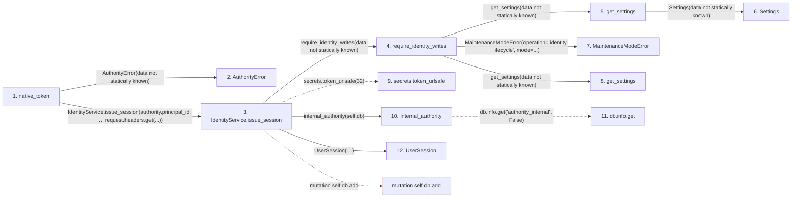

# native_token

**Entry point:** `native_token` (`http`)
**Source:** [routers_identity](../modules/routers_identity.md)
**Modules touched:** [authority](../modules/authority.md), [config](../modules/config.md), [identity_service](../modules/identity_service.md), [maintenance](../modules/maintenance.md), and 4 more

**Complete modules touched:**

- [authority](../modules/authority.md)
- [config](../modules/config.md)
- [identity_service](../modules/identity_service.md)
- [maintenance](../modules/maintenance.md)
- [routers_identity](../modules/routers_identity.md)
- [session_service](../modules/session_service.md)
- [time](../modules/time.md)
- [user_session](../modules/user_session.md)

## Call sequence

> Static overview in presentation order, not runtime execution order. Arrows retain captured callers; representative internal continuations and boundary examples precede repeated helper detail.

```mermaid
sequenceDiagram
    participant p0 as native_token
    participant p1 as IdentityService.issue_session
    participant p2 as get_client_ip
    participant p3 as AuthorityError
    participant p4 as IdentityService
    participant p5 as require_identity_writes
    participant p6 as get_settings
    participant p7 as internal_authority
    participant p8 as UserSession
    participant p9 as digest
    participant p10 as utc_now
    participant p11 as MaintenanceModeError
    participant p12 as Settings
    participant p13 as ip_address
    participant p14 as request.headers.get (backend/app/routers/identity.py:native_token)
    participant p15 as secrets.token_urlsafe
    participant p16 as any
    participant p17 as ip_network
    participant p18 as request.headers.get (backend/app/services/sess…n_service.py:get_client_ip)
    participant p19 as forwarded_for.split(…)[…].strip
    participant p20 as forwarded_for.split
    participant p21 as timedelta
    participant p22 as real_ip.strip
    participant p23 as self.db.add
    participant p24 as self.db.flush
    participant p25 as db.info.get
    participant p26 as hashlib.sha256(…).hexdigest
    participant p27 as datetime.now
    participant p28 as hashlib.sha256
    p0->>p1: IdentityService.issue_session
    p0->>p2: get_client_ip
    p0->>p3: AuthorityError
    p0->>p4: IdentityService
    p1->>p5: require_identity_writes
    p5->>p6: get_settings
    p1->>p7: internal_authority
    p1->>p8: UserSession
    p1->>p9: digest
    p1->>p10: utc_now
    p5->>p11: MaintenanceModeError
    p6->>p12: Settings
    p2-->>p13: ip_address(direct_ip)
    p0-->>p14: request.headers.get (backend/app/routers/identity.py:native_token)('User-Agent')
    p1-->>p15: secrets.token_urlsafe(32)
    p2-->>p16: any(...)
    p2-->>p17: ip_network(network, strict=False)
    p2-->>p18: request.headers.get (backend/app/services/sess…n_service.py:get_client_ip)('X-Forwarded-For')
    p1-->>p15: secrets.token_urlsafe(32)
    p2-->>p19: forwarded_for.split(…)[…].strip
    p2-->>p20: forwarded_for.split(',')
    p2-->>p18: request.headers.get (backend/app/services/sess…n_service.py:get_client_ip)('X-Real-IP')
    p1-->>p21: timedelta(seconds=...)
    p2-->>p22: real_ip.strip
    p1-->>p23: self.db.add(session)
    p1-->>p24: self.db.flush
    p7-->>p25: db.info.get('authority_internal', False)
    p9-->>p26: hashlib.sha256(…).hexdigest
    p10-->>p27: datetime.now(UTC)
    p9-->>p28: hashlib.sha256(value.encode(...))
```

<!-- Auto-generated from static call edges. Dashed arrows are external or unresolved calls. Reviewed runtime conditions and side effects belong in Behavior. -->

> Call sequence diagram shows 30 of 35 interactions; 5 omitted to keep the visualization within the 30-interaction and generated-diagram limits, with uncertain identities omitted rather than inferred.

> Captured boundary calls: external 8 of 8 (0 omitted); unresolved 10 of 11 (1 omitted). These counts cover the captured static trace.

Omitted captured detail, grouped by actual caller occurrence and target module:

| Caller | Parent step | Target module | Kind | Omitted interactions |
| --- | --- | --- | --- | --- |
| `backend/app/services/identity_service.py:require_identity_writes` | 4 | [backend/app/config.py](../modules/config.md) | internal | 1 |
| `backend/app/services/identity_service.py:digest` | 13 | - | unresolved | 1 |
| `backend/app/services/identity_service.py:IdentityService.issue_session` | 3 | [backend/app/utils/time.py](../modules/time.md) | internal | 1 |
| `backend/app/services/identity_service.py:IdentityService.issue_session` | 3 | [backend/app/config.py](../modules/config.md) | internal | 1 |
| `backend/app/services/session_service.py:get_client_ip` | 26 | [backend/app/config.py](../modules/config.md) | internal | 1 |
> Detailed flow queries retain their own coverage and limits; omitted paths may execute at runtime.

## Data flow

<!-- Auto-generated static analysis. Treat values and boundaries as best-effort hints, not runtime proof. -->

### Analysis coverage

**Effect analysis partially available.** Flow assembly and source effect analysis are separate; empty observations do not prove an empty handler body.

Source steps: 17; effect analysis evaluated: 12, partial: 0, unavailable: 5. Counts include steps omitted from the displayed trace.

Collector observations for 12 source steps with known totals: observed: 28, emitted: 28, omitted: 0. Unavailable totals are excluded.

- Callable record unavailable for one or more source steps; those steps have no represented callable body.
- Effect collector totals unavailable; observed counts cover captured records only.

| Step | Callable record | Effect analysis | Collector totals | Observed | Emitted | Omitted |
|---|---|---|---|---:|---:|---:|
| `native_token` | `available` | `evaluated` | `available` | `5` | `5` | `0` |
| `AuthorityError` | `unavailable` | `unavailable` | `unavailable` | — | — | — |
| `IdentityService.issue_session` | `available` | `evaluated` | `available` | `6` | `6` | `0` |
| `require_identity_writes` | `available` | `evaluated` | `available` | `0` | `0` | `0` |
| `get_settings` | `available` | `evaluated` | `available` | `1` | `1` | `0` |
| `Settings` | `unavailable` | `unavailable` | `unavailable` | — | — | — |
| `MaintenanceModeError` | `unavailable` | `unavailable` | `unavailable` | — | — | — |
| `get_settings` | `available` | `evaluated` | `available` | `1` | `1` | `0` |
| `secrets.token_urlsafe` | `not_applicable` | `not_applicable` | `not_applicable` | — | — | — |
| `internal_authority` | `available` | `evaluated` | `available` | `3` | `3` | `0` |
| `db.info.get` | `not_applicable` | `not_applicable` | `not_applicable` | — | — | — |
| `UserSession` | `unavailable` | `unavailable` | `unavailable` | — | — | — |

### Step data

| Step | Inputs | Reads | Writes | Returns |
|---|---|---|---|---|
| `native_token` | `request: Request`, `response: Response`, `db: Database` | - | `response.headers[...]` | `{...}` |
| `AuthorityError` | - | - | - | - |
| `IdentityService.issue_session` | `principal_id`, `ip_address`, `user_agent` | `self.db` | - | `(...)` |
| `require_identity_writes` | - | - | - | - |
| `get_settings` | - | - | - | `Settings(...)` |
| `Settings` | - | - | - | - |
| `MaintenanceModeError` | - | - | - | - |
| `get_settings` | - | - | - | `Settings(...)` |
| `secrets.token_urlsafe` | - | - | - | - |
| `internal_authority` | `db` | - | `db.info[...]`, `db.info[...]` | - |
| `db.info.get` | - | - | - | - |
| `UserSession` | - | - | - | - |

### Call data

| From | To | Line | Call |
|---|---|---:|---|
| native_token | AuthorityError | 319 | `AuthorityError(data not statically known)` |
| native_token | IdentityService.issue_session | 320 | `IdentityService(db).issue_session(authority.principal_id, ..., request.headers.get(...))` |
| IdentityService.issue_session | require_identity_writes | 226 | `require_identity_writes(data not statically known)` |
| require_identity_writes | get_settings | 31 | `get_settings(data not statically known)` |
| get_settings | Settings | 481 | `Settings(data not statically known)` |
| require_identity_writes | MaintenanceModeError | 32 | `MaintenanceModeError(operation='identity lifecycle', mode=...)` |
| require_identity_writes | get_settings | 32 | `get_settings(data not statically known)` |
| IdentityService.issue_session | secrets.token_urlsafe | 227 | `secrets.token_urlsafe(32)` |
| IdentityService.issue_session | internal_authority | 228 | `internal_authority(self.db)` |
| internal_authority | db.info.get | 87 | `db.info.get('authority_internal', False)` |
| IdentityService.issue_session | UserSession | 229 | `UserSession(principal_id=principal_id, session_token_hash=digest(...), csrf_token=secrets.token_urlsafe(...), authenticated_at=utc_now(...), ip_address=..., user_agent=..., expires_at=...)` |

### Boundary effects

| Kind | Target | Step | Line |
|---|---|---|---:|
| mutation | `self.db.add` | `IdentityService.issue_session` | 233 |

### Static analysis gaps

| Kind | Step | Target | Line |
|---|---|---|---:|
| external_call | `IdentityService.issue_session` | `secrets.token_urlsafe` | 227 |
| unresolved_call | `internal_authority` | `db.info.get` | 87 |
| step_limit | `native_token` | `first 12 steps` | 0 |

## Behavior

This flow starts at `native_token` and is classified as `http`. The generated call and data-flow sections are bounded static projections; runtime conditions and side effects require source-level confirmation.
