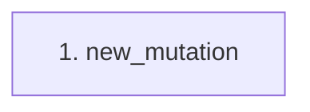

# new_mutation

**Entry point:** `new_mutation` (`http`)
**Source:** [test_runtime_boundaries](../modules/test_runtime_boundaries.md)
**Modules touched:** [test_runtime_boundaries](../modules/test_runtime_boundaries.md)

## Call sequence

> Static overview in presentation order, not runtime execution order. Arrows retain captured callers; representative internal continuations and boundary examples precede repeated helper detail.

<!-- Auto-generated from static call edges. Dashed arrows are external or unresolved calls. Reviewed runtime conditions and side effects belong in Behavior. -->
*No outbound call observations are available in this static trace.*

## Data flow

<!-- Auto-generated static analysis. Treat values and boundaries as best-effort hints, not runtime proof. -->

### Analysis coverage

**Effect analysis evaluated.** Flow assembly and source effect analysis are separate; empty observations do not prove an empty handler body.

Source steps: 1; effect analysis evaluated: 1, partial: 0, unavailable: 0. Counts include steps omitted from the displayed trace.

Collector observations for 1 source steps with known totals: observed: 1, emitted: 1, omitted: 0. Unavailable totals are excluded.

### Step data

| Step | Inputs | Reads | Writes | Returns |
|---|---|---|---|---|
| `new_mutation` | - | - | - | `{...}` |

### Call data

*No call data transfers detected.*

### Boundary effects

*No boundary-effect observations were captured in this static trace.*

### Static analysis gaps

*No static call-resolution gaps detected in the captured trace.*

## Behavior

This flow starts at `new_mutation` and is classified as `http`. The generated call and data-flow sections are bounded static projections; runtime conditions and side effects require source-level confirmation.
