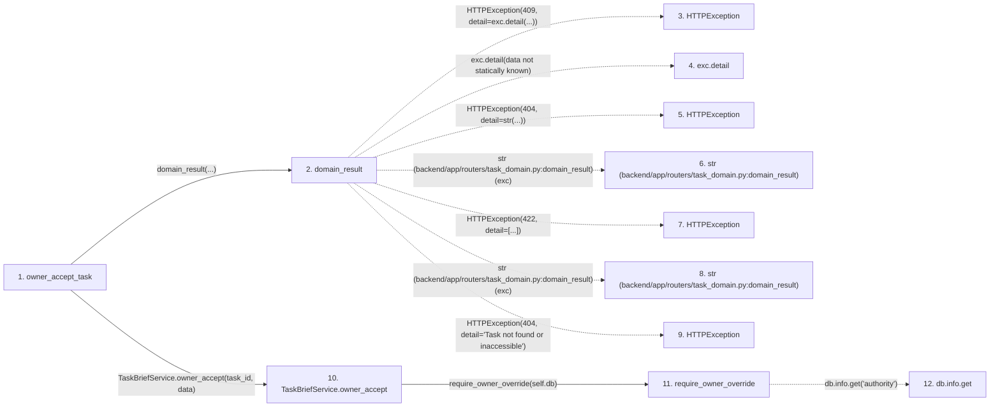

# owner_accept_task

**Entry point:** `owner_accept_task` (`http`)
**Source:** [routers_task_domain](../modules/routers_task_domain.md)
**Modules touched:** [agent_readiness](../modules/agent_readiness.md), [authority](../modules/authority.md), [commands](../modules/commands.md), [external_link_service](../modules/external_link_service.md), and 9 more

**Complete modules touched:**

- [agent_readiness](../modules/agent_readiness.md)
- [authority](../modules/authority.md)
- [commands](../modules/commands.md)
- [external_link_service](../modules/external_link_service.md)
- [review_provenance](../modules/review_provenance.md)
- [routers_task_domain](../modules/routers_task_domain.md)
- [schemas_external_link](../modules/schemas_external_link.md)
- [schemas_task](../modules/schemas_task.md)
- [services_work_metrics](../modules/services_work_metrics.md)
- [snapshot_service](../modules/snapshot_service.md)
- [task_brief_service](../modules/task_brief_service.md)
- [task_service](../modules/task_service.md)
- [time](../modules/time.md)

## Call sequence

> Static overview in presentation order, not runtime execution order. Arrows retain captured callers; representative internal continuations and boundary examples precede repeated helper detail.

```mermaid
sequenceDiagram
    participant p0 as owner_accept_task
    participant p1 as TaskBriefService.owner_accept
    participant p2 as TaskService.task_to_response
    participant p3 as domain_result
    participant p4 as TaskBriefService
    participant p5 as TaskService
    participant p6 as require_owner_override
    participant p7 as TaskBriefService._owner_accept
    participant p8 as task_signals
    participant p9 as evaluate_agent_readiness
    participant p10 as ExternalLinkService.task_links_to_response
    participant p11 as working_today
    participant p12 as ExternalLinkService.link_to_response
    participant p13 as ExternalLinkService.legacy_task_link_response
    participant p14 as TaskBriefService._locked
    participant p15 as different_publisher_required
    participant p16 as _add_criterion
    participant p17 as current_command
    participant p18 as AuthorityError
    participant p19 as TaskAssignee
    participant p20 as TaskProject
    participant p21 as TaskMilestone
    participant p22 as TaskClaimedBy
    participant p23 as TaskResponse
    participant p24 as ExternalLinkService
    participant p25 as utc_now
    participant p26 as effective_work_flags
    participant p27 as PlanningConflict
    participant p28 as _dependency_task
    participant p29 as HTTPException
    participant p30 as exc.detail
    p0->>p1: TaskBriefService.owner_accept
    p0->>p2: TaskService.task_to_response
    p0->>p3: domain_result
    p0->>p4: TaskBriefService
    p0->>p5: TaskService
    p1->>p6: require_owner_override
    p1->>p7: TaskBriefService._owner_accept
    p2->>p8: task_signals
    p2->>p9: evaluate_agent_readiness
    p2->>p10: ExternalLinkService.task_links_to_response
    p8->>p11: working_today
    p10->>p12: ExternalLinkService.link_to_response
    p10->>p13: ExternalLinkService.legacy_task_link_response
    p7->>p14: TaskBriefService._locked
    p7->>p15: different_publisher_required
    p9->>p16: _add_criterion
    p2->>p17: current_command
    p1->>p18: AuthorityError
    p2->>p19: TaskAssignee
    p2->>p20: TaskProject
    p2->>p21: TaskMilestone
    p2->>p22: TaskClaimedBy
    p2->>p23: TaskResponse
    p2->>p24: ExternalLinkService
    p9->>p25: utc_now
    p8->>p26: effective_work_flags
    p7->>p27: PlanningConflict
    p9->>p28: _dependency_task
    p3-->>p29: HTTPException(409, detail=exc.detail(...))
    p3-->>p30: exc.detail
```

<!-- Auto-generated from static call edges. Dashed arrows are external or unresolved calls. Reviewed runtime conditions and side effects belong in Behavior. -->

> Call sequence diagram shows 30 of 177 interactions; 147 omitted to keep the visualization within the 30-interaction and generated-diagram limits, with uncertain identities omitted rather than inferred.

> Captured boundary calls: external 1 of 54 (53 omitted); unresolved 1 of 70 (69 omitted). These counts cover the captured static trace.

Omitted captured detail, grouped by actual caller occurrence and target module:

| Caller | Parent step | Target module | Kind | Omitted interactions |
| --- | --- | --- | --- | --- |
| `backend/app/routers/task_domain.py:domain_result` | 2 | - | external | 5 |
| `backend/app/authority.py:require_owner_override` | 11 | - | unresolved | 1 |
| `backend/app/authority.py:require_owner_override` | 11 | [backend/app/authority.py](../modules/authority.md) | internal | 1 |
| `backend/app/services/task_brief_service.py:TaskBriefService.owner_accept` | 10 | - | unresolved | 1 |
| `backend/app/services/task_brief_service.py:TaskBriefService.owner_accept` | 10 | - | external | 1 |
| `backend/app/services/task_brief_service.py:TaskBriefService._owner_accept` | 17 | [backend/app/commands.py](../modules/commands.md) | internal | 1 |
| `backend/app/commands.py:current_command` | 18 | - | external | 2 |
| `backend/app/commands.py:current_command` | 18 | - | unresolved | 1 |
> Omission summary shows 8 of 48 groups; 40 further groups are not expanded here. Counts above include all omitted interactions.
> Detailed flow queries retain their own coverage and limits; omitted paths may execute at runtime.

## Data flow

<!-- Auto-generated static analysis. Treat values and boundaries as best-effort hints, not runtime proof. -->

### Analysis coverage

**Effect analysis partially available.** Flow assembly and source effect analysis are separate; empty observations do not prove an empty handler body.

Source steps: 54; effect analysis evaluated: 37, partial: 0, unavailable: 17. Counts include steps omitted from the displayed trace.

Collector observations for 37 source steps with known totals: observed: 198, emitted: 198, omitted: 0. Unavailable totals are excluded.

- Callable record unavailable for one or more source steps; those steps have no represented callable body.
- Effect collector totals unavailable; observed counts cover captured records only.

| Step | Callable record | Effect analysis | Collector totals | Observed | Emitted | Omitted |
|---|---|---|---|---:|---:|---:|
| `owner_accept_task` | `available` | `evaluated` | `available` | `4` | `4` | `0` |
| `domain_result` | `available` | `evaluated` | `available` | `3` | `3` | `0` |
| `HTTPException` | `not_applicable` | `not_applicable` | `not_applicable` | — | — | — |
| `exc.detail` | `not_applicable` | `not_applicable` | `not_applicable` | — | — | — |
| `HTTPException` | `not_applicable` | `not_applicable` | `not_applicable` | — | — | — |
| `str (backend/app/routers/task_domain.py:domain_result)` | `not_applicable` | `not_applicable` | `not_applicable` | — | — | — |
| `HTTPException` | `not_applicable` | `not_applicable` | `not_applicable` | — | — | — |
| `str (backend/app/routers/task_domain.py:domain_result)` | `not_applicable` | `not_applicable` | `not_applicable` | — | — | — |
| `HTTPException` | `not_applicable` | `not_applicable` | `not_applicable` | — | — | — |
| `TaskBriefService.owner_accept` | `available` | `evaluated` | `available` | `6` | `6` | `0` |
| `require_owner_override` | `available` | `evaluated` | `available` | `2` | `2` | `0` |
| `db.info.get` | `not_applicable` | `not_applicable` | `not_applicable` | — | — | — |

### Step data

| Step | Inputs | Reads | Writes | Returns |
|---|---|---|---|---|
| `owner_accept_task` | `task_id: int`, `data: OwnerAcceptanceWrite`, `db: DB` | - | - | `...` |
| `domain_result` | `awaitable` | `TaskVersionConflictError` | - | `result` |
| `HTTPException` | - | - | - | - |
| `exc.detail` | - | - | - | - |
| `HTTPException` | - | - | - | - |
| `str (backend/app/routers/task_domain.py:domain_result)` | - | - | - | - |
| `HTTPException` | - | - | - | - |
| `str (backend/app/routers/task_domain.py:domain_result)` | - | - | - | - |
| `HTTPException` | - | - | - | - |
| `TaskBriefService.owner_accept` | `task_id: int`, `data: OwnerAcceptanceWrite` | `self.db` | `self.db.info[...]`, `self.db.info[...]` | `...` |
| `require_owner_override` | `db` | - | - | `authority` |
| `db.info.get` | - | - | - | - |

### Call data

| From | To | Line | Call |
|---|---|---:|---|
| owner_accept_task | domain_result | 278 | `domain_result(...)` |
| domain_result | HTTPException | 55 | `HTTPException(409, detail=exc.detail(...))` |
| domain_result | exc.detail | 55 | `exc.detail(data not statically known)` |
| domain_result | HTTPException | 57 | `HTTPException(404, detail=str(...))` |
| domain_result | str (backend/app/routers/task_domain.py:domain_result) | 57 | `str(exc)` |
| domain_result | HTTPException | 59 | `HTTPException(422, detail=[...])` |
| domain_result | str (backend/app/routers/task_domain.py:domain_result) | 59 | `str(exc)` |
| domain_result | HTTPException | 61 | `HTTPException(404, detail='Task not found or inaccessible')` |
| owner_accept_task | TaskBriefService.owner_accept | 278 | `TaskBriefService(db).owner_accept(task_id, data)` |
| TaskBriefService.owner_accept | require_owner_override | 337 | `require_owner_override(self.db)` |
| require_owner_override | db.info.get | 102 | `db.info.get('authority')` |

### Boundary effects

*No boundary-effect observations were captured in this static trace.*

### Static analysis gaps

| Kind | Step | Target | Line |
|---|---|---|---:|
| external_call | `domain_result` | `HTTPException` | 55 |
| unresolved_call | `domain_result` | `exc.detail` | 55 |
| external_call | `domain_result` | `HTTPException` | 57 |
| external_call | `domain_result` | `HTTPException` | 59 |
| external_call | `domain_result` | `HTTPException` | 61 |
| unresolved_call | `require_owner_override` | `db.info.get` | 102 |
| step_limit | `owner_accept_task` | `first 12 steps` | 0 |

## Behavior

This flow starts at `owner_accept_task` and is classified as `http`. The generated call and data-flow sections are bounded static projections; runtime conditions and side effects require source-level confirmation.
