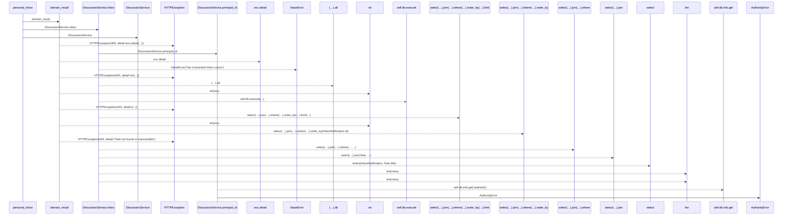
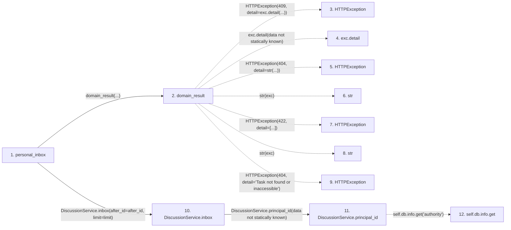

# personal_inbox

**Entry point:** `personal_inbox` (`http`)
**Source:** [routers_discussion](../modules/routers_discussion.md)
**Modules touched:** [authority](../modules/authority.md), [discussion_service](../modules/discussion_service.md), [routers_discussion](../modules/routers_discussion.md), [routers_task_domain](../modules/routers_task_domain.md)

## Call sequence

> Static overview in presentation order, not runtime execution order. Arrows retain captured callers; representative internal continuations and boundary examples precede repeated helper detail.

<!-- Auto-generated from static call edges. Dashed arrows are external or unresolved calls. Reviewed runtime conditions and side effects belong in Behavior. -->

> Call sequence diagram shows 23 of 23 interactions; 0 omitted to keep the visualization within the 30-interaction and generated-diagram limits, with uncertain identities omitted rather than inferred.

> Captured boundary calls: external 10 of 10 (0 omitted); unresolved 8 of 8 (0 omitted). These counts cover the captured static trace.
> Detailed flow queries retain their own coverage and limits; omitted paths may execute at runtime.

## Data flow

<!-- Auto-generated static analysis. Treat values and boundaries as best-effort hints, not runtime proof. -->

### Analysis coverage

**Effect analysis partially available.** Flow assembly and source effect analysis are separate; empty observations do not prove an empty handler body.

Source steps: 6; effect analysis evaluated: 4, partial: 0, unavailable: 2. Counts include steps omitted from the displayed trace.

Collector observations for 4 source steps with known totals: observed: 11, emitted: 11, omitted: 0. Unavailable totals are excluded.

- Callable record unavailable for one or more source steps; those steps have no represented callable body.
- Effect collector totals unavailable; observed counts cover captured records only.

| Step | Callable record | Effect analysis | Collector totals | Observed | Emitted | Omitted |
|---|---|---|---|---:|---:|---:|
| `personal_inbox` | `available` | `evaluated` | `available` | `4` | `4` | `0` |
| `domain_result` | `available` | `evaluated` | `available` | `3` | `3` | `0` |
| `HTTPException` | `not_applicable` | `not_applicable` | `not_applicable` | — | — | — |
| `exc.detail` | `not_applicable` | `not_applicable` | `not_applicable` | — | — | — |
| `HTTPException` | `not_applicable` | `not_applicable` | `not_applicable` | — | — | — |
| `str` | `not_applicable` | `not_applicable` | `not_applicable` | — | — | — |
| `HTTPException` | `not_applicable` | `not_applicable` | `not_applicable` | — | — | — |
| `str` | `not_applicable` | `not_applicable` | `not_applicable` | — | — | — |
| `HTTPException` | `not_applicable` | `not_applicable` | `not_applicable` | — | — | — |
| `DiscussionService.inbox` | `available` | `evaluated` | `available` | `3` | `3` | `0` |
| `DiscussionService.principal_id` | `available` | `evaluated` | `available` | `1` | `1` | `0` |
| `self.db.info.get` | `not_applicable` | `not_applicable` | `not_applicable` | — | — | — |

### Step data

| Step | Inputs | Reads | Writes | Returns |
|---|---|---|---|---|
| `personal_inbox` | `db: DiscussionDatabase`, `after_id: int`, `limit: int` | - | - | `...` |
| `domain_result` | `awaitable` | `TaskVersionConflictError` | - | `result` |
| `HTTPException` | - | - | - | - |
| `exc.detail` | - | - | - | - |
| `HTTPException` | - | - | - | - |
| `str` | - | - | - | - |
| `HTTPException` | - | - | - | - |
| `str` | - | - | - | - |
| `HTTPException` | - | - | - | - |
| `DiscussionService.inbox` | `after_id`, `limit` | - | - | `{...}` |
| `DiscussionService.principal_id` | - | - | - | `authority.principal_id` |
| `self.db.info.get` | - | - | - | - |

### Call data

| From | To | Line | Call |
|---|---|---:|---|
| personal_inbox | domain_result | 75 | `domain_result(...)` |
| domain_result | HTTPException | 51 | `HTTPException(409, detail=exc.detail(...))` |
| domain_result | exc.detail | 51 | `exc.detail(data not statically known)` |
| domain_result | HTTPException | 53 | `HTTPException(404, detail=str(...))` |
| domain_result | str | 53 | `str(exc)` |
| domain_result | HTTPException | 55 | `HTTPException(422, detail=[...])` |
| domain_result | str | 55 | `str(exc)` |
| domain_result | HTTPException | 57 | `HTTPException(404, detail='Task not found or inaccessible')` |
| personal_inbox | DiscussionService.inbox | 75 | `DiscussionService(db).inbox(after_id=after_id, limit=limit)` |
| DiscussionService.inbox | DiscussionService.principal_id | 236 | `self.principal_id(data not statically known)` |
| DiscussionService.principal_id | self.db.info.get | 24 | `self.db.info.get('authority')` |

### Boundary effects

*No boundary-effect observations were captured in this static trace.*

### Static analysis gaps

| Kind | Step | Target | Line |
|---|---|---|---:|
| external_call | `domain_result` | `HTTPException` | 51 |
| unresolved_call | `domain_result` | `exc.detail` | 51 |
| external_call | `domain_result` | `HTTPException` | 53 |
| external_call | `domain_result` | `HTTPException` | 55 |
| external_call | `domain_result` | `HTTPException` | 57 |
| unresolved_call | `DiscussionService.principal_id` | `self.db.info.get` | 24 |
| step_limit | `personal_inbox` | `first 12 steps` | 0 |

## Behavior

Returns a bounded personal inbox joined to currently visible tasks. Read/unread state is independent of task status, and revoked task access removes its notifications from the projection.
