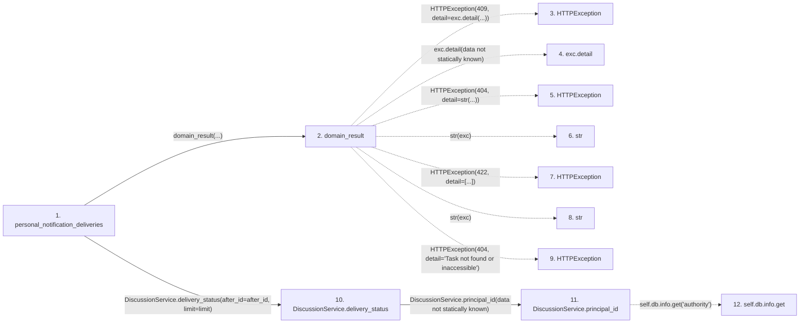

# personal_notification_deliveries

**Entry point:** `personal_notification_deliveries` (`http`)
**Source:** [routers_discussion](../modules/routers_discussion.md)
**Modules touched:** [authority](../modules/authority.md), [discussion_service](../modules/discussion_service.md), [routers_discussion](../modules/routers_discussion.md), [routers_task_domain](../modules/routers_task_domain.md)

## Call sequence

> Static overview in presentation order, not runtime execution order. Arrows retain captured callers; representative internal continuations and boundary examples precede repeated helper detail.

```mermaid
sequenceDiagram
    participant p0 as personal_notification_deliveries
    participant p1 as domain_result
    participant p2 as DiscussionService.delivery_status
    participant p3 as DiscussionService
    participant p4 as HTTPException
    participant p5 as DiscussionService.principal_id
    participant p6 as exc.detail
    participant p7 as ValueError
    participant p8 as select(…).join(…).where
    participant p9 as str
    participant p10 as select(…).join
    participant p11 as select
    participant p12 as OutboundWebhookDelivery.payload_json[…].as_integer (backend/app/services/disc…Service.delivery_status, 1)
    participant p13 as OutboundWebhookDelivery.payload_json[…].as_integer (backend/app/services/disc…ionService.delivery_status)
    participant p14 as (…).all
    participant p15 as self.db.execute
    participant p16 as query.order_by(…).limit
    participant p17 as query.order_by
    participant p18 as len
    participant p19 as self.db.info.get
    participant p20 as AuthorityError
    p0->>p1: domain_result
    p0->>p2: DiscussionService.delivery_status
    p0->>p3: DiscussionService
    p1-->>p4: HTTPException(409, detail=exc.detail(...))
    p2->>p5: DiscussionService.principal_id
    p1-->>p6: exc.detail
    p2-->>p7: ValueError('Use a bounded delivery cursor')
    p1-->>p4: HTTPException(404, detail=str(...))
    p2-->>p8: select(…).join(…).where(..., ..., ...)
    p1-->>p9: str(exc)
    p2-->>p10: select(…).join(Task, ...)
    p1-->>p4: HTTPException(422, detail=[...])
    p2-->>p11: select(OutboundWebhookDelivery, Task.title)
    p1-->>p9: str(exc)
    p2-->>p12: OutboundWebhookDelivery.payload_json[…].as_integer (backend/app/services/disc…Service.delivery_status, 1)
    p1-->>p4: HTTPException(404, detail='Task not found or inaccessible')
    p2-->>p13: OutboundWebhookDelivery.payload_json[…].as_integer (backend/app/services/disc…ionService.delivery_status)
    p2-->>p14: (…).all
    p2-->>p15: self.db.execute(...)
    p2-->>p16: query.order_by(…).limit(...)
    p2-->>p17: query.order_by(OutboundWebhookDelivery.id)
    p2-->>p18: len(rows)
    p2-->>p18: len(rows)
    p5-->>p19: self.db.info.get('authority')
    p5->>p20: AuthorityError
```

<!-- Auto-generated from static call edges. Dashed arrows are external or unresolved calls. Reviewed runtime conditions and side effects belong in Behavior. -->

> Call sequence diagram shows 25 of 25 interactions; 0 omitted to keep the visualization within the 30-interaction and generated-diagram limits, with uncertain identities omitted rather than inferred.

> Captured boundary calls: external 10 of 10 (0 omitted); unresolved 10 of 10 (0 omitted). These counts cover the captured static trace.
> Detailed flow queries retain their own coverage and limits; omitted paths may execute at runtime.

## Data flow

<!-- Auto-generated static analysis. Treat values and boundaries as best-effort hints, not runtime proof. -->

### Analysis coverage

**Effect analysis partially available.** Flow assembly and source effect analysis are separate; empty observations do not prove an empty handler body.

Source steps: 6; effect analysis evaluated: 4, partial: 0, unavailable: 2. Counts include steps omitted from the displayed trace.

Collector observations for 4 source steps with known totals: observed: 13, emitted: 13, omitted: 0. Unavailable totals are excluded.

- Callable record unavailable for one or more source steps; those steps have no represented callable body.
- Effect collector totals unavailable; observed counts cover captured records only.

| Step | Callable record | Effect analysis | Collector totals | Observed | Emitted | Omitted |
|---|---|---|---|---:|---:|---:|
| `personal_notification_deliveries` | `available` | `evaluated` | `available` | `4` | `4` | `0` |
| `domain_result` | `available` | `evaluated` | `available` | `3` | `3` | `0` |
| `HTTPException` | `not_applicable` | `not_applicable` | `not_applicable` | — | — | — |
| `exc.detail` | `not_applicable` | `not_applicable` | `not_applicable` | — | — | — |
| `HTTPException` | `not_applicable` | `not_applicable` | `not_applicable` | — | — | — |
| `str` | `not_applicable` | `not_applicable` | `not_applicable` | — | — | — |
| `HTTPException` | `not_applicable` | `not_applicable` | `not_applicable` | — | — | — |
| `str` | `not_applicable` | `not_applicable` | `not_applicable` | — | — | — |
| `HTTPException` | `not_applicable` | `not_applicable` | `not_applicable` | — | — | — |
| `DiscussionService.delivery_status` | `available` | `evaluated` | `available` | `5` | `5` | `0` |
| `DiscussionService.principal_id` | `available` | `evaluated` | `available` | `1` | `1` | `0` |
| `self.db.info.get` | `not_applicable` | `not_applicable` | `not_applicable` | — | — | — |

### Step data

| Step | Inputs | Reads | Writes | Returns |
|---|---|---|---|---|
| `personal_notification_deliveries` | `db: DiscussionDatabase`, `after_id: int`, `limit: int` | - | - | `...` |
| `domain_result` | `awaitable` | `TaskVersionConflictError` | - | `result` |
| `HTTPException` | - | - | - | - |
| `exc.detail` | - | - | - | - |
| `HTTPException` | - | - | - | - |
| `str` | - | - | - | - |
| `HTTPException` | - | - | - | - |
| `str` | - | - | - | - |
| `HTTPException` | - | - | - | - |
| `DiscussionService.delivery_status` | `after_id`, `limit` | `OutboundWebhookDelivery`, `SUPPRESSED_DELIVERY_ERRORS` | - | `{...}` |
| `DiscussionService.principal_id` | - | - | - | `authority.principal_id` |
| `self.db.info.get` | - | - | - | - |

### Call data

| From | To | Line | Call |
|---|---|---:|---|
| personal_notification_deliveries | domain_result | 80 | `domain_result(...)` |
| domain_result | HTTPException | 51 | `HTTPException(409, detail=exc.detail(...))` |
| domain_result | exc.detail | 51 | `exc.detail(data not statically known)` |
| domain_result | HTTPException | 53 | `HTTPException(404, detail=str(...))` |
| domain_result | str | 53 | `str(exc)` |
| domain_result | HTTPException | 55 | `HTTPException(422, detail=[...])` |
| domain_result | str | 55 | `str(exc)` |
| domain_result | HTTPException | 57 | `HTTPException(404, detail='Task not found or inaccessible')` |
| personal_notification_deliveries | DiscussionService.delivery_status | 80 | `DiscussionService(db).delivery_status(after_id=after_id, limit=limit)` |
| DiscussionService.delivery_status | DiscussionService.principal_id | 259 | `self.principal_id(data not statically known)` |
| DiscussionService.principal_id | self.db.info.get | 24 | `self.db.info.get('authority')` |

### Boundary effects

*No boundary-effect observations were captured in this static trace.*

### Static analysis gaps

| Kind | Step | Target | Line |
|---|---|---|---:|
| external_call | `domain_result` | `HTTPException` | 51 |
| unresolved_call | `domain_result` | `exc.detail` | 51 |
| external_call | `domain_result` | `HTTPException` | 53 |
| external_call | `domain_result` | `HTTPException` | 55 |
| external_call | `domain_result` | `HTTPException` | 57 |
| unresolved_call | `DiscussionService.principal_id` | `self.db.info.get` | 24 |
| step_limit | `personal_notification_deliveries` | `first 12 steps` | 0 |

## Behavior

Shows the current person’s scoped inbox delivery state and bounded attempt information. Access/subscription suppression is distinct from successful delivery and transient failure; private transport payloads are not returned.
