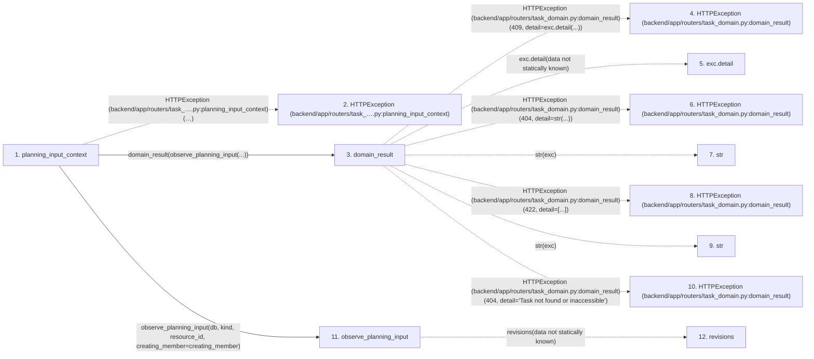

# planning_input_context

**Entry point:** `planning_input_context` (`http`)
**Source:** [routers_task_domain](../modules/routers_task_domain.md)
**Modules touched:** [commands](../modules/commands.md), [planning_input_context](../modules/planning_input_context.md), [routers_task_domain](../modules/routers_task_domain.md)

## Call sequence

> Static overview in presentation order, not runtime execution order. Arrows retain captured callers; representative internal continuations and boundary examples precede repeated helper detail.

```mermaid
sequenceDiagram
    participant p0 as planning_input_context
    participant p1 as observe_planning_input
    participant p2 as domain_result
    participant p3 as PlanningInputUnavailable
    participant p4 as PlanningConflict
    participant p5 as HTTPException (backend/app/routers/task_….py:planning_input_context)
    participant p6 as revisions
    participant p7 as HTTPException (backend/app/routers/task_domain.py:domain_result)
    participant p8 as exc.detail
    participant p9 as list
    participant p10 as (…).mappings().first
    participant p11 as str
    participant p12 as (…).mappings (backend/app/services/plan…:observe_planning_input, 2)
    participant p13 as db.execute
    participant p14 as select(…).where (backend/app/services/plan…:observe_planning_input, 2)
    participant p15 as select
    participant p16 as dict
    participant p17 as (…).mappings().all (backend/app/services/plan…:observe_planning_input, 1)
    participant p18 as (…).mappings (backend/app/services/plan…:observe_planning_input, 1)
    participant p19 as select(…).where(…).order_by(…).limit (backend/app/services/plan…:observe_planning_input, 1)
    participant p20 as select(…).where(…).order_by (backend/app/services/plan…:observe_planning_input, 1)
    participant p21 as select(…).where (backend/app/services/plan…:observe_planning_input, 1)
    participant p22 as len
    participant p23 as (…).mappings().all (backend/app/services/plan….py:observe_planning_input)
    p0->>p1: observe_planning_input
    p0->>p2: domain_result
    p1->>p3: PlanningInputUnavailable
    p1->>p4: PlanningConflict
    p0-->>p5: HTTPException (backend/app/routers/task_….py:planning_input_context)(…)
    p1-->>p6: revisions
    p2-->>p7: HTTPException (backend/app/routers/task_domain.py:domain_result)(409, detail=exc.detail(...))
    p2-->>p8: exc.detail
    p1-->>p9: list(model.__table__.columns)
    p2-->>p7: HTTPException (backend/app/routers/task_domain.py:domain_result)(404, detail=str(...))
    p1-->>p10: (…).mappings().first
    p2-->>p11: str(exc)
    p1-->>p12: (…).mappings (backend/app/services/plan…:observe_planning_input, 2)
    p2-->>p7: HTTPException (backend/app/routers/task_domain.py:domain_result)(422, detail=[...])
    p1-->>p13: db.execute(...)
    p2-->>p11: str(exc)
    p1-->>p14: select(…).where (backend/app/services/plan…:observe_planning_input, 2)(...)
    p2-->>p7: HTTPException (backend/app/routers/task_domain.py:domain_result)(404, detail='Task not found or inaccessible')
    p1-->>p15: select(...)
    p1-->>p16: dict(row)
    p1-->>p17: (…).mappings().all (backend/app/services/plan…:observe_planning_input, 1)
    p1-->>p18: (…).mappings (backend/app/services/plan…:observe_planning_input, 1)
    p1-->>p13: db.execute(...)
    p1-->>p19: select(…).where(…).order_by(…).limit (backend/app/services/plan…:observe_planning_input, 1)(501)
    p1-->>p20: select(…).where(…).order_by (backend/app/services/plan…:observe_planning_input, 1)(Vacation.id)
    p1-->>p21: select(…).where (backend/app/services/plan…:observe_planning_input, 1)(...)
    p1-->>p15: select(...)
    p1-->>p22: len(vacations)
    p1-->>p16: dict(vacation)
    p1-->>p23: (…).mappings().all (backend/app/services/plan….py:observe_planning_input)
```

<!-- Auto-generated from static call edges. Dashed arrows are external or unresolved calls. Reviewed runtime conditions and side effects belong in Behavior. -->

> Call sequence diagram shows 30 of 45 interactions; 15 omitted to keep the visualization within the 30-interaction and generated-diagram limits, with uncertain identities omitted rather than inferred.

> Captured boundary calls: external 13 of 18 (5 omitted); unresolved 13 of 20 (7 omitted). These counts cover the captured static trace.

Omitted captured detail, grouped by actual caller occurrence and target module:

| Caller | Parent step | Target module | Kind | Omitted interactions |
| --- | --- | --- | --- | --- |
| `backend/app/services/planning_input_context.py:observe_planning_input` | 11 | - | unresolved | 7 |
| `backend/app/services/planning_input_context.py:observe_planning_input` | 11 | - | external | 5 |
| `backend/app/services/planning_input_context.py:observe_planning_input` | 11 | [backend/app/commands.py](../modules/commands.md) | internal | 3 |
> Detailed flow queries retain their own coverage and limits; omitted paths may execute at runtime.

## Data flow

<!-- Auto-generated static analysis. Treat values and boundaries as best-effort hints, not runtime proof. -->

### Analysis coverage

**Effect analysis partially available.** Flow assembly and source effect analysis are separate; empty observations do not prove an empty handler body.

Source steps: 8; effect analysis evaluated: 3, partial: 0, unavailable: 5. Counts include steps omitted from the displayed trace.

Collector observations for 3 source steps with known totals: observed: 17, emitted: 17, omitted: 0. Unavailable totals are excluded.

- Callable record unavailable for one or more source steps; those steps have no represented callable body.
- Effect collector totals unavailable; observed counts cover captured records only.

| Step | Callable record | Effect analysis | Collector totals | Observed | Emitted | Omitted |
|---|---|---|---|---:|---:|---:|
| `planning_input_context` | `available` | `evaluated` | `available` | `5` | `5` | `0` |
| `HTTPException (backend/app/routers/task_….py:planning_input_context)` | `not_applicable` | `not_applicable` | `not_applicable` | — | — | — |
| `domain_result` | `available` | `evaluated` | `available` | `3` | `3` | `0` |
| `HTTPException (backend/app/routers/task_domain.py:domain_result)` | `not_applicable` | `not_applicable` | `not_applicable` | — | — | — |
| `exc.detail` | `not_applicable` | `not_applicable` | `not_applicable` | — | — | — |
| `HTTPException (backend/app/routers/task_domain.py:domain_result)` | `not_applicable` | `not_applicable` | `not_applicable` | — | — | — |
| `str` | `not_applicable` | `not_applicable` | `not_applicable` | — | — | — |
| `HTTPException (backend/app/routers/task_domain.py:domain_result)` | `not_applicable` | `not_applicable` | `not_applicable` | — | — | — |
| `str` | `not_applicable` | `not_applicable` | `not_applicable` | — | — | — |
| `HTTPException (backend/app/routers/task_domain.py:domain_result)` | `not_applicable` | `not_applicable` | `not_applicable` | — | — | — |
| `observe_planning_input` | `available` | `evaluated` | `available` | `9` | `9` | `0` |
| `revisions` | `not_applicable` | `not_applicable` | `not_applicable` | — | — | — |

### Step data

| Step | Inputs | Reads | Writes | Returns |
|---|---|---|---|---|
| `planning_input_context` | `kind: Literal['calendar', 'project', 'iteration', 'profile', 'member', 'vacation']`, `resource_id: int`, `db: DB`, `creating_member: bool` | - | - | `...` |
| `HTTPException (backend/app/routers/task_….py:planning_input_context)` | - | - | - | - |
| `domain_result` | `awaitable` | `TaskVersionConflictError` | - | `result` |
| `HTTPException (backend/app/routers/task_domain.py:domain_result)` | - | - | - | - |
| `exc.detail` | - | - | - | - |
| `HTTPException (backend/app/routers/task_domain.py:domain_result)` | - | - | - | - |
| `str` | - | - | - | - |
| `HTTPException (backend/app/routers/task_domain.py:domain_result)` | - | - | - | - |
| `str` | - | - | - | - |
| `HTTPException (backend/app/routers/task_domain.py:domain_result)` | - | - | - | - |
| `observe_planning_input` | `db`, `kind`, `resource_id`, `creating_member`, `intent` | - | `values[...]`, `resource[...]`, `resource[...]` | `{...}` |
| `revisions` | - | - | - | - |

### Call data

| From | To | Line | Call |
|---|---|---:|---|
| planning_input_context | HTTPException (backend/app/routers/task_….py:planning_input_context) | 33 | `HTTPException(422, detail='Use a positive planning resource identity and a supported member-create context.')` |
| planning_input_context | domain_result | 35 | `domain_result(observe_planning_input(...))` |
| domain_result | HTTPException (backend/app/routers/task_domain.py:domain_result) | 51 | `HTTPException(409, detail=exc.detail(...))` |
| domain_result | exc.detail | 51 | `exc.detail(data not statically known)` |
| domain_result | HTTPException (backend/app/routers/task_domain.py:domain_result) | 53 | `HTTPException(404, detail=str(...))` |
| domain_result | str | 53 | `str(exc)` |
| domain_result | HTTPException (backend/app/routers/task_domain.py:domain_result) | 55 | `HTTPException(422, detail=[...])` |
| domain_result | str | 55 | `str(exc)` |
| domain_result | HTTPException (backend/app/routers/task_domain.py:domain_result) | 57 | `HTTPException(404, detail='Task not found or inaccessible')` |
| planning_input_context | observe_planning_input | 35 | `observe_planning_input(db, kind, resource_id, creating_member=creating_member)` |
| observe_planning_input | revisions | 147 | `revisions(data not statically known)` |

### Boundary effects

*No boundary-effect observations were captured in this static trace.*

### Static analysis gaps

| Kind | Step | Target | Line |
|---|---|---|---:|
| external_call | `planning_input_context` | `HTTPException` | 33 |
| external_call | `domain_result` | `HTTPException` | 51 |
| unresolved_call | `domain_result` | `exc.detail` | 51 |
| external_call | `domain_result` | `HTTPException` | 53 |
| external_call | `domain_result` | `HTTPException` | 55 |
| external_call | `domain_result` | `HTTPException` | 57 |
| unresolved_call | `observe_planning_input` | `revisions` | 147 |
| step_limit | `planning_input_context` | `first 12 steps` | 0 |

## Behavior

This flow starts at `planning_input_context` and is classified as `http`. The generated call and data-flow sections are bounded static projections; runtime conditions and side effects require source-level confirmation.
