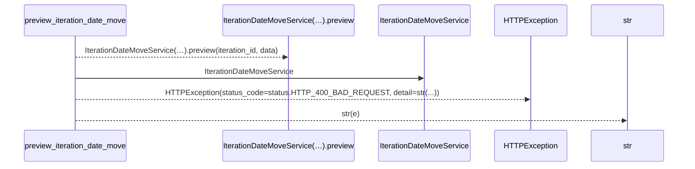
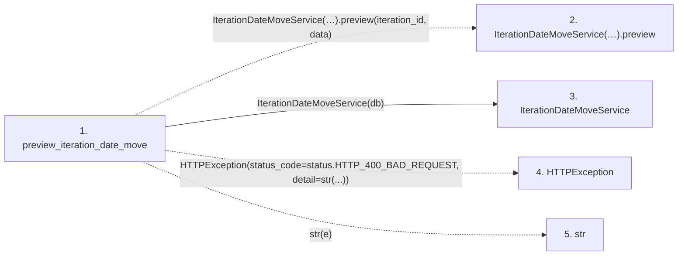

# preview_iteration_date_move

**Entry point:** `preview_iteration_date_move` (`http`)
**Source:** [iterations](../modules/iterations.md)
**Modules touched:** [iteration_date_move](../modules/iteration_date_move.md), [iterations](../modules/iterations.md)

## Call sequence

> Static overview in presentation order, not runtime execution order. Arrows retain captured callers; representative internal continuations and boundary examples precede repeated helper detail.

<!-- Auto-generated from static call edges. Dashed arrows are external or unresolved calls. Reviewed runtime conditions and side effects belong in Behavior. -->

> Call sequence diagram shows 4 of 4 interactions; 0 omitted to keep the visualization within the 30-interaction and generated-diagram limits, with uncertain identities omitted rather than inferred.

> Captured boundary calls: external 2 of 2 (0 omitted); unresolved 1 of 1 (0 omitted). These counts cover the captured static trace.
> Detailed flow queries retain their own coverage and limits; omitted paths may execute at runtime.

## Data flow

<!-- Auto-generated static analysis. Treat values and boundaries as best-effort hints, not runtime proof. -->

### Analysis coverage

**Effect analysis partially available.** Flow assembly and source effect analysis are separate; empty observations do not prove an empty handler body.

Source steps: 2; effect analysis evaluated: 1, partial: 0, unavailable: 1. Counts include steps omitted from the displayed trace.

Collector observations for 1 source steps with known totals: observed: 5, emitted: 5, omitted: 0. Unavailable totals are excluded.

- Callable record unavailable for one or more source steps; those steps have no represented callable body.
- Effect collector totals unavailable; observed counts cover captured records only.

| Step | Callable record | Effect analysis | Collector totals | Observed | Emitted | Omitted |
|---|---|---|---|---:|---:|---:|
| `preview_iteration_date_move` | `available` | `evaluated` | `available` | `5` | `5` | `0` |
| `IterationDateMoveService(…).preview` | `not_applicable` | `not_applicable` | `not_applicable` | — | — | — |
| `IterationDateMoveService` | `unavailable` | `unavailable` | `unavailable` | — | — | — |
| `HTTPException` | `not_applicable` | `not_applicable` | `not_applicable` | — | — | — |
| `str` | `not_applicable` | `not_applicable` | `not_applicable` | — | — | — |

### Step data

| Step | Inputs | Reads | Writes | Returns |
|---|---|---|---|---|
| `preview_iteration_date_move` | `iteration_id: int`, `data: IterationDateMoveRequest`, `db: Annotated[AsyncSession, Depends(get_db, scope='function')]` | `status` | - | `...` |
| `IterationDateMoveService(…).preview` | - | - | - | - |
| `IterationDateMoveService` | - | - | - | - |
| `HTTPException` | - | - | - | - |
| `str` | - | - | - | - |

### Call data

| From | To | Line | Call |
|---|---|---:|---|
| preview_iteration_date_move | IterationDateMoveService(…).preview | 162 | `IterationDateMoveService(db).preview(iteration_id, data)` |
| preview_iteration_date_move | IterationDateMoveService | 162 | `IterationDateMoveService(db)` |
| preview_iteration_date_move | HTTPException | 164 | `HTTPException(status_code=status.HTTP_400_BAD_REQUEST, detail=str(...))` |
| preview_iteration_date_move | str | 164 | `str(e)` |

### Boundary effects

*No boundary-effect observations were captured in this static trace.*

### Static analysis gaps

| Kind | Step | Target | Line |
|---|---|---|---:|
| unresolved_call | `preview_iteration_date_move` | `IterationDateMoveService(db).preview` | 162 |
| external_call | `preview_iteration_date_move` | `HTTPException` | 164 |

## Behavior

Previews a proposed iteration period against each person's shared capacity. It runs the real iteration update inside a rolled-back command, so it refuses exactly what the update would refuse and observes the same revisions, then compares, per person of the iteration team and per date of the proposed period, the hours this iteration's rows would request with the hours the person's other rows already book in any project, with dated adjustments applied. Bookings in iterations the caller cannot read are reported only as a total. Nothing is saved.
