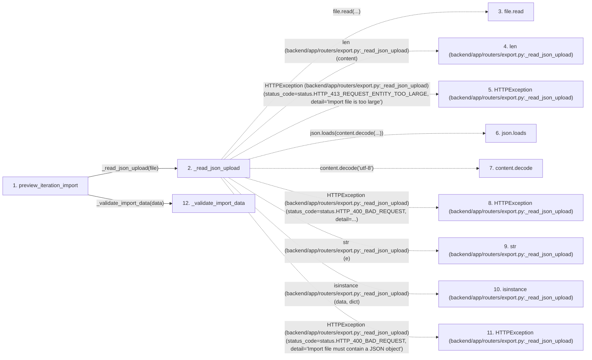

# preview_iteration_import

**Entry point:** `preview_iteration_import` (`http`)
**Source:** [export](../modules/export.md)
**Modules touched:** [commands](../modules/commands.md), [export](../modules/export.md), [import_planning_service](../modules/import_planning_service.md), [iteration_service](../modules/iteration_service.md)

## Call sequence

> Static overview in presentation order, not runtime execution order. Arrows retain captured callers; representative internal continuations and boundary examples precede repeated helper detail.

```mermaid
sequenceDiagram
    participant p0 as preview_iteration_import
    participant p1 as _validate_import_data
    participant p2 as observe_import_planning
    participant p3 as _read_json_upload
    participant p4 as IterationService.get_by_id
    participant p5 as IterationService
    participant p6 as _validate_import_task_tree
    participant p7 as PlanningConflict
    participant p8 as HTTPException (backend/app/routers/expor…y:preview_iteration_import)
    participant p9 as file.read
    participant p10 as data.get
    participant p11 as self.db.execute
    participant p12 as read
    participant p13 as len (backend/app/routers/export.py:_read_json_upload)
    participant p14 as isinstance (backend/app/routers/export.py:_validate_import_data)
    participant p15 as select(…).options(…).where
    participant p16 as hashlib.sha256(…).hexdigest
    participant p17 as HTTPException (backend/app/routers/export.py:_read_json_upload)
    participant p18 as HTTPException (backend/app/routers/export.py:_validate_import_data)
    participant p19 as select(…).options
    participant p20 as hashlib.sha256
    participant p21 as json.loads
    participant p22 as select
    participant p23 as json.dumps(…).encode (backend/app/services/impo…observe_import_planning, 1)
    participant p24 as content.decode
    participant p25 as selectinload
    participant p26 as json.dumps
    p0->>p1: _validate_import_data
    p0->>p2: observe_import_planning
    p0->>p3: _read_json_upload
    p0->>p4: IterationService.get_by_id
    p0->>p5: IterationService
    p1->>p6: _validate_import_task_tree
    p2->>p7: PlanningConflict
    p0-->>p8: HTTPException (backend/app/routers/expor…y:preview_iteration_import)(404, detail='Iteration not found or inaccessible')
    p3-->>p9: file.read(...)
    p1-->>p10: data.get('tasks', [...])
    p4-->>p11: self.db.execute(...)
    p2-->>p12: read
    p3-->>p13: len (backend/app/routers/export.py:_read_json_upload)(content)
    p1-->>p14: isinstance (backend/app/routers/export.py:_validate_import_data)(tasks, list)
    p4-->>p15: select(…).options(…).where(...)
    p2-->>p16: hashlib.sha256(…).hexdigest
    p3-->>p17: HTTPException (backend/app/routers/export.py:_read_json_upload)(status_code=status.HTTP_413_REQUEST_ENTITY_TOO_LARGE, detail='Import file is too large')
    p1-->>p18: HTTPException (backend/app/routers/export.py:_validate_import_data)(422, detail='Tasks must be a list')
    p4-->>p19: select(…).options(selectinload(...), selectinload(...))
    p2-->>p20: hashlib.sha256(...)
    p3-->>p21: json.loads(content.decode(...))
    p4-->>p22: select(Iteration)
    p2-->>p23: json.dumps(…).encode (backend/app/services/impo…observe_import_planning, 1)
    p3-->>p24: content.decode('utf-8')
    p1-->>p10: data.get('team_members', [...])
    p4-->>p25: selectinload(Iteration.calendar)
    p2-->>p26: json.dumps(data, sort_keys=True, separators=(...))
    p3-->>p17: HTTPException (backend/app/routers/export.py:_read_json_upload)(status_code=status.HTTP_400_BAD_REQUEST, detail=...)
    p1-->>p14: isinstance (backend/app/routers/export.py:_validate_import_data)(members, list)
    p4-->>p25: selectinload(Iteration.project)
```

<!-- Auto-generated from static call edges. Dashed arrows are external or unresolved calls. Reviewed runtime conditions and side effects belong in Behavior. -->

> Call sequence diagram shows 30 of 54 interactions; 24 omitted to keep the visualization within the 30-interaction and generated-diagram limits, with uncertain identities omitted rather than inferred.

> Captured boundary calls: external 13 of 30 (17 omitted); unresolved 10 of 16 (6 omitted). These counts cover the captured static trace.

Omitted captured detail, grouped by actual caller occurrence and target module:

| Caller | Parent step | Target module | Kind | Omitted interactions |
| --- | --- | --- | --- | --- |
| `backend/app/routers/export.py:_read_json_upload` | 2 | - | external | 3 |
| `backend/app/routers/export.py:_validate_import_task_tree` | 16 | - | unresolved | 3 |
| `backend/app/routers/export.py:_validate_import_task_tree` | 16 | - | external | 6 |
| `backend/app/routers/export.py:_validate_import_data` | 12 | - | external | 6 |
| `backend/app/services/iteration_service.py:IterationService.get_by_id` | 34 | - | unresolved | 1 |
| `backend/app/services/import_planning_service.py:observe_import_planning` | 44 | - | unresolved | 2 |
| `backend/app/services/import_planning_service.py:observe_import_planning` | 44 | - | external | 2 |
| `backend/app/services/import_planning_service.py:observe_import_planning` | 44 | [backend/app/commands.py](../modules/commands.md) | internal | 1 |
> Detailed flow queries retain their own coverage and limits; omitted paths may execute at runtime.

## Data flow

<!-- Auto-generated static analysis. Treat values and boundaries as best-effort hints, not runtime proof. -->

### Analysis coverage

**Effect analysis partially available.** Flow assembly and source effect analysis are separate; empty observations do not prove an empty handler body.

Source steps: 9; effect analysis evaluated: 6, partial: 0, unavailable: 3. Counts include steps omitted from the displayed trace.

Collector observations for 6 source steps with known totals: observed: 27, emitted: 27, omitted: 0. Unavailable totals are excluded.

- Callable record unavailable for one or more source steps; those steps have no represented callable body.
- Effect collector totals unavailable; observed counts cover captured records only.

| Step | Callable record | Effect analysis | Collector totals | Observed | Emitted | Omitted |
|---|---|---|---|---:|---:|---:|
| `preview_iteration_import` | `available` | `evaluated` | `available` | `4` | `4` | `0` |
| `_read_json_upload` | `available` | `evaluated` | `available` | `8` | `8` | `0` |
| `file.read` | `not_applicable` | `not_applicable` | `not_applicable` | — | — | — |
| `len (backend/app/routers/export.py:_read_json_upload)` | `not_applicable` | `not_applicable` | `not_applicable` | — | — | — |
| `HTTPException (backend/app/routers/export.py:_read_json_upload)` | `not_applicable` | `not_applicable` | `not_applicable` | — | — | — |
| `json.loads` | `not_applicable` | `not_applicable` | `not_applicable` | — | — | — |
| `content.decode` | `not_applicable` | `not_applicable` | `not_applicable` | — | — | — |
| `HTTPException (backend/app/routers/export.py:_read_json_upload)` | `not_applicable` | `not_applicable` | `not_applicable` | — | — | — |
| `str (backend/app/routers/export.py:_read_json_upload)` | `not_applicable` | `not_applicable` | `not_applicable` | — | — | — |
| `isinstance (backend/app/routers/export.py:_read_json_upload)` | `not_applicable` | `not_applicable` | `not_applicable` | — | — | — |
| `HTTPException (backend/app/routers/export.py:_read_json_upload)` | `not_applicable` | `not_applicable` | `not_applicable` | — | — | — |
| `_validate_import_data` | `available` | `evaluated` | `available` | `1` | `1` | `0` |

### Step data

| Step | Inputs | Reads | Writes | Returns |
|---|---|---|---|---|
| `preview_iteration_import` | `file: Annotated[UploadFile, File(...)]`, `db: Annotated[AsyncSession, Depends(get_db, scope='function')]`, `iteration_id: int \| None` | - | - | `...` |
| `_read_json_upload` | `file: UploadFile` | `MAX_JSON_IMPORT_BYTES`, `MAX_JSON_IMPORT_BYTES`, `status`, `json`, `status`, `status` | - | `data` |
| `file.read` | - | - | - | - |
| `len (backend/app/routers/export.py:_read_json_upload)` | - | - | - | - |
| `HTTPException (backend/app/routers/export.py:_read_json_upload)` | - | - | - | - |
| `json.loads` | - | - | - | - |
| `content.decode` | - | - | - | - |
| `HTTPException (backend/app/routers/export.py:_read_json_upload)` | - | - | - | - |
| `str (backend/app/routers/export.py:_read_json_upload)` | - | - | - | - |
| `isinstance (backend/app/routers/export.py:_read_json_upload)` | - | - | - | - |
| `HTTPException (backend/app/routers/export.py:_read_json_upload)` | - | - | - | - |
| `_validate_import_data` | `data` | - | - | - |

### Call data

| From | To | Line | Call |
|---|---|---:|---|
| preview_iteration_import | _read_json_upload | 263 | `_read_json_upload(file)` |
| _read_json_upload | file.read | 38 | `file.read(...)` |
| _read_json_upload | len (backend/app/routers/export.py:_read_json_upload) | 39 | `len(content)` |
| _read_json_upload | HTTPException (backend/app/routers/export.py:_read_json_upload) | 40 | `HTTPException(status_code=status.HTTP_413_REQUEST_ENTITY_TOO_LARGE, detail='Import file is too large')` |
| _read_json_upload | json.loads | 45 | `json.loads(content.decode(...))` |
| _read_json_upload | content.decode | 45 | `content.decode('utf-8')` |
| _read_json_upload | HTTPException (backend/app/routers/export.py:_read_json_upload) | 47 | `HTTPException(status_code=status.HTTP_400_BAD_REQUEST, detail=...)` |
| _read_json_upload | str (backend/app/routers/export.py:_read_json_upload) | 49 | `str(e)` |
| _read_json_upload | isinstance (backend/app/routers/export.py:_read_json_upload) | 51 | `isinstance(data, dict)` |
| _read_json_upload | HTTPException (backend/app/routers/export.py:_read_json_upload) | 52 | `HTTPException(status_code=status.HTTP_400_BAD_REQUEST, detail='Import file must contain a JSON object')` |
| preview_iteration_import | _validate_import_data | 264 | `_validate_import_data(data)` |

### Boundary effects

*No boundary-effect observations were captured in this static trace.*

### Static analysis gaps

| Kind | Step | Target | Line |
|---|---|---|---:|
| unresolved_call | `_read_json_upload` | `file.read` | 38 |
| external_call | `_read_json_upload` | `HTTPException` | 40 |
| external_call | `_read_json_upload` | `json.loads` | 45 |
| unresolved_call | `_read_json_upload` | `content.decode` | 45 |
| external_call | `_read_json_upload` | `HTTPException` | 47 |
| external_call | `_read_json_upload` | `isinstance` | 51 |
| external_call | `_read_json_upload` | `HTTPException` | 52 |
| step_limit | `preview_iteration_import` | `first 12 steps` | 0 |

## Behavior

This flow starts at `preview_iteration_import` and is classified as `http`. The generated call and data-flow sections are bounded static projections; runtime conditions and side effects require source-level confirmation.
