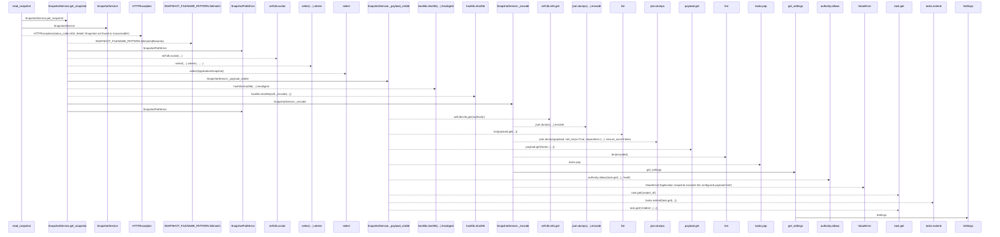
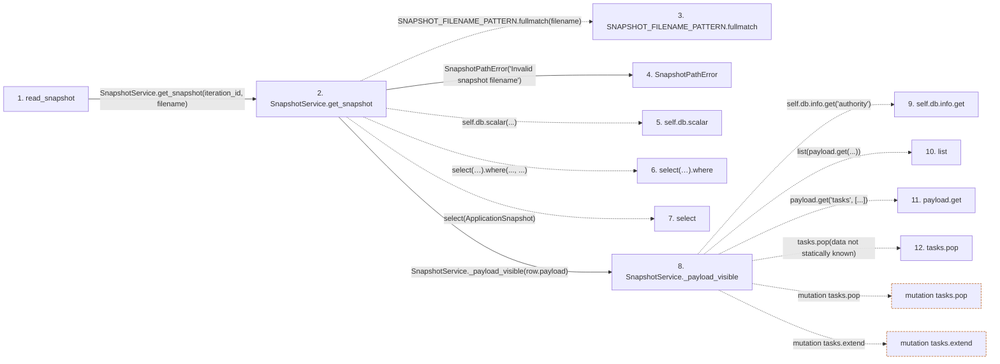

# read_snapshot

**Entry point:** `read_snapshot` (`http`)
**Source:** [snapshots](../modules/snapshots.md)
**Modules touched:** [config](../modules/config.md), [snapshot_service](../modules/snapshot_service.md), [snapshots](../modules/snapshots.md)

## Call sequence

> Static overview in presentation order, not runtime execution order. Arrows retain captured callers; representative internal continuations and boundary examples precede repeated helper detail.

<!-- Auto-generated from static call edges. Dashed arrows are external or unresolved calls. Reviewed runtime conditions and side effects belong in Behavior. -->

> Call sequence diagram shows 27 of 27 interactions; 0 omitted to keep the visualization within the 30-interaction and generated-diagram limits, with uncertain identities omitted rather than inferred.

> Captured boundary calls: external 7 of 7 (0 omitted); unresolved 12 of 12 (0 omitted). These counts cover the captured static trace.
> Detailed flow queries retain their own coverage and limits; omitted paths may execute at runtime.

## Data flow

<!-- Auto-generated static analysis. Treat values and boundaries as best-effort hints, not runtime proof. -->

### Analysis coverage

**Effect analysis partially available.** Flow assembly and source effect analysis are separate; empty observations do not prove an empty handler body.

Source steps: 9; effect analysis evaluated: 5, partial: 0, unavailable: 4. Counts include steps omitted from the displayed trace.

Collector observations for 5 source steps with known totals: observed: 18, emitted: 18, omitted: 0. Unavailable totals are excluded.

- Callable record unavailable for one or more source steps; those steps have no represented callable body.
- Effect collector totals unavailable; observed counts cover captured records only.

| Step | Callable record | Effect analysis | Collector totals | Observed | Emitted | Omitted |
|---|---|---|---|---:|---:|---:|
| `read_snapshot` | `available` | `evaluated` | `available` | `4` | `4` | `0` |
| `SnapshotService.get_snapshot` | `available` | `evaluated` | `available` | `5` | `5` | `0` |
| `SNAPSHOT_FILENAME_PATTERN.fullmatch` | `not_applicable` | `not_applicable` | `not_applicable` | — | — | — |
| `SnapshotPathError` | `unavailable` | `unavailable` | `unavailable` | — | — | — |
| `self.db.scalar` | `not_applicable` | `not_applicable` | `not_applicable` | — | — | — |
| `select(…).where` | `not_applicable` | `not_applicable` | `not_applicable` | — | — | — |
| `select` | `not_applicable` | `not_applicable` | `not_applicable` | — | — | — |
| `SnapshotService._payload_visible` | `available` | `evaluated` | `available` | `6` | `6` | `0` |
| `self.db.info.get` | `not_applicable` | `not_applicable` | `not_applicable` | — | — | — |
| `list` | `not_applicable` | `not_applicable` | `not_applicable` | — | — | — |
| `payload.get` | `not_applicable` | `not_applicable` | `not_applicable` | — | — | — |
| `tasks.pop` | `not_applicable` | `not_applicable` | `not_applicable` | — | — | — |

### Step data

| Step | Inputs | Reads | Writes | Returns |
|---|---|---|---|---|
| `read_snapshot` | `iteration_id: int`, `filename: str`, `db: Annotated[AsyncSession, Depends(get_db, scope='function')]` | - | - | `payload` |
| `SnapshotService.get_snapshot` | `iteration_id: int`, `filename: str` | `ApplicationSnapshot` | - | `None`, `row.payload` |
| `SNAPSHOT_FILENAME_PATTERN.fullmatch` | - | - | - | - |
| `SnapshotPathError` | - | - | - | - |
| `self.db.scalar` | - | - | - | - |
| `select(…).where` | - | - | - | - |
| `select` | - | - | - | - |
| `SnapshotService._payload_visible` | `payload` | - | - | `True`, `False`, `True` |
| `self.db.info.get` | - | - | - | - |
| `list` | - | - | - | - |
| `payload.get` | - | - | - | - |
| `tasks.pop` | - | - | - | - |

### Call data

| From | To | Line | Call |
|---|---|---:|---|
| read_snapshot | SnapshotService.get_snapshot | 283 | `SnapshotService(db).get_snapshot(iteration_id, filename)` |
| SnapshotService.get_snapshot | SNAPSHOT_FILENAME_PATTERN.fullmatch | 306 | `SNAPSHOT_FILENAME_PATTERN.fullmatch(filename)` |
| SnapshotService.get_snapshot | SnapshotPathError | 307 | `SnapshotPathError('Invalid snapshot filename')` |
| SnapshotService.get_snapshot | self.db.scalar | 308 | `self.db.scalar(...)` |
| SnapshotService.get_snapshot | select(…).where | 308 | `select(ApplicationSnapshot).where(..., ...)` |
| SnapshotService.get_snapshot | select | 308 | `select(ApplicationSnapshot)` |
| SnapshotService.get_snapshot | SnapshotService._payload_visible | 309 | `self._payload_visible(row.payload)` |
| SnapshotService._payload_visible | self.db.info.get | 317 | `self.db.info.get('authority')` |
| SnapshotService._payload_visible | list | 320 | `list(payload.get(...))` |
| SnapshotService._payload_visible | payload.get | 320 | `payload.get('tasks', [...])` |
| SnapshotService._payload_visible | tasks.pop | 322 | `tasks.pop(data not statically known)` |

### Boundary effects

| Kind | Target | Step | Line |
|---|---|---|---:|
| mutation | `tasks.pop` | `SnapshotService._payload_visible` | 322 |
| mutation | `tasks.extend` | `SnapshotService._payload_visible` | 325 |

### Static analysis gaps

| Kind | Step | Target | Line |
|---|---|---|---:|
| unresolved_call | `SnapshotService.get_snapshot` | `SNAPSHOT_FILENAME_PATTERN.fullmatch` | 306 |
| unresolved_call | `SnapshotService.get_snapshot` | `self.db.scalar` | 308 |
| unresolved_call | `SnapshotService.get_snapshot` | `select(ApplicationSnapshot).where` | 308 |
| external_call | `SnapshotService.get_snapshot` | `select` | 308 |
| unresolved_call | `SnapshotService._payload_visible` | `self.db.info.get` | 317 |
| unresolved_call | `SnapshotService._payload_visible` | `payload.get` | 320 |
| step_limit | `read_snapshot` | `first 12 steps` | 0 |

## Behavior

This flow starts at `read_snapshot` and is classified as `http`. The generated call and data-flow sections are bounded static projections; runtime conditions and side effects require source-level confirmation.
