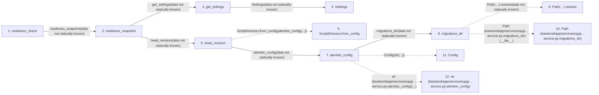

# readiness_check

**Entry point:** `readiness_check` (`http`)
**Source:** [app_main](../modules/app_main.md)
**Modules touched:** [app_database](../modules/app_database.md), [app_main](../modules/app_main.md), [config](../modules/config.md), [database_config](../modules/database_config.md), and 4 more

**Complete modules touched:**

- [app_database](../modules/app_database.md)
- [app_main](../modules/app_main.md)
- [config](../modules/config.md)
- [database_config](../modules/database_config.md)
- [maintenance](../modules/maintenance.md)
- [observability](../modules/observability.md)
- [time](../modules/time.md)
- [upgrade_service](../modules/upgrade_service.md)

## Call sequence

> Static overview in presentation order, not runtime execution order. Arrows retain captured callers; representative internal continuations and boundary examples precede repeated helper detail.

```mermaid
sequenceDiagram
    participant p0 as readiness_check
    participant p1 as readiness_snapshot
    participant p2 as get_settings
    participant p3 as head_revision
    participant p4 as _queue_snapshot
    participant p5 as maintenance_state
    participant p6 as alembic_config
    participant p7 as maintenance_configuration_fingerprint
    participant p8 as database_configuration
    participant p9 as parse_database_configuration
    participant p10 as _postgresql_snapshot
    participant p11 as database_runtime_summary
    participant p12 as _resident_set_size_bytes
    participant p13 as Settings
    participant p14 as utc_now
    participant p15 as UpgradeError
    participant p16 as as_utc
    participant p17 as migrations_dir
    participant p18 as alembic_safe_url
    participant p19 as _settings_value
    participant p20 as DatabaseConfigurationError
    participant p21 as DatabaseConfiguration
    participant p22 as redact_database_url
    participant p23 as _certificate_path
    participant p24 as JSONResponse
    participant p25 as async_session_maker
    participant p26 as asyncio.timeout
    participant p27 as db.execute (backend/app/observability.py:readiness_snapshot)
    participant p28 as text (backend/app/observability.py:readiness_snapshot)
    participant p29 as list (backend/app/observability.py:readiness_snapshot)
    participant p30 as (…).scalars
    p0->>p1: readiness_snapshot
    p0->>p2: get_settings
    p1->>p3: head_revision
    p1->>p4: _queue_snapshot
    p1->>p5: maintenance_state
    p3->>p6: alembic_config
    p5->>p7: maintenance_configuration_fingerprint
    p6->>p8: database_configuration
    p8->>p9: parse_database_configuration
    p1->>p10: _postgresql_snapshot
    p1->>p11: database_runtime_summary
    p1->>p12: _resident_set_size_bytes
    p2->>p13: Settings
    p4->>p14: utc_now
    p3->>p15: UpgradeError
    p4->>p16: as_utc
    p6->>p17: migrations_dir
    p6->>p18: alembic_safe_url
    p9->>p19: _settings_value
    p9->>p20: DatabaseConfigurationError
    p9->>p21: DatabaseConfiguration
    p9->>p22: redact_database_url
    p9->>p23: _certificate_path
    p0-->>p24: JSONResponse(status_code=..., content=payload)
    p1-->>p25: async_session_maker
    p1-->>p26: asyncio.timeout(settings.database_readiness_timeout_seconds)
    p1-->>p27: db.execute (backend/app/observability.py:readiness_snapshot)(text(...))
    p1-->>p28: text (backend/app/observability.py:readiness_snapshot)('SELECT 1')
    p1-->>p29: list (backend/app/observability.py:readiness_snapshot)(...)
    p1-->>p30: (…).scalars
```

<!-- Auto-generated from static call edges. Dashed arrows are external or unresolved calls. Reviewed runtime conditions and side effects belong in Behavior. -->

> Call sequence diagram shows 30 of 205 interactions; 175 omitted to keep the visualization within the 30-interaction and generated-diagram limits, with uncertain identities omitted rather than inferred.

> Captured boundary calls: external 4 of 74 (70 omitted); unresolved 3 of 62 (59 omitted). These counts cover the captured static trace.

Omitted captured detail, grouped by actual caller occurrence and target module:

| Caller | Parent step | Target module | Kind | Omitted interactions |
| --- | --- | --- | --- | --- |
| `backend/app/observability.py:readiness_snapshot` | 2 | [backend/app/config.py](../modules/config.md) | internal | 1 |
| `backend/app/services/upgrade_service.py:head_revision` | 5 | - | external | 2 |
| `backend/app/services/upgrade_service.py:migrations_dir` | 8 | - | unresolved | 1 |
| `backend/app/services/upgrade_service.py:migrations_dir` | 8 | - | external | 1 |
| `backend/app/services/upgrade_service.py:alembic_config` | 7 | - | external | 3 |
| `backend/app/services/upgrade_service.py:alembic_config` | 7 | - | unresolved | 2 |
| `backend/app/database_config.py:alembic_safe_url` | 16 | - | external | 2 |
| `backend/app/database_config.py:alembic_safe_url` | 16 | - | unresolved | 2 |
> Omission summary shows 8 of 31 groups; 23 further groups are not expanded here. Counts above include all omitted interactions.
> Detailed flow queries retain their own coverage and limits; omitted paths may execute at runtime.

> Trace truncated at the depth limit; deeper calls are omitted.

## Data flow

<!-- Auto-generated static analysis. Treat values and boundaries as best-effort hints, not runtime proof. -->

### Analysis coverage

**Effect analysis partially available.** Flow assembly and source effect analysis are separate; empty observations do not prove an empty handler body.

Source steps: 70; effect analysis evaluated: 46, partial: 0, unavailable: 24. Counts include steps omitted from the displayed trace.

Collector observations for 46 source steps with known totals: observed: 129, emitted: 129, omitted: 0. Unavailable totals are excluded.

- Callable record unavailable for one or more source steps; those steps have no represented callable body.
- Effect collector totals unavailable; observed counts cover captured records only.

| Step | Callable record | Effect analysis | Collector totals | Observed | Emitted | Omitted |
|---|---|---|---|---:|---:|---:|
| `readiness_check` | `available` | `evaluated` | `available` | `2` | `2` | `0` |
| `readiness_snapshot` | `available` | `evaluated` | `available` | `6` | `6` | `0` |
| `get_settings` | `available` | `evaluated` | `available` | `1` | `1` | `0` |
| `Settings` | `unavailable` | `unavailable` | `unavailable` | — | — | — |
| `head_revision` | `available` | `evaluated` | `available` | `1` | `1` | `0` |
| `ScriptDirectory.from_config` | `not_applicable` | `not_applicable` | `not_applicable` | — | — | — |
| `alembic_config` | `available` | `evaluated` | `available` | `3` | `3` | `0` |
| `migrations_dir` | `available` | `evaluated` | `available` | `1` | `1` | `0` |
| `Path(…).resolve` | `not_applicable` | `not_applicable` | `not_applicable` | — | — | — |
| `Path (backend/app/services/upgr…service.py:migrations_dir)` | `not_applicable` | `not_applicable` | `not_applicable` | — | — | — |
| `Config` | `not_applicable` | `not_applicable` | `not_applicable` | — | — | — |
| `str (backend/app/services/upgr…service.py:alembic_config)` | `not_applicable` | `not_applicable` | `not_applicable` | — | — | — |

### Step data

| Step | Inputs | Reads | Writes | Returns |
|---|---|---|---|---|
| `readiness_check` | `request: Request` | - | - | `JSONResponse(...)` |
| `readiness_snapshot` | - | `SQLAlchemyError`, `SQLAlchemyError`, `SQLAlchemyError`, `SQLAlchemyError` | - | `(...)`, `(...)` |
| `get_settings` | - | - | - | `Settings(...)` |
| `Settings` | - | - | - | - |
| `head_revision` | - | - | - | `heads[...]` |
| `ScriptDirectory.from_config` | - | - | - | - |
| `alembic_config` | `connection: Connection \| None` | - | `config.attributes[...]` | `config` |
| `migrations_dir` | - | - | - | `...` |
| `Path(…).resolve` | - | - | - | - |
| `Path (backend/app/services/upgr…service.py:migrations_dir)` | - | - | - | - |
| `Config` | - | - | - | - |
| `str (backend/app/services/upgr…service.py:alembic_config)` | - | - | - | - |

### Call data

| From | To | Line | Call |
|---|---|---:|---|
| readiness_check | readiness_snapshot | 263 | `readiness_snapshot(data not statically known)` |
| readiness_snapshot | get_settings | 252 | `get_settings(data not statically known)` |
| get_settings | Settings | 481 | `Settings(data not statically known)` |
| readiness_snapshot | head_revision | 253 | `head_revision(data not statically known)` |
| head_revision | ScriptDirectory.from_config | 90 | `ScriptDirectory.from_config(alembic_config(...))` |
| head_revision | alembic_config | 90 | `alembic_config(data not statically known)` |
| alembic_config | migrations_dir | 70 | `migrations_dir(data not statically known)` |
| migrations_dir | Path(…).resolve | 59 | `Path(__file__).resolve(data not statically known)` |
| migrations_dir | Path (backend/app/services/upgr…service.py:migrations_dir) | 59 | `Path(__file__)` |
| alembic_config | Config | 71 | `Config(str(...))` |
| alembic_config | str (backend/app/services/upgr…service.py:alembic_config) | 71 | `str(...)` |

### Boundary effects

*No boundary-effect observations were captured in this static trace.*

### Static analysis gaps

| Kind | Step | Target | Line |
|---|---|---|---:|
| external_call | `head_revision` | `ScriptDirectory.from_config` | 90 |
| unresolved_call | `migrations_dir` | `Path(__file__).resolve` | 59 |
| external_call | `alembic_config` | `Config` | 71 |
| step_limit | `readiness_check` | `first 12 steps` | 0 |
| truncated_flow | `readiness_check` | `depth limit` | 0 |

## Behavior

This flow starts at `readiness_check` and is classified as `http`. The generated call and data-flow sections are bounded static projections; runtime conditions and side effects require source-level confirmation.
