# receive_github_webhook

**Entry point:** `receive_github_webhook` (`http`)
**Source:** [routers_github](../modules/routers_github.md)
**Modules touched:** [authority](../modules/authority.md), [config](../modules/config.md), [identity_service](../modules/identity_service.md), [language_service](../modules/language_service.md), and 3 more

**Complete modules touched:**

- [authority](../modules/authority.md)
- [config](../modules/config.md)
- [identity_service](../modules/identity_service.md)
- [language_service](../modules/language_service.md)
- [routers_github](../modules/routers_github.md)
- [system_settings_service](../modules/system_settings_service.md)
- [url_policy](../modules/url_policy.md)

## Call sequence

> Static overview in presentation order, not runtime execution order. Arrows retain captured callers; representative internal continuations and boundary examples precede repeated helper detail.

```mermaid
sequenceDiagram
    participant p0 as receive_github_webhook
    participant p1 as resolve_runtime_ui_language
    participant p2 as backend_error_message
    participant p3 as bind_verified_system
    participant p4 as RuntimeSettingsService.get_app_settings
    participant p5 as entity_not_found_message
    participant p6 as scoped_entity_not_found_message
    participant p7 as entity_deleted_message
    participant p8 as RuntimeSettingsService.resolve
    participant p9 as localized
    participant p10 as RuntimeSettingsService._definition
    participant p11 as RuntimeSettingsService._decrypt_secret
    participant p12 as RuntimeSettingsService._coerce
    participant p13 as RuntimeSettingsService._fernet
    participant p14 as normalize_provider_api_url
    participant p15 as normalize_language
    participant p16 as internal_authority
    participant p17 as RuntimeSettingsService
    participant p18 as get_settings
    participant p19 as AuthorityError
    participant p20 as Authority
    participant p21 as RuntimeSettingsService._row
    participant p22 as RuntimeSettingsService._env_value
    participant p23 as RuntimeSettingsError
    participant p24 as RuntimeSettingsEncryptionError
    participant p25 as normalize_external_http_url
    participant p26 as HTTPException
    participant p27 as request.body
    participant p28 as service.verify_signature
    participant p29 as service.parse_payload
    participant p30 as service.process
    p0->>p1: resolve_runtime_ui_language
    p0->>p2: backend_error_message
    p0->>p3: bind_verified_system
    p1->>p4: RuntimeSettingsService.get_app_settings
    p2->>p5: entity_not_found_message
    p2->>p6: scoped_entity_not_found_message
    p2->>p7: entity_deleted_message
    p4->>p8: RuntimeSettingsService.resolve
    p5->>p9: localized
    p8->>p10: RuntimeSettingsService._definition
    p8->>p11: RuntimeSettingsService._decrypt_secret
    p8->>p12: RuntimeSettingsService._coerce
    p11->>p13: RuntimeSettingsService._fernet
    p12->>p14: normalize_provider_api_url
    p1->>p15: normalize_language
    p3->>p16: internal_authority
    p1->>p17: RuntimeSettingsService
    p3->>p18: get_settings
    p3->>p19: AuthorityError
    p3->>p20: Authority
    p8->>p21: RuntimeSettingsService._row
    p8->>p22: RuntimeSettingsService._env_value
    p10->>p23: RuntimeSettingsError
    p11->>p24: RuntimeSettingsEncryptionError
    p14->>p25: normalize_external_http_url
    p0-->>p26: HTTPException(status_code=status.HTTP_400_BAD_REQUEST, detail=backend_error_message(...))
    p0-->>p27: request.body
    p0-->>p28: service.verify_signature(body, github_signature)
    p0-->>p29: service.parse_payload(body)
    p0-->>p30: service.process(github_event, github_delivery, payload)
```

<!-- Auto-generated from static call edges. Dashed arrows are external or unresolved calls. Reviewed runtime conditions and side effects belong in Behavior. -->

> Call sequence diagram shows 30 of 189 interactions; 159 omitted to keep the visualization within the 30-interaction and generated-diagram limits, with uncertain identities omitted rather than inferred.

> Captured boundary calls: external 1 of 53 (52 omitted); unresolved 4 of 77 (73 omitted). These counts cover the captured static trace.

Omitted captured detail, grouped by actual caller occurrence and target module:

| Caller | Parent step | Target module | Kind | Omitted interactions |
| --- | --- | --- | --- | --- |
| `backend/app/services/language_service.py:normalize_language` | 3 | - | unresolved | 2 |
| `backend/app/services/language_service.py:normalize_language` | 3 | - | external | 1 |
| `backend/app/services/system_settings_service.py:RuntimeSettingsService._definition` | 9 | - | unresolved | 1 |
| `backend/app/services/system_settings_service.py:RuntimeSettingsService._row` | 12 | - | unresolved | 3 |
| `backend/app/services/system_settings_service.py:RuntimeSettingsService._row` | 12 | - | external | 1 |
| `backend/app/services/system_settings_service.py:RuntimeSettingsService._decrypt_secret` | 17 | - | unresolved | 3 |
| `backend/app/services/system_settings_service.py:RuntimeSettingsService._fernet` | 20 | - | external | 2 |
| `backend/app/services/system_settings_service.py:RuntimeSettingsService._fernet` | 20 | [backend/app/services/system_settings_service.py](../modules/system_settings_service.md) | internal | 2 |
> Omission summary shows 8 of 35 groups; 27 further groups are not expanded here. Counts above include all omitted interactions.
> Detailed flow queries retain their own coverage and limits; omitted paths may execute at runtime.

> Trace truncated at the depth limit; deeper calls are omitted.

## Data flow

<!-- Auto-generated static analysis. Treat values and boundaries as best-effort hints, not runtime proof. -->

### Analysis coverage

**Effect analysis partially available.** Flow assembly and source effect analysis are separate; empty observations do not prove an empty handler body.

Source steps: 60; effect analysis evaluated: 34, partial: 4, unavailable: 22. Counts include steps omitted from the displayed trace.

Collector observations for 38 source steps with known totals: observed: 305, emitted: 201, omitted: 104. Unavailable totals are excluded.

- Callable record unavailable for one or more source steps; those steps have no represented callable body.
- Effect collector omitted observations before flow assembly; displayed effects are partial.
- Effect collector totals unavailable; observed counts cover captured records only.

| Step | Callable record | Effect analysis | Collector totals | Observed | Emitted | Omitted |
|---|---|---|---|---:|---:|---:|
| `receive_github_webhook` | `available` | `evaluated` | `available` | `13` | `13` | `0` |
| `resolve_runtime_ui_language` | `available` | `evaluated` | `available` | `5` | `5` | `0` |
| `normalize_language` | `available` | `evaluated` | `available` | `4` | `4` | `0` |
| `str(…).strip().lower` | `not_applicable` | `not_applicable` | `not_applicable` | — | — | — |
| `str(…).strip (backend/app/services/lang…ice.py:normalize_language)` | `not_applicable` | `not_applicable` | `not_applicable` | — | — | — |
| `str (backend/app/services/lang…ice.py:normalize_language)` | `not_applicable` | `not_applicable` | `not_applicable` | — | — | — |
| `RuntimeSettingsService.get_app_settings` | `available` | `evaluated` | `available` | `1` | `1` | `0` |
| `RuntimeSettingsService.resolve` | `available` | `evaluated` | `available` | `4` | `4` | `0` |
| `RuntimeSettingsService._definition` | `available` | `evaluated` | `available` | `2` | `2` | `0` |
| `SETTING_DEFINITIONS.get` | `not_applicable` | `not_applicable` | `not_applicable` | — | — | — |
| `RuntimeSettingsError` | `unavailable` | `unavailable` | `unavailable` | — | — | — |
| `RuntimeSettingsService._row` | `available` | `evaluated` | `available` | `3` | `3` | `0` |

```mermaid
flowchart LR
    s1["1. receive_github_webhook"]
    s2["2. resolve_runtime_ui_language"]
    s3["3. normalize_language"]
    s4["4. str(…).strip().lower"]
    s5["5. str(…).strip (backend/app/services/lang…ice.py:normalize_language)"]
    s6["6. str (backend/app/services/lang…ice.py:normalize_language)"]
    s7["7. RuntimeSettingsService.get_app_settings"]
    s8["8. RuntimeSettingsService.resolve"]
    s9["9. RuntimeSettingsService._definition"]
    s10["10. SETTING_DEFINITIONS.get"]
    s11["11. RuntimeSettingsError"]
    s12["12. RuntimeSettingsService._row"]
    s1 -->|"resolve_runtime_ui_language(service.db)"| s2
    s2 -->|"normalize_language(default)"| s3
    s3 -. "str(…).strip().lower(data not statically known)" .-> s4
    s3 -. "str(…).strip (backend/app/services/lang…ice.py:normalize_language)(data not statically known)" .-> s5
    s3 -. "str (backend/app/services/lang…ice.py:normalize_language)(...)" .-> s6
    s2 -->|"RuntimeSettingsService.get_app_settings(data not statically known)"| s7
    s7 -->|"RuntimeSettingsService.resolve('app.ui_language')"| s8
    s8 -->|"RuntimeSettingsService._definition(key)"| s9
    s9 -. "SETTING_DEFINITIONS.get(key)" .-> s10
    s9 -->|"RuntimeSettingsError(...)"| s11
    s8 -->|"RuntimeSettingsService._row(key)"| s12
    click s1 "../modules/routers_github.md"
    click s2 "../modules/language_service.md"
    click s3 "../modules/language_service.md"
    click s7 "../modules/system_settings_service.md"
    click s8 "../modules/system_settings_service.md"
    click s9 "../modules/system_settings_service.md"
    click s11 "../modules/system_settings_service.md"
    click s12 "../modules/system_settings_service.md"
```

### Step data

| Step | Inputs | Reads | Writes | Returns |
|---|---|---|---|---|
| `receive_github_webhook` | `request: Request`, `service: Annotated[GitHubWebhookService, Depends(get_github_webhook_service)]`, `github_event: Annotated[Optional[str], Header(alias='X-GitHub-Event')]`, `github_delivery: Annotated[Optional[str], Header(alias='X-GitHub-Delivery')]`, `github_signature: Annotated[Optional[str], Header(alias='X-Hub-Signature-256')]` | `status`, `GitHubWebhookConfigurationError`, `status`, `GitHubWebhookSignatureError`, `status`, `GitHubWebhookPayloadError`, `status` | - | `...` |
| `resolve_runtime_ui_language` | `db: Any`, `default: LanguageCode \| None` | - | - | `normalize_language(...)`, `normalize_language(...)`, `fallback` |
| `normalize_language` | `value: Any`, `default: LanguageCode` | - | - | `normalized`, `default` |
| `str(…).strip().lower` | - | - | - | - |
| `str(…).strip (backend/app/services/lang…ice.py:normalize_language)` | - | - | - | - |
| `str (backend/app/services/lang…ice.py:normalize_language)` | - | - | - | - |
| `RuntimeSettingsService.get_app_settings` | - | - | - | `SimpleNamespace(...)` |
| `RuntimeSettingsService.resolve` | `key: str` | - | - | `(...)`, `(...)`, `(...)` |
| `RuntimeSettingsService._definition` | `key: str` | - | - | `definition` |
| `SETTING_DEFINITIONS.get` | - | - | - | - |
| `RuntimeSettingsError` | - | - | - | - |
| `RuntimeSettingsService._row` | `key: str` | `SystemSetting` | - | `result.scalar_one_or_none(...)` |

### Call data

| From | To | Line | Call |
|---|---|---:|---|
| receive_github_webhook | resolve_runtime_ui_language | 151 | `resolve_runtime_ui_language(service.db)` |
| resolve_runtime_ui_language | normalize_language | 406 | `normalize_language(default)` |
| normalize_language | str(…).strip().lower | 35 | `str(value or '').strip().lower(data not statically known)` |
| normalize_language | str(…).strip (backend/app/services/lang…ice.py:normalize_language) | 35 | `str(value or '').strip(data not statically known)` |
| normalize_language | str (backend/app/services/lang…ice.py:normalize_language) | 35 | `str(...)` |
| resolve_runtime_ui_language | RuntimeSettingsService.get_app_settings | 411 | `RuntimeSettingsService(db).get_app_settings(data not statically known)` |
| RuntimeSettingsService.get_app_settings | RuntimeSettingsService.resolve | 337 | `self.resolve('app.ui_language')` |
| RuntimeSettingsService.resolve | RuntimeSettingsService._definition | 284 | `self._definition(key)` |
| RuntimeSettingsService._definition | SETTING_DEFINITIONS.get | 154 | `SETTING_DEFINITIONS.get(key)` |
| RuntimeSettingsService._definition | RuntimeSettingsError | 156 | `RuntimeSettingsError(...)` |
| RuntimeSettingsService.resolve | RuntimeSettingsService._row | 285 | `self._row(key)` |

### Boundary effects

*No boundary-effect observations were captured in this static trace.*

### Static analysis gaps

| Kind | Step | Target | Line |
|---|---|---|---:|
| unresolved_call | `normalize_language` | `str(value or '').strip().lower` | 35 |
| unresolved_call | `normalize_language` | `str(value or '').strip` | 35 |
| unresolved_call | `RuntimeSettingsService._definition` | `SETTING_DEFINITIONS.get` | 154 |
| step_limit | `receive_github_webhook` | `first 12 steps` | 0 |
| truncated_flow | `receive_github_webhook` | `depth limit` | 0 |

## Behavior

This flow starts at `receive_github_webhook` and is classified as `http`. The generated call and data-flow sections are bounded static projections; runtime conditions and side effects require source-level confirmation.
