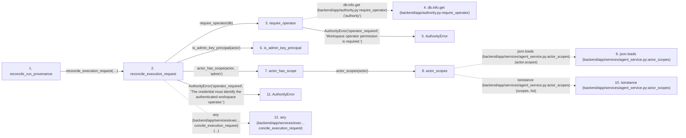

# reconcile_run_provenance

**Entry point:** `reconcile_run_provenance` (`http`)
**Source:** [agent_catalog](../modules/agent_catalog.md)
**Modules touched:** [agent_catalog](../modules/agent_catalog.md), [agent_model_catalog_service](../modules/agent_model_catalog_service.md), [agent_service](../modules/agent_service.md), and 18 more

**Complete modules touched:**

- [agent_catalog](../modules/agent_catalog.md)
- [agent_model_catalog_service](../modules/agent_model_catalog_service.md)
- [agent_service](../modules/agent_service.md)
- [agent_team_setup](../modules/agent_team_setup.md)
- [agent_team_setup_service](../modules/agent_team_setup_service.md)
- [authority](../modules/authority.md)
- [autonomy_canonical](../modules/autonomy_canonical.md)
- [commands](../modules/commands.md)
- [delivery_dependency_service](../modules/delivery_dependency_service.md)
- [discussion_service](../modules/discussion_service.md)
- [execution_reconciliation](../modules/execution_reconciliation.md)
- [identity_service](../modules/identity_service.md)
- [models_agent](../modules/models_agent.md)
- [models_identity](../modules/models_identity.md)
- [models_outbound_webhook](../modules/models_outbound_webhook.md)
- [review_provenance](../modules/review_provenance.md)
- [routers_agent_planning](../modules/routers_agent_planning.md)
- [schemas_agent_planning](../modules/schemas_agent_planning.md)
- [task_brief_service](../modules/task_brief_service.md)
- [task_service](../modules/task_service.md)
- [time](../modules/time.md)

## Call sequence

> Static overview in presentation order, not runtime execution order. Arrows retain captured callers; representative internal continuations and boundary examples precede repeated helper detail.

```mermaid
sequenceDiagram
    participant p0 as reconcile_run_provenance
    participant p1 as reconcile_execution_request
    participant p2 as _handle_model_error
    participant p3 as require_operator
    participant p4 as actor_has_scope
    participant p5 as reconcile_execution
    participant p6 as command_transaction
    participant p7 as _digest
    participant p8 as _observations
    participant p9 as _canonical_json
    participant p10 as DeliveryDependencyService.reconcile
    participant p11 as DiscussionService.enqueue
    participant p12 as _ack_at_begin
    participant p13 as _model_at_begin
    participant p14 as recover_terminal_observation
    participant p15 as ensure_agent_team_secret_free
    participant p16 as _actor_binding_ids
    participant p17 as _latest_configuration
    participant p18 as DeliveryDependencyService.validate_cycles
    participant p19 as DiscussionService.recipient_authorized
    participant p20 as no_output_corroborated
    participant p21 as TaskService.reserve_task_version
    participant p22 as clear_execution_evidence
    participant p23 as is_admin_key_principal
    participant p24 as AuthorityError
    participant p25 as AgentPlanningCommandContext
    participant p26 as _handle_agent_error
    participant p27 as actor_scopes
    participant p28 as AgentModelConflictError
    participant p29 as HTTPException (backend/app/routers/agent…:reconcile_run_provenance)
    participant p30 as exc.detail (backend/app/routers/agent…og.py:_handle_model_error)
    p0->>p1: reconcile_execution_request
    p0->>p2: _handle_model_error
    p1->>p3: require_operator
    p1->>p4: actor_has_scope
    p1->>p5: reconcile_execution
    p5->>p6: command_transaction
    p5->>p7: _digest
    p5->>p8: _observations
    p7->>p9: _canonical_json
    p6->>p10: DeliveryDependencyService.reconcile
    p6->>p11: DiscussionService.enqueue
    p8->>p12: _ack_at_begin
    p8->>p13: _model_at_begin
    p8->>p14: recover_terminal_observation
    p9->>p15: ensure_agent_team_secret_free
    p13->>p16: _actor_binding_ids
    p13->>p17: _latest_configuration
    p10->>p18: DeliveryDependencyService.validate_cycles
    p11->>p19: DiscussionService.recipient_authorized
    p14->>p20: no_output_corroborated
    p10->>p21: TaskService.reserve_task_version
    p10->>p22: clear_execution_evidence
    p1->>p23: is_admin_key_principal
    p1->>p24: AuthorityError
    p1->>p25: AgentPlanningCommandContext
    p2->>p26: _handle_agent_error
    p4->>p27: actor_scopes
    p5->>p28: AgentModelConflictError
    p0-->>p29: HTTPException (backend/app/routers/agent…:reconcile_run_provenance)(status_code=422, detail=str(...))
    p2-->>p30: exc.detail (backend/app/routers/agent…og.py:_handle_model_error)
```

<!-- Auto-generated from static call edges. Dashed arrows are external or unresolved calls. Reviewed runtime conditions and side effects belong in Behavior. -->

> Call sequence diagram shows 30 of 451 interactions; 421 omitted to keep the visualization within the 30-interaction and generated-diagram limits, with uncertain identities omitted rather than inferred.

> Captured boundary calls: external 1 of 113 (112 omitted); unresolved 1 of 254 (253 omitted). These counts cover the captured static trace.

Omitted captured detail, grouped by actual caller occurrence and target module:

| Caller | Parent step | Target module | Kind | Omitted interactions |
| --- | --- | --- | --- | --- |
| `backend/app/authority.py:require_operator` | 3 | - | unresolved | 1 |
| `backend/app/authority.py:require_operator` | 3 | [backend/app/authority.py](../modules/authority.md) | internal | 1 |
| `backend/app/services/agent_service.py:actor_scopes` | 8 | - | external | 2 |
| `backend/app/services/execution_reconciliation.py:reconcile_execution_request` | 2 | - | external | 1 |
| `backend/app/services/execution_reconciliation.py:reconcile_execution_request` | 2 | - | unresolved | 2 |
| `backend/app/services/execution_reconciliation.py:reconcile_execution` | 16 | [backend/app/authority.py](../modules/authority.md) | internal | 2 |
| `backend/app/services/execution_reconciliation.py:reconcile_execution` | 16 | - | external | 9 |
| `backend/app/commands.py:command_transaction` | 21 | [backend/app/commands.py](../modules/commands.md) | internal | 2 |
> Omission summary shows 8 of 79 groups; 71 further groups are not expanded here. Counts above include all omitted interactions.
> Detailed flow queries retain their own coverage and limits; omitted paths may execute at runtime.

> Trace truncated at the depth limit; deeper calls are omitted.

## Data flow

<!-- Auto-generated static analysis. Treat values and boundaries as best-effort hints, not runtime proof. -->

### Analysis coverage

**Effect analysis partially available.** Flow assembly and source effect analysis are separate; empty observations do not prove an empty handler body.

Source steps: 85; effect analysis evaluated: 63, partial: 3, unavailable: 19. Counts include steps omitted from the displayed trace.

Collector observations for 66 source steps with known totals: observed: 388, emitted: 382, omitted: 6. Unavailable totals are excluded.

- Callable record unavailable for one or more source steps; those steps have no represented callable body.
- Effect collector omitted observations before flow assembly; displayed effects are partial.
- Effect collector totals unavailable; observed counts cover captured records only.

| Step | Callable record | Effect analysis | Collector totals | Observed | Emitted | Omitted |
|---|---|---|---|---:|---:|---:|
| `reconcile_run_provenance` | `available` | `partial` | `available` | `11` | `10` | `1` |
| `reconcile_execution_request` | `available` | `partial` | `available` | `10` | `9` | `1` |
| `require_operator` | `available` | `evaluated` | `available` | `1` | `1` | `0` |
| `db.info.get (backend/app/authority.py:require_operator)` | `not_applicable` | `not_applicable` | `not_applicable` | — | — | — |
| `AuthorityError` | `unavailable` | `unavailable` | `unavailable` | — | — | — |
| `is_admin_key_principal` | `available` | `evaluated` | `available` | `3` | `3` | `0` |
| `actor_has_scope` | `available` | `evaluated` | `available` | `3` | `3` | `0` |
| `actor_scopes` | `available` | `evaluated` | `available` | `3` | `3` | `0` |
| `json.loads (backend/app/services/agent_service.py:actor_scopes)` | `not_applicable` | `not_applicable` | `not_applicable` | — | — | — |
| `isinstance (backend/app/services/agent_service.py:actor_scopes)` | `not_applicable` | `not_applicable` | `not_applicable` | — | — | — |
| `AuthorityError` | `unavailable` | `unavailable` | `unavailable` | — | — | — |
| `any (backend/app/services/exec…concile_execution_request)` | `not_applicable` | `not_applicable` | `not_applicable` | — | — | — |

### Step data

| Step | Inputs | Reads | Writes | Returns |
|---|---|---|---|---|
| `reconcile_run_provenance` | `run_id: int`, `actor: Annotated[AgentActor, Depends(get_model_catalog_principal)]`, `db: Annotated[AsyncSession, Depends(get_db, scope='function')]`, `apply: bool`, `expected_evidence_digest: Annotated[str \| None, Query(pattern='^[a-f0-9]{64}$')]`, `archived_acknowledgement: AgentTeamRuntimeAcknowledgement \| None`, `idempotency_key: Annotated[str \| None, Header(alias='Idempotency-Key')]`, `rationale: Annotated[str \| None, Header(alias='X-Agent-Rationale')]` | `AgentModelConflictError` | - | `...` |
| `reconcile_execution_request` | `db`, `actor`, `run_id`, `apply`, `expected_evidence_digest`, `archived_acknowledgement`, `idempotency_key`, `rationale` | - | - | `...` |
| `require_operator` | `db` | - | - | - |
| `db.info.get (backend/app/authority.py:require_operator)` | - | - | - | - |
| `AuthorityError` | - | - | - | - |
| `is_admin_key_principal` | `actor: AgentActor` | `ADMIN_KEY_PRINCIPAL_NAME` | - | `...` |
| `actor_has_scope` | `actor: AgentActor`, `scope: str` | - | - | `...` |
| `actor_scopes` | `actor: AgentActor` | `json` | - | `...` |
| `json.loads (backend/app/services/agent_service.py:actor_scopes)` | - | - | - | - |
| `isinstance (backend/app/services/agent_service.py:actor_scopes)` | - | - | - | - |
| `AuthorityError` | - | - | - | - |
| `any (backend/app/services/exec…concile_execution_request)` | - | - | - | - |

### Call data

| From | To | Line | Call |
|---|---|---:|---|
| reconcile_run_provenance | reconcile_execution_request | 87 | `reconcile_execution_request(db, actor, run_id, apply=apply, expected_evidence_digest=expected_evidence_digest, archived_acknowledgement=archived_acknowledgement, idempotency_key=idempotency_key, rationale=rationale, correlation_id=correlation_id)` |
| reconcile_execution_request | require_operator | 467 | `require_operator(db)` |
| require_operator | db.info.get (backend/app/authority.py:require_operator) | 84 | `db.info.get('authority')` |
| require_operator | AuthorityError | 86 | `AuthorityError('operator_required', 'Workspace operator permission is required.')` |
| reconcile_execution_request | is_admin_key_principal | 470 | `is_admin_key_principal(actor)` |
| reconcile_execution_request | actor_has_scope | 474 | `actor_has_scope(actor, 'admin')` |
| actor_has_scope | actor_scopes | 95 | `actor_scopes(actor)` |
| actor_scopes | json.loads (backend/app/services/agent_service.py:actor_scopes) | 87 | `json.loads(actor.scopes)` |
| actor_scopes | isinstance (backend/app/services/agent_service.py:actor_scopes) | 90 | `isinstance(scopes, list)` |
| reconcile_execution_request | AuthorityError | 476 | `AuthorityError('operator_required', 'The credential must identify the authenticated workspace operator.')` |
| reconcile_execution_request | any (backend/app/services/exec…concile_execution_request) | 480 | `any(...)` |

### Boundary effects

*No boundary-effect observations were captured in this static trace.*

### Static analysis gaps

| Kind | Step | Target | Line |
|---|---|---|---:|
| unresolved_call | `require_operator` | `db.info.get` | 84 |
| external_call | `actor_scopes` | `json.loads` | 87 |
| external_call | `actor_scopes` | `isinstance` | 90 |
| external_call | `reconcile_execution_request` | `any` | 480 |
| step_limit | `reconcile_run_provenance` | `first 12 steps` | 0 |
| truncated_flow | `reconcile_run_provenance` | `depth limit` | 0 |

## Behavior

An authenticated workspace operator can inspect the server evidence for a historical run. An apply request includes the preview digest, a rationale, a correlation ID and an idempotency key. The response distinguishes fields actually applied from facts that remain missing.
