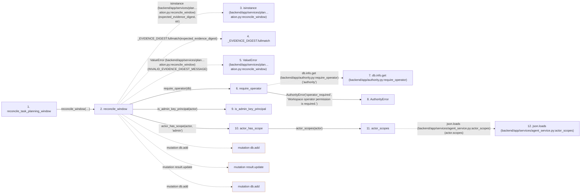

# reconcile_task_planning_window

**Entry point:** `reconcile_task_planning_window` (`http`)
**Source:** [agent_catalog](../modules/agent_catalog.md)
**Modules touched:** [agent_catalog](../modules/agent_catalog.md), [agent_model_catalog_service](../modules/agent_model_catalog_service.md), [agent_planning_service](../modules/agent_planning_service.md), and 26 more

**Complete modules touched:**

- [agent_catalog](../modules/agent_catalog.md)
- [agent_model_catalog_service](../modules/agent_model_catalog_service.md)
- [agent_planning_service](../modules/agent_planning_service.md)
- [agent_routing_policy](../modules/agent_routing_policy.md)
- [agent_routing_service](../modules/agent_routing_service.md)
- [agent_service](../modules/agent_service.md)
- [agent_team_setup_service](../modules/agent_team_setup_service.md)
- [authority](../modules/authority.md)
- [commands](../modules/commands.md)
- [config](../modules/config.md)
- [delivery_dependency_service](../modules/delivery_dependency_service.md)
- [discussion_service](../modules/discussion_service.md)
- [execution_planning_window](../modules/execution_planning_window.md)
- [execution_reconciliation](../modules/execution_reconciliation.md)
- [identity_service](../modules/identity_service.md)
- [models_agent](../modules/models_agent.md)
- [models_identity](../modules/models_identity.md)
- [models_outbound_webhook](../modules/models_outbound_webhook.md)
- [mutation_versions](../modules/mutation_versions.md)
- [planning_window_reconciliation](../modules/planning_window_reconciliation.md)
- [query_limits](../modules/query_limits.md)
- [review_provenance](../modules/review_provenance.md)
- [routers_agent_planning](../modules/routers_agent_planning.md)
- [schemas_agent_planning](../modules/schemas_agent_planning.md)
- [snapshot_service](../modules/snapshot_service.md)
- [task_brief_service](../modules/task_brief_service.md)
- [task_hierarchy_service](../modules/task_hierarchy_service.md)
- [task_service](../modules/task_service.md)
- [time](../modules/time.md)

## Call sequence

> Static overview in presentation order, not runtime execution order. Arrows retain captured callers; representative internal continuations and boundary examples precede repeated helper detail.

```mermaid
sequenceDiagram
    participant p0 as reconcile_task_planning_window
    participant p1 as reconcile_window
    participant p2 as _handle_model_error
    participant p3 as require_operator
    participant p4 as actor_has_scope
    participant p5 as command_transaction
    participant p6 as source_receipt_id
    participant p7 as TaskService.get_by_id
    participant p8 as _planning_proof
    participant p9 as original_ownership
    participant p10 as make_window
    participant p11 as seal_authority
    participant p12 as assignment_context
    participant p13 as authority_stamp
    participant p14 as TaskService._load_iteration_tree
    participant p15 as task_context
    participant p16 as authority_matches
    participant p17 as DeliveryDependencyService.reconcile
    participant p18 as DiscussionService.enqueue
    participant p19 as SnapshotService._task_to_export
    participant p20 as actor_provenance
    participant p21 as _snapshot_task
    participant p22 as TaskHierarchyService._load_iteration_tree
    participant p23 as _authority_basis
    participant p24 as DeliveryDependencyService.validate_cycles
    participant p25 as _canonical_snapshot_checksum
    participant p26 as DiscussionService.recipient_authorized
    participant p27 as AgentRoutingService._profile_revision
    participant p28 as TaskService.reserve_task_version
    participant p29 as HTTPException (backend/app/routers/agent…cile_task_planning_window)
    participant p30 as _EVIDENCE_DIGEST.fullmatch
    p0->>p1: reconcile_window
    p0->>p2: _handle_model_error
    p1->>p3: require_operator
    p1->>p4: actor_has_scope
    p1->>p5: command_transaction
    p1->>p6: source_receipt_id
    p1->>p7: TaskService.get_by_id
    p1->>p8: _planning_proof
    p1->>p9: original_ownership
    p1->>p10: make_window
    p1->>p11: seal_authority
    p10->>p12: assignment_context
    p11->>p13: authority_stamp
    p7->>p14: TaskService._load_iteration_tree
    p10->>p15: task_context
    p11->>p16: authority_matches
    p5->>p17: DeliveryDependencyService.reconcile
    p5->>p18: DiscussionService.enqueue
    p8->>p19: SnapshotService._task_to_export
    p9->>p20: actor_provenance
    p8->>p21: _snapshot_task
    p14->>p22: TaskHierarchyService._load_iteration_tree
    p13->>p23: _authority_basis
    p17->>p24: DeliveryDependencyService.validate_cycles
    p21->>p25: _canonical_snapshot_checksum
    p18->>p26: DiscussionService.recipient_authorized
    p20->>p27: AgentRoutingService._profile_revision
    p17->>p28: TaskService.reserve_task_version
    p0-->>p29: HTTPException (backend/app/routers/agent…cile_task_planning_window)(status_code=422, detail=str(...))
    p1-->>p30: _EVIDENCE_DIGEST.fullmatch(expected_evidence_digest)
```

<!-- Auto-generated from static call edges. Dashed arrows are external or unresolved calls. Reviewed runtime conditions and side effects belong in Behavior. -->

> Call sequence diagram shows 30 of 746 interactions; 716 omitted to keep the visualization within the 30-interaction and generated-diagram limits, with uncertain identities omitted rather than inferred.

> Captured boundary calls: external 1 of 243 (242 omitted); unresolved 1 of 378 (377 omitted). These counts cover the captured static trace.

Omitted captured detail, grouped by actual caller occurrence and target module:

| Caller | Parent step | Target module | Kind | Omitted interactions |
| --- | --- | --- | --- | --- |
| `backend/app/services/planning_window_reconciliation.py:reconcile_window` | 2 | - | external | 21 |
| `backend/app/authority.py:require_operator` | 6 | - | unresolved | 1 |
| `backend/app/authority.py:require_operator` | 6 | [backend/app/authority.py](../modules/authority.md) | internal | 1 |
| `backend/app/services/planning_window_reconciliation.py:reconcile_window` | 2 | [backend/app/services/agent_service.py](../modules/agent_service.md) | internal | 1 |
| `backend/app/services/agent_service.py:actor_has_scope` | 10 | [backend/app/services/agent_service.py](../modules/agent_service.md) | internal | 1 |
| `backend/app/services/agent_service.py:actor_scopes` | 11 | - | external | 2 |
| `backend/app/services/planning_window_reconciliation.py:reconcile_window` | 2 | [backend/app/authority.py](../modules/authority.md) | internal | 1 |
| `backend/app/services/planning_window_reconciliation.py:reconcile_window` | 2 | [backend/app/schemas/agent_planning.py](../modules/schemas_agent_planning.md) | internal | 1 |
> Omission summary shows 8 of 151 groups; 143 further groups are not expanded here. Counts above include all omitted interactions.
> Detailed flow queries retain their own coverage and limits; omitted paths may execute at runtime.

> Trace truncated at the depth limit; deeper calls are omitted.

## Data flow

<!-- Auto-generated static analysis. Treat values and boundaries as best-effort hints, not runtime proof. -->

### Analysis coverage

**Effect analysis partially available.** Flow assembly and source effect analysis are separate; empty observations do not prove an empty handler body.

Source steps: 126; effect analysis evaluated: 85, partial: 10, unavailable: 31. Counts include steps omitted from the displayed trace.

Collector observations for 95 source steps with known totals: observed: 608, emitted: 537, omitted: 71. Unavailable totals are excluded.

- Callable record unavailable for one or more source steps; those steps have no represented callable body.
- Effect collector omitted observations before flow assembly; displayed effects are partial.
- Effect collector totals unavailable; observed counts cover captured records only.

| Step | Callable record | Effect analysis | Collector totals | Observed | Emitted | Omitted |
|---|---|---|---|---:|---:|---:|
| `reconcile_task_planning_window` | `available` | `partial` | `available` | `13` | `10` | `3` |
| `reconcile_window` | `available` | `partial` | `available` | `28` | `24` | `4` |
| `isinstance (backend/app/services/plan…ation.py:reconcile_window)` | `not_applicable` | `not_applicable` | `not_applicable` | — | — | — |
| `_EVIDENCE_DIGEST.fullmatch` | `not_applicable` | `not_applicable` | `not_applicable` | — | — | — |
| `ValueError (backend/app/services/plan…ation.py:reconcile_window)` | `not_applicable` | `not_applicable` | `not_applicable` | — | — | — |
| `require_operator` | `available` | `evaluated` | `available` | `1` | `1` | `0` |
| `db.info.get (backend/app/authority.py:require_operator)` | `not_applicable` | `not_applicable` | `not_applicable` | — | — | — |
| `AuthorityError` | `unavailable` | `unavailable` | `unavailable` | — | — | — |
| `is_admin_key_principal` | `available` | `evaluated` | `available` | `3` | `3` | `0` |
| `actor_has_scope` | `available` | `evaluated` | `available` | `3` | `3` | `0` |
| `actor_scopes` | `available` | `evaluated` | `available` | `3` | `3` | `0` |
| `json.loads (backend/app/services/agent_service.py:actor_scopes)` | `not_applicable` | `not_applicable` | `not_applicable` | — | — | — |

### Step data

| Step | Inputs | Reads | Writes | Returns |
|---|---|---|---|---|
| `reconcile_task_planning_window` | `task_id: int`, `actor: Annotated[AgentActor, Depends(get_model_catalog_principal)]`, `db: Annotated[AsyncSession, Depends(get_db, scope='function')]`, `planning_receipt_id: Annotated[int \| None, Query(gt=0)]`, `planning_actor_id: Annotated[int \| None, Query(gt=0)]`, `planning_command_key: Annotated[str \| None, Query(min_length=1, max_length=255)]`, `apply: bool`, `expected_evidence_digest: Annotated[str \| None, Query(pattern='^[a-f0-9]{64}$')]` | `AgentModelConflictError` | - | `...` |
| `reconcile_window` | `db`, `actor`, `task_id`, `receipt_id`, `planning_actor_id`, `planning_command_key`, `apply`, `expected_evidence_digest` | `INVALID_EVIDENCE_DIGEST_MESSAGE`, `Task`, `Task`, `Iteration`, `CommandAudit`, `ACTION`, `CommandAudit`, `ACTION` | `result[...]`, `task.execution_planning_window` | `previous.details[...]`, `result`, `result` |
| `isinstance (backend/app/services/plan…ation.py:reconcile_window)` | - | - | - | - |
| `_EVIDENCE_DIGEST.fullmatch` | - | - | - | - |
| `ValueError (backend/app/services/plan…ation.py:reconcile_window)` | - | - | - | - |
| `require_operator` | `db` | - | - | - |
| `db.info.get (backend/app/authority.py:require_operator)` | - | - | - | - |
| `AuthorityError` | - | - | - | - |
| `is_admin_key_principal` | `actor: AgentActor` | `ADMIN_KEY_PRINCIPAL_NAME` | - | `...` |
| `actor_has_scope` | `actor: AgentActor`, `scope: str` | - | - | `...` |
| `actor_scopes` | `actor: AgentActor` | `json` | - | `...` |
| `json.loads (backend/app/services/agent_service.py:actor_scopes)` | - | - | - | - |

### Call data

| From | To | Line | Call |
|---|---|---:|---|
| reconcile_task_planning_window | reconcile_window | 130 | `reconcile_window(db, actor, task_id, planning_receipt_id, apply=apply, planning_actor_id=planning_actor_id, planning_command_key=planning_command_key, expected_evidence_digest=expected_evidence_digest, idempotency_key=idempotency_key, rationale=rationale, correlation_id=correlation_id)` |
| reconcile_window | isinstance (backend/app/services/plan…ation.py:reconcile_window) | 318 | `isinstance(expected_evidence_digest, str)` |
| reconcile_window | _EVIDENCE_DIGEST.fullmatch | 319 | `_EVIDENCE_DIGEST.fullmatch(expected_evidence_digest)` |
| reconcile_window | ValueError (backend/app/services/plan…ation.py:reconcile_window) | 321 | `ValueError(INVALID_EVIDENCE_DIGEST_MESSAGE)` |
| reconcile_window | require_operator | 322 | `require_operator(db)` |
| require_operator | db.info.get (backend/app/authority.py:require_operator) | 91 | `db.info.get('authority')` |
| require_operator | AuthorityError | 93 | `AuthorityError('operator_required', 'Workspace operator permission is required.')` |
| reconcile_window | is_admin_key_principal | 328 | `is_admin_key_principal(actor)` |
| reconcile_window | actor_has_scope | 332 | `actor_has_scope(actor, 'admin')` |
| actor_has_scope | actor_scopes | 95 | `actor_scopes(actor)` |
| actor_scopes | json.loads (backend/app/services/agent_service.py:actor_scopes) | 87 | `json.loads(actor.scopes)` |

### Boundary effects

| Kind | Target | Step | Line |
|---|---|---|---:|
| mutation | `db.add` | `reconcile_window` | 459 |
| mutation | `result.update` | `reconcile_window` | 461 |
| mutation | `db.add` | `reconcile_window` | 462 |

### Static analysis gaps

| Kind | Step | Target | Line |
|---|---|---|---:|
| external_call | `reconcile_window` | `isinstance` | 318 |
| unresolved_call | `reconcile_window` | `_EVIDENCE_DIGEST.fullmatch` | 319 |
| external_call | `reconcile_window` | `ValueError` | 321 |
| unresolved_call | `require_operator` | `db.info.get` | 91 |
| external_call | `actor_scopes` | `json.loads` | 87 |
| step_limit | `reconcile_task_planning_window` | `first 12 steps` | 0 |
| truncated_flow | `reconcile_task_planning_window` | `depth limit` | 0 |

## Behavior

This flow starts at `reconcile_task_planning_window` and is classified as `http`. The generated call and data-flow sections are bounded static projections; runtime conditions and side effects require source-level confirmation.
