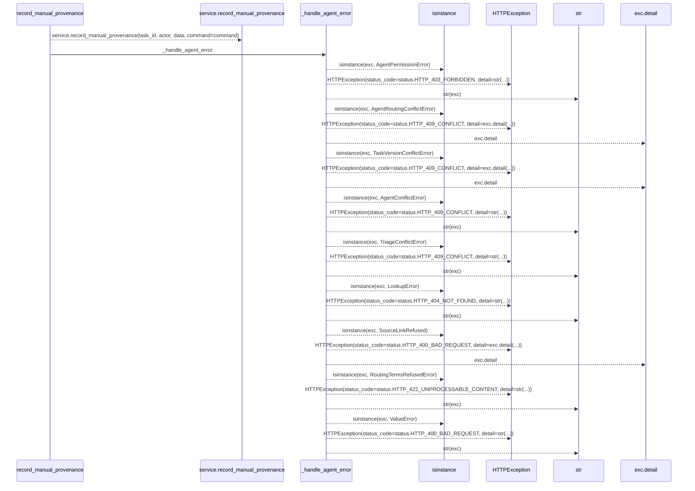
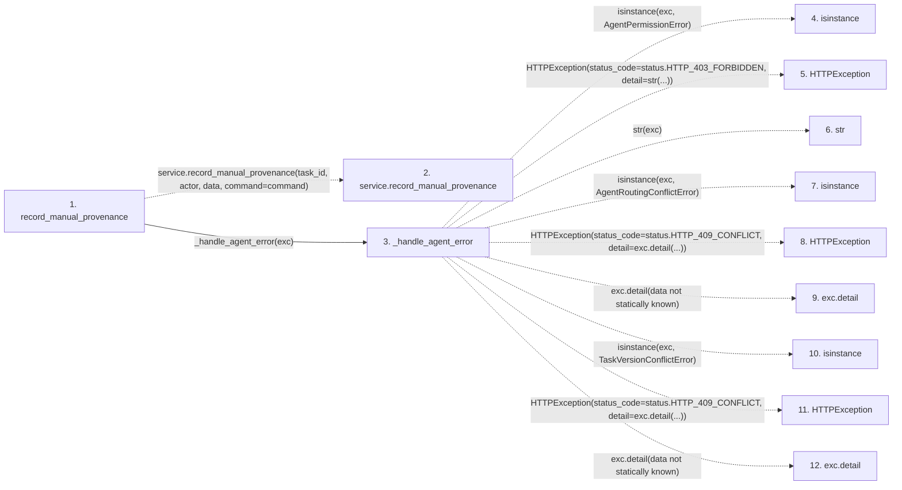

# record_manual_provenance

**Entry point:** `record_manual_provenance` (`http`)
**Source:** [routers_agent_planning](../modules/routers_agent_planning.md)
**Modules touched:** [routers_agent_planning](../modules/routers_agent_planning.md)

## Call sequence

> Static overview in presentation order, not runtime execution order. Arrows retain captured callers; representative internal continuations and boundary examples precede repeated helper detail.

<!-- Auto-generated from static call edges. Dashed arrows are external or unresolved calls. Reviewed runtime conditions and side effects belong in Behavior. -->

> Call sequence diagram shows 29 of 29 interactions; 0 omitted to keep the visualization within the 30-interaction and generated-diagram limits, with uncertain identities omitted rather than inferred.

> Captured boundary calls: external 24 of 24 (0 omitted); unresolved 4 of 4 (0 omitted). These counts cover the captured static trace.
> Detailed flow queries retain their own coverage and limits; omitted paths may execute at runtime.

## Data flow

<!-- Auto-generated static analysis. Treat values and boundaries as best-effort hints, not runtime proof. -->

### Analysis coverage

**Effect analysis partially available.** Flow assembly and source effect analysis are separate; empty observations do not prove an empty handler body.

Source steps: 2; effect analysis evaluated: 1, partial: 1, unavailable: 0. Counts include steps omitted from the displayed trace.

Collector observations for 2 source steps with known totals: observed: 23, emitted: 15, omitted: 8. Unavailable totals are excluded.

- Effect collector omitted observations before flow assembly; displayed effects are partial.

| Step | Callable record | Effect analysis | Collector totals | Observed | Emitted | Omitted |
|---|---|---|---|---:|---:|---:|
| `record_manual_provenance` | `available` | `evaluated` | `available` | `6` | `6` | `0` |
| `service.record_manual_provenance` | `not_applicable` | `not_applicable` | `not_applicable` | — | — | — |
| `_handle_agent_error` | `available` | `partial` | `available` | `17` | `9` | `8` |
| `isinstance` | `not_applicable` | `not_applicable` | `not_applicable` | — | — | — |
| `HTTPException` | `not_applicable` | `not_applicable` | `not_applicable` | — | — | — |
| `str` | `not_applicable` | `not_applicable` | `not_applicable` | — | — | — |
| `isinstance` | `not_applicable` | `not_applicable` | `not_applicable` | — | — | — |
| `HTTPException` | `not_applicable` | `not_applicable` | `not_applicable` | — | — | — |
| `exc.detail` | `not_applicable` | `not_applicable` | `not_applicable` | — | — | — |
| `isinstance` | `not_applicable` | `not_applicable` | `not_applicable` | — | — | — |
| `HTTPException` | `not_applicable` | `not_applicable` | `not_applicable` | — | — | — |
| `exc.detail` | `not_applicable` | `not_applicable` | `not_applicable` | — | — | — |

### Step data

| Step | Inputs | Reads | Writes | Returns |
|---|---|---|---|---|
| `record_manual_provenance` | `task_id: int`, `data: ManualProvenanceWrite`, `actor: Annotated[AgentActor, Depends(get_agent_actor)]`, `service: Annotated[AgentPlanningService, Depends(get_agent_planning_service)]`, `command: Annotated[AgentPlanningCommandContext, Depends(get_agent_planning_command_context)]` | - | - | `...` |
| `service.record_manual_provenance` | - | - | - | - |
| `_handle_agent_error` | `exc: Exception` | `AgentPermissionError`, `status`, `AgentRoutingConflictError`, `status`, `TaskVersionConflictError`, `status`, `AgentConflictError`, `status` | - | - |
| `isinstance` | - | - | - | - |
| `HTTPException` | - | - | - | - |
| `str` | - | - | - | - |
| `isinstance` | - | - | - | - |
| `HTTPException` | - | - | - | - |
| `exc.detail` | - | - | - | - |
| `isinstance` | - | - | - | - |
| `HTTPException` | - | - | - | - |
| `exc.detail` | - | - | - | - |

### Call data

| From | To | Line | Call |
|---|---|---:|---|
| record_manual_provenance | service.record_manual_provenance | 461 | `service.record_manual_provenance(task_id, actor, data, command=command)` |
| record_manual_provenance | _handle_agent_error | 463 | `_handle_agent_error(exc)` |
| _handle_agent_error | isinstance | 111 | `isinstance(exc, AgentPermissionError)` |
| _handle_agent_error | HTTPException | 112 | `HTTPException(status_code=status.HTTP_403_FORBIDDEN, detail=str(...))` |
| _handle_agent_error | str | 112 | `str(exc)` |
| _handle_agent_error | isinstance | 113 | `isinstance(exc, AgentRoutingConflictError)` |
| _handle_agent_error | HTTPException | 114 | `HTTPException(status_code=status.HTTP_409_CONFLICT, detail=exc.detail(...))` |
| _handle_agent_error | exc.detail | 114 | `exc.detail(data not statically known)` |
| _handle_agent_error | isinstance | 115 | `isinstance(exc, TaskVersionConflictError)` |
| _handle_agent_error | HTTPException | 116 | `HTTPException(status_code=status.HTTP_409_CONFLICT, detail=exc.detail(...))` |
| _handle_agent_error | exc.detail | 116 | `exc.detail(data not statically known)` |

### Boundary effects

*No boundary-effect observations were captured in this static trace.*

### Static analysis gaps

| Kind | Step | Target | Line |
|---|---|---|---:|
| unresolved_call | `record_manual_provenance` | `service.record_manual_provenance` | 461 |
| external_call | `_handle_agent_error` | `isinstance` | 111 |
| external_call | `_handle_agent_error` | `HTTPException` | 112 |
| external_call | `_handle_agent_error` | `isinstance` | 113 |
| external_call | `_handle_agent_error` | `HTTPException` | 114 |
| unresolved_call | `_handle_agent_error` | `exc.detail` | 114 |
| external_call | `_handle_agent_error` | `isinstance` | 115 |
| external_call | `_handle_agent_error` | `HTTPException` | 116 |
| unresolved_call | `_handle_agent_error` | `exc.detail` | 116 |
| step_limit | `record_manual_provenance` | `first 12 steps` | 0 |

## Behavior

Records who executed resolved work that was delivered outside recorded runs, and the exact candidate they delivered. Only a signed-in owner, operator or project manager, or the project's PM agent, may record it; the operator key and paired observers cannot, and a human executor can be attested only by an accountable person. The task must be resolved, uncanceled leaf work, and the artifact revision must be the current one. Before any lock is taken the head commit, commits and pull request or base commit are checked against GitHub with the same check the verifier's verdict uses. The record is an append-only task event: it advances the task version and appears on the timeline but never reopens, resolves or accepts the task or touches its progress. Under the project's different-review-publisher policy, review counts the executor, and an agent recorder, as contributors for independence, and only the latest record at the current brief and artifact revisions supplies the review candidate. It is refused when the task already has recorded agent or manual execution, already holds the maximum of 50 provenance records, names a pull request that is not linked to the task, or names an executor that contradicts the task's manual executor.
