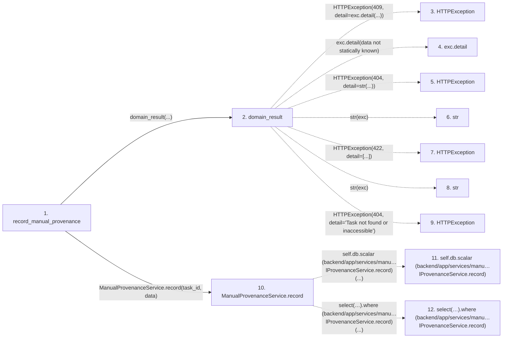

# record_manual_provenance

**Entry point:** `record_manual_provenance` (`http`)
**Source:** [routers_task_domain](../modules/routers_task_domain.md)
**Modules touched:** [agent_routing_policy](../modules/agent_routing_policy.md), [agent_routing_service](../modules/agent_routing_service.md), [authority](../modules/authority.md), [commands](../modules/commands.md), and 8 more

**Complete modules touched:**

- [agent_routing_policy](../modules/agent_routing_policy.md)
- [agent_routing_service](../modules/agent_routing_service.md)
- [authority](../modules/authority.md)
- [commands](../modules/commands.md)
- [execution_planning_window](../modules/execution_planning_window.md)
- [github_links](../modules/github_links.md)
- [github_status_service](../modules/github_status_service.md)
- [manual_provenance_service](../modules/manual_provenance_service.md)
- [review_provenance](../modules/review_provenance.md)
- [routers_task_domain](../modules/routers_task_domain.md)
- [system_settings_service](../modules/system_settings_service.md)
- [url_policy](../modules/url_policy.md)

## Call sequence

> Static overview in presentation order, not runtime execution order. Arrows retain captured callers; representative internal continuations and boundary examples precede repeated helper detail.

```mermaid
sequenceDiagram
    participant p0 as record_manual_provenance
    participant p1 as ManualProvenanceService.record
    participant p2 as domain_result
    participant p3 as ManualProvenanceService
    participant p4 as require_provenance_recorder
    participant p5 as _links
    participant p6 as ManualProvenanceService._verify_candidate
    participant p7 as ManualProvenanceService._record
    participant p8 as _commit (backend/app/services/manual_provenance_service.py)
    participant p9 as _submission_candidate
    participant p10 as GitHubStatusService.from_runtime
    participant p11 as ManualProvenanceService._require_no_recorded_execution
    participant p12 as ManualProvenanceService._require_consistent_executor
    participant p13 as ManualProvenanceService._require_task_evidence
    participant p14 as ManualProvenanceService._executor
    participant p15 as ManualProvenanceService._agent_recorder
    participant p16 as parse_github_url
    participant p17 as RuntimeSettingsService.get_github_settings
    participant p18 as ManualProvenanceService._require_project_actor
    participant p19 as ManualProvenanceService._binding_receipt
    participant p20 as _manual_history
    participant p21 as candidate_version
    participant p22 as digest
    participant p23 as current_window
    participant p24 as RuntimeSettingsService.resolve
    participant p25 as actor_provenance
    participant p26 as canonical_routing_json_bytes
    participant p27 as _commit (backend/app/utils/github_links.py)
    participant p28 as normalize_stored_display_url
    participant p29 as HTTPException
    participant p30 as self.db.scalar (backend/app/services/manu…lProvenanceService.record)
    p0->>p1: ManualProvenanceService.record
    p0->>p2: domain_result
    p0->>p3: ManualProvenanceService
    p1->>p4: require_provenance_recorder
    p1->>p5: _links
    p1->>p6: ManualProvenanceService._verify_candidate
    p1->>p7: ManualProvenanceService._record
    p5->>p8: _commit (backend/app/services/manual_provenance_service.py)
    p6->>p9: _submission_candidate
    p6->>p10: GitHubStatusService.from_runtime
    p7->>p11: ManualProvenanceService._require_no_recorded_execution
    p7->>p12: ManualProvenanceService._require_consistent_executor
    p7->>p13: ManualProvenanceService._require_task_evidence
    p7->>p14: ManualProvenanceService._executor
    p7->>p15: ManualProvenanceService._agent_recorder
    p8->>p16: parse_github_url
    p10->>p17: RuntimeSettingsService.get_github_settings
    p14->>p18: ManualProvenanceService._require_project_actor
    p14->>p19: ManualProvenanceService._binding_receipt
    p11->>p20: _manual_history
    p9->>p21: candidate_version
    p9->>p22: digest
    p21->>p23: current_window
    p17->>p24: RuntimeSettingsService.resolve
    p19->>p25: actor_provenance
    p22->>p26: canonical_routing_json_bytes
    p16->>p27: _commit (backend/app/utils/github_links.py)
    p20->>p28: normalize_stored_display_url
    p2-->>p29: HTTPException(409, detail=exc.detail(...))
    p1-->>p30: self.db.scalar (backend/app/services/manu…lProvenanceService.record)(...)
```

<!-- Auto-generated from static call edges. Dashed arrows are external or unresolved calls. Reviewed runtime conditions and side effects belong in Behavior. -->

> Call sequence diagram shows 30 of 371 interactions; 341 omitted to keep the visualization within the 30-interaction and generated-diagram limits, with uncertain identities omitted rather than inferred.

> Captured boundary calls: external 1 of 91 (90 omitted); unresolved 1 of 163 (162 omitted). These counts cover the captured static trace.

Omitted captured detail, grouped by actual caller occurrence and target module:

| Caller | Parent step | Target module | Kind | Omitted interactions |
| --- | --- | --- | --- | --- |
| `backend/app/routers/task_domain.py:domain_result` | 2 | - | unresolved | 1 |
| `backend/app/routers/task_domain.py:domain_result` | 2 | - | external | 5 |
| `backend/app/services/manual_provenance_service.py:ManualProvenanceService.record` | 10 | - | unresolved | 1 |
| `backend/app/services/manual_provenance_service.py:ManualProvenanceService.record` | 10 | - | external | 3 |
| `backend/app/services/manual_provenance_service.py:require_provenance_recorder` | 15 | - | unresolved | 3 |
| `backend/app/services/manual_provenance_service.py:require_provenance_recorder` | 15 | [backend/app/authority.py](../modules/authority.md) | internal | 1 |
| `backend/app/services/manual_provenance_service.py:ManualProvenanceService.record` | 10 | [backend/app/authority.py](../modules/authority.md) | internal | 1 |
| `backend/app/utils/github_links.py:parse_github_url` | 23 | - | unresolved | 10 |
> Omission summary shows 8 of 80 groups; 72 further groups are not expanded here. Counts above include all omitted interactions.
> Detailed flow queries retain their own coverage and limits; omitted paths may execute at runtime.

> Trace truncated at the depth limit; deeper calls are omitted.

## Data flow

<!-- Auto-generated static analysis. Treat values and boundaries as best-effort hints, not runtime proof. -->

### Analysis coverage

**Effect analysis partially available.** Flow assembly and source effect analysis are separate; empty observations do not prove an empty handler body.

Source steps: 118; effect analysis evaluated: 71, partial: 1, unavailable: 46. Counts include steps omitted from the displayed trace.

Collector observations for 72 source steps with known totals: observed: 465, emitted: 460, omitted: 5. Unavailable totals are excluded.

- Callable record unavailable for one or more source steps; those steps have no represented callable body.
- Effect collector omitted observations before flow assembly; displayed effects are partial.
- Effect collector totals unavailable; observed counts cover captured records only.

| Step | Callable record | Effect analysis | Collector totals | Observed | Emitted | Omitted |
|---|---|---|---|---:|---:|---:|
| `record_manual_provenance` | `available` | `evaluated` | `available` | `4` | `4` | `0` |
| `domain_result` | `available` | `evaluated` | `available` | `3` | `3` | `0` |
| `HTTPException` | `not_applicable` | `not_applicable` | `not_applicable` | — | — | — |
| `exc.detail` | `not_applicable` | `not_applicable` | `not_applicable` | — | — | — |
| `HTTPException` | `not_applicable` | `not_applicable` | `not_applicable` | — | — | — |
| `str` | `not_applicable` | `not_applicable` | `not_applicable` | — | — | — |
| `HTTPException` | `not_applicable` | `not_applicable` | `not_applicable` | — | — | — |
| `str` | `not_applicable` | `not_applicable` | `not_applicable` | — | — | — |
| `HTTPException` | `not_applicable` | `not_applicable` | `not_applicable` | — | — | — |
| `ManualProvenanceService.record` | `available` | `evaluated` | `available` | `8` | `8` | `0` |
| `self.db.scalar (backend/app/services/manu…lProvenanceService.record)` | `not_applicable` | `not_applicable` | `not_applicable` | — | — | — |
| `select(…).where (backend/app/services/manu…lProvenanceService.record)` | `not_applicable` | `not_applicable` | `not_applicable` | — | — | — |

### Step data

| Step | Inputs | Reads | Writes | Returns |
|---|---|---|---|---|
| `record_manual_provenance` | `task_id: int`, `data: ManualProvenanceWrite`, `db: DB` | - | - | `...` |
| `domain_result` | `awaitable` | `TaskVersionConflictError` | - | `result` |
| `HTTPException` | - | - | - | - |
| `exc.detail` | - | - | - | - |
| `HTTPException` | - | - | - | - |
| `str` | - | - | - | - |
| `HTTPException` | - | - | - | - |
| `str` | - | - | - | - |
| `HTTPException` | - | - | - | - |
| `ManualProvenanceService.record` | `task_id`, `data`, `commit` | `Task`, `self.db` | `self.db.info[...]`, `self.db.info[...]` | `...` |
| `self.db.scalar (backend/app/services/manu…lProvenanceService.record)` | - | - | - | - |
| `select(…).where (backend/app/services/manu…lProvenanceService.record)` | - | - | - | - |

### Call data

| From | To | Line | Call |
|---|---|---:|---|
| record_manual_provenance | domain_result | 384 | `domain_result(...)` |
| domain_result | HTTPException | 56 | `HTTPException(409, detail=exc.detail(...))` |
| domain_result | exc.detail | 56 | `exc.detail(data not statically known)` |
| domain_result | HTTPException | 58 | `HTTPException(404, detail=str(...))` |
| domain_result | str | 58 | `str(exc)` |
| domain_result | HTTPException | 60 | `HTTPException(422, detail=[...])` |
| domain_result | str | 60 | `str(exc)` |
| domain_result | HTTPException | 62 | `HTTPException(404, detail='Task not found or inaccessible')` |
| record_manual_provenance | ManualProvenanceService.record | 384 | `ManualProvenanceService(db).record(task_id, data)` |
| ManualProvenanceService.record | self.db.scalar (backend/app/services/manu…lProvenanceService.record) | 216 | `self.db.scalar(...)` |
| ManualProvenanceService.record | select(…).where (backend/app/services/manu…lProvenanceService.record) | 216 | `select(Task).where(...)` |

### Boundary effects

*No boundary-effect observations were captured in this static trace.*

### Static analysis gaps

| Kind | Step | Target | Line |
|---|---|---|---:|
| external_call | `domain_result` | `HTTPException` | 56 |
| unresolved_call | `domain_result` | `exc.detail` | 56 |
| external_call | `domain_result` | `HTTPException` | 58 |
| external_call | `domain_result` | `HTTPException` | 60 |
| external_call | `domain_result` | `HTTPException` | 62 |
| unresolved_call | `ManualProvenanceService.record` | `self.db.scalar` | 216 |
| unresolved_call | `ManualProvenanceService.record` | `select(Task).where` | 216 |
| step_limit | `record_manual_provenance` | `first 12 steps` | 0 |
| truncated_flow | `record_manual_provenance` | `depth limit` | 0 |

## Behavior

Records who executed resolved work that was delivered outside recorded runs, and the exact candidate they delivered. Only a signed-in owner, operator or project manager, or the project's PM agent, may record it; the operator key and paired observers cannot, and a human executor can be attested only by an accountable person. The task must be resolved, uncanceled leaf work, and the artifact revision must be the current one. Before any lock is taken the head commit, commits and pull request or base commit are checked against GitHub with the same check the verifier's verdict uses. The record is an append-only task event: it advances the task version and appears on the timeline but never reopens, resolves or accepts the task or touches its progress. Review counts the executor, and an agent recorder, as contributors for independence, and only the latest record at the current brief and artifact revisions supplies the review candidate.
