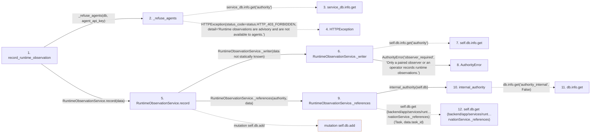

# record_runtime_observation

**Entry point:** `record_runtime_observation` (`http`)
**Source:** [routers_agent](../modules/routers_agent.md)
**Modules touched:** [authority](../modules/authority.md), [config](../modules/config.md), [models_runtime_observation](../modules/models_runtime_observation.md), [routers_agent](../modules/routers_agent.md), and 2 more

**Complete modules touched:**

- [authority](../modules/authority.md)
- [config](../modules/config.md)
- [models_runtime_observation](../modules/models_runtime_observation.md)
- [routers_agent](../modules/routers_agent.md)
- [runtime_observation_service](../modules/runtime_observation_service.md)
- [time](../modules/time.md)

## Call sequence

> Static overview in presentation order, not runtime execution order. Arrows retain captured callers; representative internal continuations and boundary examples precede repeated helper detail.

```mermaid
sequenceDiagram
    participant p0 as record_runtime_observation
    participant p1 as RuntimeObservationService.record
    participant p2 as _refuse_agents
    participant p3 as RuntimeObservationService
    participant p4 as RuntimeObservationService._writer
    participant p5 as RuntimeObservationService._references
    participant p6 as _same
    participant p7 as get_settings
    participant p8 as internal_authority
    participant p9 as AuthorityError
    participant p10 as utc_now
    participant p11 as AgentRuntimeObservation
    participant p12 as Settings
    participant p13 as as_utc
    participant p14 as HTTPException
    participant p15 as service_db.info.get
    participant p16 as data.model_dump
    participant p17 as set
    participant p18 as self.db.get (backend/app/services/runt…eObservationService.record)
    participant p19 as AgentRuntimeObservation.observer_session_id.is_
    participant p20 as self.db.scalar (backend/app/services/runt…eObservationService.record)
    participant p21 as select(…).where (backend/app/services/runt…eObservationService.record)
    participant p22 as select (backend/app/services/runt…eObservationService.record)
    participant p23 as any
    participant p24 as getattr
    participant p25 as select(…).select_from(…).where
    participant p26 as select(…).select_from
    participant p27 as func.count
    participant p28 as timedelta
    p0->>p1: RuntimeObservationService.record
    p0->>p2: _refuse_agents
    p0->>p3: RuntimeObservationService
    p1->>p4: RuntimeObservationService._writer
    p1->>p5: RuntimeObservationService._references
    p1->>p6: _same
    p1->>p7: get_settings
    p1->>p8: internal_authority
    p1->>p9: AuthorityError
    p1->>p10: utc_now
    p1->>p11: AgentRuntimeObservation
    p7->>p12: Settings
    p6->>p13: as_utc
    p2-->>p14: HTTPException(status_code=status.HTTP_403_FORBIDDEN, detail='Runtime observations are advisory and are not available to agents.')
    p2-->>p15: service_db.info.get('authority')
    p1-->>p16: data.model_dump(include=set(...))
    p1-->>p17: set(RECORDED_FIELDS)
    p1-->>p18: self.db.get (backend/app/services/runt…eObservationService.record)(UserSession, authority.session_id)
    p1-->>p19: AgentRuntimeObservation.observer_session_id.is_(None)
    p1-->>p20: self.db.scalar (backend/app/services/runt…eObservationService.record)(...)
    p1-->>p21: select(…).where (backend/app/services/runt…eObservationService.record)(owner, ...)
    p1-->>p22: select (backend/app/services/runt…eObservationService.record)(AgentRuntimeObservation)
    p1-->>p23: any(...)
    p1-->>p24: getattr(existing, field)
    p1-->>p20: self.db.scalar (backend/app/services/runt…eObservationService.record)(...)
    p1-->>p25: select(…).select_from(…).where(owner, ...)
    p1-->>p26: select(…).select_from(AgentRuntimeObservation)
    p1-->>p22: select (backend/app/services/runt…eObservationService.record)(func.count(...))
    p1-->>p27: func.count
    p1-->>p28: timedelta(hours=1)
```

<!-- Auto-generated from static call edges. Dashed arrows are external or unresolved calls. Reviewed runtime conditions and side effects belong in Behavior. -->

> Call sequence diagram shows 30 of 57 interactions; 27 omitted to keep the visualization within the 30-interaction and generated-diagram limits, with uncertain identities omitted rather than inferred.

> Captured boundary calls: external 8 of 12 (4 omitted); unresolved 9 of 23 (14 omitted). These counts cover the captured static trace.

Omitted captured detail, grouped by actual caller occurrence and target module:

| Caller | Parent step | Target module | Kind | Omitted interactions |
| --- | --- | --- | --- | --- |
| `backend/app/services/runtime_observation_service.py:RuntimeObservationService._writer` | 6 | - | unresolved | 1 |
| `backend/app/services/runtime_observation_service.py:RuntimeObservationService._writer` | 6 | [backend/app/authority.py](../modules/authority.md) | internal | 1 |
| `backend/app/services/runtime_observation_service.py:RuntimeObservationService._references` | 9 | [backend/app/authority.py](../modules/authority.md) | internal | 6 |
| `backend/app/authority.py:internal_authority` | 10 | - | unresolved | 1 |
| `backend/app/services/runtime_observation_service.py:RuntimeObservationService._references` | 9 | - | unresolved | 8 |
| `backend/app/services/runtime_observation_service.py:RuntimeObservationService._references` | 9 | - | external | 1 |
| `backend/app/services/runtime_observation_service.py:_same` | 35 | - | external | 2 |
| `backend/app/utils/time.py:as_utc` | 38 | - | unresolved | 2 |
> Omission summary shows 8 of 12 groups; 4 further groups are not expanded here. Counts above include all omitted interactions.
> Detailed flow queries retain their own coverage and limits; omitted paths may execute at runtime.

## Data flow

<!-- Auto-generated static analysis. Treat values and boundaries as best-effort hints, not runtime proof. -->

### Analysis coverage

**Effect analysis partially available.** Flow assembly and source effect analysis are separate; empty observations do not prove an empty handler body.

Source steps: 23; effect analysis evaluated: 12, partial: 0, unavailable: 11. Counts include steps omitted from the displayed trace.

Collector observations for 12 source steps with known totals: observed: 56, emitted: 56, omitted: 0. Unavailable totals are excluded.

- Callable record unavailable for one or more source steps; those steps have no represented callable body.
- Effect collector totals unavailable; observed counts cover captured records only.

| Step | Callable record | Effect analysis | Collector totals | Observed | Emitted | Omitted |
|---|---|---|---|---:|---:|---:|
| `record_runtime_observation` | `available` | `evaluated` | `available` | `8` | `8` | `0` |
| `_refuse_agents` | `available` | `evaluated` | `available` | `3` | `3` | `0` |
| `service_db.info.get` | `not_applicable` | `not_applicable` | `not_applicable` | — | — | — |
| `HTTPException` | `not_applicable` | `not_applicable` | `not_applicable` | — | — | — |
| `RuntimeObservationService.record` | `available` | `evaluated` | `available` | `13` | `13` | `0` |
| `RuntimeObservationService._writer` | `available` | `evaluated` | `available` | `1` | `1` | `0` |
| `self.db.info.get` | `not_applicable` | `not_applicable` | `not_applicable` | — | — | — |
| `AuthorityError` | `unavailable` | `unavailable` | `unavailable` | — | — | — |
| `RuntimeObservationService._references` | `available` | `evaluated` | `available` | `8` | `8` | `0` |
| `internal_authority` | `available` | `evaluated` | `available` | `3` | `3` | `0` |
| `db.info.get` | `not_applicable` | `not_applicable` | `not_applicable` | — | — | — |
| `self.db.get (backend/app/services/runt…rvationService._references)` | `not_applicable` | `not_applicable` | `not_applicable` | — | — | — |

### Step data

| Step | Inputs | Reads | Writes | Returns |
|---|---|---|---|---|
| `record_runtime_observation` | `data: AgentRuntimeObservationCreate`, `response: Response`, `db: Annotated[AsyncSession, Depends(get_db, scope='function')]`, `agent_api_key: Annotated[Optional[str], Header(alias='X-Agent-API-Key')]` | `status` | `response.status_code`, `response.headers[...]` | `row` |
| `_refuse_agents` | `service_db`, `agent_api_key` | `status` | - | - |
| `service_db.info.get` | - | - | - | - |
| `HTTPException` | - | - | - | - |
| `RuntimeObservationService.record` | `data: AgentRuntimeObservationCreate` | `RECORDED_FIELDS`, `self.db`, `UserSession`, `AgentRuntimeObservation`, `AgentRuntimeObservation`, `AgentRuntimeObservation`, `RECORDED_FIELDS`, `AgentRuntimeObservation` | `values[...]` | `(...)`, `(...)` |
| `RuntimeObservationService._writer` | - | - | - | `authority` |
| `self.db.info.get` | - | - | - | - |
| `AuthorityError` | - | - | - | - |
| `RuntimeObservationService._references` | `authority`, `data: AgentRuntimeObservationCreate` | `self.db`, `Task`, `AgentRun`, `Task`, `AgentActor` | - | `task` |
| `internal_authority` | `db` | - | `db.info[...]`, `db.info[...]` | - |
| `db.info.get` | - | - | - | - |
| `self.db.get (backend/app/services/runt…rvationService._references)` | - | - | - | - |

### Call data

| From | To | Line | Call |
|---|---|---:|---|
| record_runtime_observation | _refuse_agents | 1615 | `_refuse_agents(db, agent_api_key)` |
| _refuse_agents | service_db.info.get | 1595 | `service_db.info.get('authority')` |
| _refuse_agents | HTTPException | 1597 | `HTTPException(status_code=status.HTTP_403_FORBIDDEN, detail='Runtime observations are advisory and are not available to agents.')` |
| record_runtime_observation | RuntimeObservationService.record | 1616 | `RuntimeObservationService(db).record(data)` |
| RuntimeObservationService.record | RuntimeObservationService._writer | 66 | `self._writer(data not statically known)` |
| RuntimeObservationService._writer | self.db.info.get | 31 | `self.db.info.get('authority')` |
| RuntimeObservationService._writer | AuthorityError | 33 | `AuthorityError('observer_required', 'Only a paired observer or an operator records runtime observations.')` |
| RuntimeObservationService.record | RuntimeObservationService._references | 67 | `self._references(authority, data)` |
| RuntimeObservationService._references | internal_authority | 39 | `internal_authority(self.db)` |
| internal_authority | db.info.get | 92 | `db.info.get('authority_internal', False)` |
| RuntimeObservationService._references | self.db.get (backend/app/services/runt…rvationService._references) | 40 | `self.db.get(Task, data.task_id)` |

### Boundary effects

| Kind | Target | Step | Line |
|---|---|---|---:|
| mutation | `self.db.add` | `RuntimeObservationService.record` | 94 |

### Static analysis gaps

| Kind | Step | Target | Line |
|---|---|---|---:|
| unresolved_call | `_refuse_agents` | `service_db.info.get` | 1595 |
| external_call | `_refuse_agents` | `HTTPException` | 1597 |
| unresolved_call | `RuntimeObservationService._writer` | `self.db.info.get` | 31 |
| unresolved_call | `internal_authority` | `db.info.get` | 92 |
| unresolved_call | `RuntimeObservationService._references` | `self.db.get` | 40 |
| step_limit | `record_runtime_observation` | `first 12 steps` | 0 |

## Behavior

Records one advisory observation from a paired observer or an operator; agent keys get 403. References must be readable by the observer, and a non-operator names an actor only through a run or assignment of such a task. The row is written inside the internal authority boundary and nothing else changes. A repeated key with the same content returns the first row (200); different content returns 409; past the hourly limit an observer gets 429.
