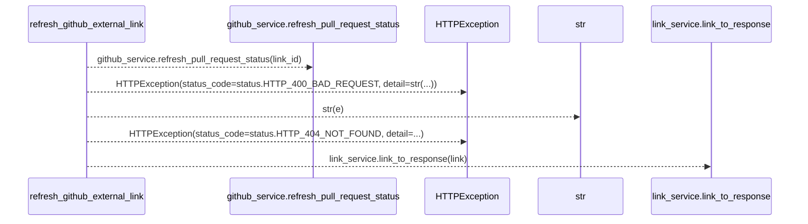
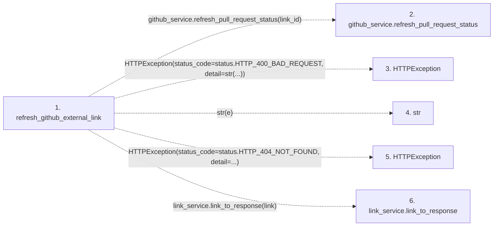

# refresh_github_external_link

**Entry point:** `refresh_github_external_link` (`http`)
**Source:** [tasks](../modules/tasks.md)
**Modules touched:** [tasks](../modules/tasks.md)

## Call sequence

> Static overview in presentation order, not runtime execution order. Arrows retain captured callers; representative internal continuations and boundary examples precede repeated helper detail.

<!-- Auto-generated from static call edges. Dashed arrows are external or unresolved calls. Reviewed runtime conditions and side effects belong in Behavior. -->

> Call sequence diagram shows 5 of 5 interactions; 0 omitted to keep the visualization within the 30-interaction and generated-diagram limits, with uncertain identities omitted rather than inferred.

> Captured boundary calls: external 3 of 3 (0 omitted); unresolved 2 of 2 (0 omitted). These counts cover the captured static trace.
> Detailed flow queries retain their own coverage and limits; omitted paths may execute at runtime.

## Data flow

<!-- Auto-generated static analysis. Treat values and boundaries as best-effort hints, not runtime proof. -->

### Analysis coverage

**Effect analysis evaluated.** Flow assembly and source effect analysis are separate; empty observations do not prove an empty handler body.

Source steps: 1; effect analysis evaluated: 1, partial: 0, unavailable: 0. Counts include steps omitted from the displayed trace.

Collector observations for 1 source steps with known totals: observed: 7, emitted: 7, omitted: 0. Unavailable totals are excluded.

### Step data

| Step | Inputs | Reads | Writes | Returns |
|---|---|---|---|---|
| `refresh_github_external_link` | `link_id: int`, `github_service: Annotated[GitHubStatusService, Depends(get_github_status_service)]`, `link_service: Annotated[ExternalLinkService, Depends(get_external_link_service)]` | `ExternalLinkValidationError`, `status`, `status` | - | `link_service.link_to_response(...)` |
| `github_service.refresh_pull_request_status` | - | - | - | - |
| `HTTPException` | - | - | - | - |
| `str` | - | - | - | - |
| `HTTPException` | - | - | - | - |
| `link_service.link_to_response` | - | - | - | - |

### Call data

| From | To | Line | Call |
|---|---|---:|---|
| refresh_github_external_link | github_service.refresh_pull_request_status | 506 | `github_service.refresh_pull_request_status(link_id)` |
| refresh_github_external_link | HTTPException | 508 | `HTTPException(status_code=status.HTTP_400_BAD_REQUEST, detail=str(...))` |
| refresh_github_external_link | str | 510 | `str(e)` |
| refresh_github_external_link | HTTPException | 514 | `HTTPException(status_code=status.HTTP_404_NOT_FOUND, detail=...)` |
| refresh_github_external_link | link_service.link_to_response | 518 | `link_service.link_to_response(link)` |

### Boundary effects

*No boundary-effect observations were captured in this static trace.*

### Static analysis gaps

| Kind | Step | Target | Line |
|---|---|---|---:|
| unresolved_call | `refresh_github_external_link` | `github_service.refresh_pull_request_status` | 506 |
| external_call | `refresh_github_external_link` | `HTTPException` | 508 |
| external_call | `refresh_github_external_link` | `HTTPException` | 514 |
| unresolved_call | `refresh_github_external_link` | `link_service.link_to_response` | 518 |

## Behavior

This flow starts at `refresh_github_external_link` and is classified as `http`. The generated call and data-flow sections are bounded static projections; runtime conditions and side effects require source-level confirmation.
