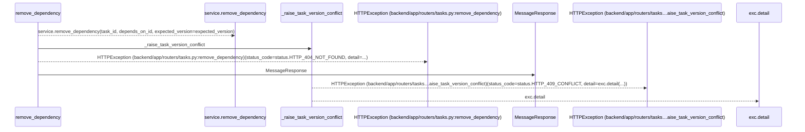
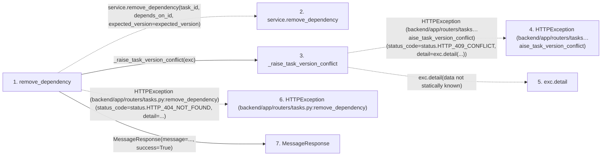

# remove_dependency

**Entry point:** `remove_dependency` (`http`)
**Source:** [tasks](../modules/tasks.md)
**Modules touched:** [schemas_common](../modules/schemas_common.md), [tasks](../modules/tasks.md)

## Call sequence

> Static overview in presentation order, not runtime execution order. Arrows retain captured callers; representative internal continuations and boundary examples precede repeated helper detail.

<!-- Auto-generated from static call edges. Dashed arrows are external or unresolved calls. Reviewed runtime conditions and side effects belong in Behavior. -->

> Call sequence diagram shows 6 of 6 interactions; 0 omitted to keep the visualization within the 30-interaction and generated-diagram limits, with uncertain identities omitted rather than inferred.

> Captured boundary calls: external 2 of 2 (0 omitted); unresolved 2 of 2 (0 omitted). These counts cover the captured static trace.
> Detailed flow queries retain their own coverage and limits; omitted paths may execute at runtime.

## Data flow

<!-- Auto-generated static analysis. Treat values and boundaries as best-effort hints, not runtime proof. -->

### Analysis coverage

**Effect analysis partially available.** Flow assembly and source effect analysis are separate; empty observations do not prove an empty handler body.

Source steps: 3; effect analysis evaluated: 2, partial: 0, unavailable: 1. Counts include steps omitted from the displayed trace.

Collector observations for 2 source steps with known totals: observed: 9, emitted: 9, omitted: 0. Unavailable totals are excluded.

- Callable record unavailable for one or more source steps; those steps have no represented callable body.
- Effect collector totals unavailable; observed counts cover captured records only.

| Step | Callable record | Effect analysis | Collector totals | Observed | Emitted | Omitted |
|---|---|---|---|---:|---:|---:|
| `remove_dependency` | `available` | `evaluated` | `available` | `7` | `7` | `0` |
| `service.remove_dependency` | `not_applicable` | `not_applicable` | `not_applicable` | — | — | — |
| `_raise_task_version_conflict` | `available` | `evaluated` | `available` | `2` | `2` | `0` |
| `HTTPException (backend/app/routers/tasks…aise_task_version_conflict)` | `not_applicable` | `not_applicable` | `not_applicable` | — | — | — |
| `exc.detail` | `not_applicable` | `not_applicable` | `not_applicable` | — | — | — |
| `HTTPException (backend/app/routers/tasks.py:remove_dependency)` | `not_applicable` | `not_applicable` | `not_applicable` | — | — | — |
| `MessageResponse` | `unavailable` | `unavailable` | `unavailable` | — | — | — |

### Step data

| Step | Inputs | Reads | Writes | Returns |
|---|---|---|---|---|
| `remove_dependency` | `task_id: int`, `depends_on_id: int`, `service: Annotated[TaskService, Depends(get_task_service)]`, `expected_version: int \| None` | `TaskVersionConflictError`, `status` | - | `MessageResponse(...)` |
| `service.remove_dependency` | - | - | - | - |
| `_raise_task_version_conflict` | `exc: TaskVersionConflictError` | `status` | - | - |
| `HTTPException (backend/app/routers/tasks…aise_task_version_conflict)` | - | - | - | - |
| `exc.detail` | - | - | - | - |
| `HTTPException (backend/app/routers/tasks.py:remove_dependency)` | - | - | - | - |
| `MessageResponse` | - | - | - | - |

### Call data

| From | To | Line | Call |
|---|---|---:|---|
| remove_dependency | service.remove_dependency | 651 | `service.remove_dependency(task_id, depends_on_id, expected_version=expected_version)` |
| remove_dependency | _raise_task_version_conflict | 653 | `_raise_task_version_conflict(exc)` |
| _raise_task_version_conflict | HTTPException (backend/app/routers/tasks…aise_task_version_conflict) | 59 | `HTTPException(status_code=status.HTTP_409_CONFLICT, detail=exc.detail(...))` |
| _raise_task_version_conflict | exc.detail | 61 | `exc.detail(data not statically known)` |
| remove_dependency | HTTPException (backend/app/routers/tasks.py:remove_dependency) | 655 | `HTTPException(status_code=status.HTTP_404_NOT_FOUND, detail=...)` |
| remove_dependency | MessageResponse | 659 | `MessageResponse(message=..., success=True)` |

### Boundary effects

*No boundary-effect observations were captured in this static trace.*

### Static analysis gaps

| Kind | Step | Target | Line |
|---|---|---|---:|
| unresolved_call | `remove_dependency` | `service.remove_dependency` | 651 |
| external_call | `_raise_task_version_conflict` | `HTTPException` | 59 |
| unresolved_call | `_raise_task_version_conflict` | `exc.detail` | 61 |
| external_call | `remove_dependency` | `HTTPException` | 655 |

## Behavior

This flow starts at `remove_dependency` and is classified as `http`. The generated call and data-flow sections are bounded static projections; runtime conditions and side effects require source-level confirmation.

Actual dependency changes invalidate current progress and acceptance through general updates and individual add/remove commands. Immutable evidence history remains available, a command reserves one task version, and no-op dependency requests retain their current version. Locked graph relationships are loaded explicitly before applying a dependency update.
