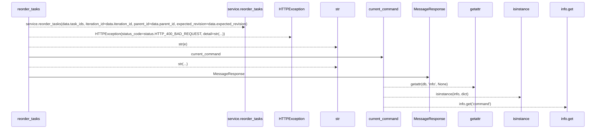
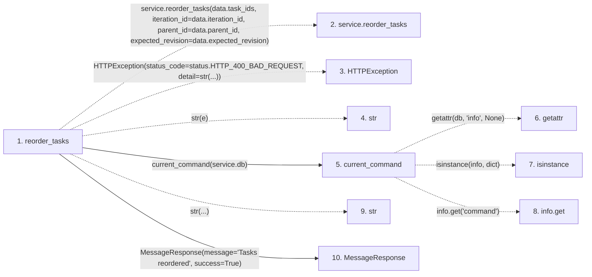

# reorder_tasks

**Entry point:** `reorder_tasks` (`http`)
**Source:** [tasks](../modules/tasks.md)
**Modules touched:** [commands](../modules/commands.md), [schemas_common](../modules/schemas_common.md), [tasks](../modules/tasks.md)

## Call sequence

> Static overview in presentation order, not runtime execution order. Arrows retain captured callers; representative internal continuations and boundary examples precede repeated helper detail.

<!-- Auto-generated from static call edges. Dashed arrows are external or unresolved calls. Reviewed runtime conditions and side effects belong in Behavior. -->

> Call sequence diagram shows 9 of 9 interactions; 0 omitted to keep the visualization within the 30-interaction and generated-diagram limits, with uncertain identities omitted rather than inferred.

> Captured boundary calls: external 5 of 5 (0 omitted); unresolved 2 of 2 (0 omitted). These counts cover the captured static trace.
> Detailed flow queries retain their own coverage and limits; omitted paths may execute at runtime.

## Data flow

<!-- Auto-generated static analysis. Treat values and boundaries as best-effort hints, not runtime proof. -->

### Analysis coverage

**Effect analysis partially available.** Flow assembly and source effect analysis are separate; empty observations do not prove an empty handler body.

Source steps: 3; effect analysis evaluated: 2, partial: 0, unavailable: 1. Counts include steps omitted from the displayed trace.

Collector observations for 2 source steps with known totals: observed: 8, emitted: 8, omitted: 0. Unavailable totals are excluded.

- Callable record unavailable for one or more source steps; those steps have no represented callable body.
- Effect collector totals unavailable; observed counts cover captured records only.

| Step | Callable record | Effect analysis | Collector totals | Observed | Emitted | Omitted |
|---|---|---|---|---:|---:|---:|
| `reorder_tasks` | `available` | `evaluated` | `available` | `6` | `6` | `0` |
| `service.reorder_tasks` | `not_applicable` | `not_applicable` | `not_applicable` | — | — | — |
| `HTTPException` | `not_applicable` | `not_applicable` | `not_applicable` | — | — | — |
| `str` | `not_applicable` | `not_applicable` | `not_applicable` | — | — | — |
| `current_command` | `available` | `evaluated` | `available` | `2` | `2` | `0` |
| `getattr` | `not_applicable` | `not_applicable` | `not_applicable` | — | — | — |
| `isinstance` | `not_applicable` | `not_applicable` | `not_applicable` | — | — | — |
| `info.get` | `not_applicable` | `not_applicable` | `not_applicable` | — | — | — |
| `str` | `not_applicable` | `not_applicable` | `not_applicable` | — | — | — |
| `MessageResponse` | `unavailable` | `unavailable` | `unavailable` | — | — | — |

### Step data

| Step | Inputs | Reads | Writes | Returns |
|---|---|---|---|---|
| `reorder_tasks` | `data: TaskReorder`, `response: Response`, `service: Annotated[TaskService, Depends(get_task_service)]` | `status` | `response.headers[...]` | `MessageResponse(...)` |
| `service.reorder_tasks` | - | - | - | - |
| `HTTPException` | - | - | - | - |
| `str` | - | - | - | - |
| `current_command` | `db` | - | - | `...` |
| `getattr` | - | - | - | - |
| `isinstance` | - | - | - | - |
| `info.get` | - | - | - | - |
| `str` | - | - | - | - |
| `MessageResponse` | - | - | - | - |

### Call data

| From | To | Line | Call |
|---|---|---:|---|
| reorder_tasks | service.reorder_tasks | 673 | `service.reorder_tasks(data.task_ids, iteration_id=data.iteration_id, parent_id=data.parent_id, expected_revision=data.expected_revision)` |
| reorder_tasks | HTTPException | 680 | `HTTPException(status_code=status.HTTP_400_BAD_REQUEST, detail=str(...))` |
| reorder_tasks | str | 680 | `str(e)` |
| reorder_tasks | current_command | 682 | `current_command(service.db)` |
| current_command | getattr | 73 | `getattr(db, 'info', None)` |
| current_command | isinstance | 74 | `isinstance(info, dict)` |
| current_command | info.get | 74 | `info.get('command')` |
| reorder_tasks | str | 684 | `str(...)` |
| reorder_tasks | MessageResponse | 685 | `MessageResponse(message='Tasks reordered', success=True)` |

### Boundary effects

*No boundary-effect observations were captured in this static trace.*

### Static analysis gaps

| Kind | Step | Target | Line |
|---|---|---|---:|
| unresolved_call | `reorder_tasks` | `service.reorder_tasks` | 673 |
| external_call | `reorder_tasks` | `HTTPException` | 680 |
| external_call | `current_command` | `getattr` | 73 |
| external_call | `current_command` | `isinstance` | 74 |
| unresolved_call | `current_command` | `info.get` | 74 |

## Behavior

This flow starts at `reorder_tasks` and is classified as `http`. The generated call and data-flow sections are bounded static projections; runtime conditions and side effects require source-level confirmation.
