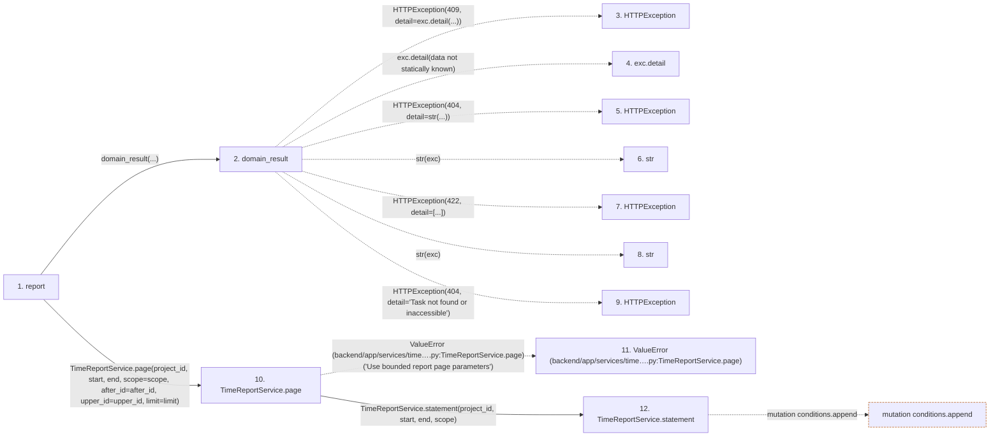

# report

**Entry point:** `report` (`http`)
**Source:** [time_entries](../modules/time_entries.md)
**Modules touched:** [authority](../modules/authority.md), [routers_task_domain](../modules/routers_task_domain.md), [time_entries](../modules/time_entries.md), [time_report_service](../modules/time_report_service.md)

## Call sequence

> Static overview in presentation order, not runtime execution order. Arrows retain captured callers; representative internal continuations and boundary examples precede repeated helper detail.

```mermaid
sequenceDiagram
    participant p0 as report
    participant p1 as TimeReportService.page
    participant p2 as domain_result
    participant p3 as TimeReportService
    participant p4 as TimeReportService.statement
    participant p5 as internal_authority
    participant p6 as TimeReportService.item
    participant p7 as AuthorityError
    participant p8 as HTTPException
    participant p9 as exc.detail
    participant p10 as ValueError (backend/app/services/time….py:TimeReportService.page)
    participant p11 as query.subquery
    participant p12 as str
    participant p13 as (…).one
    participant p14 as self.db.execute
    participant p15 as select(…).select_from
    participant p16 as select (backend/app/services/time….py:TimeReportService.page)
    participant p17 as func.count (backend/app/services/time….py:TimeReportService.page)
    participant p18 as func.sum (backend/app/services/time….py:TimeReportService.page)
    participant p19 as case (backend/app/services/time….py:TimeReportService.page)
    participant p20 as self.db.scalar (backend/app/services/time….py:TimeReportService.page)
    participant p21 as func.max
    participant p22 as (…).all
    p0->>p1: TimeReportService.page
    p0->>p2: domain_result
    p0->>p3: TimeReportService
    p1->>p4: TimeReportService.statement
    p1->>p5: internal_authority
    p1->>p6: TimeReportService.item
    p4->>p7: AuthorityError
    p2-->>p8: HTTPException(409, detail=exc.detail(...))
    p2-->>p9: exc.detail
    p1-->>p10: ValueError (backend/app/services/time….py:TimeReportService.page)('Use bounded report page parameters')
    p2-->>p8: HTTPException(404, detail=str(...))
    p1-->>p11: query.subquery
    p2-->>p12: str(exc)
    p2-->>p8: HTTPException(422, detail=[...])
    p1-->>p13: (…).one
    p2-->>p12: str(exc)
    p1-->>p14: self.db.execute(...)
    p2-->>p8: HTTPException(404, detail='Task not found or inaccessible')
    p1-->>p15: select(…).select_from(all_rows)
    p1-->>p16: select (backend/app/services/time….py:TimeReportService.page)(func.count(...), func.sum(...), func.sum(...), func.sum(...), func.count(...))
    p1-->>p17: func.count (backend/app/services/time….py:TimeReportService.page)
    p1-->>p18: func.sum (backend/app/services/time….py:TimeReportService.page)(case(...))
    p1-->>p19: case (backend/app/services/time….py:TimeReportService.page)((...), else_=0)
    p1-->>p18: func.sum (backend/app/services/time….py:TimeReportService.page)(all_rows.c.recorded_minutes)
    p1-->>p18: func.sum (backend/app/services/time….py:TimeReportService.page)(all_rows.c.estimate_hours)
    p1-->>p17: func.count (backend/app/services/time….py:TimeReportService.page)(all_rows.c.estimate_hours)
    p1-->>p20: self.db.scalar (backend/app/services/time….py:TimeReportService.page)(select(...))
    p1-->>p16: select (backend/app/services/time….py:TimeReportService.page)(func.max(...))
    p1-->>p21: func.max(all_rows.c.task_id)
    p1-->>p22: (…).all
```

<!-- Auto-generated from static call edges. Dashed arrows are external or unresolved calls. Reviewed runtime conditions and side effects belong in Behavior. -->

> Call sequence diagram shows 30 of 90 interactions; 60 omitted to keep the visualization within the 30-interaction and generated-diagram limits, with uncertain identities omitted rather than inferred.

> Captured boundary calls: external 16 of 38 (22 omitted); unresolved 7 of 44 (37 omitted). These counts cover the captured static trace.

Omitted captured detail, grouped by actual caller occurrence and target module:

| Caller | Parent step | Target module | Kind | Omitted interactions |
| --- | --- | --- | --- | --- |
| `backend/app/services/time_report_service.py:TimeReportService.statement` | 12 | - | unresolved | 32 |
| `backend/app/services/time_report_service.py:TimeReportService.statement` | 12 | - | external | 19 |
| `backend/app/services/time_report_service.py:TimeReportService.statement` | 12 | [backend/app/authority.py](../modules/authority.md) | internal | 1 |
| `backend/app/authority.py:internal_authority` | 60 | - | unresolved | 1 |
| `backend/app/services/time_report_service.py:TimeReportService.page` | 10 | - | unresolved | 4 |
| `backend/app/services/time_report_service.py:TimeReportService.page` | 10 | - | external | 3 |
> Detailed flow queries retain their own coverage and limits; omitted paths may execute at runtime.

## Data flow

<!-- Auto-generated static analysis. Treat values and boundaries as best-effort hints, not runtime proof. -->

### Analysis coverage

**Effect analysis partially available.** Flow assembly and source effect analysis are separate; empty observations do not prove an empty handler body.

Source steps: 9; effect analysis evaluated: 7, partial: 0, unavailable: 2. Counts include steps omitted from the displayed trace.

Collector observations for 7 source steps with known totals: observed: 41, emitted: 41, omitted: 0. Unavailable totals are excluded.

- Callable record unavailable for one or more source steps; those steps have no represented callable body.
- Effect collector totals unavailable; observed counts cover captured records only.

| Step | Callable record | Effect analysis | Collector totals | Observed | Emitted | Omitted |
|---|---|---|---|---:|---:|---:|
| `report` | `available` | `evaluated` | `available` | `9` | `9` | `0` |
| `domain_result` | `available` | `evaluated` | `available` | `3` | `3` | `0` |
| `HTTPException` | `not_applicable` | `not_applicable` | `not_applicable` | — | — | — |
| `exc.detail` | `not_applicable` | `not_applicable` | `not_applicable` | — | — | — |
| `HTTPException` | `not_applicable` | `not_applicable` | `not_applicable` | — | — | — |
| `str` | `not_applicable` | `not_applicable` | `not_applicable` | — | — | — |
| `HTTPException` | `not_applicable` | `not_applicable` | `not_applicable` | — | — | — |
| `str` | `not_applicable` | `not_applicable` | `not_applicable` | — | — | — |
| `HTTPException` | `not_applicable` | `not_applicable` | `not_applicable` | — | — | — |
| `TimeReportService.page` | `available` | `evaluated` | `available` | `9` | `9` | `0` |
| `ValueError (backend/app/services/time….py:TimeReportService.page)` | `not_applicable` | `not_applicable` | `not_applicable` | — | — | — |
| `TimeReportService.statement` | `available` | `evaluated` | `available` | `12` | `12` | `0` |

### Step data

| Step | Inputs | Reads | Writes | Returns |
|---|---|---|---|---|
| `report` | `db: DB`, `project_id: int`, `start: date`, `end: date`, `scope: Literal['mine', 'project']`, `after_id: int`, `upper_id: int \| None`, `limit: int` | - | - | `...` |
| `domain_result` | `awaitable` | `TaskVersionConflictError` | - | `result` |
| `HTTPException` | - | - | - | - |
| `exc.detail` | - | - | - | - |
| `HTTPException` | - | - | - | - |
| `str` | - | - | - | - |
| `HTTPException` | - | - | - | - |
| `str` | - | - | - | - |
| `HTTPException` | - | - | - | - |
| `TimeReportService.page` | `project_id`, `start`, `end`, `scope`, `after_id`, `upper_id`, `limit` | `self.db` | - | `{...}` |
| `ValueError (backend/app/services/time….py:TimeReportService.page)` | - | - | - | - |
| `TimeReportService.statement` | `project_id`, `start`, `end`, `scope` | `TimeEntry`, `TimeEntry`, `TimeEntry`, `Task`, `Task`, `self.db` | - | `(...)` |

### Call data

| From | To | Line | Call |
|---|---|---:|---|
| report | domain_result | 52 | `domain_result(...)` |
| domain_result | HTTPException | 51 | `HTTPException(409, detail=exc.detail(...))` |
| domain_result | exc.detail | 51 | `exc.detail(data not statically known)` |
| domain_result | HTTPException | 53 | `HTTPException(404, detail=str(...))` |
| domain_result | str | 53 | `str(exc)` |
| domain_result | HTTPException | 55 | `HTTPException(422, detail=[...])` |
| domain_result | str | 55 | `str(exc)` |
| domain_result | HTTPException | 57 | `HTTPException(404, detail='Task not found or inaccessible')` |
| report | TimeReportService.page | 52 | `TimeReportService(db).page(project_id, start, end, scope=scope, after_id=after_id, upper_id=upper_id, limit=limit)` |
| TimeReportService.page | ValueError (backend/app/services/time….py:TimeReportService.page) | 62 | `ValueError('Use bounded report page parameters')` |
| TimeReportService.page | TimeReportService.statement | 63 | `self.statement(project_id, start, end, scope)` |

### Boundary effects

| Kind | Target | Step | Line |
|---|---|---|---:|
| mutation | `conditions.append` | `TimeReportService.statement` | 33 |

### Static analysis gaps

| Kind | Step | Target | Line |
|---|---|---|---:|
| external_call | `domain_result` | `HTTPException` | 51 |
| unresolved_call | `domain_result` | `exc.detail` | 51 |
| external_call | `domain_result` | `HTTPException` | 53 |
| external_call | `domain_result` | `HTTPException` | 55 |
| external_call | `domain_result` | `HTTPException` | 57 |
| external_call | `TimeReportService.page` | `ValueError` | 62 |
| step_limit | `report` | `first 12 steps` | 0 |

## Behavior

This flow starts at `report` and is classified as `http`. The generated call and data-flow sections are bounded static projections; runtime conditions and side effects require source-level confirmation.
