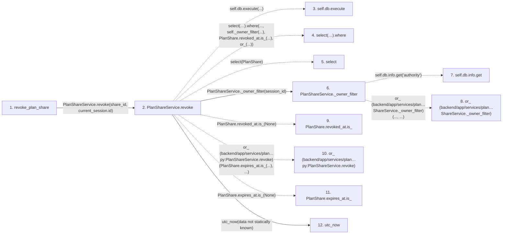

# revoke_plan_share

**Entry point:** `revoke_plan_share` (`http`)
**Source:** [plan_shares](../modules/plan_shares.md)
**Modules touched:** [commands](../modules/commands.md), [plan_share_service](../modules/plan_share_service.md), [plan_shares](../modules/plan_shares.md), [schemas_common](../modules/schemas_common.md), [time](../modules/time.md)

## Call sequence

> Static overview in presentation order, not runtime execution order. Arrows retain captured callers; representative internal continuations and boundary examples precede repeated helper detail.

```mermaid
sequenceDiagram
    participant p0 as revoke_plan_share
    participant p1 as PlanShareService.revoke
    participant p2 as PlanShareService
    participant p3 as HTTPException
    participant p4 as MessageResponse
    participant p5 as self.db.execute
    participant p6 as select(…).where
    participant p7 as select
    participant p8 as PlanShareService._owner_filter
    participant p9 as PlanShare.revoked_at.is_
    participant p10 as or_ (backend/app/services/plan…py:PlanShareService.revoke)
    participant p11 as PlanShare.expires_at.is_
    participant p12 as utc_now
    participant p13 as result.scalar_one_or_none
    participant p14 as commit_or_flush
    participant p15 as self.db.rollback
    participant p16 as self.db.info.get
    participant p17 as datetime.now
    participant p18 as current_command
    participant p19 as or_ (backend/app/services/plan…ShareService._owner_filter)
    participant p20 as db.flush
    participant p21 as db.commit
    participant p22 as getattr
    participant p23 as isinstance
    participant p24 as info.get
    p0->>p1: PlanShareService.revoke
    p0->>p2: PlanShareService
    p0-->>p3: HTTPException(status_code=status.HTTP_404_NOT_FOUND, detail='Plan share not found or not owned by this session')
    p0->>p4: MessageResponse
    p1-->>p5: self.db.execute(...)
    p1-->>p6: select(…).where(..., self._owner_filter(...), PlanShare.revoked_at.is_(...), or_(...))
    p1-->>p7: select(PlanShare)
    p1->>p8: PlanShareService._owner_filter
    p1-->>p9: PlanShare.revoked_at.is_(None)
    p1-->>p10: or_ (backend/app/services/plan…py:PlanShareService.revoke)(PlanShare.expires_at.is_(...), ...)
    p1-->>p11: PlanShare.expires_at.is_(None)
    p1->>p12: utc_now
    p1-->>p13: result.scalar_one_or_none
    p1->>p12: utc_now
    p1->>p14: commit_or_flush
    p1-->>p15: self.db.rollback
    p8-->>p16: self.db.info.get('authority')
    p12-->>p17: datetime.now(UTC)
    p14->>p18: current_command
    p8-->>p19: or_ (backend/app/services/plan…ShareService._owner_filter)(..., ...)
    p14-->>p20: db.flush
    p14-->>p21: db.commit
    p18-->>p22: getattr(db, 'info', None)
    p18-->>p23: isinstance(info, dict)
    p18-->>p24: info.get('command')
```

<!-- Auto-generated from static call edges. Dashed arrows are external or unresolved calls. Reviewed runtime conditions and side effects belong in Behavior. -->

> Call sequence diagram shows 25 of 25 interactions; 0 omitted to keep the visualization within the 30-interaction and generated-diagram limits, with uncertain identities omitted rather than inferred.

> Captured boundary calls: external 7 of 7 (0 omitted); unresolved 10 of 10 (0 omitted). These counts cover the captured static trace.
> Detailed flow queries retain their own coverage and limits; omitted paths may execute at runtime.

## Data flow

<!-- Auto-generated static analysis. Treat values and boundaries as best-effort hints, not runtime proof. -->

### Analysis coverage

**Effect analysis partially available.** Flow assembly and source effect analysis are separate; empty observations do not prove an empty handler body.

Source steps: 9; effect analysis evaluated: 7, partial: 0, unavailable: 2. Counts include steps omitted from the displayed trace.

Collector observations for 7 source steps with known totals: observed: 28, emitted: 28, omitted: 0. Unavailable totals are excluded.

- Callable record unavailable for one or more source steps; those steps have no represented callable body.
- Effect collector totals unavailable; observed counts cover captured records only.

| Step | Callable record | Effect analysis | Collector totals | Observed | Emitted | Omitted |
|---|---|---|---|---:|---:|---:|
| `revoke_plan_share` | `available` | `evaluated` | `available` | `7` | `7` | `0` |
| `PlanShareService.revoke` | `available` | `evaluated` | `available` | `8` | `8` | `0` |
| `self.db.execute` | `not_applicable` | `not_applicable` | `not_applicable` | — | — | — |
| `select(…).where` | `not_applicable` | `not_applicable` | `not_applicable` | — | — | — |
| `select` | `not_applicable` | `not_applicable` | `not_applicable` | — | — | — |
| `PlanShareService._owner_filter` | `available` | `evaluated` | `available` | `6` | `6` | `0` |
| `self.db.info.get` | `not_applicable` | `not_applicable` | `not_applicable` | — | — | — |
| `or_ (backend/app/services/plan…ShareService._owner_filter)` | `not_applicable` | `not_applicable` | `not_applicable` | — | — | — |
| `PlanShare.revoked_at.is_` | `not_applicable` | `not_applicable` | `not_applicable` | — | — | — |
| `or_ (backend/app/services/plan…py:PlanShareService.revoke)` | `not_applicable` | `not_applicable` | `not_applicable` | — | — | — |
| `PlanShare.expires_at.is_` | `not_applicable` | `not_applicable` | `not_applicable` | — | — | — |
| `utc_now` | `available` | `evaluated` | `available` | `2` | `2` | `0` |

### Step data

| Step | Inputs | Reads | Writes | Returns |
|---|---|---|---|---|
| `revoke_plan_share` | `share_id: int`, `response: Response`, `current_session: Annotated[UserSession, Depends(session_service.get_current_session)]`, `db: Annotated[AsyncSession, Depends(get_db, scope='function')]` | `status` | `response.headers[...]` | `MessageResponse(...)` |
| `PlanShareService.revoke` | `share_id: int`, `session_id: int` | `PlanShare`, `PlanShare`, `self.db` | `share.revoked_at` | `False`, `True` |
| `self.db.execute` | - | - | - | - |
| `select(…).where` | - | - | - | - |
| `select` | - | - | - | - |
| `PlanShareService._owner_filter` | `session_id` | `PlanShare`, `PlanShare`, `PlanShare` | - | `or_(...)`, `...` |
| `self.db.info.get` | - | - | - | - |
| `or_ (backend/app/services/plan…ShareService._owner_filter)` | - | - | - | - |
| `PlanShare.revoked_at.is_` | - | - | - | - |
| `or_ (backend/app/services/plan…py:PlanShareService.revoke)` | - | - | - | - |
| `PlanShare.expires_at.is_` | - | - | - | - |
| `utc_now` | - | `UTC` | - | `datetime.now(...)` |

### Call data

| From | To | Line | Call |
|---|---|---:|---|
| revoke_plan_share | PlanShareService.revoke | 100 | `PlanShareService(db).revoke(share_id, current_session.id)` |
| PlanShareService.revoke | self.db.execute | 182 | `self.db.execute(...)` |
| PlanShareService.revoke | select(…).where | 183 | `select(PlanShare).where(..., self._owner_filter(...), PlanShare.revoked_at.is_(...), or_(...))` |
| PlanShareService.revoke | select | 183 | `select(PlanShare)` |
| PlanShareService.revoke | PlanShareService._owner_filter | 185 | `self._owner_filter(session_id)` |
| PlanShareService._owner_filter | self.db.info.get | 96 | `self.db.info.get('authority')` |
| PlanShareService._owner_filter | or_ (backend/app/services/plan…ShareService._owner_filter) | 98 | `or_(..., ...)` |
| PlanShareService.revoke | PlanShare.revoked_at.is_ | 186 | `PlanShare.revoked_at.is_(None)` |
| PlanShareService.revoke | or_ (backend/app/services/plan…py:PlanShareService.revoke) | 187 | `or_(PlanShare.expires_at.is_(...), ...)` |
| PlanShareService.revoke | PlanShare.expires_at.is_ | 187 | `PlanShare.expires_at.is_(None)` |
| PlanShareService.revoke | utc_now | 187 | `utc_now(data not statically known)` |

### Boundary effects

*No boundary-effect observations were captured in this static trace.*

### Static analysis gaps

| Kind | Step | Target | Line |
|---|---|---|---:|
| unresolved_call | `PlanShareService.revoke` | `self.db.execute` | 182 |
| unresolved_call | `PlanShareService.revoke` | `select(PlanShare).where` | 183 |
| external_call | `PlanShareService.revoke` | `select` | 183 |
| unresolved_call | `PlanShareService._owner_filter` | `self.db.info.get` | 96 |
| external_call | `PlanShareService._owner_filter` | `or_` | 98 |
| unresolved_call | `PlanShareService.revoke` | `PlanShare.revoked_at.is_` | 186 |
| external_call | `PlanShareService.revoke` | `or_` | 187 |
| unresolved_call | `PlanShareService.revoke` | `PlanShare.expires_at.is_` | 187 |
| step_limit | `revoke_plan_share` | `first 12 steps` | 0 |

## Behavior

This flow starts at `revoke_plan_share` and is classified as `http`. The generated call and data-flow sections are bounded static projections; runtime conditions and side effects require source-level confirmation.
