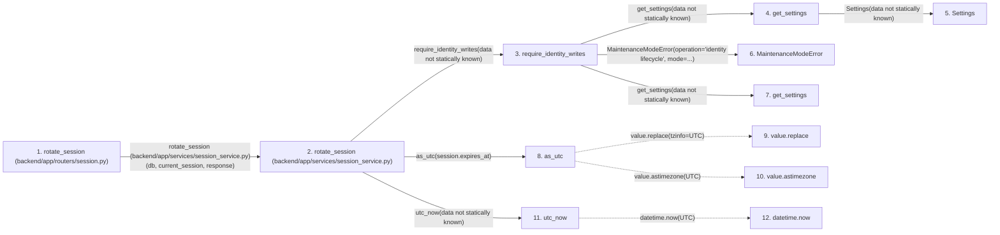

# rotate_session

**Entry point:** `rotate_session` (`http`)
**Source:** [routers_session](../modules/routers_session.md)
**Modules touched:** [authority](../modules/authority.md), [commands](../modules/commands.md), [config](../modules/config.md), [identity_service](../modules/identity_service.md), and 4 more

**Complete modules touched:**

- [authority](../modules/authority.md)
- [commands](../modules/commands.md)
- [config](../modules/config.md)
- [identity_service](../modules/identity_service.md)
- [maintenance](../modules/maintenance.md)
- [routers_session](../modules/routers_session.md)
- [session_service](../modules/session_service.md)
- [time](../modules/time.md)

## Call sequence

> Static overview in presentation order, not runtime execution order. Arrows retain captured callers; representative internal continuations and boundary examples precede repeated helper detail.

```mermaid
sequenceDiagram
    participant p0 as rotate_session (backend/app/routers/session.py)
    participant p1 as rotate_session (backend/app/services/session_service.py)
    participant p2 as require_identity_writes
    participant p3 as commit_or_flush
    participant p4 as _cookie_options
    participant p5 as get_settings
    participant p6 as as_utc
    participant p7 as utc_now
    participant p8 as AuthorityError
    participant p9 as _new_token
    participant p10 as _token_digest
    participant p11 as current_command
    participant p12 as MaintenanceModeError
    participant p13 as Settings
    participant p14 as secrets.token_urlsafe (backend/app/services/sess…_service.py:rotate_session)
    participant p15 as db.refresh
    participant p16 as timedelta
    participant p17 as response.set_cookie
    participant p18 as value.replace
    participant p19 as datetime.now
    participant p20 as secrets.token_urlsafe (backend/app/services/session_service.py:_new_token)
    participant p21 as hashlib.sha256(…).hexdigest
    participant p22 as value.astimezone
    participant p23 as hashlib.sha256
    participant p24 as db.flush
    participant p25 as token.encode
    participant p26 as db.commit
    participant p27 as getattr
    participant p28 as isinstance
    participant p29 as info.get
    p0->>p1: rotate_session (backend/app/services/session_service.py)
    p1->>p2: require_identity_writes
    p1->>p3: commit_or_flush
    p1->>p4: _cookie_options
    p2->>p5: get_settings
    p1->>p6: as_utc
    p1->>p7: utc_now
    p1->>p8: AuthorityError
    p1->>p9: _new_token
    p1->>p10: _token_digest
    p3->>p11: current_command
    p2->>p12: MaintenanceModeError
    p5->>p13: Settings
    p1-->>p14: secrets.token_urlsafe (backend/app/services/sess…_service.py:rotate_session)(32)
    p1-->>p15: db.refresh(session)
    p1-->>p16: timedelta(seconds=...)
    p1-->>p17: response.set_cookie(value=raw_token, **=options)
    p6-->>p18: value.replace(tzinfo=UTC)
    p7-->>p19: datetime.now(UTC)
    p9-->>p20: secrets.token_urlsafe (backend/app/services/session_service.py:_new_token)(32)
    p10-->>p21: hashlib.sha256(…).hexdigest
    p6-->>p22: value.astimezone(UTC)
    p10-->>p23: hashlib.sha256(token.encode(...))
    p3-->>p24: db.flush
    p10-->>p25: token.encode('utf-8')
    p3-->>p26: db.commit
    p11-->>p27: getattr(db, 'info', None)
    p11-->>p28: isinstance(info, dict)
    p11-->>p29: info.get('command')
    p1->>p7: utc_now
```

<!-- Auto-generated from static call edges. Dashed arrows are external or unresolved calls. Reviewed runtime conditions and side effects belong in Behavior. -->

> Call sequence diagram shows 30 of 35 interactions; 5 omitted to keep the visualization within the 30-interaction and generated-diagram limits, with uncertain identities omitted rather than inferred.

> Captured boundary calls: external 7 of 7 (0 omitted); unresolved 9 of 9 (0 omitted). These counts cover the captured static trace.

Omitted captured detail, grouped by actual caller occurrence and target module:

| Caller | Parent step | Target module | Kind | Omitted interactions |
| --- | --- | --- | --- | --- |
| `backend/app/services/identity_service.py:require_identity_writes` | 3 | [backend/app/config.py](../modules/config.md) | internal | 1 |
| `backend/app/services/session_service.py:rotate_session` | 2 | [backend/app/config.py](../modules/config.md) | internal | 3 |
| `backend/app/services/session_service.py:_cookie_options` | 33 | [backend/app/config.py](../modules/config.md) | internal | 1 |
> Detailed flow queries retain their own coverage and limits; omitted paths may execute at runtime.

## Data flow

<!-- Auto-generated static analysis. Treat values and boundaries as best-effort hints, not runtime proof. -->

### Analysis coverage

**Effect analysis partially available.** Flow assembly and source effect analysis are separate; empty observations do not prove an empty handler body.

Source steps: 20; effect analysis evaluated: 17, partial: 0, unavailable: 3. Counts include steps omitted from the displayed trace.

Collector observations for 17 source steps with known totals: observed: 34, emitted: 34, omitted: 0. Unavailable totals are excluded.

- Callable record unavailable for one or more source steps; those steps have no represented callable body.
- Effect collector totals unavailable; observed counts cover captured records only.

| Step | Callable record | Effect analysis | Collector totals | Observed | Emitted | Omitted |
|---|---|---|---|---:|---:|---:|
| `rotate_session (backend/app/routers/session.py)` | `available` | `evaluated` | `available` | `4` | `4` | `0` |
| `rotate_session (backend/app/services/session_service.py)` | `available` | `evaluated` | `available` | `8` | `8` | `0` |
| `require_identity_writes` | `available` | `evaluated` | `available` | `0` | `0` | `0` |
| `get_settings` | `available` | `evaluated` | `available` | `1` | `1` | `0` |
| `Settings` | `unavailable` | `unavailable` | `unavailable` | — | — | — |
| `MaintenanceModeError` | `unavailable` | `unavailable` | `unavailable` | — | — | — |
| `get_settings` | `available` | `evaluated` | `available` | `1` | `1` | `0` |
| `as_utc` | `available` | `evaluated` | `available` | `5` | `5` | `0` |
| `value.replace` | `not_applicable` | `not_applicable` | `not_applicable` | — | — | — |
| `value.astimezone` | `not_applicable` | `not_applicable` | `not_applicable` | — | — | — |
| `utc_now` | `available` | `evaluated` | `available` | `2` | `2` | `0` |
| `datetime.now` | `not_applicable` | `not_applicable` | `not_applicable` | — | — | — |

### Step data

| Step | Inputs | Reads | Writes | Returns |
|---|---|---|---|---|
| `rotate_session (backend/app/routers/session.py)` | `response: Response`, `current_session: Annotated[UserSession, Depends(session_service.get_current_session)]`, `db: Annotated[AsyncSession, Depends(get_db, scope='function')]` | - | - | `...` |
| `rotate_session (backend/app/services/session_service.py)` | `db: AsyncSession`, `session: UserSession`, `response: Response` | - | `session.csrf_token`, `session.session_token_hash`, `session.expires_at`, `options[...]` | `session` |
| `require_identity_writes` | - | - | - | - |
| `get_settings` | - | - | - | `Settings(...)` |
| `Settings` | - | - | - | - |
| `MaintenanceModeError` | - | - | - | - |
| `get_settings` | - | - | - | `Settings(...)` |
| `as_utc` | `value: datetime` | `UTC`, `UTC` | - | `value.replace(...)`, `value.astimezone(...)` |
| `value.replace` | - | - | - | - |
| `value.astimezone` | - | - | - | - |
| `utc_now` | - | `UTC` | - | `datetime.now(...)` |
| `datetime.now` | - | - | - | - |

### Call data

| From | To | Line | Call |
|---|---|---:|---|
| rotate_session (backend/app/routers/session.py) | rotate_session (backend/app/services/session_service.py) | 33 | `session_service.rotate_session(db, current_session, response)` |
| rotate_session (backend/app/services/session_service.py) | require_identity_writes | 193 | `require_identity_writes(data not statically known)` |
| require_identity_writes | get_settings | 31 | `get_settings(data not statically known)` |
| get_settings | Settings | 481 | `Settings(data not statically known)` |
| require_identity_writes | MaintenanceModeError | 32 | `MaintenanceModeError(operation='identity lifecycle', mode=...)` |
| require_identity_writes | get_settings | 32 | `get_settings(data not statically known)` |
| rotate_session (backend/app/services/session_service.py) | as_utc | 194 | `as_utc(session.expires_at)` |
| as_utc | value.replace | 24 | `value.replace(tzinfo=UTC)` |
| as_utc | value.astimezone | 25 | `value.astimezone(UTC)` |
| rotate_session (backend/app/services/session_service.py) | utc_now | 194 | `utc_now(data not statically known)` |
| utc_now | datetime.now | 13 | `datetime.now(UTC)` |

### Boundary effects

*No boundary-effect observations were captured in this static trace.*

### Static analysis gaps

| Kind | Step | Target | Line |
|---|---|---|---:|
| unresolved_call | `as_utc` | `value.replace` | 24 |
| unresolved_call | `as_utc` | `value.astimezone` | 25 |
| external_call | `utc_now` | `datetime.now` | 13 |
| step_limit | `rotate_session` | `first 12 steps` | 0 |

## Behavior

This flow starts at `rotate_session` and is classified as `http`. The generated call and data-flow sections are bounded static projections; runtime conditions and side effects require source-level confirmation.
